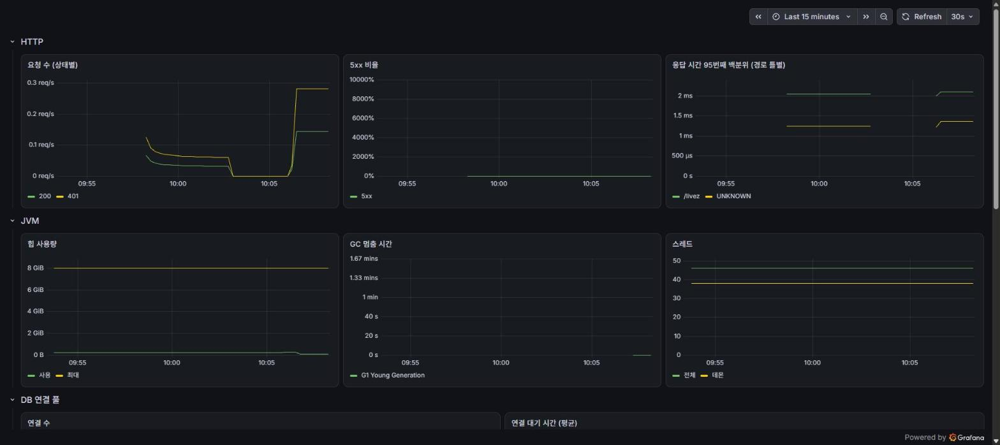

# reberu

팀 단위 업무·출석 관리 서비스입니다. 업무와 출석 활동에 레벨업 같은 게임 요소를 더했습니다.

- Java 17, Spring Boot 4.1.2, Gradle Kotlin DSL
- PostgreSQL 17, Spring Data JPA, Flyway
- Spring Security (Google OAuth2, 서버 세션)

## 준비물

- JDK 17 (`JAVA_HOME`이 JDK 17 이상을 가리켜야 합니다)
- Docker Desktop

## 로컬 실행

```bash
# 1. 환경 변수 파일 만들기 (.env는 Git에 올라가지 않습니다)
cp .env.example .env
# .env를 열어 DB_PASSWORD, CURSOR_SIGNING_KEY, GOOGLE_CLIENT_ID, GOOGLE_CLIENT_SECRET 값을 채웁니다.
# CURSOR_SIGNING_KEY는 openssl rand -base64 32 | tr -d '\r\n' 로 만듭니다.
# Google 값은 Google Cloud 콘솔의 OAuth 클라이언트(웹 애플리케이션)에서 받습니다.
# 승인된 리디렉션 URI: http://localhost:8080/login/oauth2/code/google
# Google 로그인을 해 보지 않을 거면 아무 문자열(예: local-client)을 넣어도 서버는 뜹니다.

# 2. PostgreSQL 실행
docker compose up -d

# 3. 애플리케이션 실행
./gradlew bootRun
```

아직 화면을 만들지 않았기 때문에, 브라우저로 접속하면 `401` JSON 응답(`UNAUTHENTICATED`)이 옵니다. 정상 동작입니다. `http://localhost:8080/oauth2/authorization/google`로 Google 로그인을 시작할 수 있습니다.

### 지표와 대시보드

```bash
# .env에서 GRAFANA_ADMIN_PASSWORD 줄의 주석을 풀고 비밀번호를 넣은 뒤(admin은 쓸 수 없음)
docker compose --profile observability up -d
```



앱을 띄운 상태에서 `http://localhost:3000/d/reberu-overview`에 `admin`과 넣은 비밀번호로 들어가면 `reberu 개요` 대시보드가 보입니다. Prometheus 수집 상태는 `http://localhost:9090/targets`에서 봅니다. 자세한 설정과 문제 해결은 [docs/operations/observability.md](docs/operations/observability.md) §5에 있습니다.

## 테스트

```bash
./gradlew test
```

테스트는 Testcontainers로 PostgreSQL 컨테이너를 직접 띄우므로 Docker가 실행 중이어야 합니다. `.env`는 필요하지 않습니다.

## 문서

### 기획과 설계

- [제품 개요](docs/product/overview.md) · 목적, 역할, 기능 구성, 단계별 범위
- [설계 결정 기록](docs/adr/README.md) · 주요 기술 결정과 근거
- [테넌시](docs/architecture/tenancy.md) · 조직·팀·멤버십, 권한, 데이터 격리
- [보안](docs/architecture/security.md) · 위협 모델, 보안 요구사항, 보안 테스트
- [API 명세](docs/architecture/api.md) · 주소 체계, 공통 형식, API 목록
- [모듈 구조](docs/architecture/modules.md) · 모듈 경계, 의존 방향, 도메인 이벤트
- [도메인 규칙](docs/domain/rules.md) · 업무, 출석, EXP·레벨 규칙
- [도메인 모델](docs/domain/model.md) · 엔티티, 관계, 제약

### 개발과 운영

- [기여 가이드](CONTRIBUTING.md) · Git, 릴리스, 코드·테스트 규칙
- [관측](docs/operations/observability.md) · 지표, 대시보드, 경보

[전체 문서 목록](docs/README.md)
