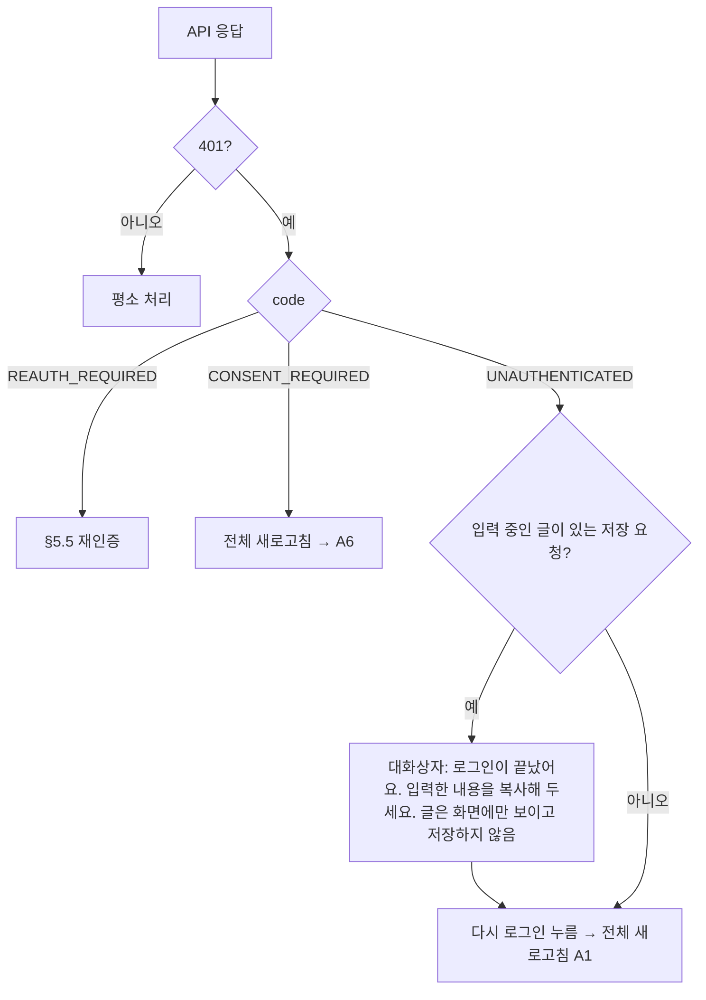
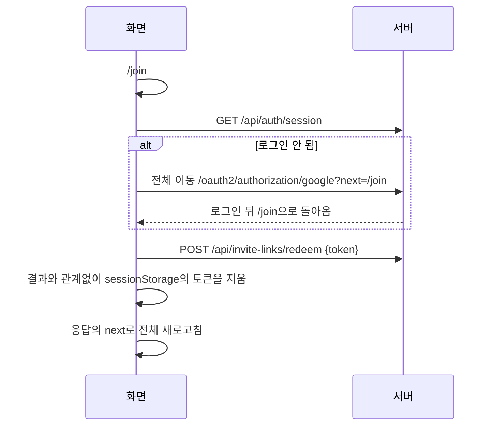
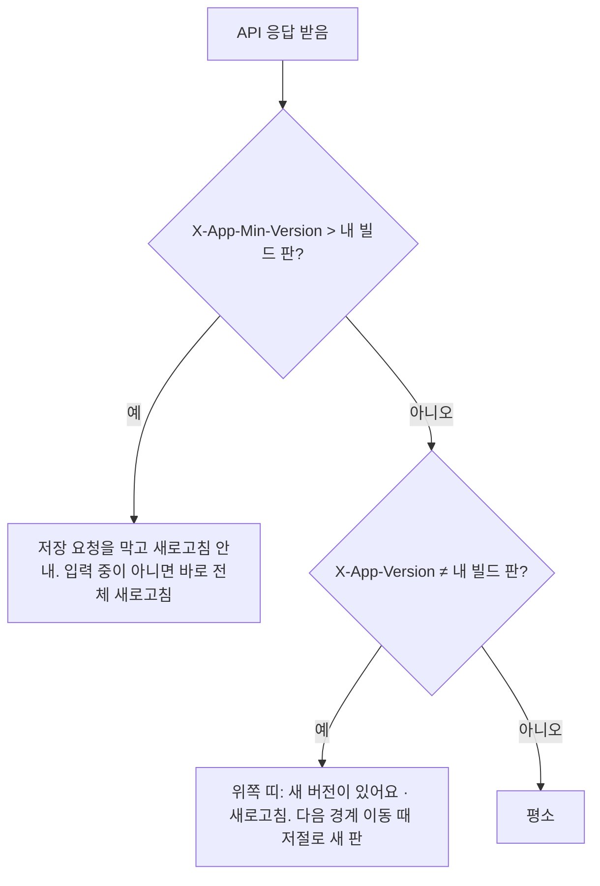

# 프론트엔드 설계

> 버전: v0.1.0\
> 수정일: 2026-11-05

브라우저 화면의 구조, 상태 관리, 새로고침 없이 오래 열어 두는 페이지에서 생기는 결함을 막는 규칙, 화면 쪽 보안을 정한다. 기술 선택의 근거는 [ADR-0019](../adr/0019-spa-frontend.md)다. 화면 내용은 [product/screens.md](../product/screens.md), API는 [architecture/api.md](api.md), 실시간 채널은 [architecture/realtime.md](realtime.md), 보안 요구사항은 [architecture/security.md](security.md)를 따른다. 요구사항 ID 접두어는 `FE`다.

## 1. 범위

- 다룬다: 기술 구성, 배포와 제공 방식, 화면 상태의 종류와 둘 곳, 보안 경계의 전체 새로고침, 서버 데이터 최신화, 실시간 연결의 화면 쪽 처리, 배포 버전 불일치, 주소(라우팅), 자원 정리, 렌더링 보안, 의존성, 검증.
- 다루지 않는다: 화면 구성과 문구(product 문서), 디자인 시스템, 접근성 세부(화면 설계 때 정한다), 3D 장면 연출([product/spaces.md](../product/spaces.md)).
- 도입 시점은 v0.3이다. v0.1~v0.2는 API와 테스트로 검증한다([ADR-0009](../adr/0009-backend-first-mvp.md)).

## 2. 구성

| 역할 | 쓰는 것 | 비고 |
| --- | --- | --- |
| 화면 | React + TypeScript | 엄격 모드(`strict`) |
| 빌드 | Vite | 결과물은 정적 파일뿐이다 |
| 주소 | React Router | 화면마다 주소(§7) |
| 서버 데이터 | TanStack Query | 서버 데이터의 유일한 보관 위치(§4) |
| 실시간 | STOMP 클라이언트 | [architecture/realtime.md](realtime.md) §9의 기술 확정을 따른다 |
| 3D 공간 | three.js + React Three Fiber | 공간 모듈 화면에서만 불러온다(§9) |
| 서식 있는 글 렌더링 | DOMPurify | 렌더링 컴포넌트 하나에서만 쓴다(§10) |
| 화면 시험 | Playwright | §12 |

- 위 목록의 의존성은 아직 추가하지 않았다. 프론트엔드를 시작할 때 목록과 판을 보여 주고 승인을 받는다.
- 위 목록 밖의 라이브러리는 §11의 기준을 통과해야 더한다. 전역 상태 라이브러리, 런타임 CSS-in-JS, 서버 렌더링 프레임워크는 쓰지 않는다(ADR-0019).

## 3. 원칙

| ID | 원칙 | 수준 |
| --- | --- | --- |
| FE-PRIN-01 | 서버가 정본이다. 화면이 가진 서버 데이터는 모두 캐시이며, 언제든 버리고 다시 불러와도 결과가 같아야 한다 | 필수 |
| FE-PRIN-02 | 보안 경계(계정, 조직, 팀이 바뀌는 순간)는 화면 안에서 상태를 고쳐 넘기지 않고 페이지를 완전히 다시 불러와 넘는다(§5) | 필수 |
| FE-PRIN-03 | 주소가 화면 상태다. 새로고침해도 같은 화면이 같은 대상으로 다시 열린다(§7) | 필수 |
| FE-PRIN-04 | 확신할 수 없으면 닫힌 쪽으로 간다. 세션·권한·버전·연결 상태가 불확실하면 데이터를 보이지 않고 다시 불러온다 | 필수 |
| FE-PRIN-05 | 화면의 권한 판단은 버튼을 숨기는 데만 쓴다. 허용 여부는 서버가 정한다(SEC-AUTHZ-12) | 필수 |
| FE-PRIN-06 | 의존성은 적을수록 안전하다. 같은 일을 표준 API로 할 수 있으면 라이브러리를 더하지 않는다 | 필수 |

## 4. 화면 상태

### 4.1 상태의 종류와 둘 곳

| 종류 | 예 | 둘 곳 | 수명 |
| --- | --- | --- | --- |
| 서버 데이터 | 업무, 팀원, 설정, 알림 | TanStack Query 캐시 | 페이지 수명. 보안 경계에서 사라짐 |
| 주소 상태 | 지금 팀, 열린 업무, 탭, 거르기 조건 | 주소의 경로와 쿼리 | 새로고침해도 남음 |
| 화면 임시 상태 | 입력 중인 글, 열린 대화상자, 펼침 | 컴포넌트 상태 | 그 컴포넌트 수명 |
| 실시간 휘발 상태 | 아바타 위치, 접속 여부, 리액션 | 실시간 계층의 메모리 | 연결 수명 |
| 기기 설정 | 소리 켜기, 3D 끄기, 단순하게 보기 | `localStorage`(§4.3 허용 목록) | 기기에 남음 |

| ID | 요구사항 | 수준 |
| --- | --- | --- |
| FE-STATE-01 | 서버 데이터는 TanStack Query 캐시에만 둔다. 컴포넌트 상태나 전역 객체로 복사해 따로 들고 다니지 않는다. 입력 양식의 처음 값으로 쓸 때만 복사하고, 저장한 뒤에는 캐시를 다시 불러온다 | 필수 |
| FE-STATE-02 | 캐시 키는 범위로 시작한다: `['org', orgId, ...]`, `['team', teamId, ...]`, `['me', ...]`. 범위 없는 키에 조직·팀 데이터를 두지 않는다 | 필수 |
| FE-STATE-03 | 팀 화면의 캐시 키에 쓰는 `teamId`는 주소에서 읽은 값만 쓴다. 다른 출처(이전 화면, 저장소)의 팀 값을 쓰지 않는다 | 필수 |
| FE-STATE-04 | 화면 임시 상태에는 서버 데이터의 정본 역할을 맡기지 않는다. 예: 권한, 멤버십, 켜진 모듈을 컴포넌트 상태로 따로 기억하지 않는다 | 필수 |

### 4.2 낙관적 갱신

| ID | 요구사항 | 수준 |
| --- | --- | --- |
| FE-STATE-10 | 저장 요청은 서버 응답을 받은 뒤에 화면을 바꾼다. 응답 전에 결과를 미리 그리는 낙관적 갱신은 쓰지 않는다 | 필수 |
| FE-STATE-11 | 예외는 실시간 휘발 상태(내 아바타 움직임, 리액션 표시)뿐이다. 이것은 서버가 버려도 업무 데이터가 틀어지지 않는다 | 필수 |

### 4.3 브라우저 저장소

| 저장소 | 둘 수 있는 것 | 둘 수 없는 것 |
| --- | --- | --- |
| `localStorage` | 기기 설정: 소리 켜기(기본 꺼짐), 3D 끄기, 단순하게 보기 선호, 마지막으로 연 화면의 종류(대상 ID 없이) | 아래 "모든 저장소 공통" |
| `sessionStorage` | 초대 링크 토큰(로그인하는 동안만, §5.3), 화면 조각 다시 불러오기 시도 표시(§6.3) | 위 둘 밖의 모든 것 |
| 쿠키 | 서버가 내려 준 세션 쿠키와 CSRF 쿠키만. 화면이 쿠키를 만들지 않는다 | — |
| IndexedDB, Cache Storage, 서비스 워커 | 쓰지 않는다 | — |

모든 저장소 공통 금지: 세션 ID, 토큰(초대 링크 토큰의 위 예외 밖), 이메일, 이름, 업무·팀·조직의 내용과 식별자, 권한·역할, 서버 응답 본문, 입력 중인 글.

| ID | 요구사항 | 수준 |
| --- | --- | --- |
| FE-STORE-01 | 브라우저 저장소는 위 표의 허용 항목만 쓴다. 저장소 접근은 코드 한 모듈에서만 하고, 그 모듈이 키 허용 목록을 갖는다. 목록 밖의 키를 쓰려 하면 개발 빌드는 오류를, 운영 빌드는 무시한다 | 필수 |
| FE-STORE-02 | 서비스 워커와 오프라인 캐시를 쓰지 않는다. 옛 화면 코드와 옛 데이터가 남는 경로를 만들지 않는다 | 필수 |
| FE-STORE-03 | 로그아웃할 때 `sessionStorage`를 모두 지운다. `localStorage`의 기기 설정은 개인정보가 아니므로 남긴다 | 필수 |

## 5. 보안 경계와 전체 새로고침

### 5.1 경계 사건

"전체 새로고침"은 `location.replace(주소)` 또는 `location.assign(주소)`로 페이지를 완전히 다시 불러오는 것이다. 메모리의 캐시, 실시간 연결, 구독, 3D 자원이 한 번에 사라진다.

| 사건 | 화면 처리 | 가는 곳 |
| --- | --- | --- |
| 로그아웃 | `POST /api/auth/logout` 응답을 기다린 뒤, 성공·실패와 관계없이 `sessionStorage`를 지우고 전체 새로고침 | A1 |
| 로그인 완료, 가입 동의 완료 | 서버의 `302` 또는 응답의 `next`로 전체 새로고침 | `next` |
| 팀 바꾸기(A3에서 고르기, 위쪽 막대의 팀 전환) | 전체 새로고침 | `/teams/{teamId}` |
| 조직 바꾸기, 조직 관리(F)와 팀 화면 사이 이동 | 전체 새로고침 | 새 범위의 첫 화면 |
| `membership.removed`, `org-membership.removed` 받음 | 진행 중인 입력을 버린다는 안내 없이 바로 전체 새로고침([architecture/realtime.md](realtime.md) §6.5) | A3 |
| `account.suspended` 받음, 실시간 연결이 세션 문제로 닫힘 | 전체 새로고침 | A1 |
| HTTP `401 UNAUTHENTICATED` | §5.2 | A1 |
| 다른 탭에서 로그아웃·계정 바뀜 | §5.4 | A1 또는 새 첫 화면 |
| 지금 화면의 범위에서 `404 NOT_FOUND`(팀 요약, 조직 요약 같은 범위 확인 API) | 전체 새로고침 | A3 |

| ID | 요구사항 | 수준 |
| --- | --- | --- |
| FE-BND-01 | 위 표의 사건은 화면 안 이동(라우터 이동, 캐시 비우기)으로 처리하지 않는다. 반드시 전체 새로고침한다 | 필수 |
| FE-BND-02 | 같은 팀 안의 화면 이동(B1 → C1, C1 → C2 등)은 화면 안 이동으로 한다. 경계가 아니므로 캐시를 유지한다 | 필수 |
| FE-BND-03 | 전체 새로고침 직전에 실시간 연결을 닫는 처리를 기다리지 않는다. 서버는 연결이 끊긴 것으로 처리한다(접속 유예, [architecture/realtime.md](realtime.md) §6.2) | 필수 |
| FE-BND-04 | 경계를 넘은 뒤 첫 화면은 `GET /api/auth/session`과 그 범위의 요약 API로 처음부터 그린다. 이전 페이지의 어떤 값도 이어받지 않는다 | 필수 |

### 5.2 세션 만료

| ID | 요구사항 | 수준 |
| --- | --- | --- |
| FE-SESS-01 | `401` 처리는 API 호출 계층 한곳에서 한다. 화면마다 따로 처리하지 않는다 | 필수 |
| FE-SESS-02 | 세션이 끝났을 때 입력 중인 글을 브라우저 저장소에 남기지 않는다(FE-STORE-01). 대화상자에 보여 주고 사용자가 직접 복사하게 한다 | 필수 |
| FE-SESS-03 | `401`을 받은 뒤에는 같은 페이지에서 다른 API를 더 부르지 않는다. 진행 중인 요청과 다시 불러오기를 멈춘다 | 필수 |

### 5.3 초대 링크와 로그인

| ID | 요구사항 | 수준 |
| --- | --- | --- |
| FE-LINK-01 | 토큰을 읽자마자 주소에서 지운다. 토큰이 방문 기록, 북마크, 화면 공유에 남지 않게 한다 | 필수 |
| FE-LINK-02 | `sessionStorage`의 토큰은 넣은 지 10분이 지나면 쓰지 않고 지운다. 쓴 뒤에는 결과와 관계없이 지운다 | 필수 |
| FE-LINK-03 | 가입 대기(A6) 중이면 토큰을 동의 요청의 `inviteToken`으로 보낸다([architecture/api.md](api.md) §4) | 필수 |

### 5.4 여러 탭

| ID | 요구사항 | 수준 |
| --- | --- | --- |
| FE-TAB-01 | 탭끼리 `BroadcastChannel`(`reberu-session`)로 로그아웃·로그인 사건을 알린다. 메시지에는 사건 이름만 담고 계정 ID, 이메일, 팀 값을 담지 않는다 | 필수 |
| FE-TAB-02 | 로그아웃·로그인 사건을 받은 탭은 전체 새로고침한다 | 필수 |
| FE-TAB-03 | 탭이 다시 보일 때(`visibilitychange`)와 창이 다시 활성화될 때 `GET /api/auth/session`의 계정이 이 페이지를 연 계정과 같은지 확인한다. 다르거나 로그인 상태가 아니면 전체 새로고침한다. `BroadcastChannel`이 없는 환경의 안전망이다 | 필수 |
| FE-TAB-04 | 여러 탭이 서로 다른 팀을 열어 두는 것은 허용한다. 각 탭의 범위는 그 탭의 주소가 정한다(FE-STATE-03) | 필수 |

### 5.5 최근 인증

| ID | 요구사항 | 수준 |
| --- | --- | --- |
| FE-REAUTH-01 | 🔒 행동의 확인 대화상자를 열기 전에 `GET /api/auth/session`의 인증 시각을 확인한다. 기준(OQ-29: 1시간)에서 5분 안쪽만 남았거나 지났으면 입력을 받기 전에 재인증부터 한다. 입력한 뒤에 재인증으로 페이지를 떠나 내용을 잃지 않게 한다 | 필수 |
| FE-REAUTH-02 | 재인증은 전체 이동(`/oauth2/authorization/google?reauth=true&next=...`)으로 한다. `next`는 지금 주소이며 서버 허용 목록에 없으면 서버가 버린다(SEC-AUTH-08) | 필수 |
| FE-REAUTH-03 | 재인증에서 돌아온 뒤 행동을 자동으로 다시 보내지 않는다. 같은 화면을 다시 열고 사용자가 다시 누른다([architecture/security.md](security.md) §7.2) | 필수 |

## 6. 서버 데이터 최신화

### 6.1 다시 불러오는 때

| 때 | 다시 불러오는 것 |
| --- | --- |
| 화면에 들어옴 | 그 화면의 쿼리. 캐시가 있으면 먼저 보이고 뒤에서 새로 불러온다 |
| 실시간 이벤트 받음 | §6.2 표의 키 |
| 실시간 재연결, `seq` 건너뜀, `epoch` 바뀜 | 지금 범위의 모든 활성 쿼리([architecture/realtime.md](realtime.md) §6.3, RT-MSG-04) |
| 탭이 다시 보임, 창 활성화 | 지금 화면의 활성 쿼리 |
| 저장 요청 성공 | 그 자원과 그 자원을 담은 목록의 키 |
| `409 VERSION_CONFLICT`, `409 ALREADY_PROCESSED` | 그 자원과 목록의 키. "이미 처리됐어요" 또는 "다른 사람이 먼저 고쳤어요"를 보인다(UX-SCR-012) |

| ID | 요구사항 | 수준 |
| --- | --- | --- |
| FE-SYNC-01 | 쿼리의 신선 시간은 기본 30초, 관리 화면(E·F)은 0이다. 관리 화면은 열 때마다 새로 불러온다 | 필수 |
| FE-SYNC-02 | 실시간 연결이 `RECONNECTING`인 동안에는 서버 데이터를 보이되, 저장 버튼 옆에 "연결이 불안정해요"를 보인다. HTTP 요청은 막지 않는다([architecture/realtime.md](realtime.md) §6.1) | 필수 |
| FE-SYNC-03 | 다시 불러오기가 실패해도 이전 값을 지우지 않는다. 단 실패가 `401`·`404`면 §5의 경계 처리를 한다 | 필수 |
| FE-SYNC-04 | 화면에 들어올 때 받은 버전보다 낮은 버전의 실시간 이벤트는 버린다(RT-EVT-03) | 필수 |

### 6.2 이벤트와 다시 불러올 키

| 이벤트 | 다시 불러올 키 |
| --- | --- |
| `task.changed` | `['team', teamId, 'tasks']` 아래 전부, 업무 패널 |
| `project.changed` | `['team', teamId, 'projects']` 아래 전부 |
| `report.changed` | `['team', teamId, 'reports', 기간 키]` |
| `team.settings-changed` | `['team', teamId]` 요약과 설정 |
| `team.modules-changed`, `org.modules-changed` | 범위 요약. 지금 화면이 꺼진 모듈의 화면이면 그 범위 첫 화면으로 화면 안 이동하고 "이 기능이 꺼졌어요"를 한 번 보인다 |
| `notification.created` | `['me', 'notifications']` 수와 목록 |
| `join-request.decided` | `['me', 'join-requests']`. 승인이면 `next`로 전체 새로고침(새 팀은 경계) |

- FE-SYNC-10 (필수): 이벤트와 키의 대응은 코드 한곳의 표로 둔다. 이벤트 처리기가 흩어져 캐시를 직접 고치지 않는다. 표에 없는 이벤트는 무시하고 개발 빌드에서만 경고한다.
- FE-SYNC-11 (필수): 이벤트 본문으로 캐시 값을 직접 고치지 않고 다시 불러온다(RT-EVT-02). 예외는 실시간 휘발 상태(§4.1)뿐이다.

### 6.3 저장 요청

| ID | 요구사항 | 수준 |
| --- | --- | --- |
| FE-MUT-01 | 저장 버튼은 요청을 보낸 뒤 응답까지 다시 누를 수 없다(UX-SCR-022) | 필수 |
| FE-MUT-02 | 만드는 요청의 `Idempotency-Key`는 사용자의 한 번의 의도(양식을 연 순간)마다 하나 만든다. 같은 양식에서 실패 후 다시 보내면 같은 키를 쓴다. 양식을 닫으면 버린다([architecture/api.md](api.md) API-CON-03) | 필수 |
| FE-MUT-03 | 잠금이 있는 자원의 수정 요청은 화면이 읽은 `version`을 그대로 보낸다. 최신 값을 몰래 다시 읽어 `version`만 바꿔 보내지 않는다 | 필수 |
| FE-MUT-04 | 저장 실패 시 입력한 내용을 지우지 않는다(UX-SCR-011). `400 INVALID_REQUEST`의 `fields`는 해당 칸 아래에 보인다 | 필수 |
| FE-MUT-05 | 입력 중인 글이 있는 화면을 떠나려 하면 확인을 받는다. 같은 팀 안 이동은 화면 안 확인, 페이지를 떠나면 `beforeunload`. 보안 경계 사건(§5.1)은 확인 없이 떠난다 | 필수 |

## 7. 주소

| 화면 | 주소 예 |
| --- | --- |
| A0~A6 | `/start`, `/login`, `/requests`, `/teams`, `/orgs/new`, `/orgs/search`, `/signup` |
| 초대 링크 | `/join` (토큰은 `#` 뒤, §5.3) |
| 팀 첫 화면, 공간 | `/teams/{teamId}`, `/teams/{teamId}/spaces/{spaceKey}` |
| 업무 화면 | `/teams/{teamId}/tasks`, `/teams/{teamId}/tasks/{taskId}` |
| 팀 관리 | `/teams/{teamId}/admin/{section}` |
| 조직 관리 | `/orgs/{orgId}/admin/{section}` |
| 내 계정 | `/me`, `/me/account` |

| ID | 요구사항 | 수준 |
| --- | --- | --- |
| FE-ROUTE-01 | 화면마다 주소가 있다. 탭, 거르기 조건, 열린 상세는 경로나 쿼리에 둔다. 새로고침하면 같은 화면이 열린다 | 필수 |
| FE-ROUTE-02 | 주소의 식별자는 화면이 형식(UUID)만 확인하고 그대로 API에 쓴다. 볼 수 없는 대상은 서버의 `404`로 알고, 없는 대상과 같은 "찾을 수 없어요" 화면을 보인다(SEC-AUTHZ-05) | 필수 |
| FE-ROUTE-03 | 주소에 이메일, 이름, 토큰, 검색어 밖의 사용자 입력을 넣지 않는다. 검색어는 공개 조직 찾기(A5)에만 쿼리로 둔다 | 필수 |
| FE-ROUTE-04 | 로그인 뒤 돌아갈 주소는 앱 안의 상대 경로만 쓴다. 화면이 `next` 값을 만들 때 `/`로 시작하고 `//`로 시작하지 않는지 확인한다. 최종 판정은 서버가 한다(SEC-AUTH-08) | 필수 |
| FE-ROUTE-05 | 알 수 없는 주소는 "찾을 수 없어요" 화면이다. 서버는 `/api`, `/oauth2`, `/login/oauth2` 밖의 모든 주소에 같은 `index.html`을 돌려준다(§8) | 필수 |

## 8. 배포와 버전

### 8.1 제공 방식

| 항목 | 규칙 |
| --- | --- |
| 출처 | 화면 파일과 API를 같은 출처(같은 호스트·포트·스킴)에서 제공한다. CORS를 열지 않는다 |
| 제공하는 쪽 | Spring Boot가 빌드 결과를 정적 자원으로 제공하거나, 앞단 리버스 프록시가 제공한다. 둘 중 하나는 배포 방식을 정할 때 고른다 |
| `index.html` | `Cache-Control: no-store`. 보안 헤더(SEC-HDR-02~06)를 API와 똑같이 붙인다 |
| 해시가 붙은 파일(`/assets/*-{hash}.js` 등) | `Cache-Control: public, max-age=31536000, immutable` |
| 이전 판의 해시 파일 | 새 판을 배포한 뒤 최소 7일 남긴다 |
| 소스 맵 | 운영 배포에 올리지 않는다 |
| 빌드에 넣는 환경 값 | 공개해도 되는 값(앱 판, 배포 모드 표시)만. 비밀값을 넣지 않는다 |

### 8.2 버전 불일치

| ID | 요구사항 | 수준 |
| --- | --- | --- |
| FE-VER-01 | 서버는 모든 API 응답에 `X-App-Version`(지금 배포된 화면 판)과 `X-App-Min-Version`(서버가 받아 주는 가장 낮은 화면 판)을 담는다 | 필수 |
| FE-VER-02 | API는 바로 이전 판의 화면이 부르는 형태를 깨지 않게 바꾼다(필드 더하기만). 깨는 변경은 `X-App-Min-Version`을 올리는 배포로만 한다 | 필수 |
| FE-VER-03 | 화면 조각(지연 로딩한 파일)을 불러오지 못하면 한 번만 전체 새로고침한다. 같은 판에서 두 번째 실패면 새로고침하지 않고 "잠시 후 다시 열어 주세요"를 보인다. 시도 표시는 `sessionStorage`에 판과 함께 둔다(무한 새로고침 방지) | 필수 |
| FE-VER-04 | 실시간 연결의 서버 판이 화면 판과 맞지 않아도 연결은 유지하고 §8.2 흐름을 따른다 | 필수 |

## 9. 자원 정리

| ID | 요구사항 | 수준 |
| --- | --- | --- |
| FE-RES-01 | 실시간 구독은 그 구독이 필요한 화면 컴포넌트가 만들고, 컴포넌트가 사라질 때 해제한다. 구독 관리는 실시간 계층 한곳에서 하고, 화면은 "이 범위를 듣는다"만 선언한다 | 필수 |
| FE-RES-02 | 타이머, 이벤트 리스너, `requestAnimationFrame`은 만든 컴포넌트가 정리한다. 정리 없는 전역 리스너를 두지 않는다 | 필수 |
| FE-RES-03 | 3D 장면을 떠날 때 지오메트리, 재질, 텍스처, 렌더 대상을 모두 해제(`dispose`)하고 렌더러를 정리한다. 공간을 옮길 때도 이전 공간 자원을 해제한다 | 필수 |
| FE-RES-04 | WebGL 문맥을 잃으면(`webglcontextlost`) 한 번 복구를 시도하고, 실패하면 B7로 바꾼다(UX-SCR-023) | 필수 |
| FE-RES-05 | 3D 코드(three.js, React Three Fiber, 장면 자원)는 공간 화면의 지연 로딩 조각에만 넣는다. 공간 모듈이 꺼진 팀과 B7 사용자는 받지 않는다 | 필수 |
| FE-RES-06 | 숨겨진 탭에서는 3D 그리기를 멈추고 위치 전송을 멈춘다. 다시 보이면 공간 상태를 다시 받는다(`space.snapshot`) | 필수 |

## 10. 렌더링 보안

| ID | 요구사항 | 수준 |
| --- | --- | --- |
| FE-XSS-01 | 사용자 글은 React의 기본 텍스트 렌더링으로만 그린다(SEC-OUTPUT-01). `dangerouslySetInnerHTML`은 서식 있는 글 컴포넌트 하나에서만 쓰고, 그 컴포넌트는 서버가 정리한 HTML을 DOMPurify로 한 번 더 정리한 뒤 넣는다(SEC-INPUT-04와 같은 허용 목록) | 필수 |
| FE-XSS-02 | 운영 CSP에 Trusted Types를 켠다(SEC-HDR-02). HTML을 넣을 수 있는 정책은 서식 있는 글 컴포넌트의 정책 하나(`reberu-html`)뿐이다 | 필수 |
| FE-XSS-03 | 사용자가 넣은 링크는 그리기 전에 스킴을 다시 확인한다(`https`, `http`, `mailto`만, SEC-INPUT-05). 새 창으로 열고 `rel="noopener noreferrer"`를 붙인다(SEC-OUTPUT-02) | 필수 |
| FE-XSS-04 | `eval`, `new Function`, 문자열 `setTimeout`, 인라인 스크립트, 인라인 이벤트 속성을 쓰지 않는다. 이를 쓰는 라이브러리는 들이지 않는다(CSP에 `unsafe-eval`, `unsafe-inline`을 넣지 않는다) | 필수 |
| FE-XSS-05 | 스타일은 빌드된 CSS 파일(CSS 모듈 포함)로만 넣는다. 실행 중에 `<style>`을 만드는 방식을 쓰지 않는다(CSP `style-src 'self'`) | 필수 |
| FE-XSS-06 | 외부 출처에서 불러오는 것은 Google 프로필 사진뿐이다. `referrerpolicy="no-referrer"`로 불러오고, 실패하면 기본 아바타를 보인다. 글꼴, 아이콘, 분석 스크립트를 외부에서 불러오지 않는다 | 필수 |
| FE-XSS-07 | `iframe`, `postMessage` 수신, `window.opener` 사용을 두지 않는다 | 필수 |
| FE-XSS-08 | 오류 화면에는 서버 오류의 `message`와 `traceId`만 보인다. 응답 본문이나 예외를 그대로 보이지 않는다 | 필수 |
| FE-XSS-09 | 운영 빌드는 개발용 로그를 빼고, 콘솔에 서버 응답, 토큰, 이메일을 남기지 않는다 | 필수 |

## 11. 의존성과 빌드

| ID | 요구사항 | 수준 |
| --- | --- | --- |
| FE-DEP-01 | 잠금 파일을 커밋하고, 모든 의존성의 판을 정확히 고정한다(`^`, `~` 없음). CI는 잠금 파일 그대로 설치한다(`npm ci`) | 필수 |
| FE-DEP-02 | 설치 스크립트(`postinstall` 등)는 기본으로 막는다. 꼭 필요한 패키지만 이름을 적어 허용한다 | 필수 |
| FE-DEP-03 | 새 의존성은 다음을 확인한 뒤 승인을 받아 더한다: 하는 일을 표준 API로 할 수 없는가, 관리가 계속되는가, 하위 의존성 수, 라이선스, 알려진 취약점 | 필수 |
| FE-DEP-04 | 공개된 지 7일이 안 된 판으로 올리지 않는다. 막 올라온 악성 판을 피하기 위해서다 | 필수 |
| FE-DEP-05 | CI에서 의존성 취약점 검사(`npm audit`, 높음 이상이면 실패)와 라이선스 검사를 한다. 의존성 갱신은 Dependabot으로 받고 사람이 검토해 합친다 | 필수 |
| FE-DEP-06 | 운영 빌드 결과에 비밀값, 내부 주소, 소스 맵이 없는지 CI가 확인한다 | 필수 |

## 12. 검증

### 12.1 화면 시험 (Playwright)

| ID | 시나리오 | 확인 | 수준 |
| --- | --- | --- | --- |
| FE-TEST-01 | 다온이 바다팀 업무를 본 뒤 숲팀으로 바꾼다 | 바다팀 데이터가 화면, 캐시, 메모리 어디에도 없다. 새로고침이 일어났다 | 필수 |
| FE-TEST-02 | 다온이 로그아웃하고 같은 브라우저에서 하늘이 로그인한다 | 다온의 데이터, 저장소 값, 구독이 남지 않는다 | 필수 |
| FE-TEST-03 | 탭 두 개 중 하나에서 로그아웃한다 | 다른 탭이 A1로 간다. `BroadcastChannel`을 끈 환경에서도 탭이 다시 보일 때 간다 | 필수 |
| FE-TEST-04 | 업무를 고치는 중에 팀 관리자가 다온을 내보낸다 | 다온의 화면이 A3로 새로고침되고 그 팀 데이터가 보이지 않는다 | 필수 |
| FE-TEST-05 | 업무를 쓰는 중에 세션이 만료되고 저장을 누른다 | 입력이 대화상자에 보이고 저장소에 남지 않는다. 다시 로그인하면 A1 | 필수 |
| FE-TEST-06 | 칭찬 화면을 연 채로 팀 관리자가 칭찬 모듈을 끈다 | 첫 화면으로 옮겨지고 안내가 한 번 보인다 | 필수 |
| FE-TEST-07 | 실시간 연결을 끊고 그 사이 업무 3건을 바꾼 뒤 다시 연결한다 | 다시 연결 뒤 세 건이 모두 맞게 보인다(놓친 이벤트 복구) | 필수 |
| FE-TEST-08 | 새 판을 배포한다 | 열린 탭에 새 버전 띠가 뜬다. `X-App-Min-Version`을 올리면 저장이 막히고 새로고침된다 | 필수 |
| FE-TEST-09 | 이전 판의 화면 조각을 지운 상태에서 지연 로딩 화면을 연다 | 한 번만 새로고침하고, 다시 실패하면 안내를 보인다(무한 새로고침 없음) | 필수 |
| FE-TEST-10 | 두 사람이 같은 업무를 동시에 고친다 | 늦은 쪽이 "다른 사람이 먼저 고쳤어요"를 보고 최신 값을 받는다 | 필수 |
| FE-TEST-11 | 만들기 버튼을 빠르게 두 번 누르고, 응답 전 네트워크를 끊었다 다시 보낸다 | 자원이 하나만 생긴다 | 필수 |
| FE-TEST-12 | 초대 링크로 들어와 로그인한다 | 토큰이 주소, 방문 기록, 저장소에 남지 않는다 | 필수 |
| FE-TEST-13 | 업무 설명과 이름에 스크립트·이벤트 속성·`javascript:` 링크를 넣는다 | 실행되지 않고, CSP 위반이 0건이다 | 필수 |
| FE-TEST-14 | 공간과 업무 화면을 오가며 8시간 연다(시간을 앞당겨 실행) | 메모리가 정해진 상한 안에서 머문다. 구독 수와 3D 자원 수가 늘어나지 않는다 | 필수 |

### 12.2 정적 검사

| ID | 검사 | 수준 |
| --- | --- | --- |
| FE-LINT-01 | 금지 API 검사: `dangerouslySetInnerHTML`(허용 파일 하나 밖), `eval`, `new Function`, `localStorage`·`sessionStorage` 직접 접근(저장소 모듈 밖), `location` 직접 변경(경계 모듈 밖) | 필수 |
| FE-LINT-02 | 캐시 키 검사: 조직·팀 쿼리가 범위 접두로 시작하는지 | 필수 |
| FE-LINT-03 | 타입 검사(`tsc --noEmit`)와 린트가 CI에서 통과해야 한다 | 필수 |