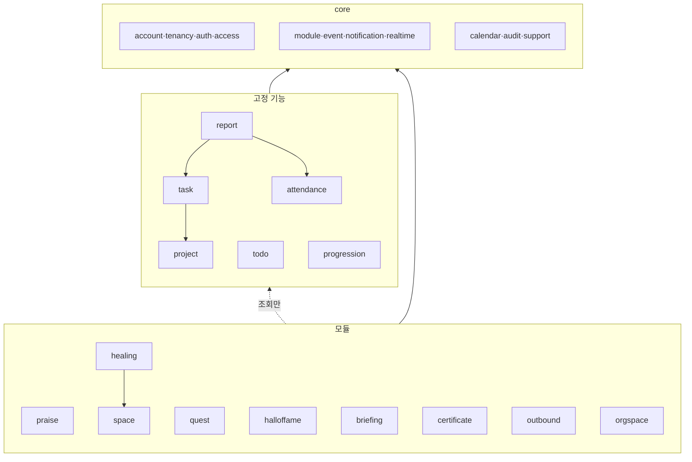
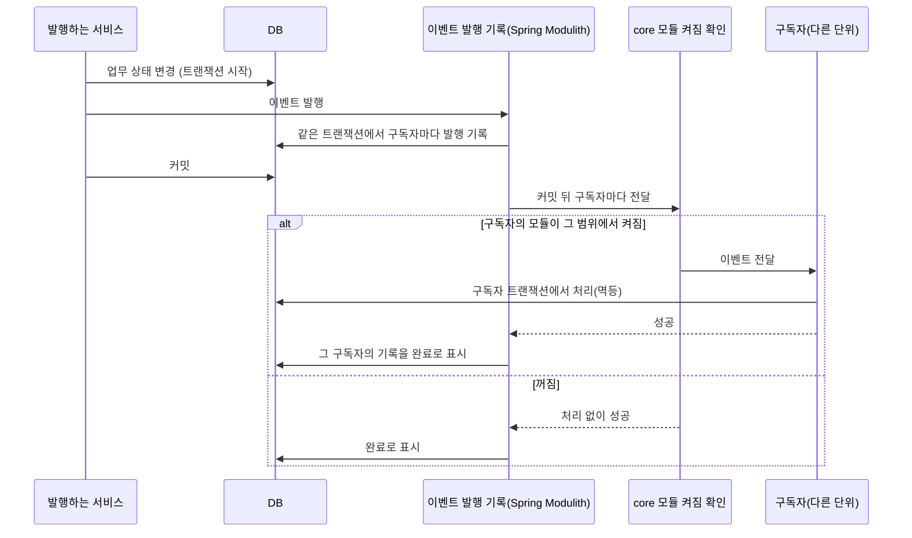
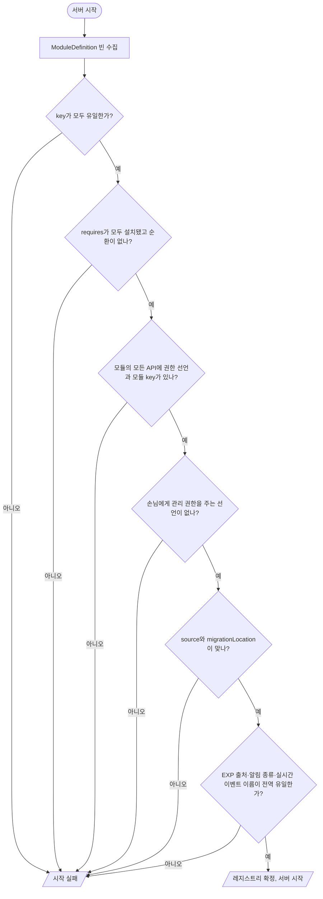

# 모듈 구조

> 버전: v0.4.0\
> 수정일: 2026-11-09

백엔드 코드를 core, 고정 기능, 모듈로 나누는 경계와 의존 방향, 모듈 사이의 소통 방식, 모듈 계약, 경계 검증을 정한다. 기능 구성은 [product/overview.md](../product/overview.md) §5, 모듈 활성화 규칙은 [architecture/tenancy.md](tenancy.md) §13, 결정의 근거는 [ADR-0002](../adr/0002-core-and-modules.md), [ADR-0014](../adr/0014-module-architecture.md), [ADR-0016](../adr/0016-spring-modulith-events.md)을 따른다. 요구사항 ID 접두어는 `ARCH`다.

## 1. 원칙

| ID | 원칙 | 수준 |
| --- | --- | --- |
| ARCH-PRIN-01 | 의존은 한 방향이다: 모듈 → 고정 기능 → core. 거꾸로 가는 의존(core가 고정 기능을, 고정 기능이 모듈을 아는 것)은 없다 | 필수 |
| ARCH-PRIN-02 | 모듈끼리는 서로의 코드를 부르지 않는다. 필요한 모듈(§5.1 `requires`)이 있어도 그 모듈의 공개 API만 쓴다 | 필수 |
| ARCH-PRIN-03 | 다른 단위의 데이터가 바뀐 것에 반응할 때는 직접 호출이 아니라 도메인 이벤트(§4)로 한다 | 필수 |
| ARCH-PRIN-04 | 모듈 하나를 코드에서 빼도 나머지는 빌드되고 테스트가 통과한다 | 필수 |
| ARCH-PRIN-05 | 기본 제공 모듈(`BUNDLED`)과 확장 모듈(`EXTENSION`)은 같은 계약(§5)과 같은 검증(§8)을 따른다. 기본 제공 모듈에만 열린 뒷문을 두지 않는다 | 필수 |
| ARCH-PRIN-06 | 보안 확인(인증, TeamContext, 권한, 모듈 켜짐)은 core가 모듈 코드보다 먼저 한다. 모듈은 이것을 끄거나 우회할 수 없다([architecture/security.md](security.md) §14) | 필수 |

## 2. 단위

| 단위 | 뜻 | 끌 수 있나 | 예 |
| --- | --- | --- | --- |
| core | 모든 기능이 기대는 바탕. 업무 기능을 담지 않는다 | 아니오 | 계정·조직·팀·멤버십, 인증·세션, TeamContext, 권한, 모듈 레지스트리, 활동 기록, 근무일·시간대, 도메인 이벤트 전달, 알림 저장·전달, 실시간 연결 |
| 고정 기능 | 모든 팀에 늘 있는 업무 기능 | 아니오 | 업무, 프로젝트, 오늘의 할 일, 리포트, 출석, 성장(EXP·레벨·시즌·업적) |
| 모듈 | 켜고 끄는 기능 | 예 | 칭찬, 공간, 힐링 존, 오늘의 퀘스트, 명예의 전당, 아침 요약, 인증·만료일 관리, 외부 알림, 조직 공간 |

- 알림은 core의 "저장·전달"과 각 기능의 "만들기"로 나뉜다. 알림 종류는 그 알림을 만드는 단위가 등록한다.
- 실시간 연결·구독 권한은 core다. 이벤트의 종류와 본문은 그 이벤트를 만드는 단위가 등록한다([architecture/realtime.md](realtime.md)).

## 3. 패키지 구조

```text
reberu/
├── core/
│   ├── account/        계정, 약관 동의, 탈퇴
│   ├── tenancy/        조직, 팀, 멤버십, 초대, 가입 방법, 직무 유형
│   ├── auth/           Google OIDC 로그인, 세션, 최근 인증
│   ├── access/         TeamContext 확정, 권한 선언·판정
│   ├── module/         모듈 계약, 레지스트리, 켜짐 상태, 설정
│   ├── event/          도메인 이벤트 발행·전달
│   ├── notification/   알림 저장, 앱 안 전달, 외부 제공자 계약
│   ├── realtime/       연결, 구독 권한, 이벤트 전달
│   ├── calendar/       시간대, 근무일, 휴일 달력
│   ├── audit/          활동 기록
│   └── support/        공통 응답·예외·보안 설정 (기존 global)
├── task/               고정 기능: 업무
├── project/            고정 기능: 프로젝트
├── todo/               고정 기능: 오늘의 할 일
├── report/             고정 기능: 리포트
├── attendance/         고정 기능: 출석
├── progression/        고정 기능: EXP 원장, 레벨, 시즌, 업적
└── module/
    ├── praise/         칭찬
    ├── space/          공간
    ├── healing/        힐링 존
    ├── quest/          오늘의 퀘스트
    ├── halloffame/     명예의 전당
    ├── briefing/       아침 요약·모닝 브리핑
    ├── certificate/    인증·만료일 관리
    ├── outbound/       외부 알림(Google Chat 웹훅 제공자)
    └── orgspace/       조직 공간
```

- 단위 하나 안의 계층은 [docs/ai/backend.md](../ai/backend.md) §2를 따른다(controller, service, repository, entity, dto, exception). 모듈은 여기에 `event`(구독자)와 모듈 정의 클래스 하나를 더한다.
- 단위마다 다른 단위가 쓸 수 있는 **공개 API**를 단위 최상위 패키지에 둔다. 하위 패키지는 내부다.

| ID | 요구사항 | 수준 |
| --- | --- | --- |
| ARCH-PKG-01 | 다른 단위는 그 단위 최상위 패키지의 공개 타입(조회 인터페이스, 이벤트 레코드, 식별자 값 객체)만 참조한다. `controller`, `service` 구현, `repository`, `entity`를 참조하지 않는다 | 필수 |
| ARCH-PKG-02 | 엔티티는 다른 단위의 엔티티를 JPA 연관관계로 가리키지 않는다. 다른 단위의 자원은 식별자(UUID)로만 가리킨다 | 필수 |
| ARCH-PKG-03 | 패키지 사이에 순환 의존이 없다 | 필수 |
| ARCH-PKG-04 | 확장 모듈은 복사한 저장소의 자기 패키지(예: `com.example.reberu`)에 둔다. `reberu` 패키지 아래에 파일을 더하지 않는다(CONTRIBUTING.md §3) | 필수 |

### 3.1 허용 의존

| 부르는 쪽 ↓ / 불리는 쪽 → | core | 고정 기능 | 모듈 |
| --- | --- | --- | --- |
| core | 같은 core 안에서 허용 | 금지 | 금지 |
| 고정 기능 | 공개 API | 공개 API만, 아래 표의 쌍만 | 금지 |
| 모듈 | 공개 API | 공개 API(조회) | `requires`로 선언한 모듈의 공개 API(조회)만 |

| 고정 기능 사이 허용 쌍 | 이유 |
| --- | --- |
| task → project | 업무는 반드시 프로젝트에 속한다. 프로젝트 존재·보관 여부를 조회한다 |
| report → task, attendance | 리포트는 업무와 출석을 모아 보여 준다(조회만) |
| progression → (없음) | 성장은 이벤트만 듣는다. 다른 기능을 부르지 않는다 |

- 표에 없는 쌍은 금지다. 새로 필요하면 이벤트로 풀 수 있는지 먼저 보고, 안 되면 ADR을 남긴다.



## 4. 도메인 이벤트

### 4.1 발행과 전달

이벤트 저장소와 전달은 Spring Modulith의 이벤트 발행 기록으로 구현한다([ADR-0016](../adr/0016-spring-modulith-events.md)). 표 구조는 [domain/model.md](../domain/model.md) §6 `event_publication`이다.



| ID | 요구사항 | 수준 |
| --- | --- | --- |
| ARCH-EVT-01 | 도메인 이벤트는 원인 변경과 같은 트랜잭션에서 이벤트 저장소에 기록한다. 원인 변경이 롤백되면 이벤트도 없다 | 필수 |
| ARCH-EVT-02 | 구독자 처리는 원인 트랜잭션이 커밋된 뒤, 구독자마다 별도 트랜잭션에서 한다. 한 구독자의 실패가 원인 변경과 다른 구독자를 되돌리지 않는다 | 필수 |
| ARCH-EVT-03 | 모든 구독자는 멱등이다. 같은 이벤트를 두 번 받아도 결과가 같다(예: EXP 원장의 멱등 키, [domain/rules.md](../domain/rules.md) §6) | 필수 |
| ARCH-EVT-04 | 실패한 전달은 간격을 늘려 다시 시도하고, 정해진 횟수를 넘으면 운영 로그에 남기고 멈춘다. 서버를 다시 켜도 미처리 이벤트는 이어서 전달한다 | 필수 |
| ARCH-EVT-05 | 이벤트는 팀 또는 조직 식별자를 반드시 담는다. 전달기는 구독자의 모듈이 그 범위에서 켜져 있을 때만 전달한다(TEN-MOD-01) | 필수 |
| ARCH-EVT-06 | 이벤트 본문은 불변 레코드이고, 다른 단위의 엔티티가 아니라 식별자와 값만 담는다 | 필수 |
| ARCH-EVT-07 | 실시간 메시지([architecture/realtime.md](realtime.md))는 도메인 이벤트의 구독자 하나로 보낸다. 실시간 전송 실패가 도메인 처리를 되돌리지 않는다 | 필수 |
| ARCH-EVT-08 | 이벤트 저장소는 세 DB에서 같게 동작해야 한다([architecture/tenancy.md](tenancy.md) §11.4). 처리된 이벤트는 보관 기간이 지나면 정리한다 | 필수 |
| ARCH-EVT-09 | 이벤트 레코드는 JSON으로 직렬화할 수 있는 값만 담고, 이름과 필드를 공개 계약으로 다룬다. 필드를 지우거나 뜻을 바꾸지 않고 더하기만 한다. 나중에 외부 메시지 브로커로 내보낼 때 레코드를 고치지 않기 위해서다(§4.2) | 필수 |
| ARCH-EVT-10 | 발행하는 쪽은 Spring의 이벤트 발행 인터페이스만 쓰고, 구독하는 쪽은 core가 정한 구독 표시만 쓴다. 이벤트 저장소 구현의 클래스를 업무 코드에서 직접 부르지 않는다 | 필수 |

### 4.2 외부 메시지 브로커로 옮기는 경로

지금은 외부 메시지 브로커(Kafka 등)를 쓰지 않는다([ADR-0014](../adr/0014-module-architecture.md)). 다음 가운데 하나가 생기면 다시 검토한다.

- 모듈을 별도 서버로 떼어 내야 할 때
- 다른 시스템이 reberu의 이벤트를 받아야 할 때
- 이벤트 양 때문에 DB의 이벤트 발행 기록이 병목이 될 때

옮길 때는 Spring Modulith의 이벤트 외부 발행 기능으로 선택한 이벤트만 브로커에 함께 내보낸다. 앱 안 구독자는 그대로 두므로 발행하는 코드와 이벤트 레코드는 바뀌지 않는다(ARCH-EVT-09, ARCH-EVT-10).

### 4.3 주요 이벤트

| 이벤트 | 발행 | 구독 |
| --- | --- | --- |
| `TaskCompleted`, `TaskReopened`, `TaskDeleted` | task | progression(EXP 지급·회수), quest, realtime |
| `TaskAssigned`, `TaskChanged` | task | notification 만들기, realtime |
| `TodoChecked`, `TodoUnchecked` | todo | progression, quest |
| `AttendanceRecorded` | attendance | progression(출석·연속 EXP), quest, realtime |
| `LevelUp` | progression | notification, outbound(팀 대화방), realtime |
| `PraiseSent` | praise | progression(받는 사람 EXP), notification, realtime |
| `RestEnded` | healing | progression(업적만, EXP 없음), quest |
| `MemberJoined`, `MembershipEnded` | core.tenancy | realtime(구독 해제), space, progression(정리 없음) |
| `TeamModuleChanged`, `OrgModuleChanged` | core.module | realtime, 해당 모듈 |
| `WorkdayStarted` | core.calendar (팀마다 조직 시간대 근무일 시작) | briefing(모닝 브리핑), attendance(없음), certificate |

- 이벤트 이름은 과거형 레코드 타입이다. 실시간 이벤트 이름(`task.changed` 등)과는 따로 둔다. 실시간 이름은 화면과의 약속이고, 도메인 이벤트는 서버 안의 약속이다.

## 5. 모듈 계약

### 5.1 모듈 정의

모듈은 정의 클래스 하나를 Spring 빈으로 등록한다. 아래는 계약의 모양이며 실제 이름은 구현에서 정한다.

```java
public interface ModuleDefinition {
    String key();                         // 전역 유일. 예: "praise"
    ModuleScope scope();                  // TEAM 또는 ORG
    ModuleSource source();                // BUNDLED 또는 EXTENSION
    Set<String> requires();               // 필요한 모듈 key
    boolean enabledByDefault();           // 직무 유형에 값이 없을 때 (OQ-41)
    List<PermissionDeclaration> permissions();
    List<MenuEntry> menus();
    List<ExpSource> expSources();         // 출처 key, 기본 양, 하루 상한
    List<NotificationKind> notificationKinds();
    List<RealtimeEventType> realtimeEvents();
    List<ScheduledJob> scheduledJobs();   // 켜진 범위에서만 실행
    ModuleSettingsSchema settings();      // 팀·조직 설정 항목과 기본값
    String migrationLocation();           // BUNDLED: core, EXTENSION: company
}
```

### 5.2 등록과 시작 검증



| ID | 요구사항 | 수준 |
| --- | --- | --- |
| ARCH-MOD-01 | 위 검증 가운데 하나라도 실패하면 서버가 시작하지 않는다. 실패 사유를 로그에 남긴다 | 필수 |
| ARCH-MOD-02 | 확장 모듈은 Spring Boot 자동 구성(`AutoConfiguration.imports`)으로 등록한다. 업스트림의 컴포넌트 스캔 설정을 고치지 않는다 | 필수 |
| ARCH-MOD-03 | 레지스트리는 서버 시작 뒤 바뀌지 않는다. 설치는 배포 단위, 허용·켜기는 데이터([architecture/tenancy.md](tenancy.md) §13)다 | 필수 |
| ARCH-MOD-04 | 배포에서 모듈 코드를 뺐는데 데이터에 그 모듈의 켜짐 기록이 남아 있으면, 그 모듈은 "설치되지 않음"으로 보고 꺼진 것으로 다룬다. 데이터는 지우지 않는다 | 필수 |

### 5.3 실행 중 켜짐 확인

| 진입점 | 확인 방법 |
| --- | --- |
| HTTP API | 컨트롤러 메서드에 모듈 key와 권한을 선언한다. core가 TeamContext 확정 뒤 켜짐을 확인하고, 꺼졌으면 404 |
| 도메인 이벤트 구독 | 전달기가 이벤트의 팀·조직에서 켜졌는지 확인한다(ARCH-EVT-05) |
| 정해진 시각 작업 | core 스케줄러가 켜진 팀·조직 목록만 넘긴다 |
| 실시간 구독·명령 | core 실시간 계층이 구독·명령 때 확인한다 |
| 알림 만들기 | core 알림 계층이 종류의 모듈이 켜졌는지 확인한다 |
| EXP 지급 | 원장이 출처의 모듈이 켜졌는지 확인한다. 꺼졌으면 지급하지 않는다 |

| ID | 요구사항 | 수준 |
| --- | --- | --- |
| ARCH-MOD-10 | 모듈 켜짐 확인은 위 진입점에서 core가 한다. 모듈 코드 안에서 켜짐을 다시 확인하는 코드를 두지 않는다 | 필수 |
| ARCH-MOD-11 | 켜짐 상태는 팀·조직 단위로 짧게 캐시할 수 있다. 바뀌면 그 범위의 캐시를 즉시 비운다 | 권장 |

## 6. 확장 지점

| 확장 지점 | 쓰는 곳 | 계약 |
| --- | --- | --- |
| 모듈 정의 | 모든 모듈 | §5.1 |
| 외부 알림 제공자 | outbound 모듈 | 제공자 key, 등록 값 검증(예: 웹훅 형식), 보내기, 비밀값 여부. 첫 구현은 Google Chat 웹훅([ADR-0012](../adr/0012-chat-webhook-notifications.md)) |
| 직무 유형 기본값 | core.tenancy | 확장 모듈이 직무 유형을 더하거나 기본 켜짐 값을 채운다 |
| 업적 조건 | progression | 모듈이 업적과 조건(어떤 이벤트를 몇 번)을 등록한다 |
| 퀘스트 조건 | quest 모듈 | 다른 모듈이 "행동으로 확인되는 퀘스트"를 등록한다 |

- 확장 지점은 위 표에 있는 것만이다. 보안 설정, 인증, TeamContext, 레지스트리 검증에는 확장 지점을 두지 않는다(ARCH-PRIN-06).

## 7. 데이터 소속 표시

| ID | 요구사항 | 수준 |
| --- | --- | --- |
| ARCH-DATA-01 | 모든 엔티티는 소속을 하나 선언한다: 계정, 조직, 팀([architecture/tenancy.md](tenancy.md) §11.5 TEN-PORT-01). 선언이 없는 엔티티가 있으면 테스트가 실패한다 | 필수 |
| ARCH-DATA-02 | 팀 소속 엔티티의 저장소 조회 메서드는 팀 식별자를 매개변수로 받는다(TEN-ISO-02). 팀 식별자 없이 자원 식별자만으로 찾는 메서드가 있으면 테스트가 실패한다 | 필수 |
| ARCH-DATA-03 | 모듈의 테이블 이름은 모듈 key를 접두어로 쓴다(예: `praise_message`). 고정 기능과 core는 접두어 없이 쓴다 | 권장 |
| ARCH-DATA-04 | 소속은 엔티티에 `@Owned(ACCOUNT·ORG·TEAM)`로 선언한다. 팀 소속 엔티티의 저장소는 식별자만으로 찾는 기본 메서드(`findById`, `findAll` 등)를 물려받지 않도록 `Repository`만 상속하고 필요한 메서드를 직접 선언한다. 조회 메서드(`find`·`get`·`count`·`exists` 등)는 `teamId` 또는 `orgId` 매개변수를 가진다 | 필수 |

## 8. 경계 검증

| ID | 검증 | 방법 | 수준 |
| --- | --- | --- | --- |
| ARCH-TEST-01 | 의존 방향(§3.1), 순환 없음, 내부 패키지 참조 없음 | Spring Modulith 구조 검증. 단위마다 허용 의존을 선언하고, 세 단위의 한 방향 규칙은 ArchUnit 규칙으로 함께 검사한다 | 필수 |
| ARCH-TEST-02 | 모든 컨트롤러 메서드에 권한 선언, 모듈 API에는 모듈 key 선언 | 시작 검증 + 테스트 | 필수 |
| ARCH-TEST-03 | 엔티티 소속 선언, 팀 식별자 없는 조회 메서드 없음 | 아키텍처 테스트 | 필수 |
| ARCH-TEST-04 | 모듈마다 "꺼진 팀"에서 API 404, 이벤트 미전달, 작업 미실행, 알림·EXP 없음 | 통합 테스트 | 필수 |
| ARCH-TEST-05 | 모듈 하나를 빼고 빌드·테스트(모듈 수만큼). 빼도 나머지가 통과 | CI 정기 작업 | 권장 |
| ARCH-TEST-06 | 이벤트 구독자 멱등: 같은 이벤트 두 번 전달 시 결과 같음 | 통합 테스트 | 필수 |
| ARCH-TEST-07 | 테스트용 가짜 모듈로 등록·허용·켜기·끄기·제거(PRD-MVP-12) | 통합 테스트 | 필수 |
| ARCH-TEST-08 | 이벤트 발행 기록: 원인 롤백 시 기록 없음, 구독자 실패 시 미완료로 남고 다시 보내면 완료, 서버를 다시 켜도 미완료 기록을 이어서 전달 | 통합 테스트(세 DB) | 필수 |

- Spring Modulith는 기본으로 최상위 패키지 바로 아래 패키지를 한 단위로 본다. `reberu.core.*`와 `reberu.module.*`의 하위 패키지를 각각 한 단위로 다루도록 단위 선언을 명시한다.

## 9. 단계

- v0.1: core 전체 골격, 모듈 계약·레지스트리·시작 검증, 이벤트 발행 기록과 모듈 켜짐 확인, 테스트용 가짜 모듈, 경계 테스트(ARCH-TEST-01~03, 07, 08).
- v0.2: 고정 기능(task, project, todo, attendance, progression)과 이벤트 연결.
- v0.3: 첫 실제 모듈(praise, outbound)과 ARCH-TEST-04·06.
- 이후: 모듈을 더할 때마다 ARCH-TEST-04를 그 모듈에 대해 추가한다.

## 10. 도구

- Spring Modulith 2.1.x를 쓴다. 2.1.2는 Spring Boot 4.1.2를 기준으로 만든 판이고, 이벤트 발행 기록 표를 PostgreSQL, MySQL, MariaDB마다 제공한다([ADR-0016](../adr/0016-spring-modulith-events.md)).
- 이벤트 발행 기록 표의 DDL은 우리 Flyway 마이그레이션에 둔다. 라이브러리의 자동 스키마 생성은 쓰지 않는다(DOM-LIB-01).
- 단위 감지는 명시 선언 방식(`spring.modulith.detection-strategy: explicitly-annotated`)이다. 단위마다 `package-info.java`에 `@ApplicationModule`을 두고, 고정 기능과 모듈은 `allowedDependencies`로 §3.1의 허용 의존을 선언한다.
- 구독자는 비동기로 처리한다(`@EnableAsync`). 서버를 다시 켜면 미완료 기록을 다시 보낸다(`spring.modulith.events.republish-outstanding-events-on-restart`).
