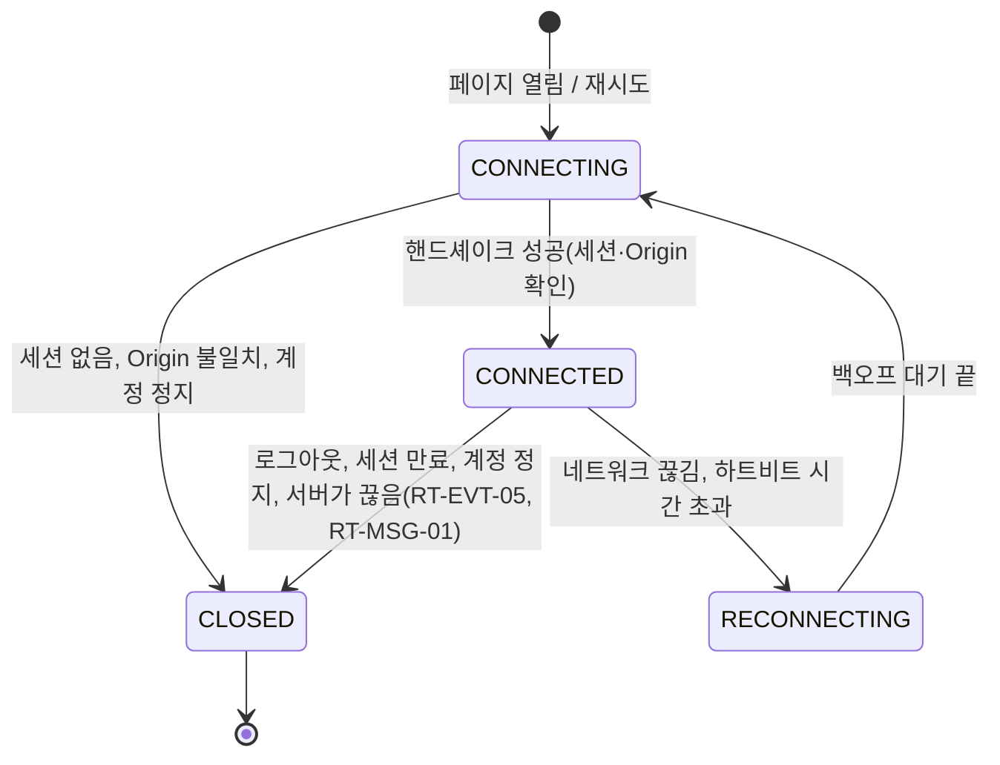
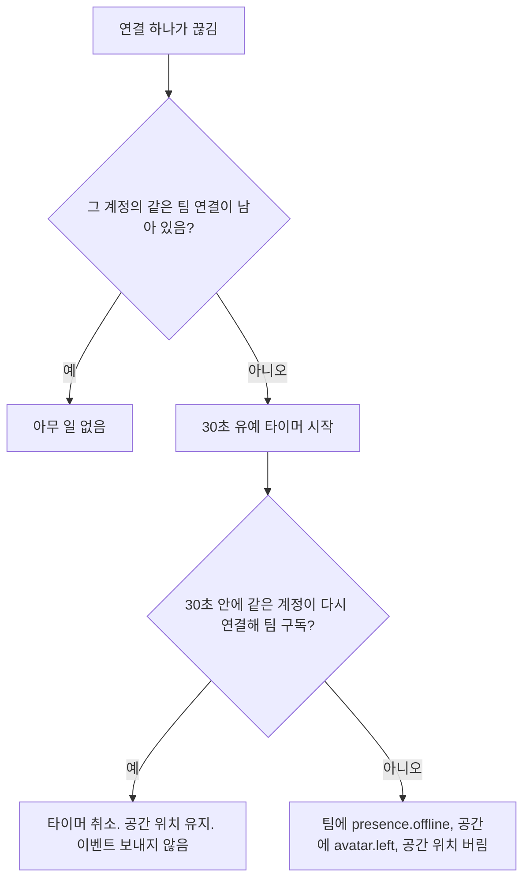
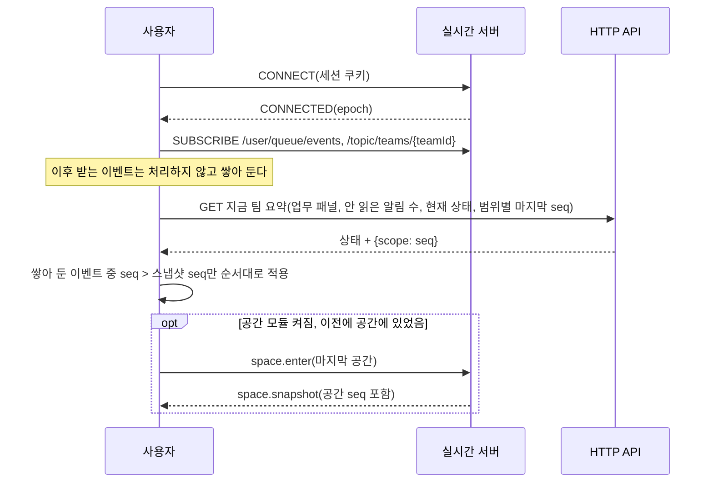
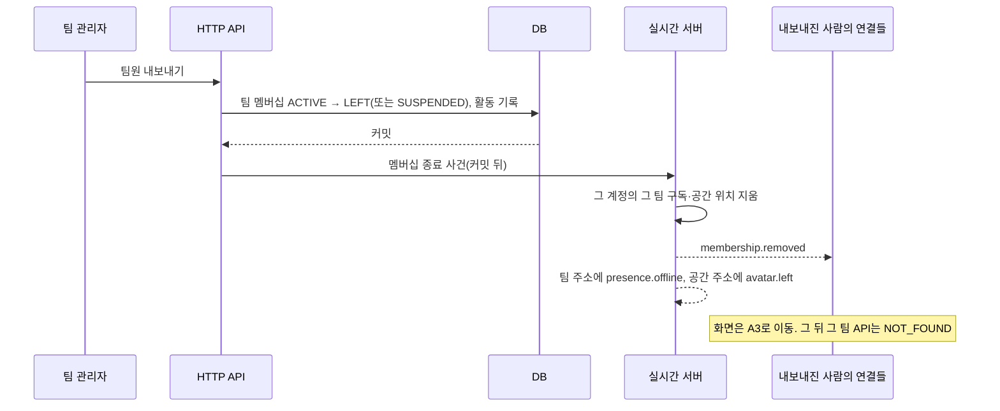

# 실시간 설계

> 버전: v0.1.0\
> 수정일: 2026-11-04

새로고침 없이 바뀌어야 하는 모든 상태의 전달 방식을 정한다. 화면별 실시간 항목은 [product/screens.md](../product/screens.md)에, 권한 확인 규칙은 [architecture/tenancy.md](tenancy.md)에, 보안 요구사항은 [architecture/security.md](security.md)에 있다. 이 문서는 그 셋을 실시간 채널에 적용하는 규칙이다.

## 1. 원칙

[ADR-0008](../adr/0008-realtime-split.md)을 따른다.

| ID | 요구사항 | 수준 |
| --- | --- | --- |
| RT-PRIN-01 | DB에 남는 행동(업무, 출석, 칭찬, 질문 등)은 HTTP API로만 처리한다. 실시간 채널은 커밋이 끝난 결과만 알린다 | 필수 |
| RT-PRIN-02 | 남기지 않는 상태(위치, 리액션, 차 마시기, 장작 넣기, 요가 동작, 편집 중 표시)만 실시간 채널로 직접 주고받는다. DB에 쓰지 않는다 | 필수 |
| RT-PRIN-03 | 실시간 채널이 끊겨도 모든 업무 기능은 HTTP API로 동작한다. 실시간 채널은 기능의 전제 조건이 아니다 | 필수 |
| RT-PRIN-04 | 이벤트는 받을 자격이 있는 가장 좁은 범위로만 보낸다 | 필수 |
| RT-PRIN-05 | 놓친 이벤트를 다시 보내지 않는다. 재연결하면 현재 상태를 API로 다시 불러온다(§6.3) | 필수 |
| RT-PRIN-06 | 메시지 안의 보낸 사람·조직·팀·공간 값은 믿지 않는다. 서버가 연결 정보와 지금 팀으로 다시 채운다 | 필수 |

## 2. 범위

### 2.1 범위 정의

| 범위 | 코드 | 받는 사람 | 구독 주소 예시 |
| --- | --- | --- | --- |
| 개인 | `USER` | 계정 한 명의 모든 연결 | `/user/queue/events`, `/user/queue/errors` |
| 팀 | `TEAM` | 그 팀의 활동 팀 멤버 중 지금 그 팀을 연 연결 | `/topic/teams/{teamId}` |
| 공간 | `TEAM_SPACE` | 그 팀 공간에 지금 들어가 있는 연결 | `/topic/teams/{teamId}/spaces/{spaceKey}` |
| 조직 공간 | `ORG_SPACE` | 그 조직 공간에 지금 들어가 있는 연결(팀과 무관) | `/topic/orgs/{orgId}/spaces/{spaceKey}` |
| 조직 | `ORG` | 그 조직의 활동 조직 멤버 전원(손님은 F7 설정에 따름) | `/topic/orgs/{orgId}` |

- `spaceKey`는 공간 종류 상수다: `LOBBY`, `DESK`, `LOUNGE`, `MEETING_ROOM`, `BEACH`, `TRAIL`(팀 공간), `PLAZA`, `HALL`, `SHARED_MEETING_ROOM:{roomId}`(조직 공간).
- 주소의 경로 값은 구독 권한 확인에만 쓰고, 이벤트 본문의 범위 값은 서버가 채운다(RT-PRIN-06).

| ID | 요구사항 | 수준 |
| --- | --- | --- |
| RT-SCOPE-01 | 조직 범위에는 드물게 바뀌는 조직 전체 공지만 보낸다(연회장 모임 일정·시작·끝, 날씨). 초당 1회를 넘는 빈도의 이벤트를 보내지 않는다 | 필수 |
| RT-SCOPE-02 | 팀 관리자에게만 가는 이벤트(가입 요청 등)는 팀 주소로 보내지 않고, 서버가 그 팀의 활동 팀 관리자 각자의 개인 주소로 나눠 보낸다 | 필수 |
| RT-SCOPE-03 | 조직 관리자가 팀 멤버가 아닌 팀은 팀·공간 범위를 구독하지 않는다. 관리 화면은 열 때 API로 불러온다 | 필수 |
| RT-SCOPE-04 | A3 팀 고르기의 팀별 접속자 수는 실시간으로 보내지 않는다. 화면을 열 때 API로 불러온다 | 필수 |

### 2.2 구독 권한

구독 요청마다 아래 조건을 모두 확인한다. 확인 순서와 실패 응답은 [architecture/tenancy.md](tenancy.md)의 지금 팀 확정 규칙과 같다.

| 주소 | 허용 조건 |
| --- | --- |
| `/user/queue/*` | 연결의 계정 본인 주소만. 다른 계정 주소는 구조상 지정할 수 없다 |
| `/topic/teams/{teamId}` | 계정 `ACTIVE` · 조직 `ACTIVE` · 조직 멤버십 `ACTIVE` · 팀 `ACTIVE` 또는 `ARCHIVED`(읽기 전용) · 팀 멤버십 `ACTIVE` |
| `/topic/teams/{teamId}/spaces/{spaceKey}` | 팀 주소 조건 · 그 팀에서 공간 모듈이 켜짐(`BEACH`·`TRAIL`이면 힐링 존 모듈도) · 서버가 그 연결의 `space.enter`를 받아들여 현재 공간이 `spaceKey`임 · 팀이 `ACTIVE` |
| `/topic/orgs/{orgId}/spaces/{spaceKey}` | 계정·조직·조직 멤버십 `ACTIVE` · 조직 공간 모듈이 켜짐 · 손님이면 F7 "손님의 조직 공간 출입"이 켜짐 · 현재 조직 공간이 `spaceKey`임 · 공용 회의실이면 그 회의의 참석자 |
| `/topic/orgs/{orgId}` | 계정·조직·조직 멤버십 `ACTIVE` · 손님이면 F7 "손님의 조직 공간 출입"이 켜짐. 조직 공간 모듈과 무관하다(날씨는 팀 공간 모듈만으로도 쓰이기 때문) |

```mermaid
flowchart TD
    S[SUBSCRIBE 요청] --> A{연결 인증됨?}
    A -- 아니오 --> X1[연결 종료]
    A -- 예 --> B{주소 패턴이 목록에 있음?}
    B -- 아니오 --> X2[오류 NOT_FOUND, 구독 안 함]
    B -- 예 --> C{계정·조직·조직 멤버십 ACTIVE?}
    C -- 아니오 --> X2
    C -- 예 --> D{팀 주소?}
    D -- 예 --> E{팀이 그 조직 소속이고 팀 멤버십 ACTIVE?}
    E -- 아니오 --> X2
    E -- 예 --> F{공간 주소?}
    D -- 아니오 --> G{손님이면 F7 손님 출입 허용?}
    G -- 아니오 --> X2
    G -- 예 --> H{조직 공간 주소?}
    H -- 아니오: 조직 주소 --> OK[구독 등록]
    H -- 예 --> I{조직 공간 모듈 켜짐, 현재 조직 공간이 그 주소, 공용 회의실이면 참석자?}
    I -- 아니오 --> X2
    I -- 예 --> OK
    F -- 아니오 --> OK
    F -- 예 --> J{공간 모듈 켜짐(BEACH·TRAIL은 힐링 존 모듈도), 현재 공간이 그 주소?}
    J -- 아니오 --> X2
    J -- 예 --> OK
```

| ID | 요구사항 | 수준 |
| --- | --- | --- |
| RT-SUB-01 | 구독 거부는 이유와 관계없이 같은 오류 코드 `NOT_FOUND`로 개인 오류 주소에 알린다. 다른 조직·팀의 존재를 드러내지 않는다 | 필수 |
| RT-SUB-02 | 구독 권한은 구독할 때 한 번 확인하고, 권한을 바꾸는 사건(§6.5)이 생기면 서버가 다시 확인해 맞지 않는 구독을 지운다 | 필수 |
| RT-SUB-03 | 공간·조직 공간 구독은 `space.enter`가 받아들여진 뒤에만 허용한다. 공간을 옮기면 이전 공간 구독을 서버가 지운다 | 필수 |
| RT-SUB-04 | 한 연결이 동시에 가질 수 있는 구독은 개인 2 + 팀 1 + 공간 1 + 조직 1 + 조직 공간 1로 제한한다. 넘는 구독 요청은 거부한다 | 필수 |

## 3. 메시지 형식

### 3.1 서버 → 사용자 (이벤트)

```json
{
  "event": "task.changed",
  "id": "8f3c9a52-...",
  "occurredAt": "2026-11-04T01:02:03.456Z",
  "scope": { "type": "TEAM", "id": "team_01H..." },
  "epoch": "srv_7d2e...",
  "seq": 1042,
  "actor": { "accountId": "acc_01H..." },
  "payload": { }
}
```

| 필드 | 뜻 |
| --- | --- |
| `event` | 이벤트 이름(§4) |
| `id` | 이벤트 고유 번호. 받는 쪽이 중복을 거른다 |
| `occurredAt` | 원인이 된 일이 일어난 시각(UTC, 밀리초) |
| `scope` | 범위 종류와 ID. 서버가 채운다 |
| `epoch` | 서버 프로세스가 시작할 때 만든 값. 바뀌면 순번이 처음부터 다시 시작된 것이다 |
| `seq` | 범위 주소마다 1씩 오르는 순번. 개인 범위는 계정마다 따로 센다 |
| `actor` | 일으킨 사람. 서버 작업이면 `null`. 서버가 채운다 |
| `payload` | 이벤트별 본문(§4). 받는 사람이 볼 권한이 없는 필드를 넣지 않는다 |

### 3.2 사용자 → 서버 (명령)

```json
{ "command": "avatar.move", "clientSeq": 381, "payload": { "x": 12.5, "z": -3.0, "dir": 1.57, "walking": true } }
```

| 필드 | 뜻 |
| --- | --- |
| `command` | 명령 이름(§4.6) |
| `clientSeq` | 연결마다 1씩 오르는 번호. 서버가 오류를 돌려줄 때 어느 명령인지 가리킨다 |
| `payload` | 명령 본문. 보낸 사람·팀·공간 값은 넣지 않는다 |

### 3.3 오류

개인 오류 주소 `/user/queue/errors`로 `{ "code", "clientSeq", "retryAfterMs" }`를 보낸다.

| 코드 | 뜻 | 뒤따르는 처리 |
| --- | --- | --- |
| `NOT_FOUND` | 권한 없음, 대상 없음, 모듈 꺼짐을 모두 포함한다 | 받는 쪽은 그 화면을 닫고 API로 다시 불러온다 |
| `INVALID` | 본문 형식·범위 위반 | 명령을 버린다 |
| `RATE_LIMITED` | 빈도 상한 초과 | `retryAfterMs` 뒤에 다시 보낸다 |
| `SPACE_FULL` | 정원 초과 | 공간 목록에서 그 공간을 흐리게 보인다 |
| `SEAT_TAKEN` | 이미 누가 앉은 자리 | 다른 자리를 고른다 |

| ID | 요구사항 | 수준 |
| --- | --- | --- |
| RT-MSG-01 | 프레임 하나의 최대 크기는 16KB, 명령 본문은 2KB다. 넘으면 연결을 끊는다 | 필수 |
| RT-MSG-02 | 서버는 명령 본문의 알 수 없는 필드를 버리고, 필수 필드가 없거나 범위를 벗어나면 `INVALID`로 응답한다 | 필수 |
| RT-MSG-03 | 받는 쪽은 같은 `id`의 이벤트를 한 번만 처리한다 | 필수 |
| RT-MSG-04 | 받는 쪽은 같은 `epoch`에서 `seq`가 1보다 크게 건너뛰거나 `epoch`가 바뀌면 그 범위의 현재 상태를 API로 다시 불러온다(§6.3) | 필수 |

## 4. 이벤트와 명령 목록

생성 경로:

- **API 뒤**: HTTP API의 트랜잭션이 커밋된 뒤 서버가 보낸다(커밋 전에는 보내지 않는다).
- **직접**: 사용자 명령을 서버가 검증한 뒤 범위에 퍼뜨린다. 저장하지 않는다.
- **서버**: 서버의 판단(시간, 연결 상태, 집계)으로 보낸다.

"저장"은 그 이벤트의 원인이 DB에 남는지를 뜻한다. 이벤트 자체는 어디에도 저장하지 않는다.

### 4.1 개인 (`USER`)

| 이벤트 | 뜻 | 본문 | 생성 | 저장 | 화면 |
| --- | --- | --- | --- | --- | --- |
| `notification.created` | 새 알림 | 알림 ID, 종류, 보낸 사람, 대상 링크, 시각, 안 읽은 수, `silent` | API 뒤 / 서버 | 알림 | B0, D1 |
| `exp.changed` | 내 EXP 변화(지급·회수) | 팀, 변화량, 출처, 누적 EXP, 시즌 EXP, 레벨 | API 뒤 | EXP 원장 | B0, C5 |
| `level.up` | 내 레벨 상승 | 팀, 새 레벨, 새로 열린 보상 | API 뒤 | 레벨 | C4 |
| `achievement.unlocked` | 업적 획득 | 팀, 업적 ID | API 뒤 / 서버 | 업적 | C4, C5 |
| `quest.completed` | 퀘스트 자동 체크 | 팀, 퀘스트 ID, EXP | API 뒤 | 퀘스트 기록 | C3, B0 |
| `invitation.received` | 새 초대 도착 | 초대 ID, 조직 이름, 팀 이름, 보낸 사람, 멤버 종류 | API 뒤 | 초대 | A0, A3 |
| `join-request.decided` | 내 가입 요청 처리 | 대상(조직/팀), 결과(`ACTIVE`/`REJECTED`) | API 뒤 | 멤버십 | A2 |
| `membership.removed` | 팀 멤버십 종료 | 팀, 이유(`REMOVED`/`SUSPENDED`/`LEFT`/`EXPIRED`/`TEAM_ARCHIVED`) | API 뒤 / 서버 | 멤버십 | 모든 화면 → A3 |
| `org-membership.removed` | 조직 멤버십 종료 | 조직, 이유(`REMOVED`/`SUSPENDED`/`LEFT`/`EXPIRED`/`ORG_SUSPENDED`) | API 뒤 / 서버 | 멤버십 | 모든 화면 → A3 또는 A0 |
| `account.suspended` | 계정 정지 | 없음 | API 뒤 | 계정 | 모든 화면 → A1 |
| `wave.received` | 동료가 손 흔들어 부름 | 보낸 사람 | 직접 | 알림으로 저장 | B0, B8 |
| `admin.join-request.created` | 새 가입 요청(팀·조직 관리자에게만, RT-SCOPE-02) | 대상, 요청한 사람, 대기 수 | API 뒤 | 멤버십 | E1, E2, F5 |
| `admin.guest-approval.requested` | 손님 초대 승인 요청(조직 관리자에게만) | 초대 ID, 팀, 이메일 일부 가림, 이용 기간 | API 뒤 | 초대 | F5 |

### 4.2 팀 (`TEAM`)

| 이벤트 | 뜻 | 본문 | 생성 | 저장 | 화면 |
| --- | --- | --- | --- | --- | --- |
| `presence.online` / `presence.offline` | 동료 접속·접속 끊김(30초 유예 뒤) | 계정, 접속자 수 | 서버 | 안 함 | B0, B7 |
| `status.changed` | 동료 현재 상태 변화 | 계정, 새 상태 | API 뒤 / 서버 | 마지막 상태 | B0, B2, B7, B8 |
| `attendance.checked-in` | 동료 출석(근무일 첫 열람) | 계정, 출석 시각 | API 뒤 | 출석 | B1, E1 |
| `task.changed` | 팀 업무 생성·수정·상태 변경·삭제 | 업무 ID, 변경 종류, 바뀐 필드 이름, 버전 | API 뒤 | 업무 | C1, C2, B0 |
| `project.changed` | 프로젝트 생성·수정·보관·복원 | 프로젝트 ID, 변경 종류 | API 뒤 | 프로젝트 | C1, C9, C10 |
| `report.changed` | 리포트 공지 칸·담당 현황 변화 | 기간 키, 바뀐 칸, 버전 | API 뒤 | 리포트 | C7 |
| `team.modules-changed` | 팀 모듈 켜짐·꺼짐 | 켜진 모듈 목록 | API 뒤 | 팀 설정 | 모든 화면 |
| `team.settings-changed` | 팀 설정 변화(이름, 공개 범위, 정원 등) | 바뀐 항목 이름 | API 뒤 | 팀 설정 | 모든 화면 |
| `presence.space-changed` | 동료가 팀 공간을 옮김 | 계정, 떠난 공간, 들어간 공간, 공간별 인원 | 직접(`space.enter`) | 안 함 | B0, B6, B7 |
| `meeting.started` / `meeting.ended` | 팀 회의 시작·끝 | 회의 ID, 시각, 끝날 때 결과 요약 | API 뒤 | 회의 | B4, B6 |
| `trail.team-distance` | 팀이 함께 걸은 거리 변화 | 오늘 거리, 시즌 거리, 새로 열린 풍경 | 서버(1분마다 묶음) | 거리 | B12 |

### 4.3 공간 (`TEAM_SPACE`)

| 이벤트 | 뜻 | 본문 | 생성 | 저장 | 화면 |
| --- | --- | --- | --- | --- | --- |
| `space.snapshot` | 들어온 나에게 현재 공간 상태 | 사람마다 계정, 위치, 방향, 앉은 자리, 현재 상태, 휴식 중 여부, 공간 순번 | 서버(나에게만) | 안 함 | B1~B5, B12 |
| `avatar.joined` / `avatar.left` | 공간에 들어옴·나감 | 계정, 처음 위치 | 서버 | 안 함 | B1~B5, B12 |
| `avatar.moved` | 위치 변화 | 계정, x, z, 방향, 걷는 중 | 직접 | 안 함 | B1~B5, B12 |
| `avatar.seated` / `avatar.stood` | 앉음·일어남 | 계정, 자리 ID | 직접 | 안 함 | B1~B5, B12 |
| `greeting.sent` | 인사 | 보낸 사람 | 직접 | 알림으로 저장 | B1, B9 |
| `reaction.sent` | 리액션 | 보낸 사람, 종류 | 직접 | 안 함 | B3 |
| `tea.poured` | 차 마시기 | 보낸 사람 | 직접 | 안 함 | B3 |
| `chat.sent` | 라운지 채팅 | 메시지 ID, 보낸 사람, 내용, 시각 | 직접 | 서버 메모리(OQ-10) | B3 |
| `level.celebrated` | 같은 공간 동료의 레벨업 | 계정, 새 레벨 | API 뒤 | 안 함 | B0 |
| `meeting.attendee-changed` | 회의 참석자 변화 | 참석자 목록 | 서버 | 참석 기록 | B4 |
| `meeting.note-changed` | 안건·메모 변화 | 회의 ID, 바뀐 부분, 버전, 바꾼 사람 | API 뒤 | 회의 | B4 |
| `meeting.note-editing` | 메모 편집 중 표시 | 계정, 켜짐/꺼짐 | 직접 | 안 함 | B4 (OQ-08) |
| `rest.started` / `rest.ended` | 동료 휴식 시작·끝 | 계정, 휴식 종류 | API 뒤 | 휴식 기록 | B5, B12 |
| `campfire.log-added` | 장작 넣기 | 보낸 사람, 모닥불 둘레 인원 | 직접 | 안 함 | B5 |
| `yoga.pose` | 요가 동작 | 계정, 동작 | 직접 | 안 함 | B5 |
| `trail.progress` | 산길 자동 걷기 진행 | 계정, 구간, 구간 진행도(0~1), 속도 | 직접 | 안 함 | B12 |
| `trail.cairn-added` | 쉼터에 남긴 말 | 말 ID, 쉼터, 남긴 사람, 내용 | API 뒤 | 30일(OQ-23) | B12 |

### 4.4 조직 공간 (`ORG_SPACE`)

- 팀 공간 이벤트 가운데 `space.snapshot`, `avatar.joined`, `avatar.left`, `avatar.moved`, `avatar.seated`, `avatar.stood`, `greeting.sent`, 공용 회의실의 `meeting.*`를 같은 모양으로 쓴다.
- 조직 공간의 본문에는 다른 팀 사람에 대해 표시 이름, 기본 아바타, 현재 상태, 팀 이름만 담는다(OQ-21).
- 위치는 관심 영역 규칙(§7.4)으로 걸러 보낸다.

| 이벤트 | 뜻 | 본문 | 생성 | 저장 | 화면 |
| --- | --- | --- | --- | --- | --- |
| `assembly.agenda-changed` | 지금 안건 변화 | 모임 ID, 안건 순서 | API 뒤 | 모임 | B10 |
| `assembly.stage-changed` | 단상에 선 사람 변화 | 계정 목록 | API 뒤 | 안 함 | B10 |
| `assembly.question-changed` | 질문 추가, 공감 수, 답함 표시 | 질문 ID, 내용, 공감 수, 답함, 쓴 사람(익명이면 없음) | API 뒤 | 모임 | B10 |
| `assembly.hand-raised` | 손들기·내리기(진행자에게만, RT-SCOPE-02 방식) | 계정, 들었음/내렸음 | 직접 | 안 함 | B10 |
| `assembly.reactions` | 묶은 리액션 수 | 종류별 수 | 서버(1초마다) | 안 함 | B10 |
| `assembly.toast` | 건배 연출 | 없음 | 직접(진행자만) | 안 함 | B10 |

### 4.5 조직 (`ORG`)

| 이벤트 | 뜻 | 본문 | 생성 | 저장 | 화면 |
| --- | --- | --- | --- | --- | --- |
| `assembly.scheduled` | 연회장 모임 일정 생성·변경·취소 | 모임 ID, 일시, 상태 | API 뒤 | 모임 | B9, D1 |
| `assembly.started` / `assembly.ended` | 연회장 모임 시작·끝 | 모임 ID, 끝날 때 요약 | API 뒤 | 모임 | 모든 화면, B9, B10 |
| `weather.changed` | 가상 날씨 변화 | 날씨, 전환 시간(초) | 서버 | 당일 날씨 | B1, B5, B10, B12 |
| `org.modules-changed` | 조직 범위 모듈 켜짐·꺼짐 | 켜진 조직 범위 모듈 목록 | API 뒤 | 조직 설정 | 모든 화면 |

### 4.6 명령 (사용자 → 서버)

| 명령 | 보내는 주소 | 빈도 상한 | 서버 검증 | 결과 |
| --- | --- | --- | --- | --- |
| `space.enter` | `/app/teams/{teamId}/space` 또는 `/app/orgs/{orgId}/space` | 1초에 2회 | 공간 모듈 켜짐(`BEACH`·`TRAIL`은 힐링 존 모듈도), 정원, 공용 회의실은 참석자 | 이전 공간 구독 해제, `space.snapshot`, `avatar.joined`, `presence.space-changed` |
| `space.leave` | 같음 | 1초에 2회 | 현재 공간 있음 | `avatar.left`, `presence.space-changed` |
| `avatar.move` | `/app/spaces/move` | 1초에 5회(§7.2) | 경계, 속도, 앉아 있지 않음 | `avatar.moved` |
| `avatar.sit` / `avatar.stand` | `/app/spaces/seat` | 1초에 2회 | 자리 존재, 비어 있음, 자리 가까이 있음 | `avatar.seated` / `avatar.stood` 또는 `SEAT_TAKEN` |
| `greeting.send` | `/app/spaces/greet` | 10초에 1회 | 현재 공간 있음 | `greeting.sent`, 받는 사람 알림 |
| `reaction.send` | `/app/spaces/react` | 1초에 2회 | 종류가 목록에 있음 | `reaction.sent` 또는 연회장은 묶음 |
| `tea.pour` | `/app/spaces/tea` | 30초에 1회 | 라운지, 찻주전자 가까이 | `tea.poured` |
| `chat.send` | `/app/spaces/chat` | 1분에 30회 | 라운지, 500자 이하, 서식 없는 글 | `chat.sent` |
| `wave.send` | `/app/me/wave` | 1분에 5회, 같은 상대 1분에 1회 | 같은 팀 활동 멤버 | 상대에게 `wave.received` |
| `meeting.note-editing` | `/app/spaces/note-editing` | 1초에 1회 | 회의 참석자 | `meeting.note-editing` |
| `campfire.log` | `/app/spaces/campfire` | 10초에 1회 | 바닷가, 모닥불 자리에 앉음 | `campfire.log-added` |
| `yoga.pose` | `/app/spaces/yoga` | 2초에 1회 | 바닷가, 요가 매트에 앉음, 동작이 목록에 있음 | `yoga.pose` |
| `trail.progress` | `/app/spaces/trail` | 구간이 바뀔 때 + 5초에 1회 | 산길, 구간 존재, 진행도 0~1, 속도 상한 | `trail.progress` |
| `assembly.hand` | `/app/orgs/{orgId}/hall/hand` | 5초에 1회 | 연회장, 모임 `IN_PROGRESS` | 진행자에게 `assembly.hand-raised` |
| `assembly.toast` | `/app/orgs/{orgId}/hall/toast` | 30초에 1회 | 진행자 | `assembly.toast` |

| ID | 요구사항 | 수준 |
| --- | --- | --- |
| RT-EVT-01 | "API 뒤" 이벤트는 트랜잭션 커밋 뒤에만 보낸다. 롤백된 변경은 이벤트를 만들지 않는다 | 필수 |
| RT-EVT-02 | "API 뒤" 이벤트의 본문은 변경 사실과 식별자만 담는다. 받는 쪽은 상세가 필요하면 API로 다시 불러온다. 단, §4의 본문 열에 적힌 필드는 담는다 | 필수 |
| RT-EVT-03 | `task.changed`, `report.changed`, `meeting.note-changed`는 대상의 버전을 담는다. 받는 쪽은 자기 버전보다 낮은 이벤트를 버린다 | 필수 |
| RT-EVT-04 | 명령의 빈도 상한은 서버가 계정 × 명령 단위로 지킨다. 넘는 명령은 버리고 `RATE_LIMITED`를 보낸다 | 필수 |
| RT-EVT-05 | 빈도 상한의 2배를 10초 동안 넘게 보내는 연결은 끊는다 | 필수 |
| RT-EVT-06 | `notification.created`의 `silent`는 받는 사람이 방해 금지 시간이거나 휴식 중이면 `true`다. 받는 쪽은 안 읽은 수만 바꾸고 잠깐 뜨는 알림을 띄우지 않는다. 알림 생성 규칙은 [domain/rules.md](../domain/rules.md) §10이다 | 필수 |

## 5. 모듈과 실시간

| ID | 요구사항 | 수준 |
| --- | --- | --- |
| RT-MOD-01 | 꺼진 모듈의 이벤트는 만들지 않는다. 꺼진 모듈의 명령은 `NOT_FOUND`로 거부한다 | 필수 |
| RT-MOD-02 | 팀 공간 모듈이 꺼지면 그 팀의 모든 공간 구독을 서버가 지우고 위치 상태를 버린다. 힐링 존 모듈만 꺼지면 `BEACH`·`TRAIL` 구독만 지운다. 연결에는 `team.modules-changed`가 간다 | 필수 |
| RT-MOD-03 | 조직 공간 모듈이 꺼지면 그 조직의 조직 공간 구독을 지우고 연회장 이벤트(`assembly.*`)를 만들지 않는다. 조직 범위 구독은 유지한다(`weather.changed`, `org.modules-changed`). 팀 공간 모듈과는 서로 영향을 주지 않는다 | 필수 |
| RT-MOD-05 | `weather.changed`는 그 조직에 공간 모듈이 켜진 팀이 하나 이상 있거나 조직 공간 모듈이 켜져 있을 때만 만든다 | 필수 |
| RT-MOD-04 | 모듈은 이벤트·명령을 등록할 때 범위(§2.1)와 빈도 상한을 함께 선언한다. 선언이 없는 이벤트·명령은 등록되지 않는다. 확장 모듈도 같다 | 필수 |

## 6. 연결 수명 주기

### 6.1 연결 상태



| 상태 | 사용자 쪽 처리 | 서버 쪽 처리 |
| --- | --- | --- |
| `CONNECTING` | 위쪽 막대에 연결 표시 없음 | 세션 쿠키와 Origin을 확인한다 |
| `CONNECTED` | 정상 | 연결 등록, 개인 주소 구독 허용 |
| `RECONNECTING` | "다시 연결하는 중" 띠. 업무 패널과 HTTP API는 계속 쓴다. 공간 뷰는 멈춘다 | 계정의 접속 유예 타이머(30초)를 시작한다 |
| `CLOSED` | 원인에 따라 A1(세션 끝, 정지) 또는 "연결할 수 없음" 안내 | 연결과 구독을 지운다 |

### 6.2 접속 유예



- 사용자 쪽 재시도 간격: 1초, 2초, 4초, 8초, 그 뒤 10초마다. 각 간격에 ±20% 무작위 지연을 더한다.
- 하트비트는 서버·사용자 모두 10초 간격으로 보내고, 25초 동안 아무 프레임이 없으면 끊긴 것으로 본다(기술 확정 때 조정).

### 6.3 재연결과 상태 복구

받는 쪽은 "구독 → 쌓아 두기 → 스냅샷 → 순번 맞추기" 순서로 복구한다. 구독보다 스냅샷을 먼저 받으면 그 사이 이벤트를 잃기 때문이다.



| ID | 요구사항 | 수준 |
| --- | --- | --- |
| RT-CONN-01 | 연결은 로그인 세션 쿠키로만 인증한다. 핸드셰이크의 Origin이 허용 목록에 없으면 거부한다([architecture/security.md](security.md)) | 필수 |
| RT-CONN-02 | 지금 팀 요약 API는 범위별 마지막 `seq`와 `epoch`를 함께 돌려준다 | 필수 |
| RT-CONN-03 | 접속 유예는 30초다. 유예 안의 재연결은 다른 사람에게 어떤 이벤트도 만들지 않는다 | 필수 |
| RT-CONN-04 | 유예가 끝나 나가면 "○○님이 나갔어요" 같은 알림을 만들지 않는다. `presence.offline`과 `avatar.left`만 보낸다 | 필수 |

### 6.4 여러 탭·여러 기기

| 항목 | 규칙 |
| --- | --- |
| 접속 | 계정 × 팀마다 연결 수를 센다. 1 이상이면 접속, 0이 되면 유예(§6.2) |
| 현재 공간 | 계정 × 팀마다 하나다. 가장 마지막으로 받아들여진 `space.enter`가 이긴다. 다른 연결은 `presence.space-changed`를 받아 그 공간으로 화면을 옮긴다 |
| 위치 | 가장 최근 `avatar.move`를 보낸 연결이 위치의 주인이다. 다른 연결이 움직이면 주인이 바뀐다 |
| 현재 상태 | 계정 × 팀마다 하나다. 어느 연결에서 바꿔도 같다 |
| 업무 화면(C·D) | 공간 연결을 유지한다. 아바타는 마지막 자리에 머문다 |

### 6.5 권한이 바뀌는 사건과 강제 해제

| 사건 | 지울 구독 | 보낼 이벤트 |
| --- | --- | --- |
| 팀 멤버십이 `ACTIVE`가 아니게 됨(내보내기, 정지, 나감, 손님 기간 만료) | 그 팀의 팀·공간 구독 | 본인에게 `membership.removed`, 팀에 `presence.offline`, 공간에 `avatar.left` |
| 팀이 `ARCHIVED`가 됨 | 그 팀의 공간 구독(팀 구독은 읽기 전용으로 유지) | 팀 멤버 전원에게 `membership.removed`(이유 `TEAM_ARCHIVED`)가 아니라 `team.settings-changed` |
| 조직 멤버십이 `ACTIVE`가 아니게 됨 | 그 조직 안의 모든 팀·공간·조직·조직 공간 구독 | 본인에게 `org-membership.removed` |
| 조직이 `SUSPENDED`·`DELETION_SCHEDULED`가 됨 | 그 조직의 모든 구독 | 조직 멤버 전원에게 `org-membership.removed`(이유 `ORG_SUSPENDED`) |
| 계정이 `SUSPENDED`·`DELETED`가 됨 | 그 계정의 모든 연결을 닫음 | 닫기 전에 `account.suspended` |
| 모듈이 꺼짐 | §5 | `team.modules-changed` / `org.modules-changed` |
| 공용 회의 참석자에서 빠짐 | 그 회의실 조직 공간 구독 | 본인에게 `NOT_FOUND` 오류 |



| ID | 요구사항 | 수준 |
| --- | --- | --- |
| RT-CONN-05 | §6.5의 사건은 커밋 뒤 1초 안에 구독 해제까지 끝낸다 | 필수 |
| RT-CONN-06 | 강제 해제 뒤 같은 연결이 같은 주소를 다시 구독하면 §2.2 규칙으로 거부된다 | 필수 |

## 7. 위치 동기화

[ADR-0010](../adr/0010-space-movement.md)을 따른다.

### 7.1 보낼 때

| 상황 | 보내는 것 |
| --- | --- |
| 걷는 중 | `avatar.move`(x, z, 방향, `walking=true`)를 최대 5Hz로 |
| 멈춤 | 마지막 위치를 `walking=false`로 한 번 보내고 그친다 |
| 앉음 | `avatar.sit`(자리 ID) 한 번. 일어날 때까지 위치를 보내지 않는다 |
| 산길 자동 걷기 | 좌표 대신 `trail.progress`(구간, 진행도, 속도)를 구간이 바뀔 때와 5초마다 |
| 공간 밖 화면(C·D) | 보내지 않는다 |

### 7.2 서버 검증과 솎아내기

```mermaid
flowchart TD
    M[avatar.move 받음] --> A{현재 공간 있고 앉아 있지 않음?}
    A -- 아니오 --> X1[버림, INVALID]
    A -- 예 --> B{좌표가 공간 경계 안이고 막힌 물체 밖?}
    B -- 아니오 --> X1
    B -- 예 --> C{직전 위치와 거리 ≤ 최대 속도 × 경과 시간 × 1.5?}
    C -- 아니오 --> X2[버림, 직전 위치를 본인에게 다시 보냄]
    C -- 예 --> D{같은 계정의 직전 전송 후 200ms 지남?}
    D -- 아니오 --> E[대기열의 그 계정 값을 이번 값으로 덮어씀]
    D -- 예 --> F[위치 저장(메모리) 후 퍼뜨림]
    E --> F2[200ms 창이 끝날 때 마지막 값만 퍼뜨림]
```

| ID | 요구사항 | 수준 |
| --- | --- | --- |
| RT-POS-01 | 위치는 서버 메모리에만 둔다. DB와 로그에 쓰지 않는다 | 필수 |
| RT-POS-02 | 계정 × 공간마다 200ms 창에서 마지막 값 하나만 퍼뜨린다 | 필수 |
| RT-POS-03 | 경계 밖, 막힌 물체 안, 속도 상한 초과 좌표는 퍼뜨리지 않는다 | 필수 |
| RT-POS-04 | 서버가 다시 시작하면 위치를 모두 잃는다. 재연결한 사람은 그 공간의 시작 지점에 나타난다 | 필수 |
| RT-POS-05 | 공간 정원은 `space.enter`를 받아들일 때 확인한다. 넘으면 `SPACE_FULL`로 거부하고 업무 기능은 그대로 쓴다 | 필수 |

### 7.3 팀 공간

팀 공간은 공간 안의 모든 사람에게 모든 위치를 보낸다.

### 7.4 조직 공간: 관심 영역

| 규칙 | 내용 |
| --- | --- |
| 칸 나누기 | 공간을 한 변 10m(기본값, 공간마다 조정) 칸으로 나눈다 |
| 가까운 사람 | 내 칸과 맞닿은 8칸에 있는 사람의 위치는 5Hz로 받는다 |
| 먼 사람 | 나머지 사람의 위치는 서버가 2초마다 한 메시지로 묶어 보낸다 |
| 앉은 사람 | 위치를 보내지 않는다(§7.1) |
| 리액션 | 연회장에서는 하나씩 퍼뜨리지 않고 1초마다 종류별 수로 묶는다(`assembly.reactions`) |
| 정원 초과 | 넘는 사람은 단순하게 보기로 참여한다. 위치를 주고받지 않고 안건·질문·리액션 수만 받는다 |

## 8. 부하 어림

기호: 공간 인원 `N`, 그중 움직이는 사람 `M`, 전송 빈도 `f`(Hz), 가까운 사람 수 `K`.

| 경우 | 가정 | 들어오는 메시지/초 | 나가는 메시지/초 |
| --- | --- | --- | --- |
| 팀 공간 | N=8, M=8, f=5 | M·f = 40 | M·(N−1)·f = 280 |
| 연회장, 관심 영역 없음 | N=100, M=100, f=5 | 500 | 100·99·5 = 49,500 |
| 연회장, 관심 영역 | N=100, M=100, K=10 | 500 | 가까운 사람 M·K·f = 5,000 + 먼 사람 묶음 N·0.5 = 50 → 약 5,050 |
| 연회장 모임 중 | N=100, M=10(90명 앉음), K=10 | 50 | 10·10·5 = 500 + 묶음 50 + 리액션 묶음 N·1 = 100 → 약 650 |

| ID | 요구사항 | 수준 |
| --- | --- | --- |
| RT-LOAD-01 | 서버 한 대, 메모리 안 메시지 중계로 위 표의 연회장 모임 중 부하를 감당한다. 수치는 조직 공간 모듈을 만드는 단계의 부하 테스트로 확인한다 | 필수 |
| RT-LOAD-02 | 서버를 여러 대로 늘릴 때는 외부 메시지 중계기와 공유 상태 저장소(접속, 현재 공간, 위치)를 둔다. 그 전까지 위치·접속 상태는 서버 한 대의 메모리에 둔다 | 권장 |

## 9. 기술 후보

선택은 실시간 기반을 만드는 단계([product/overview.md](../product/overview.md)) 전에 정하고 [docs/ai/backend.md](../ai/backend.md)에 옮긴다. 의존성 추가는 별도 승인을 받는다.

| 후보 | 장점 | 단점 | 판단 |
| --- | --- | --- | --- |
| Spring WebSocket + STOMP | 주소 기반 범위 분리, Spring Security로 CONNECT·SUBSCRIBE·SEND 권한 확인, 외부 중계기로 교체 쉬움, 하트비트 내장 | STOMP 프레임 규칙 학습 | 추천 |
| WebSocket만 사용 | 가벼움, 형식 자유 | 범위·권한·하트비트·재연결을 직접 구현 | 보류 |
| SSE | 단순, HTTP만 씀 | 사용자 → 서버 고빈도 전송(위치)에 맞지 않음 | 제외 |

## 10. 검증

각 테스트는 해당 기능을 만드는 단계([product/overview.md](../product/overview.md))에서 통과해야 한다.

| ID | 테스트 |
| --- | --- |
| RT-TEST-01 | 다른 조직·팀·공간 주소 구독이 `NOT_FOUND`로 거부되고, 거부 응답이 대상의 존재와 무관하게 같다 |
| RT-TEST-02 | 명령·이벤트 본문의 보낸 사람·팀·공간 값을 바꿔 보내도 서버가 연결 정보로 덮어쓴다 |
| RT-TEST-03 | 롤백된 트랜잭션은 이벤트를 만들지 않는다 |
| RT-TEST-04 | 팀 멤버십·조직 멤버십·계정 정지 후 1초 안에 구독이 지워지고 재구독이 거부된다 |
| RT-TEST-05 | 30초 안 재연결은 `presence.offline`을 만들지 않고, 30초를 넘기면 한 번만 만든다 |
| RT-TEST-06 | `seq`가 건너뛰거나 `epoch`가 바뀐 경우 받는 쪽이 다시 불러온다(사용자 쪽 테스트) |
| RT-TEST-07 | 빈도 상한 초과 명령이 버려지고 `RATE_LIMITED`가 오며, 2배 초과 10초 지속 시 연결이 끊긴다 |
| RT-TEST-08 | 16KB를 넘는 프레임에서 연결이 끊긴다 |
| RT-TEST-09 | 팀 관리자 전용 이벤트가 팀 주소로 나가지 않고 관리자 개인 주소로만 간다 |
| RT-TEST-10 | 꺼진 모듈의 명령이 `NOT_FOUND`이고, 모듈을 끄면 공간 구독이 지워진다 |
| RT-TEST-11 | 경계 밖·속도 초과 좌표가 퍼지지 않고, 200ms 창에서 마지막 값만 퍼진다 |
| RT-TEST-12 | 정원이 찬 공간의 `space.enter`가 `SPACE_FULL`이고, 업무 API는 계속 동작한다 |
| RT-TEST-13 | 여러 탭에서 마지막 `space.enter`가 이기고 다른 탭이 따라 옮겨진다 |
| RT-TEST-14 | 조직 공간에서 다른 팀 사람의 본문에 OQ-21 밖의 필드가 없다 |
| RT-TEST-15 | 관심 영역 밖 사람의 위치가 2초 묶음으로만 오고, 앉은 사람은 위치가 오지 않는다 |
| RT-TEST-16 | 연회장 100명(모임 중 가정) 부하 테스트에서 RT-LOAD-01을 만족한다 |
