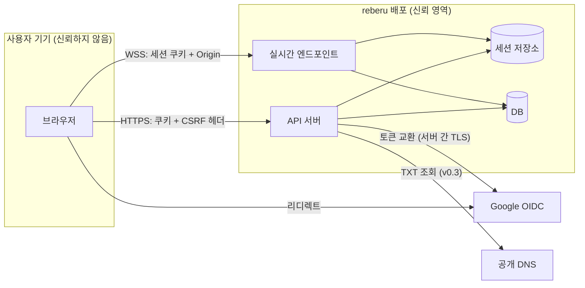
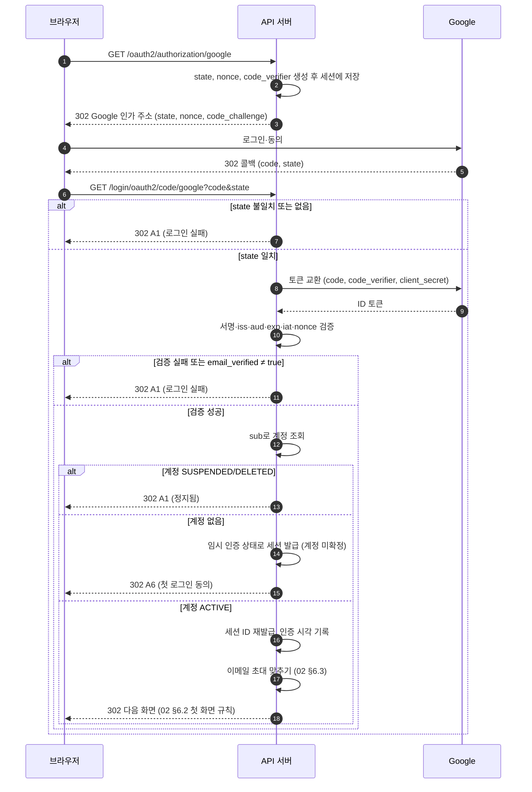
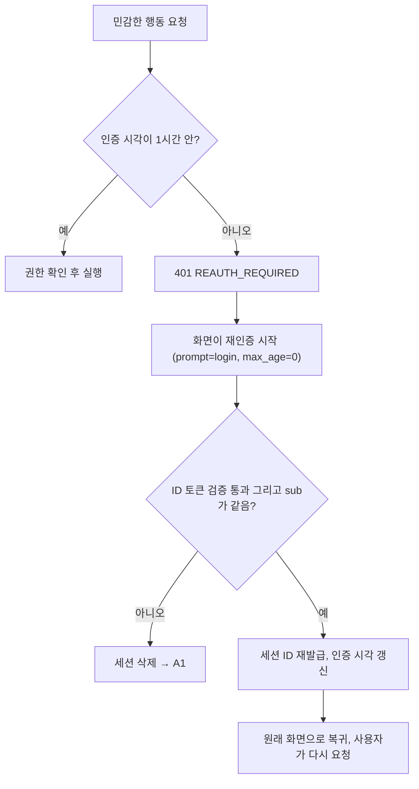
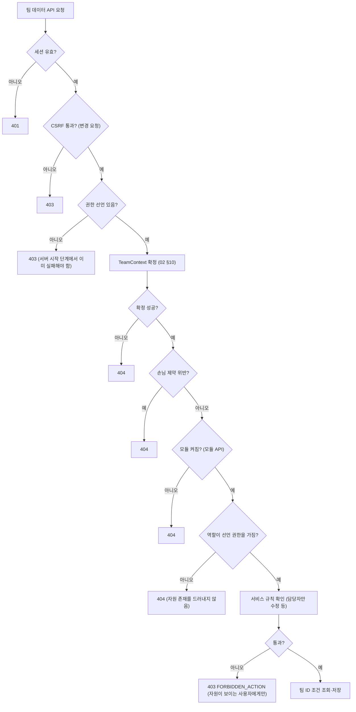

# 보안 설계

> 버전: v0.4.0\
> 수정일: 2026-11-05

reberu의 보안 요구사항과 검증 기준을 정한다. 요구사항 ID 접두어는 `SEC`다. 테넌시·멤버십 규칙은 [architecture/tenancy.md](tenancy.md), 실시간 채널 규칙은 [architecture/realtime.md](realtime.md)를 따른다.

## 1. 목표와 원칙

### 1.1 목표

- 보안 취약점을 0에 가깝게 만드는 것을 목표로 한다.
- 취약점이 없음을 보장할 수는 없다. 따라서 "안전하다"는 주장 대신 **어떤 요구사항을 어떤 테스트로 확인했는지**를 근거로 삼는다.
- 모든 필수 요구사항은 자동화 테스트 하나 이상과 연결한다(§15). 연결되지 않은 필수 요구사항은 결함으로 본다.

### 1.2 원칙

| 원칙 | 내용 |
| --- | --- |
| 기본 거부 | 권한을 선언하지 않은 API, 구독, 작업은 실행하지 않는다. 허용은 하나씩 명시한다 |
| 최소 권한 | 계정, 역할, 모듈, DB 계정, 운영자는 필요한 만큼만 가진다 |
| 여러 겹 방어 | 화면 제어 → API 권한 → 지금 팀 확정 → 서비스 규칙 → 팀을 조건으로 한 조회 → DB 제약 순으로 겹쳐 막는다. 앞의 겹을 믿고 뒤의 겹을 빼지 않는다 |
| 입력 불신 | 사용자가 보낸 조직·팀·역할·공간·좌표·빈도·보낸 사람 값은 서버가 다시 정하거나 확인한다 |
| 같은 실패 | 없는 것, 볼 수 없는 것, 꺼진 것은 같은 응답으로 돌려준다. 오류 응답에 내부 정보를 담지 않는다 |
| 검증 자동화 | 보안 규칙마다 테스트가 있고 CI가 매번 실행한다. 규칙을 바꾸면 테스트도 같은 PR에서 바꾼다 |

## 2. 보호 자산

| 자산 | 예 | 노출 시 영향 |
| --- | --- | --- |
| 세션 | 세션 쿠키, 세션 저장소 | 계정 사칭 |
| 계정 개인정보 | 이메일, 표시 이름, Google `sub`, 프로필 사진 주소 | 개인정보 유출 |
| 조직·팀 데이터 | 업무, 프로젝트, 리포트, 회의 기록, 출석, EXP | 단체 업무 정보 유출 |
| 조직 존재 정보 | 비공개 조직의 이름·존재 | 비공개 단체 노출 |
| 초대 토큰 | 초대 링크 토큰, 이메일 초대 | 무단 가입 |
| 권한 정보 | 조직 관리자 여부, 팀 역할 | 권한 상승 |
| 활동 기록 | 조직·팀 활동 기록 | 증거 훼손 |
| 비밀값 | OAuth 클라이언트 비밀, DB 비밀번호, 서명 키 | 전체 장악 |

## 3. 신뢰 경계

- 경계를 넘는 모든 입력은 검증 대상이다: 브라우저 → 서버, Google → 서버(ID 토큰), DNS → 서버(TXT 값).
- API 서버와 실시간 엔드포인트는 같은 세션 저장소와 같은 권한 판정 코드를 쓴다. 실시간 쪽에 별도 권한 규칙을 두지 않는다.

## 4. 공격자 모델

| ID | 공격자 | 가진 것 | 막아야 할 목표 |
| --- | --- | --- | --- |
| ATK-1 | 비로그인 사용자 | 공개 주소, 유출된 초대 링크 | 로그인 없이 데이터 접근, 비공개 조직 존재 확인 |
| ATK-2 | 로그인했지만 소속 없음 | 유효한 세션 | 조직·팀 데이터 접근, 초대 없이 가입 |
| ATK-3 | 다른 조직 구성원 | 자기 조직의 세션·권한 | 다른 조직의 데이터·존재 확인 |
| ATK-4 | 같은 조직 다른 팀 팀원 | 같은 조직의 활동 멤버십 | 소속되지 않은 팀의 데이터 접근 |
| ATK-5 | 손님 | 초대받은 팀의 멤버십 | 다른 팀·조직 정보 접근, 관리자 권한 획득, 기간 만료 후 접근 |
| ATK-6 | 악의적 팀 관리자 | 자기 팀 관리 권한 | 다른 팀 접근, 조직 관리자 권한 획득, 활동 기록 훼손 |
| ATK-7 | 탈취된 세션 | 남의 세션 쿠키 | 민감한 관리 행동, 장기간 사용 |
| ATK-8 | 실수가 있는 확장 모듈 | core 위에서 도는 코드 | 권한 확인 누락으로 데이터 노출 |

운영자와 배포 서버 관리자는 이 모델의 공격자가 아니다. 운영자 권한은 §14에서 최소로 제한한다.

## 5. 위협 목록

| ID | STRIDE | 위협 | 시나리오 | 대응 | 검증 |
| --- | --- | --- | --- | --- | --- |
| THR-01 | S | 계정 사칭 | 다른 Google 계정으로 초대 이메일을 가로챔 | SEC-TOKEN-08, SEC-AUTH-05 | T-INV-EMAIL |
| THR-02 | S | 로그인 위조 | 로그인 응답을 가로채거나 재전송 | SEC-AUTH-02~04 | T-AUTH-STATE, T-AUTH-NONCE |
| THR-03 | I | 다른 조직·팀 데이터 조회 | 다른 팀 업무 ID를 경로에 넣음 | SEC-AUTHZ-03~05 | T-ISO-ORG, T-ISO-TEAM |
| THR-04 | E | 권한 상승 | 요청 본문에 `role`, `orgAdmin`, `teamId`를 끼워 넣음 | SEC-AUTHZ-06, SEC-AUTHZ-07 | T-AUTHZ-MASS |
| THR-05 | E | 손님 범위 이탈 | 손님이 공개 팀 목록·조직 구성원 목록 조회 | SEC-AUTHZ-08 | T-GUEST-SCOPE |
| THR-06 | S | 초대 토큰 추측·재사용 | 토큰을 대입하거나 만료 링크 재사용 | SEC-TOKEN-01~07 | T-TOKEN-* |
| THR-07 | I | 비공개 조직 엿보기 | 검색, 링크 실패 문구, 응답 시간 차로 존재 확인 | SEC-ORG-01~03 | T-ORG-HIDDEN |
| THR-08 | T | 요청 위조(CSRF) | 다른 사이트가 로그인한 사용자 이름으로 변경 요청 | SEC-SESS-09, SEC-HDR-01 | T-CSRF |
| THR-09 | T | 스크립트 주입(XSS) | 업무 설명·채팅·남긴 말에 스크립트 삽입 | SEC-INPUT-04, SEC-OUTPUT-01, SEC-HDR-02 | T-XSS-SANITIZE, T-CSP |
| THR-10 | S | 세션 고정·탈취 | 로그인 전 세션을 유지시키거나 쿠키 탈취, DB 유출로 세션 ID 획득 | SEC-SESS-01~05, SEC-SESS-12·13 | T-SESS-ROTATE, T-SESS-COOKIE, T-SESS-STORE |
| THR-11 | E | 정지 후 계속 사용 | 정지된 사람이 기존 세션·실시간 연결로 계속 사용 | SEC-SESS-07 | T-SESS-REVOKE |
| THR-12 | I | 실시간 엿듣기 | 다른 팀 범위를 구독 | SEC-RT-02, SEC-RT-03 | T-RT-SUB |
| THR-13 | D | 실시간 남용 | 위치를 초당 수백 번 전송 | SEC-RT-04, SEC-RT-05 | T-RT-RATE |
| THR-14 | D | 대량 요청 | 로그인·초대·검색·글쓰기 반복 | SEC-RATE-01 | T-RATE |
| THR-15 | S | 도메인 가로채기 (v0.3) | 남의 도메인을 자동 가입 도메인으로 등록 | SEC-ORG-06~09 | T-DOMAIN |
| THR-16 | D | 조직 남발 | 가짜 조직을 대량으로 만들어 초대 남용 | SEC-ORG-04, SEC-RATE-01 | T-ORG-LIMIT |
| THR-17 | I | 비밀값 유출 | 키가 커밋·로그·오류 응답에 남음 | SEC-SECRET-01~03, SEC-LOG-01 | T-LOG-MASK, CI 비밀값 검사 |
| THR-18 | T | 활동 기록 훼손 | 관리자가 자기 행동 기록을 지움 | SEC-LOG-03 | T-AUDIT-IMMUTABLE |
| THR-19 | E | 확장 모듈 권한 누락 | 모듈 API가 권한 선언 없이 노출 | SEC-MOD-01~03 | T-AUTHZ-DECLARED |
| THR-20 | E | 공급망 | 의존성에 알려진 취약점 | SEC-DEP-01~03 | CI 의존성 검사 |
| THR-21 | R | 행위 부인 | 관리자가 승인·정지를 하지 않았다고 주장 | SEC-LOG-02 | T-AUDIT-RECORD |
| THR-22 | I | 웹훅 주소 유출 | 저장된 Google Chat 웹훅 주소가 화면·로그·DB 덤프로 새어 아무나 그 방에 글을 씀 | SEC-HOOK-01~04 | T-HOOK-SECRET |
| THR-23 | E | SSRF | 웹훅 주소 칸에 내부 주소를 넣어 서버가 내부망에 요청하게 함 | SEC-HOOK-05~07 | T-HOOK-SSRF |
| THR-24 | I | 알림 오배송 | 관리자가 다른 사람의 개인 알림 주소를 엉뚱한 방으로 넣어 개인 알림이 새어 나감 | SEC-HOOK-10~12 | T-HOOK-PROXY |

## 6. 인증

### 6.1 요구사항

| ID | 요구사항 | 수준 |
| --- | --- | --- |
| SEC-AUTH-01 | 로그인은 Google OpenID Connect Authorization Code 흐름만 허용한다. 비밀번호, 이메일 코드, 다른 IdP는 두지 않는다 ([ADR-0004](../adr/0004-google-oidc-only.md)) | 필수 |
| SEC-AUTH-02 | 인가 요청에 무작위 `state`를 넣고, 콜백에서 세션에 저장한 값과 일치하지 않으면 거부한다. `state`는 한 번 쓰면 버린다 | 필수 |
| SEC-AUTH-03 | 인가 요청에 무작위 `nonce`를 넣고, ID 토큰의 `nonce`가 일치하지 않으면 거부한다 | 필수 |
| SEC-AUTH-04 | PKCE(`S256`)를 쓴다 | 필수 |
| SEC-AUTH-05 | ID 토큰의 서명(Google 공개 키), `iss`, `aud`(우리 클라이언트 ID), `exp`, `iat`를 검증한다. 하나라도 실패하면 거부한다 | 필수 |
| SEC-AUTH-06 | `email_verified`가 `true`가 아니면 거부한다 | 필수 |
| SEC-AUTH-07 | 계정은 `sub`로 찾고 만든다. 이메일로 계정을 찾거나 계정을 서로 이어 붙이지 않는다 | 필수 |
| SEC-AUTH-08 | 리디렉트 URI는 설정에 고정한다. 로그인 후 돌아갈 화면은 서버가 저장한 상대 경로 목록에서만 고른다(열린 리디렉트 금지) | 필수 |
| SEC-AUTH-09 | Google 접근 토큰과 갱신 토큰은 저장하지 않는다. 필요한 모듈이 생기면 그 모듈의 ADR에서 암호화 저장을 정한다 | 필수 |
| SEC-AUTH-10 | 요청하는 범위(scope)는 `openid email profile`만 쓴다 | 필수 |
| SEC-AUTH-11 | 인증 실패는 원인과 관계없이 같은 화면(A1 "로그인하지 못했어요")과 같은 응답 코드로 돌려준다. 원인은 서버 로그에만 남긴다 | 필수 |
| SEC-AUTH-12 | 상태가 `SUSPENDED` 또는 `DELETED`인 계정의 로그인은 세션을 만들지 않고 거부한다 | 필수 |
| SEC-AUTH-13 | 첫 로그인은 약관·처리방침 동의(A6) 전까지 계정을 확정하지 않는다. 동의하지 않으면 계정을 만들지 않는다 | 필수 |

### 6.2 로그인 순서

## 7. 세션

### 7.1 요구사항

| ID | 요구사항 | 수준 |
| --- | --- | --- |
| SEC-SESS-01 | 세션은 서버 저장소에 둔다. 브라우저에는 세션 ID만 쿠키로 보낸다. 토큰 기반(JWT) 세션은 쓰지 않는다 | 필수 |
| SEC-SESS-02 | 세션 쿠키 속성: `HttpOnly`, `Secure`, `SameSite=Lax`, `Path=/`, `Domain` 지정 없음(호스트 전용). 이름은 `__Host-` 접두어를 쓴다 | 필수 |
| SEC-SESS-03 | 로그인 성공, 재인증 성공, 조직 관리자 권한 부여 직후 세션 ID를 새로 발급하고 이전 ID를 무효화한다 | 필수 |
| SEC-SESS-04 | 유휴 만료와 최대 수명을 둔다(기본값: 유휴 8시간, 최대 7일). 값은 환경 변수로 바꾼다 | 필수 |
| SEC-SESS-05 | 세션 ID는 128비트 이상의 CSPRNG 값이다 | 필수 |
| SEC-SESS-06 | 세션에는 계정 ID, 인증 시각, 마지막 요청 시각만 둔다. 역할과 멤버십은 세션에 캐시하지 않고 요청마다 조회한다 | 필수 |
| SEC-SESS-07 | 계정 정지, 조직 멤버십 정지·만료·나감, 조직 정지·보관·삭제 예약 시 영향받는 세션과 실시간 연결을 즉시 끊는다(§7.3) | 필수 |
| SEC-SESS-08 | 로그아웃은 서버 세션을 지우고, 그 세션의 실시간 연결을 닫고, 쿠키를 만료시킨다 | 필수 |
| SEC-SESS-09 | 상태를 바꾸는 요청(`POST`, `PUT`, `PATCH`, `DELETE`)은 CSRF 토큰을 헤더로 보내야 한다. 토큰은 읽을 수 있는 쿠키로 내려 주고, 화면이 헤더(`X-XSRF-TOKEN`)로 되돌려 보낸다. 없거나 다르면 `403` | 필수 |
| SEC-SESS-10 | 최근 인증이 필요한 행동(§7.2)은 인증 시각이 기준(1시간) 안이어야 한다. 아니면 `401 REAUTH_REQUIRED`로 응답하고 재인증 흐름을 탄다 | 필수 |
| SEC-SESS-11 | 계정 하나의 동시 세션 수에 상한을 둔다(기본 10, OQ-47). 넘으면 가장 오래된 세션을 끊는다 | 필수 |
| SEC-SESS-12 | 세션 ID 원문은 쿠키에만 있다. 세션 저장소에는 SHA-256 해시만 저장하고, 요청이 오면 쿠키 값을 해시해 찾는다. DB 내용이 새어 나가도 세션을 가로챌 수 없어야 한다 | 필수 |
| SEC-SESS-13 | 세션 저장소에는 정해진 열(SEC-SESS-06의 값, 로그인 진행 중의 `state`·`nonce`·`code_verifier`와 돌아갈 주소)만 둔다. 임의 속성 저장과 Java 직렬화를 쓰지 않는다. Spring Security의 인증 정보는 세션에 직렬화하지 않고 요청마다 계정 ID로 다시 만든다 | 필수 |
| SEC-SESS-14 | 로그인 진행 값은 10분 뒤 무효이고 한 번 쓰면 지운다(SEC-AUTH-02~04) | 필수 |

### 7.2 최근 인증이 필요한 행동

- 조직 관리자 지정·해제, 팀 관리자 지정·해제
- 조직 멤버십 정지·해제, 팀에서 내보내기
- 손님 초대 승인·연장, 손님을 구성원으로 바꾸기
- 조직 공개 범위·가입 방법·손님 규칙 변경(F7)
- 허용 모듈 변경(F4), 조직 보관·삭제 예약
- 도메인 자동 가입 도메인 추가(v0.3)
- 계정 탈퇴(D3)

재인증은 Google 인가 요청에 `prompt=login`과 `max_age=0`을 붙여 다시 로그인시키고, ID 토큰의 `auth_time`을 새 인증 시각으로 쓴다. 재인증한 `sub`가 세션 계정과 다르면 세션을 끊고 A1로 보낸다.

재인증 후 원래 요청을 자동으로 다시 보내지 않는다. 사용자가 다시 실행한다.

### 7.3 즉시 무효화

| 사건 | 끊는 대상 | 방법 |
| --- | --- | --- |
| 계정 정지·탈퇴 | 그 계정의 모든 세션과 실시간 연결 | 세션 저장소에서 계정 ID로 세션 목록 조회 후 삭제, 실시간 연결 종료 |
| 조직 멤버십 `SUSPENDED`·`EXPIRED`·`LEFT` | 세션은 유지, 그 조직의 지금 팀 권한과 실시간 구독 | 다음 요청부터 TeamContext 확정 실패(멤버십을 요청마다 조회), 그 조직 범위 구독 강제 해제 |
| 팀 멤버십 종료 | 그 팀 범위 구독 | 그 팀 범위·공간 구독 강제 해제 |
| 조직 `SUSPENDED`·`ARCHIVED`·`DELETION_SCHEDULED` | 그 조직 소속 모든 계정의 조직 범위 구독 | 조직 ID로 구독 일괄 해제 |

- 세션 저장소는 계정 ID로 세션을 찾을 수 있어야 한다(색인 요구).
- 무효화는 사건을 처리한 트랜잭션이 커밋된 뒤 실행하고, 실패하면 재시도한다. 재시도하는 동안에도 SEC-SESS-06에 따라 요청마다 멤버십을 조회하므로 권한은 이미 막혀 있다.

## 8. 출처 제어

| ID | 요구사항 | 수준 |
| --- | --- | --- |
| SEC-HDR-01 | CORS 허용 출처는 배포 설정의 고정 목록만 쓴다. 와일드카드(`*`)와 요청 출처 되돌려 주기를 쓰지 않는다. 자격 증명 요청은 허용 출처에서만 받는다 | 필수 |
| SEC-RT-01 | 실시간 연결 요청의 `Origin`이 허용 목록에 없으면 거부한다. 연결할 때 세션을 확인하고 없으면 거부한다 | 필수 |

## 9. 권한

### 9.1 요구사항

| ID | 요구사항 | 수준 |
| --- | --- | --- |
| SEC-AUTHZ-01 | 모든 API는 필요한 권한을 선언한다. 선언이 없는 API는 거부한다 | 필수 |
| SEC-AUTHZ-02 | 서버 시작 시 또는 테스트에서 모든 엔드포인트의 권한 선언 유무를 검사한다. 하나라도 없으면 실패한다 | 필수 |
| SEC-AUTHZ-03 | 팀 데이터 API는 요청마다 TeamContext를 확정한 뒤에만 실행한다. 확정 순서와 조건은 [architecture/tenancy.md](tenancy.md) §10를 따른다 | 필수 |
| SEC-AUTHZ-13 | DB 행 수준 보안(RLS)에 기대지 않는다. 세 DB를 지원하므로 격리는 앱 코드와 격리 테스트만으로 지킨다([architecture/tenancy.md](tenancy.md) §11.4) | 필수 |
| SEC-AUTHZ-04 | 팀 소속 자원은 늘 "팀 ID + 자원 ID"로 찾는다. 자원 ID만으로 찾는 저장소 메서드를 팀 소속 자원에 두지 않는다 | 필수 |
| SEC-AUTHZ-05 | 다른 조직·팀의 자원, 꺼진 모듈의 API, 권한 없는 자원은 모두 `404 NOT_FOUND`로 같게 응답한다. 응답 본문과 헤더에 차이를 두지 않는다 ([ADR-0006](../adr/0006-tenant-isolation.md)) | 필수 |
| SEC-AUTHZ-06 | 요청 본문은 API마다 정한 요청 DTO로만 받는다. 엔티티에 직접 바인딩하지 않는다. DTO에 없는 필드는 무시하지 않고 `400`으로 거부한다 | 필수 |
| SEC-AUTHZ-07 | 역할 변경, 조직 관리자 지정, 정지는 각각 전용 API로만 한다. 일반 수정 API로 역할·관리자 여부·소속을 바꿀 수 없다 | 필수 |
| SEC-AUTHZ-08 | 손님 제약(초대받은 팀만, 관리자 불가, 조직 정보·공개 팀 목록·조직 구성원 목록 불가, 이용 기간)은 역할 확인보다 먼저 적용한다 | 필수 |
| SEC-AUTHZ-09 | 조직 관리자 권한은 자기 조직 안에서만 유효하다. 다른 조직에는 아무 권한이 없다 | 필수 |
| SEC-AUTHZ-10 | 저장 시 참조 무결성을 확인한다: 업무의 프로젝트·담당자, 프로젝트 멤버, 초대의 팀은 모두 같은 팀(또는 같은 조직)의 것이어야 한다 | 필수 |
| SEC-AUTHZ-11 | "마지막 조직 관리자", "마지막 팀 관리자"를 없애는 변경은 거부한다. 동시에 두 요청이 와도 지켜지도록 잠금 또는 조건부 갱신으로 처리한다 | 필수 |
| SEC-AUTHZ-12 | 화면에서 숨긴 버튼과 별개로 서버가 모든 권한을 다시 확인한다 | 필수 |

### 9.2 권한 판정 순서

- `403 FORBIDDEN_ACTION`은 자원을 볼 수 있는 사용자가 그 자원에 허용되지 않은 행동을 했을 때만 쓴다(예: 팀원이 남의 업무를 수정). 볼 수 없는 자원에는 쓰지 않는다.

## 10. 초대와 토큰

| ID | 요구사항 | 수준 |
| --- | --- | --- |
| SEC-TOKEN-01 | 초대 링크 토큰은 CSPRNG로 32바이트를 만들어 패딩 없는 base64url로 쓴다 | 필수 |
| SEC-TOKEN-02 | 토큰 원문은 저장하지 않는다. SHA-256 해시만 저장한다. 원문은 만들 때 한 번만 응답한다 | 필수 |
| SEC-TOKEN-03 | 해시 조회 후 비교는 상수 시간 비교를 쓴다 | 필수 |
| SEC-TOKEN-04 | 초대 링크에는 만료 시각(필수, 최대 30일)과 사용 횟수 상한을 둔다. 만료·횟수 초과·끄기 이후에는 무효다 | 필수 |
| SEC-TOKEN-05 | 사용 횟수 증가와 상한 확인은 하나의 원자적 조건부 갱신으로 처리한다(동시 사용으로 상한을 넘지 않음) | 필수 |
| SEC-TOKEN-06 | 무효 토큰, 없는 토큰, 비공개 조직의 토큰, 로그인 상태와 무관하게 실패 응답은 "이 링크는 쓸 수 없어요" 하나다. 조직·팀 이름을 응답에 담지 않는다 | 필수 |
| SEC-TOKEN-07 | 초대 링크로는 `GUEST`가 될 수 없고, `TEAM_ADMIN`·조직 관리자 권한을 받을 수 없다 | 필수 |
| SEC-TOKEN-08 | 이메일 초대는 Google이 확인한 이메일과 초대 이메일이 정규화 후 정확히 같을 때만 수락한다 | 필수 |
| SEC-TOKEN-09 | 이메일 정규화: 앞뒤 공백 제거, 전체 소문자. 그 밖의 변형(Gmail 점 무시, `+` 꼬리 제거, 유니코드 정규화로 다른 글자를 같게 보기)은 하지 않는다. ASCII 밖의 문자가 있는 이메일은 초대 대상으로 받지 않는다 | 필수 |
| SEC-TOKEN-10 | 초대를 수락하는 순간 다시 확인한다: 초대 상태 `PENDING`, 만료 전, 조직·팀 `ACTIVE`, 가입 방법이 아직 켜져 있음, 이메일 일치. 하나라도 어긋나면 수락하지 않는다 | 필수 |
| SEC-TOKEN-11 | 초대 만들기·쓰기·끄기·수락·거절·만료는 모두 활동 기록에 남긴다 | 필수 |
| SEC-TOKEN-12 | 같은 이메일·같은 팀에 `PENDING` 초대는 하나만 둔다. 다시 보내면 기존 초대를 `REVOKED`로 바꾸고 새로 만든다 | 필수 |

## 11. 조직 만들기와 공개 조직

| ID | 요구사항 | 수준 |
| --- | --- | --- |
| SEC-ORG-01 | `PRIVATE` 조직은 검색 결과, 오류 문구, 초대 링크 실패 응답, 실시간 이벤트 어디에도 이름·존재가 드러나지 않는다 | 필수 |
| SEC-ORG-02 | 조직·초대 조회 실패 응답은 존재 여부에 따라 처리 경로가 갈리지 않게 한다. 토큰 해시 계산과 조회는 성공·실패 모두 같은 단계를 거친다 | 필수 |
| SEC-ORG-03 | 공개 조직 검색은 이름 부분 일치만 지원하고 두 글자 이상을 요구한다. 결과는 최대 20개(OQ-47)이며 이름, 한 줄 소개, 가입 방식만 담는다. 구성원 수와 구성원 정보를 담지 않는다 | 필수 |
| SEC-ORG-04 | 계정당 만들 수 있는 조직 수에 상한을 둔다. 상한은 5개다 | 필수 |
| SEC-ORG-05 | 조직 이름·한 줄 소개는 길이 상한, 제어 문자 금지, 금지어 검사를 거친다. 신고는 v0.3에 받는다 | 필수 |
| SEC-ORG-13 | 금지어 목록은 배포 설정 파일로 두고 운영자가 관리한다. 기본 목록은 서비스 이름(reberu)과 운영자·관리자·공식처럼 사칭에 쓰이는 말이다. 검사는 NFKC 정규화, 소문자, 공백·기호 제거 뒤의 값으로 하여 글자 바꿔치기를 막는다. 팀 이름과 표시 이름에도 같은 검사를 쓴다 | 필수 |
| SEC-ORG-06 | 도메인 자동 가입(v0.3)은 DNS TXT 확인을 통과한 도메인에만 켤 수 있다. 확인 값은 CSPRNG 32바이트 값이고 72시간 안에 확인하지 않으면 무효다(OQ-47) | 필수 |
| SEC-ORG-07 | 확인된 도메인은 30일마다 다시 확인한다(OQ-47). 확인 값이 사라지면 그 도메인의 자동 가입을 끄고 조직 관리자에게 알린다. 이미 들어온 사람은 그대로 둔다 | 필수 |
| SEC-ORG-08 | 도메인 자동 가입은 이메일 도메인과 ID 토큰 `hd` 값이 모두 그 도메인과 같을 때만 적용한다 | 필수 |
| SEC-ORG-09 | 한 도메인은 한 조직만 확인할 수 있다. 이미 확인된 도메인의 확인 요청은 거부한다 | 필수 |
| SEC-ORG-10 | `SINGLE_ORG` 배포의 자동 가입 도메인은 환경 변수로만 정하고 DNS 확인을 하지 않는다 | 필수 |
| SEC-ORG-11 | 공개 조직의 "바로 가입"으로 얻는 권한은 조직 공간 출입과 공개 팀 목록 보기까지다. 팀 데이터는 팀 멤버십이 있어야 보인다 | 필수 |

## 12. 입력과 출력

### 12.1 입력

| ID | 요구사항 | 수준 |
| --- | --- | --- |
| SEC-INPUT-01 | 모든 요청 DTO 필드에 형식·길이·범위 검사(Bean Validation)를 둔다. 길이 상한이 없는 문자열 필드는 두지 않는다 | 필수 |
| SEC-INPUT-02 | DB 조회는 JPA와 매개변수 바인딩만 쓴다. 문자열 연결로 쿼리를 만들지 않는다. 정렬·필터 필드는 허용 목록에서만 고른다 | 필수 |
| SEC-INPUT-03 | 요청 본문 크기 상한을 둔다(기본 1MB, OQ-47). 넘으면 `413` | 필수 |
| SEC-INPUT-04 | 서식 있는 글(업무 설명, 리포트 공지 칸)은 저장할 때 허용 목록으로 정리한다. 허용 태그: `p`, `br`, `strong`, `em`, `u`, `s`, `ul`, `ol`, `li`, `blockquote`, `code`, `pre`, `h3`, `h4`, `a`. 허용 속성: `a[href]`만. 그 밖의 태그·속성·`style`·이벤트 속성은 지운다 | 필수 |
| SEC-INPUT-05 | 링크 주소는 `https`, `http`, `mailto`만 허용한다. 외부 회의 링크는 `https`만 허용한다 | 필수 |
| SEC-INPUT-06 | 채팅, 질문, 남긴 말, 칭찬 메시지, 이름은 서식 없는 글로만 받고 제어 문자를 거부한다 | 필수 |

| 대표 필드 | 상한 |
| --- | --- |
| 표시 이름 | 30자 |
| 조직 이름 / 팀 이름 | 40자 |
| 한 줄 소개 | 100자 |
| 업무 제목 | 200자 |
| 업무 설명(정리 후) | 20,000자 |
| 세부 항목 내용 | 500자 |
| 채팅 / 칭찬 / 질문 / 남긴 말 | 200자 / 200자 / 300자 / 100자 |
| 한 번에 넣는 초대 이메일 | 50개 |

### 12.2 출력

| ID | 요구사항 | 수준 |
| --- | --- | --- |
| SEC-OUTPUT-01 | 화면은 사용자 글을 텍스트로 렌더링한다. 서식 있는 글만 정리된 HTML로 렌더링한다 | 필수 |
| SEC-OUTPUT-02 | 사용자가 넣은 링크는 `rel="noopener noreferrer"`와 새 창으로 연다 | 필수 |
| SEC-OUTPUT-03 | 오류 응답은 `{ code, message, traceId }`만 담는다. `400 INVALID_REQUEST`만 칸별 오류 `fields`(칸 이름과 정해진 사유 코드)를 더 담는다([architecture/api.md](api.md) §3.2). 예외 메시지, 스택, SQL, 경로, 클래스 이름, 입력 값을 담지 않는다 | 필수 |
| SEC-OUTPUT-04 | 응답에 다른 사람의 이메일은 필요한 화면(관리 화면, 초대 목록)에서만 담는다. 동료 카드·공간·조직 공간 응답에는 이메일을 담지 않는다 | 필수 |
| SEC-OUTPUT-05 | 오류 코드는 아래 표의 것만 쓴다. 다른 문서가 정한 오류도 이 표에 모은다 | 필수 |

| HTTP | `code` | 쓰는 경우 | 정한 곳 |
| --- | --- | --- | --- |
| 400 | `INVALID_REQUEST` | 형식·길이·허용 값 위반, DTO에 없는 필드, 잘못된 JSON·커서, 같은 중복 방지 키에 다른 본문 | SEC-INPUT-01, SEC-AUTHZ-06, [architecture/api.md](api.md) §3 |
| 401 | `UNAUTHENTICATED` | 로그인하지 않음, 세션 만료 | §7 |
| 401 | `CONSENT_REQUIRED` | 가입 대기 세션으로 동의 밖의 API를 부름 | TEN-AUTH-02 |
| 401 | `REAUTH_REQUIRED` | 최근 인증이 필요한 행동인데 인증 시각이 기준을 넘음 | §7.2 |
| 403 | `CSRF_INVALID` | 상태를 바꾸는 요청에 CSRF 토큰이 없거나 틀림 | SEC-SESS-09 |
| 403 | `FORBIDDEN_ACTION` | 볼 수 있는 자원에 허용되지 않은 행동 | §9.2 |
| 404 | `NOT_FOUND` | 없음, 다른 조직·팀, 꺼진 모듈, 볼 권한 없음 (모두 같게) | SEC-AUTHZ-05, [architecture/tenancy.md](tenancy.md) §10 |
| 409 | `READ_ONLY` | 보관된 팀·조직에 쓰기 | [architecture/tenancy.md](tenancy.md) §10 |
| 409 | `VERSION_CONFLICT` | 요청의 버전이 저장된 버전과 다름 (업무, 리포트 공지 칸) | [domain/rules.md](../domain/rules.md) RULE-TASK-05 |
| 409 | `REPORT_LOCKED` | 편집 마감이 지난 리포트 공지 칸 쓰기 | [domain/rules.md](../domain/rules.md) RULE-RPT-05 |
| 409 | `LIMIT_EXCEEDED` | 개수 상한 초과 (계정당 조직 수 등) | [architecture/tenancy.md](tenancy.md) §8.1 |
| 409 | `ALREADY_PROCESSED` | 이미 처리된 승인·거절·취소·수락, 토큰 응답의 중복 요청 | [architecture/api.md](api.md) API-CON-02·05 |
| 409 | `LAST_ADMIN_REQUIRED` | 마지막 조직·팀 관리자를 없애는 변경 | TEN-INV-20 |
| 409 | `REQUEST_COOLDOWN` | 거절 뒤 7일 안의 가입 재요청 | TEN-REQ-02 |
| 413 | `PAYLOAD_TOO_LARGE` | 요청 본문 상한 초과 | SEC-INPUT-03 |
| 429 | `RATE_LIMITED` | 요청 제한 초과 | §13.2 |
| 500 | `INTERNAL_ERROR` | 예상하지 못한 서버 오류. 원인은 서버 로그에만 남긴다 | SEC-OUTPUT-03 |

실시간 명령의 오류(`RATE_LIMITED`, `SPACE_FULL`, `SEAT_TAKEN` 등)는 [architecture/realtime.md](realtime.md) §3.3을 따른다.

### 12.3 응답 헤더

| ID | 헤더 | 값 | 수준 |
| --- | --- | --- | --- |
| SEC-HDR-02 | `Content-Security-Policy` | `default-src 'self'; script-src 'self'; style-src 'self'; img-src 'self' data: https://lh3.googleusercontent.com; font-src 'self'; worker-src 'self'; connect-src 'self' wss://<배포 호스트>; frame-ancestors 'none'; base-uri 'none'; form-action 'self'; object-src 'none'; require-trusted-types-for 'script'; trusted-types reberu-html` (인라인 스크립트·`eval` 금지. Trusted Types 정책은 서식 있는 글 하나, [architecture/frontend.md](frontend.md) FE-XSS-02) | 필수 |
| SEC-HDR-03 | `Strict-Transport-Security` | `max-age=31536000; includeSubDomains` | 필수 |
| SEC-HDR-04 | `X-Content-Type-Options` | `nosniff` | 필수 |
| SEC-HDR-05 | `Referrer-Policy` | `strict-origin-when-cross-origin` | 필수 |
| SEC-HDR-06 | `Permissions-Policy` | `camera=(), microphone=(), geolocation=(), payment=()` | 필수 |
| SEC-HDR-07 | `Cache-Control` | 인증이 필요한 API 응답은 `no-store` | 필수 |

## 13. 실시간·요청 제한·비밀값·개인정보·기록

### 13.1 실시간

| ID | 요구사항 | 수준 |
| --- | --- | --- |
| SEC-RT-02 | 구독마다 범위(개인·팀·공간·조직·조직 공간)를 들을 권한을 TeamContext와 같은 판정 코드로 확인한다 ([architecture/realtime.md](realtime.md) §2.2) | 필수 |
| SEC-RT-03 | 메시지의 조직·팀·공간·보낸 사람 값은 무시하고 서버가 연결 정보로 채운다 | 필수 |
| SEC-RT-04 | 메시지 크기 상한(기본 4KB, OQ-47)을 두고 넘으면 버린다 | 필수 |
| SEC-RT-05 | 메시지 종류별 빈도 상한을 서버에서 지킨다(위치 초당 5번 등, 04 §4.6). 넘는 메시지는 버리고, 10초 동안 계속 넘으면 연결을 끊는다 | 필수 |
| SEC-RT-06 | 공간 경계 밖 좌표, 앉을 수 없는 자리, 들어가지 않은 공간의 메시지는 버린다 | 필수 |

### 13.2 요청 제한

| ID | 대상 | 키 | 한도 | 초과 시 |
| --- | --- | --- | --- | --- |
| SEC-RATE-01 | 로그인 시작·콜백 | IP | 1분 20회 | `429`, 기록 |
| SEC-RATE-02 | 초대 링크 열기 | IP | 1분 10회. 실패 연속 20회면 15분 차단 | `429`, 기록 |
| SEC-RATE-03 | 이메일 초대 만들기 | 계정 | 1시간 200개 | `429` |
| SEC-RATE-04 | 가입 요청 | 계정 | 하루 10회 | `429` |
| SEC-RATE-05 | 조직 만들기 | 계정 | 하루 3회 (상한은 SEC-ORG-04) | `429` |
| SEC-RATE-06 | 공개 조직 검색 | 계정 | 1분 30회 | `429` |
| SEC-RATE-07 | 글쓰기(채팅, 질문, 남긴 말, 칭찬) | 계정 | 1분 30회 | `429` |
| SEC-RATE-08 | 그 밖의 API | 계정 | 1분 300회 | `429` |

- 한도는 초안이며 환경 변수로 바꾼다. 수준: 필수.
- `429` 응답은 `Retry-After` 헤더를 담는다.

### 13.3 비밀값

| ID | 요구사항 | 수준 |
| --- | --- | --- |
| SEC-SECRET-01 | 비밀값은 환경 변수로만 주입한다. `.env`와 비밀값이 담긴 파일은 커밋하지 않는다 | 필수 |
| SEC-SECRET-02 | 로그, 오류 응답, 활동 기록, 실시간 메시지에 비밀값·세션 ID·토큰 원문을 남기지 않는다 | 필수 |
| SEC-SECRET-03 | 애플리케이션 DB 계정은 데이터 읽기·쓰기 권한만 가진다. 스키마 변경 권한은 마이그레이션 실행 계정에만 준다 | 권장 |

### 13.4 개인정보

| ID | 요구사항 | 수준 |
| --- | --- | --- |
| SEC-PRIV-01 | 수집 항목은 Google `sub`, 이메일, 이름(표시 이름의 초기값), 프로필 사진 주소, Workspace 도메인(`hd`), 약관 동의 시각·버전, 외부 알림을 켠 경우 웹훅 주소(암호화)만이다 | 필수 |
| SEC-PRIV-02 | 탈퇴 시 계정의 이메일·이름·사진 주소를 지우고 `sub`는 되돌릴 수 없는 해시로 바꾼다. 팀 기록의 작성자는 "탈퇴한 사용자"로 보인다. 계정 상태는 `DELETED` | 필수 |
| SEC-PRIV-03 | 탈퇴는 그 계정이 다른 활동 멤버가 있는 조직의 마지막 조직 관리자이거나, 다른 활동 멤버가 있는 팀의 마지막 팀 관리자이면 거부한다. 혼자뿐인 조직·팀은 보관 처리한다([architecture/tenancy.md](tenancy.md) §5.1) | 필수 |
| SEC-PRIV-04 | 탈퇴한 `sub`로 다시 로그인하면 새 계정으로 본다. 이전 기록과 잇지 않는다 | 필수 |

### 13.5 로그와 활동 기록

| ID | 요구사항 | 수준 |
| --- | --- | --- |
| SEC-LOG-01 | 애플리케이션 로그는 계정 ID와 `traceId`로 기록하고 이메일은 가린다(`d***@example.com`) | 필수 |
| SEC-LOG-02 | 권한·멤버십·초대·가입 방법·모듈·조직 상태를 바꾸는 행동은 활동 기록에 남긴다: 시각, 한 사람, 행동, 대상, 조직·팀, 바뀌기 전·후 값 | 필수 |
| SEC-LOG-03 | 활동 기록은 추가만 한다. 고치거나 지우는 API를 두지 않는다. 보관 기간(기본 1년, 최소 1년, TEN-LOG-04)이 지난 기록의 정리는 서버 작업으로만 한다 | 필수 |
| SEC-LOG-04 | 인증 실패, 요청 제한 초과, CSRF 실패, 권한 거부는 보안 로그로 따로 모은다 | 필수 |

### 13.6 외부 알림 웹훅

외부 알림 모듈의 Google Chat 웹훅 제공자에 적용한다([ADR-0012](../adr/0012-chat-webhook-notifications.md)). 웹훅 주소에는 그 방에 글을 쓸 수 있는 키가 들어 있으므로 비밀값으로 다룬다.

| ID | 요구사항 | 수준 |
| --- | --- | --- |
| SEC-HOOK-01 | 웹훅 주소는 AES-256-GCM으로 암호화해 저장한다. 키는 환경 변수로 주입하고, 저장값에 키 버전을 함께 남겨 키를 바꿀 수 있게 한다 | 필수 |
| SEC-HOOK-02 | 저장한 웹훅 주소는 어떤 API로도 원문을 돌려주지 않는다. 화면에는 방 표시용 끝 4자리만 보인다. 바꾸기와 지우기만 된다 | 필수 |
| SEC-HOOK-03 | 웹훅 주소를 로그, 오류 응답, 활동 기록에 남기지 않는다. 활동 기록에는 "등록·변경·삭제" 사실과 대상만 남긴다 | 필수 |
| SEC-HOOK-04 | 웹훅 주소 등록·변경·삭제는 최근 인증(§7)이 필요하다 | 필수 |
| SEC-HOOK-05 | 받는 주소 형식은 `https://chat.googleapis.com/v1/spaces/{space}/messages?key=…&token=…` 하나다. 스킴, 호스트(정확히 일치), 경로 접두사, 쿼리 키를 모두 검사하고 다른 형식은 거부한다 | 필수 |
| SEC-HOOK-06 | 발송 요청은 리다이렉트를 따라가지 않고, 연결·응답 시간 제한(각 5초)을 둔다 | 필수 |
| SEC-HOOK-07 | 발송은 요청 처리 흐름과 분리된 발송 대기열에서 한다. 실패하면 간격을 늘려 최대 5번 다시 보낸다. 연속 실패가 20번이면 그 연결을 멈추고 등록한 사람과 팀 관리자에게 알린다 | 필수 |
| SEC-HOOK-08 | Google Chat의 보내기 한도를 넘지 않도록 웹훅마다 초당 1건으로 줄 세운다 | 필수 |
| SEC-HOOK-09 | 외부로 나가는 내용은 [domain/rules.md](../domain/rules.md) §10.4의 내용 수준을 따른다. 팀 대화방의 기본값은 "개수와 링크"다 | 필수 |
| SEC-HOOK-10 | 관리자가 다른 사람의 개인 웹훅을 대신 등록하면, 본인이 reberu에서 확인하기 전까지 그 웹훅에는 "개수와 링크" 수준만 보낸다 | 필수 |
| SEC-HOOK-11 | 웹훅을 등록하거나 바꾸면 그 방으로 연결 확인 메시지를 한 번 보낸다 | 필수 |
| SEC-HOOK-12 | 개인 웹훅의 주인은 언제든 끄거나 바꿀 수 있다. 대신 등록한 관리자는 그 사람이 확인한 뒤에는 바꿀 수 없다 | 필수 |

## 14. 의존성·모듈·운영자

| ID | 요구사항 | 수준 |
| --- | --- | --- |
| SEC-DEP-01 | 의존성 버전을 고정한다. 동적 버전(`+`, `latest`)을 쓰지 않는다 | 필수 |
| SEC-DEP-02 | Gradle Wrapper 검증을 CI에서 한다 | 필수 |
| SEC-DEP-03 | 의존성 취약점 검사와 정적 분석을 CI에 둔다. 도구 추가는 의존성·CI 변경 승인을 거친다 | 권장 |
| SEC-DEP-04 | 새 의존성은 쓰는 이유, 유지 상태, 알려진 취약점을 PR에 적는다 | 필수 |
| SEC-MOD-01 | 권한 판정, TeamContext 확정, 모듈 켜짐 확인은 core가 모듈 코드보다 먼저 한다 | 필수 |
| SEC-MOD-02 | 모듈은 등록할 때 모든 API의 권한을 선언한다. 선언이 없으면 서버가 시작하지 않는다 | 필수 |
| SEC-MOD-03 | 확장 모듈은 core의 보안 설정(필터, 헤더, CSRF, 세션, 요청 제한)을 끄거나 바꿀 수 없다. 이런 확장 지점을 두지 않는다 | 필수 |
| SEC-MOD-04 | 모듈이 꺼진 팀에서 그 모듈의 API·구독·정해진 때 작업·알림은 실행되지 않는다 | 필수 |
| SEC-ORG-12 | 운영자(배포 설정의 환경 변수로 지정)는 조직 정지·해제만 한다. 조직·팀의 업무 데이터, 구성원 이메일을 보는 API를 운영자에게 주지 않는다. 운영자 행동은 모두 기록한다 | 필수 |

## 15. 검증

### 15.1 단계별 필수 보안 테스트

단계 구분은 [product/overview.md](../product/overview.md)의 MVP 단계를 따른다. 각 단계는 앞 단계의 테스트를 모두 포함한다.

#### v0.1 보안 테스트

| 테스트 ID | 확인 내용 | 요구사항 |
| --- | --- | --- |
| T-AUTH-STATE, T-AUTH-NONCE | state·nonce 불일치·재사용 거부 | SEC-AUTH-02, 03 |
| T-AUTH-TOKEN | 서명·iss·aud·exp 위조, `email_verified=false` 거부 | SEC-AUTH-05, 06 |
| T-AUTH-SUB | 같은 이메일 다른 `sub`는 다른 계정 | SEC-AUTH-07 |
| T-AUTH-REDIRECT | 외부 주소로 돌아가기 거부 | SEC-AUTH-08 |
| T-AUTH-CONSENT | 동의 전 계정 미생성 | SEC-AUTH-13 |
| T-SESS-ROTATE | 로그인·재인증 후 세션 ID 변경 | SEC-SESS-03 |
| T-SESS-COOKIE | 쿠키 속성 | SEC-SESS-02 |
| T-SESS-REVOKE | 정지·멤버십 종료 직후 요청 거부, 실시간 연결 종료 | SEC-SESS-07 |
| T-SESS-REAUTH | 민감한 행동의 최근 인증 요구 | SEC-SESS-10 |
| T-SESS-STORE | 세션 저장소에 해시만 있음, 원문으로 찾을 수 없음, 정해진 열 밖의 값 저장 불가, 동시 세션 상한, 로그인 진행 값 10분 만료·1회 사용 | SEC-SESS-11~14 |
| T-CSRF | CSRF 헤더 없는 변경 요청 `403` | SEC-SESS-09 |
| T-ISO-ORG, T-ISO-TEAM | 모든 팀·조직 API에서 다른 조직·팀 사람은 `404` | SEC-AUTHZ-03~05 |
| T-AUTHZ-DECLARED | 모든 엔드포인트 권한 선언 존재 | SEC-AUTHZ-01, 02, SEC-MOD-02 |
| T-AUTHZ-MATRIX | 역할별 권한 표 ([architecture/tenancy.md](tenancy.md) §9.2) 전 칸 | SEC-AUTHZ-07, 09 |
| T-AUTHZ-MASS | 요청 본문의 역할·소속 끼워 넣기 `400` | SEC-AUTHZ-06 |
| T-AUTHZ-LASTADMIN | 동시 요청에서도 마지막 관리자 유지 | SEC-AUTHZ-11 |
| T-GUEST-SCOPE | 손님: 다른 팀·공개 팀 목록·조직 구성원 목록 `404`, 관리자 지정 거부, 만료 후 거부 | SEC-AUTHZ-08 |
| T-TOKEN-* | 토큰 길이·해시 저장·만료·횟수 동시성·끄기·실패 응답 동일 | SEC-TOKEN-01~07 |
| T-INV-EMAIL | 이메일 정규화와 정확 일치, 수락 시 재검증 | SEC-TOKEN-08~10 |
| T-ORG-HIDDEN | 비공개 조직이 검색·링크 실패·오류에 드러나지 않음 | SEC-ORG-01~03 |
| T-ORG-LIMIT | 조직 만들기 상한·요청 제한 | SEC-ORG-04, SEC-RATE-05 |
| T-ORG-OPEN | 바로 가입이 팀 데이터를 열지 않음 | SEC-ORG-11 |
| T-HDR | 보안 헤더·CORS | SEC-HDR-01~07 |
| T-RATE | 요청 제한 `429`와 `Retry-After` | SEC-RATE-01~08 |
| T-LOG-MASK, T-AUDIT-RECORD, T-AUDIT-IMMUTABLE | 로그 마스킹, 활동 기록 생성, 수정·삭제 API 없음 | SEC-LOG-01~03 |
| T-PRIV-DELETE | 탈퇴 시 개인정보 삭제·가명 처리, 마지막 관리자 탈퇴 거부 | SEC-PRIV-02~04 |
| T-MODULE-OFF | 꺼진 모듈의 API `404` | SEC-MOD-04 |

#### v0.2 보안 테스트

| 테스트 ID | 확인 내용 | 요구사항 |
| --- | --- | --- |
| T-XSS-SANITIZE | 서식 있는 글의 스크립트·이벤트 속성·위험 스킴 제거 | SEC-INPUT-04, 05 |
| T-INPUT-LIMIT | 길이 상한·본문 크기 상한 | SEC-INPUT-01, 03 |
| T-AUTHZ-TASK | 담당자·관리자 수정 권한, 팀 밖 담당자 지정 거부 | SEC-AUTHZ-10 |

#### v0.3 보안 테스트

| 테스트 ID | 확인 내용 | 요구사항 |
| --- | --- | --- |
| T-RT-SUB | 다른 팀·조직 범위 구독 거부 | SEC-RT-01, 02 |
| T-RT-SPOOF | 메시지의 팀·보낸 사람 값 무시 | SEC-RT-03 |
| T-RT-RATE | 크기·빈도 상한, 지속 초과 시 연결 종료 | SEC-RT-04, 05 |
| T-DOMAIN | DNS 확인 전 자동 가입 불가, `hd` 불일치 거부, 중복 도메인 거부, 재확인 실패 시 끔 | SEC-ORG-06~09 |
| T-HOOK-SECRET | 웹훅 주소가 API 응답·로그·활동 기록에 원문으로 나오지 않음, 저장값이 암호문 | SEC-HOOK-01~03 |
| T-HOOK-SSRF | 다른 호스트·스킴·경로, 내부 주소, 리다이렉트 응답 거부 | SEC-HOOK-05, 06 |
| T-HOOK-PROXY | 대신 등록한 개인 웹훅은 확인 전 "개수와 링크"만 받음, 확인 뒤 관리자는 못 바꿈 | SEC-HOOK-10, 12 |
| T-HOOK-ACCOUNT | 개인 계정에게 개인 Chat 알림 설정이 없음, 계정 종류가 권한 판정에 쓰이지 않음 | TEN-ACC-01, 03 |

#### v0.4 이후 보안 테스트

| 테스트 ID | 확인 내용 | 요구사항 |
| --- | --- | --- |
| T-RT-BOUNDS | 공간 경계 밖 좌표·들어가지 않은 공간 메시지 버림 | SEC-RT-06 |
| T-ORGSPACE-INFO | 조직 공간 응답에 다른 팀 기록·이메일 없음, 손님 출입 설정 반영 | SEC-OUTPUT-04, SEC-AUTHZ-08 |

### 15.2 릴리스 전 점검

- [ ] §15.1의 해당 단계 테스트가 모두 CI에서 통과한다
- [ ] 새 엔드포인트·구독·정해진 때 작업이 모두 권한을 선언했다
- [ ] 새 요청 DTO의 모든 문자열 필드에 길이 상한이 있다
- [ ] 새 의존성의 이유·유지 상태·취약점을 확인했다
- [ ] 비밀값이 코드·설정 파일·로그에 없다
- [ ] 보안 검토(`/security-review`)를 거쳤고 발견 사항을 처리했다
- [ ] 이 문서의 규칙을 바꿨다면 연결된 테스트도 바꿨다
