# 테넌시·멤버십·권한

> 버전: v0.14.0\
> 수정일: 2026-11-11

배포, 조직, 팀, 계정, 멤버십의 구조와 상태 전이, 가입 흐름, 권한, 데이터 격리를 정한다. 도메인 모델과 인가 구현의 기준이다. 보안 세부(토큰, 세션, 요청 제한)는 [architecture/security.md](security.md), 용어는 [README.md](../README.md) §4를 따른다.

관련 결정: [ADR-0003](../adr/0003-multi-org.md), [ADR-0004](../adr/0004-google-oidc-only.md), [ADR-0005](../adr/0005-join-policy.md), [ADR-0006](../adr/0006-tenant-isolation.md), [ADR-0002](../adr/0002-core-and-modules.md).

## 1. 범위

- 다룬다: 배포 모드, 개념 모델과 불변식, 상태 전이, 로그인 판정, 가입 경로, 조직 만들기, 권한, 지금 팀 확정, 데이터 소속과 격리, 직무 유형, 모듈 활성화, 생애, 활동 기록 대상.
- 다루지 않는다: 테이블 설계, API 본문 형식, 토큰·세션 구현([architecture/security.md](security.md)), 실시간 구독 규칙([architecture/realtime.md](realtime.md)).

## 2. 기본 구조

| 항목 | 결정 | 근거 |
| --- | --- | --- |
| 계층 | 배포 하나에 조직 여러 개, 조직 하나에 팀 여러 개 | ADR-0003 |
| 계정 | 배포 전체에 하나. Google `sub`로 식별 | ADR-0004 |
| 소속 | 계정 × 조직 = 조직 멤버십, 계정 × 팀 = 팀 멤버십 | ADR-0003 |
| 가입 | 조직·팀의 공개 범위와 가입 방법이 정한다. 이메일 도메인은 신분을 정하지 않는다 | ADR-0005 |
| 멤버 종류 | 들어올 때의 초대·가입 방법이 정한다 | ADR-0005 |
| 격리 | 조직 사이, 팀 사이 데이터는 완전히 분리한다. 볼 수 없는 자원은 없는 것으로 응답한다 | ADR-0006 |
| 직무 구분 | 팀을 만들 때 고르는 직무 유형이 기본값을 복사한다 | ADR-0002 |
| 기능 | 고정 기능 + 범위(`TEAM`/`ORG`)와 출처(`BUNDLED`/`EXTENSION`)가 있는 모듈 | ADR-0002 |

## 3. 배포 모드

| 모드 | 용도 | 조직 만들기 | 조직 찾기 | 첫 조직 관리자 |
| --- | --- | --- | --- | --- |
| `MULTI_ORG` (기본) | 누구나 쓰는 서비스 | 활동 계정이면 누구나 | 공개 조직만 보임 | 조직을 만든 계정 |
| `SINGLE_ORG` | 한 단체가 복사해 띄운 배포 | 불가. 시작할 때 조직 하나를 만든다 | 없음 | 환경 변수의 이메일 (§8.2) |

| ID | 요구사항 | 수준 |
| --- | --- | --- |
| TEN-MODE-01 | 두 모드는 같은 코드·같은 스키마로 동작한다. 모드는 조직 만들기, 조직 찾기, 첫 관리자 지정 방식만 바꾼다 | 필수 |
| TEN-MODE-02 | `SINGLE_ORG`에서 조직 만들기·공개 조직 찾기 API는 404를 돌려준다 | 필수 |
| TEN-MODE-03 | `SINGLE_ORG`에서 조직이 둘 이상이 되는 경로는 없다. 시작할 때 조직이 둘 이상이면 서버가 시작하지 않는다 | 필수 |
| TEN-MODE-04 | 격리·권한 테스트는 모드와 관계없이 조직 두 개 이상으로 돌린다 | 필수 |
| TEN-MODE-05 | 배포 모드는 환경 변수 `DEPLOYMENT_MODE`로만 정한다. 실행 중에 바꾸지 않는다. `SINGLE_ORG`는 `SINGLE_ORG_NAME`, `SINGLE_ORG_TIME_ZONE`, `SINGLE_ORG_ADMIN_EMAIL`이 없으면 시작하지 않는다 | 필수 |

## 4. 개념 모델

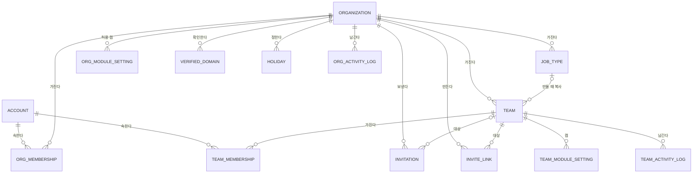

| 개념 | 주요 속성 (개념 수준) |
| --- | --- |
| 계정 | Google `sub`, 확인된 이메일(소문자), 표시 이름, 프로필 사진 주소, 상태, 약관 동의 시각·버전 |
| 조직 | 이름, 한 줄 소개, 공개 범위, 가입 방법 설정, 손님 규칙, 시간대, 상태, 만든 계정 |
| 조직 멤버십 | 계정, 조직, 멤버 종류, 조직 관리자 여부, 상태, 만료 시각(손님), 들어온 경로 |
| 팀 | 조직, 이름, 공개 범위, 팀 가입 방식(승인 필요/바로), 직무 유형에서 복사한 설정, 상태 |
| 팀 멤버십 | 계정, 팀, 팀 역할, 상태, 만료 시각(손님), 들어온 경로 |
| 이메일 초대 | 조직, 팀(구성원은 선택, 손님은 필수), 이메일, 멤버 종류, 팀 역할, 수락 기한, 손님 이용 일수, 상태, 만든 계정, 승인한 계정 |
| 초대 링크 | 조직, 팀, 토큰 해시, 승인 필요 여부, 기본 팀 역할, 만료 시각, 사용 횟수·상한, 켜짐 여부 |
| 확인한 도메인 | 조직, 도메인, 확인 값, 확인 시각, 자동 가입 방식 |

### 4.1 불변식

| ID | 불변식 | 수준 |
| --- | --- | --- |
| TEN-INV-01 | 계정은 Google `sub`로 유일하다. 같은 `sub`로 계정이 둘 생기지 않는다 | 필수 |
| TEN-INV-02 | 팀은 정확히 한 조직에 속하고, 소속 조직은 바뀌지 않는다 | 필수 |
| TEN-INV-03 | 계정 × 조직의 조직 멤버십은 최대 하나다. 계정 × 팀의 팀 멤버십은 최대 하나다 | 필수 |
| TEN-INV-04 | 팀 멤버십이 `ACTIVE`이려면 같은 계정이 그 팀의 조직에 `ACTIVE` 조직 멤버십을 가진다 | 필수 |
| TEN-INV-05 | `ACTIVE`·`ARCHIVED`·`DELETION_SCHEDULED` 조직에는 `ACTIVE` 조직 관리자가 한 명 이상 있다. 예외는 혼자뿐인 조직 관리자가 탈퇴해 보관된 "관리자 없는 보관 조직"(§5.1)뿐이다 | 필수 |
| TEN-INV-06 | `ACTIVE` 팀에는 `ACTIVE` 팀 관리자(`TEAM_ADMIN`)가 한 명 이상 있다 | 필수 |
| TEN-INV-07 | 손님(`GUEST`)은 조직 관리자가 될 수 없고, 팀 역할은 `TEAM_MEMBER` 또는 `VIEWER`만 가진다 | 필수 |
| TEN-INV-08 | 손님의 팀 멤버십은 만료 시각을 반드시 가지며, 만료 시각은 승인 시각(승인이 없으면 만든 시각)으로부터 90일을 넘지 않는다 | 필수 |
| TEN-INV-09 | 손님의 조직 멤버십 만료 시각은 그 손님의 `ACTIVE` 팀 멤버십 만료 시각 중 가장 늦은 값이다 | 필수 |
| TEN-INV-10 | 확인한 도메인은 배포 전체에서 한 조직에만 속한다 | 필수 |
| TEN-INV-11 | 가입 방법(초대, 링크, 요청, 자동 가입)으로 조직 관리자 권한이나 `TEAM_ADMIN` 역할을 줄 수 없다 | 필수 |
| TEN-INV-12 | 조직 소속 데이터는 팀 소속 데이터를 참조하지 않는다. 팀 소속 데이터는 다른 팀의 데이터를 참조하지 않는다 | 필수 |
| TEN-INV-13 | `SINGLE_ORG` 배포에는 `DELETED`가 아닌 조직이 정확히 하나 있다 | 필수 |

| ID | 요구사항 | 수준 |
| --- | --- | --- |
| TEN-INV-20 | TEN-INV-05·06을 깨는 변경(마지막 관리자의 강등, 정지, 내보내기, 나가기, 탈퇴)은 거부한다. 동시에 두 요청이 들어와도 깨지지 않도록 조직·팀 단위로 직렬화하거나 조건부 갱신으로 처리한다 | 필수 |
| TEN-INV-21 | TEN-INV-01·03·10은 DB 유일 제약으로도 보장한다 | 필수 |

## 5. 상태 전이

모든 전이는 활동 기록을 남긴다(§15). "권한 회수"는 해당 범위의 세션 권한 캐시 무효화와 실시간 구독 해제를 뜻한다([architecture/security.md](security.md) §7.3, [architecture/realtime.md](realtime.md) §6.5. 연결에는 `membership.removed`·`org-membership.removed`·`account.suspended` 가운데 맞는 이벤트를 먼저 보낸다).

### 5.1 계정

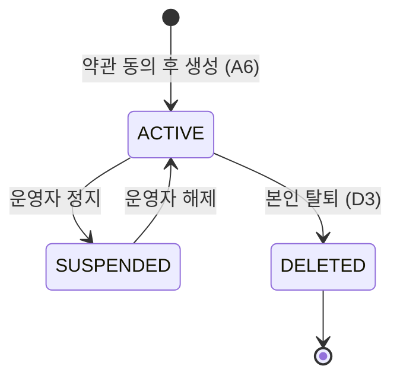

| 전이 | 주체 | 조건 | 부수 효과 |
| --- | --- | --- | --- |
| 생성 → `ACTIVE` | 본인 | `email_verified`, 약관 동의 | 대기 중인 이메일 초대 처리(§6.3) |
| `ACTIVE` → `SUSPENDED` | 운영자 | — | 모든 세션 무효화, 모든 실시간 연결 종료 |
| `SUSPENDED` → `ACTIVE` | 운영자 | — | 없음 (다시 로그인해야 함) |
| `ACTIVE` → `DELETED` | 본인 | 아래 마지막 관리자 규칙을 통과. 최근 인증. 확인 문구 입력 | 모든 멤버십 `LEFT`, 모든 세션 무효화, 개인정보 삭제(이메일, 이름, 사진), `sub`는 해시로 대체, 업무·출석·EXP·활동 기록은 남기고 작성자는 "탈퇴한 사용자"로 표시 |

마지막 관리자 규칙:

| 경우 | 처리 |
| --- | --- |
| 어떤 조직의 유일한 조직 관리자이고, 그 조직에 다른 `ACTIVE` 조직 멤버가 있음 | 탈퇴를 거부한다. 그 조직에서 조직 관리자를 넘긴 뒤 탈퇴한다 |
| 어떤 조직의 유일한 조직 관리자이고, 그 조직의 `ACTIVE` 멤버가 본인뿐 | 조직 이름을 입력해 확인하면, 탈퇴와 같은 트랜잭션에서 그 조직을 `ARCHIVED`로 바꾸고 "관리자 없음"으로 표시한다. 이 조직은 복원할 수 없고, 남은 초대·링크·가입 요청을 모두 무효로 한다. 조직 삭제(v0.3)가 생기면 서버 작업이 삭제 대상으로 다룬다 |
| 어떤 팀의 유일한 팀 관리자이고, 그 팀에 다른 `ACTIVE` 팀 멤버가 있음 | 탈퇴를 거부한다. 그 팀에서 팀 관리자를 넘긴 뒤 탈퇴한다 |
| 어떤 팀의 유일한 팀 관리자이고, 그 팀의 `ACTIVE` 멤버가 본인뿐 | 탈퇴와 같은 트랜잭션에서 그 팀을 `ARCHIVED`로 바꾼다. 조직 관리자는 새 팀 관리자를 정해야 복원할 수 있다 |

- 위 판정과 탈퇴는 TEN-INV-20처럼 조직·팀 단위로 직렬화한다. 판정 뒤 다른 사람이 들어와도 관리자 없는 `ACTIVE` 조직·팀이 생기지 않는다.
- 탈퇴한 계정의 `sub`는 되돌릴 수 없는 해시로 바꾼다([architecture/security.md](security.md) SEC-PRIV-02). 원문 `sub`로는 더 이상 찾을 수 없으므로 같은 Google 계정으로 다시 로그인하면 새 계정이 된다(OQ-46).

### 5.2 조직

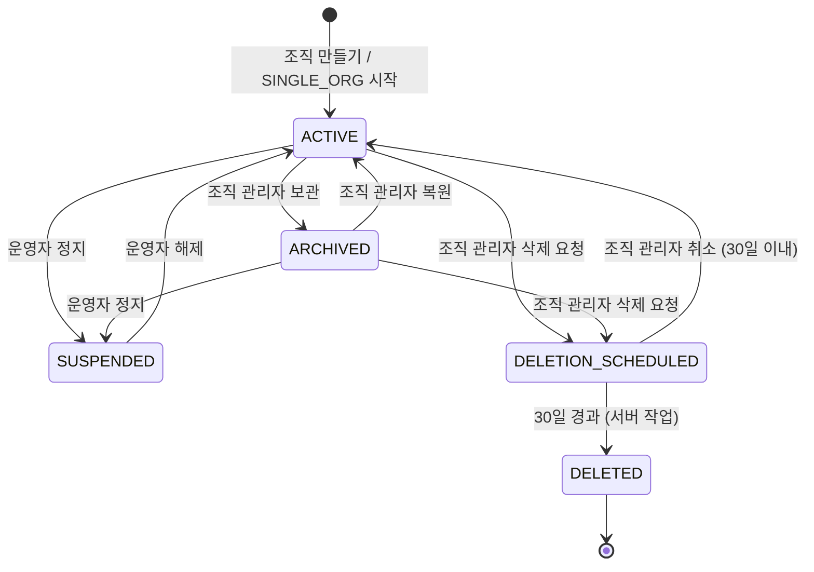

| 상태 | 읽기 | 쓰기 | 새 멤버 | 출석·EXP | 찾기 노출 |
| --- | --- | --- | --- | --- | --- |
| `ACTIVE` | 가능 | 가능 | 가능 | 기록 | 공개면 노출 |
| `ARCHIVED` | 가능 | 불가 | 불가 | 기록 안 함 | 노출 안 함 |
| `SUSPENDED` | 불가 | 불가 | 불가 | 기록 안 함 | 노출 안 함 |
| `DELETION_SCHEDULED` | 가능 | 불가 (취소만) | 불가 | 기록 안 함 | 노출 안 함 |
| `DELETED` | 불가 (데이터 없음) | 불가 | 불가 | — | — |

- `SUSPENDED` 해제는 정지 직전 상태가 아니라 `ACTIVE`로 돌아간다. 보관 중에 정지된 조직은 해제 후 조직 관리자가 다시 보관한다.
- 삭제 요청과 취소는 조직 관리자의 최근 인증이 필요하다. 삭제 요청 시 모든 조직 멤버에게 알린다.
- 조직 삭제와 신고는 v0.3이다. v0.1에는 `ACTIVE`, `ARCHIVED`, `SUSPENDED`만 쓴다.

### 5.3 팀

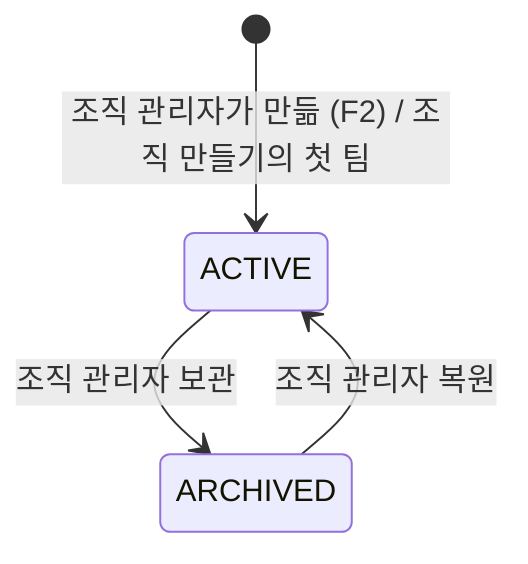

- 팀은 지우지 않는다. 팀 데이터는 조직이 `DELETED`가 될 때만 지운다.
- `ARCHIVED` 팀은 읽기만 된다. 새 멤버십, 업무 쓰기, 출석, EXP 지급이 없다. 실시간 팀·공간 범위는 닫는다.

| ID | 요구사항 | 수준 |
| --- | --- | --- |
| TEN-TEAM-01 | 팀을 만들 때 첫 팀 관리자는 그 조직의 `ACTIVE` 구성원(`MEMBER`)이어야 한다. 손님과 조직 밖 계정은 `400`이다(TEN-INV-07) | 필수 |
| TEN-TEAM-02 | 복원할 때 `ACTIVE` 팀 관리자가 없으면 `newAdminAccountId`가 필수다. 팀 관리자가 있는데 `newAdminAccountId`를 보내면 `400`으로 거부한다. 복원을 관리자를 늘리는 경로로 쓰지 못하게 한다(TEN-INV-06) | 필수 |
| TEN-TEAM-03 | 복원 때 새 팀 관리자는 TEN-TEAM-01과 같은 자격이어야 한다. 그 팀의 `ACTIVE` 멤버면 역할을 `TEAM_ADMIN`으로 올리고, 멤버십이 없으면 `ACTIVE`·`TEAM_ADMIN`으로 넣는다. 그 밖의 상태(`LEFT`, `SUSPENDED` 등)면 `400`이다 | 필수 |
| TEN-TEAM-04 | 이미 보관된 팀의 보관, 이미 `ACTIVE`인 팀의 복원은 `409 ALREADY_PROCESSED`다(API-CON-02). 보관·복원은 팀 행을 잠가 직렬화한다 | 필수 |
| TEN-TEAM-05 | 조직이 `ACTIVE`가 아니면 팀 만들기·보관·복원은 `409 READ_ONLY`다(§5.2) | 필수 |

### 5.4 조직 멤버십

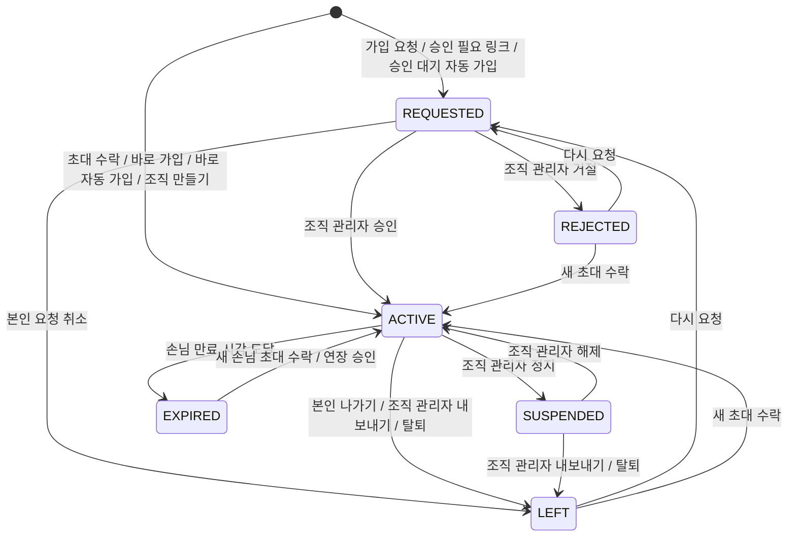

| 전이 | 주체 | 조건 | 부수 효과 |
| --- | --- | --- | --- |
| → `REQUESTED` | 본인 | 공개 조직이며 가입 요청이 켜짐, 또는 승인 필요 링크, 또는 승인 대기 자동 가입 | 조직 관리자에게 알림 |
| `REQUESTED` → `ACTIVE` | 조직 관리자 | 조직 `ACTIVE` | 본인에게 알림. 들어갈 팀·역할을 함께 고르면 팀 멤버십 `ACTIVE` |
| `REQUESTED` → `REJECTED` | 조직 관리자 | — | 본인에게 `join-request.decided` |
| `REQUESTED` → `LEFT` | 본인 | — | 요청 취소. 사유 `SELF`. 대기 중인 팀 요청도 함께 `LEFT` |
| `ACTIVE` → `SUSPENDED` | 조직 관리자 | TEN-INV-05 유지 | 그 조직 범위 권한 회수. 팀 멤버십 상태는 바꾸지 않는다(§10에서 막힘) |
| `SUSPENDED` → `ACTIVE` | 조직 관리자 | — | 팀 멤버십은 정지 전 상태로 다시 유효 |
| `ACTIVE`/`SUSPENDED` → `LEFT` | 본인, 조직 관리자, 탈퇴 | TEN-INV-05 유지 | 그 조직의 모든 팀 멤버십 `LEFT`, 권한 회수. 조직 관리자 여부를 해제 |
| `ACTIVE` → `EXPIRED` | 서버 | 손님, 현재 시각 ≥ 만료 시각 | 모든 팀 멤버십 `EXPIRED`, 권한 회수 |

- 내보내기와 스스로 나가기는 같은 `LEFT` 상태이며, 사유(`SELF`, `REMOVED`, `ACCOUNT_DELETED`)로 구분한다.
- `REJECTED`·`LEFT` 상태에서 자동 가입(§7.7)은 일어나지 않는다. 다시 들어오려면 요청이나 초대가 있어야 한다.

### 5.5 팀 멤버십

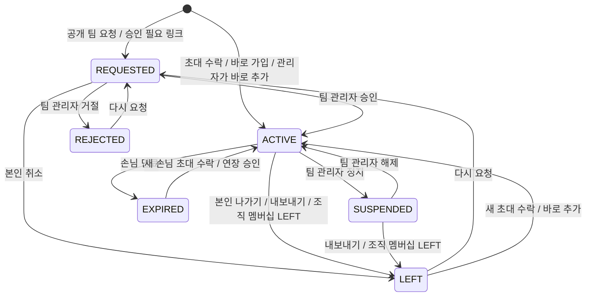

| 전이 | 주체 | 조건 | 부수 효과 |
| --- | --- | --- | --- |
| → `ACTIVE` | 수락자, 팀 관리자, 조직 관리자 | TEN-INV-04, 팀 `ACTIVE` | 팀 범위 알림 `membership` 계열, 활동 기록 |
| `REQUESTED` → `ACTIVE`·`REJECTED` | 팀 관리자, 조직 관리자 | 팀 `ACTIVE` | 본인에게 `join-request.decided` |
| `REQUESTED` → `LEFT` | 본인 | — | 요청 취소. 사유 `SELF` |
| `ACTIVE` → `SUSPENDED` | 팀 관리자, 조직 관리자 | TEN-INV-06 유지 | 그 팀 권한 회수 |
| `ACTIVE`/`SUSPENDED` → `LEFT` | 본인, 팀 관리자, 조직 관리자, 연쇄 | TEN-INV-06 유지 | 그 팀 권한 회수, 그 사람이 담당한 업무는 담당자 없음으로 바꾸지 않고 그대로 둔다 |
| `ACTIVE` → `EXPIRED` | 서버 | 손님, 만료 시각 도달 | 그 팀 권한 회수, 팀 관리자에게 알림 |

- 팀 멤버십의 출석·EXP·업적 기록은 상태가 바뀌어도 지우지 않는다. 다시 `ACTIVE`가 되면 이어진다.

### 5.6 이메일 초대

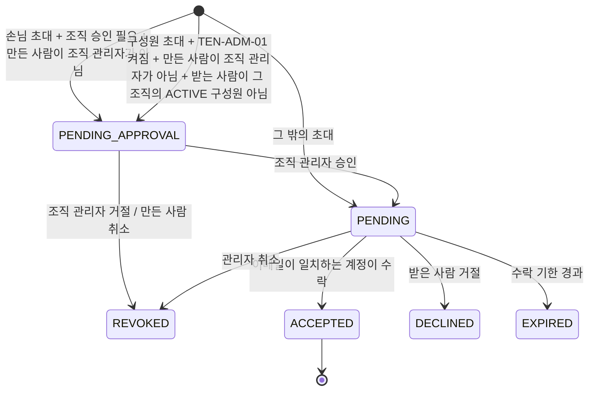

| ID | 요구사항 | 수준 |
| --- | --- | --- |
| TEN-INVT-01 | 초대 이메일은 앞뒤 공백을 지우고 소문자로 저장한다. 수락은 계정의 확인된 이메일(소문자)과 완전히 같을 때만 된다 | 필수 |
| TEN-INVT-02 | 같은 조직·같은 이메일·같은 팀에 `PENDING_APPROVAL` 또는 `PENDING` 초대는 하나만 있다. 새로 만들면 기존 것을 `REVOKED`로 바꾼다 | 필수 |
| TEN-INVT-03 | 수락 기한은 기본 7일, 최대 30일이다(조직 설정) | 필수 |
| TEN-INVT-04 | `PENDING_APPROVAL` 초대는 수락할 수 없고 받은 사람에게 보이지 않는다 | 필수 |
| TEN-INVT-05 | 수락 시점에 조직·팀이 `ACTIVE`가 아니면 수락하지 않고 초대를 `EXPIRED`로 바꾼다 | 필수 |
| TEN-INVT-06 | reberu는 초대 메일을 보내지 않는다(OQ-44). 초대받은 사람에게는 초대한 사람이 직접 알린다 | 필수 |

## 6. 로그인과 계정

### 6.1 로그인 콜백 판정

ID 토큰 검증 세부는 [architecture/security.md](security.md) §6을 따른다.

```mermaid
flowchart TD
    S([Google 콜백]) --> V{ID 토큰 서명·iss·aud·exp·nonce·state 유효?}
    V -- 아니오 --> E1[/A1 로그인 실패. 세션 만들지 않음/]
    V -- 예 --> EV{email_verified = true?}
    EV -- 아니오 --> E1
    EV -- 예 --> F{sub로 계정이 있나?}
    F -- 없음 --> P[가입 대기 세션 생성: sub·이메일·이름·사진만 보관, 계정 없음]
    P --> A6[/A6 약관 동의/]
    A6 -- 동의 안 함 --> E2[/가입 대기 세션 폐기, A1/]
    A6 -- 동의 --> C[계정 생성 ACTIVE]
    C --> BS
    F -- 있음 --> ST{계정 상태}
    ST -- SUSPENDED --> E3[/A1 정지됨. 세션 만들지 않음/]
    ST -- ACTIVE --> U[이메일·이름·사진·Workspace 도메인(hd) 갱신]
    U --> BS{SINGLE_ORG이고 조직 관리자 0명이고 이메일 = 부트스트랩 이메일?}
    BS -- 예 --> B1[부트스트랩: 조직 멤버십 ACTIVE·MEMBER·조직 관리자]
    BS -- 아니오 --> IM
    B1 --> IM[대기 중인 이메일 초대 처리 §6.3]
    IM --> DA{도메인 자동 가입 대상? §7.7}
    DA -- 바로 구성원 --> DA1[조직 멤버십 ACTIVE·MEMBER]
    DA -- 승인 대기 --> DA2[조직 멤버십 REQUESTED]
    DA -- 아님 --> R
    DA1 --> R
    DA2 --> R
    R[세션 번호 새로 발급, 로그인 세션 확정] --> H{첫 화면 결정}
    H -- 방금 수락된 초대가 있음 --> T1[/그 초대의 팀 첫 화면. 팀이 없으면 그 조직의 A3/]
    H -- ACTIVE 팀 멤버십 1개 --> T2[/그 팀 첫 화면/]
    H -- ACTIVE 팀 멤버십 2개 이상 --> T3[/A3/]
    H -- ACTIVE 팀 멤버십 0개 --> T4[/ACTIVE 조직 멤버십이 있으면 A3. 없으면 A0, REQUESTED가 있으면 A2/]
```

| ID | 요구사항 | 수준 |
| --- | --- | --- |
| TEN-AUTH-01 | 계정은 `sub`로만 찾는다. 이메일로 계정을 찾거나 두 계정을 합치지 않는다 | 필수 |
| TEN-AUTH-02 | 약관 동의 전에는 계정을 만들지 않는다. 가입 대기 세션에는 DB 쓰기 권한이 있는 어떤 API도 허용하지 않는다(동의 API 제외) | 필수 |
| TEN-AUTH-03 | 가입 대기 세션은 15분 뒤 사라진다(OQ-47) | 필수 |
| TEN-AUTH-04 | 로그인할 때마다 Google이 준 이메일·이름·사진 주소로 계정 정보를 갱신한다. 표시 이름을 사용자가 바꿨으면 표시 이름은 갱신하지 않는다. 처음 표시 이름은 Google 이름이고 아바타는 기본 아바타이며, 본인이 C5에서 바꾼다 | 필수 |
| TEN-AUTH-05 | 이메일이 바뀐 계정은 바뀐 이메일로만 초대와 맞춰 본다. 이전 이메일로 보낸 초대는 수락되지 않는다 | 필수 |
| TEN-AUTH-06 | 판정 과정의 모든 실패는 사유를 나누지 않는 같은 응답을 돌려준다(정지됨 제외) | 필수 |
| TEN-AUTH-07 | 계정을 만들 때와 로그인할 때마다 ID 토큰의 `hd` 값을 계정의 Workspace 도메인으로 기록한다. 값이 없으면 개인 계정이다(§6.4) | 필수 |

### 6.2 첫 화면 규칙

- "방금 수락된 초대"는 초대 링크로 들어와 이번 로그인 처리에서 `ACCEPTED`가 된 초대다. 이메일 초대는 여기에 들지 않는다(§6.3). 여러 개면 가장 최근에 만든 초대의 팀으로 간다.
- 팀 첫 화면은 그 팀에서 공간 모듈이 켜져 있으면 B1, 꺼져 있으면 B7이다([product/spaces.md](../product/spaces.md)).
- 조직 관리자가 팀 멤버십 없이 조직에만 있으면 A3에서 그 조직의 F1로 갈 수 있다.

| ID | 요구사항 | 수준 |
| --- | --- | --- |
| TEN-HOME-01 | 첫 화면 판정에서 세는 팀 멤버십은 `ACTIVE` 팀 멤버십 가운데 팀이 `ACTIVE`이고, 그 조직의 내 조직 멤버십이 `ACTIVE`이며, 조직이 `SUSPENDED`·`DELETED`가 아닌 것이다. 보관된 팀은 A3 목록에는 보이지만 "팀 하나면 바로 그 팀" 판정에는 들지 않는다 | 필수 |
| TEN-HOME-02 | 세는 팀 멤버십이 0개라도 `ACTIVE` 조직 멤버십이 하나 이상 있으면 A0이 아니라 A3이다. 조직에 들어온 사람에게 조직 만들기 첫 화면을 보이지 않는다 | 필수 |
| TEN-HOME-03 | `GET /api/auth/session`과 `GET /api/me/home`의 `next`는 같은 판정 기준으로 만든다. 세션 확인은 자주 불리므로 `next`만 구하는 가벼운 조회를 쓰고, 두 경로가 같은 값을 내는지 테스트로 확인한다 | 필수 |
| TEN-HOME-04 | A2(`JOIN_PENDING`) 판정에서 세는 가입 요청은 처리될 수 있는 것뿐이다. 조직 요청은 조직이 `ACTIVE`일 때, 팀 요청은 팀과 조직이 모두 `ACTIVE`일 때만 센다 | 필수 |

### 6.3 대기 중인 이메일 초대 처리

| 경우 | 처리 |
| --- | --- |
| 이메일 초대 (계정이 새것이든 아니든) | 자동으로 수락하지 않는다. 확인된 이메일과 일치하는 `PENDING` 초대를 첫 화면의 초대 카드로 보인다. 본인이 [수락]을 누르면 들어간다 |
| 초대 링크로 들어옴 | 사용자가 링크를 직접 열었으므로 로그인 직후 자동으로 처리한다. 링크가 승인 필요면 `REQUESTED`, 아니면 `ACTIVE`(§7) |

- 기준은 "사용자가 직접 행동한 것만 자동으로 처리한다"이다. 남이 내 이메일만 넣은 초대로 원치 않는 조직에 들어가 이름·이메일이 드러나는 것을 막는다.

| ID | 요구사항 | 수준 |
| --- | --- | --- |
| TEN-AUTH-10 | 초대 수락은 하나의 트랜잭션에서 초대 `ACCEPTED`, 조직 멤버십 생성·전이, 팀 멤버십 생성·전이를 함께 한다. 하나라도 실패하면 모두 되돌린다 | 필수 |
| TEN-AUTH-11 | 이미 `ACTIVE`인 조직 멤버십에 구성원 초대가 오면 팀 멤버십만 만든다. 이미 `ACTIVE`인 팀 멤버십이면 초대만 `ACCEPTED`로 바꾸고 역할은 바꾸지 않는다 | 필수 |
| TEN-AUTH-12 | 조직 멤버십이 `SUSPENDED`이면 초대를 수락하지 않는다. 초대는 `PENDING`으로 남는다 | 필수 |
| TEN-AUTH-13 | 구성원인 조직 멤버십에 손님 초대가 오면 멤버 종류를 바꾸지 않고 팀 멤버십만 만든다. 이때 그 팀 멤버십은 만료 시각을 갖지 않는다 | 필수 |
| TEN-AUTH-14 | 손님인 조직 멤버십에 구성원 초대가 오면 수락하지 않는다. 손님을 구성원으로 바꾸는 것은 조직 관리자의 F5 행동으로만 한다 | 필수 |

### 6.4 Google 계정 종류

| 종류 | 판별 | 뜻 |
| --- | --- | --- |
| Workspace 계정 | ID 토큰에 `hd`가 있다 | Google Workspace 도메인에 속한 계정. Google Chat 웹훅을 만들 수 있다 |
| 개인 계정 | `hd`가 없다 (예: `gmail.com`) | 개인 Google 계정. Google Chat 웹훅을 만들 수 없다 |

| ID | 요구사항 | 수준 |
| --- | --- | --- |
| TEN-ACC-01 | 계정 종류는 기능 안내에만 쓴다. 권한 판정, TeamContext 확정, 멤버 종류(구성원/손님) 결정에 쓰지 않는다 | 필수 |
| TEN-ACC-02 | 계정 종류는 로그인할 때마다 다시 판정한다. 사용자가 바꿀 수 없다 | 필수 |
| TEN-ACC-03 | 개인 Google Chat 알림 설정(D2)은 Workspace 계정에게만 보인다. 개인 계정에게는 메뉴가 없다 | 필수 |
| TEN-ACC-04 | 도메인 자동 가입(§7.7)은 계정 종류가 아니라 DNS로 확인한 도메인과 `hd`의 일치로 판정한다 | 필수 |

- 조직도 Workspace 조직과 일반 조직으로 나누지 않는다. 조직은 쓰는 기능(가입 방법, 외부 알림)만 다르고 구조와 권한은 같다.

## 7. 가입 정책

### 7.1 공개 범위

| 대상 | `PRIVATE` (기본) | `PUBLIC` |
| --- | --- | --- |
| 조직 | 조직 찾기(A5)에 나오지 않는다. 존재를 알 수 있는 응답이 없다 | 이름과 한 줄 소개가 조직 찾기에 나온다 |
| 팀 | 그 조직 구성원에게도 팀 목록에 나오지 않는다 | 그 조직 구성원의 팀 목록에 나온다. 손님에게는 나오지 않는다 |

### 7.2 가입 방법

| 방법 | 대상 | 결과 멤버 종류 | 승인 | 기본 |
| --- | --- | --- | --- | --- |
| 이메일 초대 | 조직(+팀) | 초대가 정함 | 손님 초대와 팀 관리자의 새 구성원 초대는 조직 설정에 따라(TEN-ADM-01) | 늘 켜짐 |
| 초대 링크 | 팀 | `MEMBER` | 링크 설정. 팀 관리자 링크의 새 구성원은 TEN-ADM-01 | 꺼짐 |
| 조직 가입 요청 | 공개 조직 | `MEMBER` | 조직 설정(승인 필요/바로) | 꺼짐. 공개로 바꿔도 꺼진 채로 두고 조직 관리자가 F7에서 직접 켠다. 켤 때 기본은 승인 필요 |
| 팀 가입 요청 | 공개 팀 | — (조직 구성원만) | 팀 설정(승인 필요/바로, OQ-52) | 승인 필요 |
| 도메인 자동 가입 | 조직 | `MEMBER` | 조직 설정(바로/승인 대기) | 꺼짐 |

- 도메인 자동 가입은 v0.3에 넣는다. 나머지는 v0.1이다. 단계 계획은 [product/overview.md](../product/overview.md)를 따른다.

| ID | 요구사항 | 수준 |
| --- | --- | --- |
| TEN-JOIN-01 | 꺼진 가입 방법의 API는 404를 돌려준다 | 필수 |
| TEN-JOIN-02 | 어떤 가입 방법도 `TEAM_ADMIN` 역할이나 조직 관리자 권한을 주지 않는다(TEN-INV-11) | 필수 |
| TEN-JOIN-03 | 손님(`GUEST`)은 이메일 초대로만 만들어진다 | 필수 |
| TEN-JOIN-04 | 조직 가입 요청·바로 가입은 조직 멤버십만 만든다. 팀 데이터는 팀 멤버십이 있어야 보인다 | 필수 |
| TEN-JOIN-05 | 가입 방법이나 공개 범위를 바꿔도 이미 있는 멤버십은 바뀌지 않는다 | 필수 |

### 7.3 이메일 초대

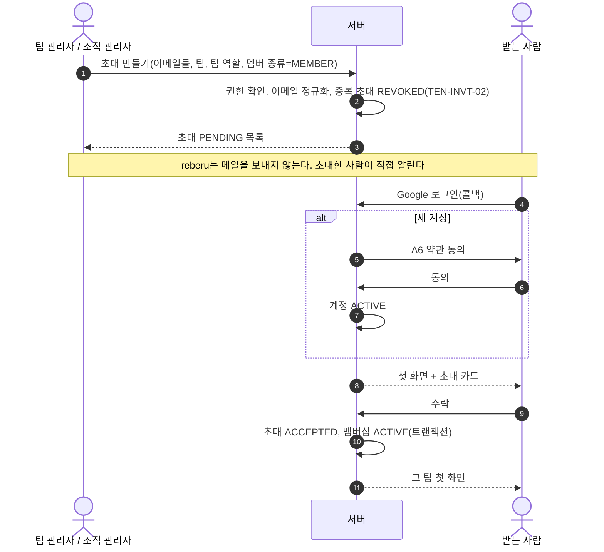

- 구성원 초대에서 팀은 선택이다. 팀이 없으면 조직 멤버십만 만든다.
- 초대를 만들 수 있는 사람: 조직 관리자(모든 팀, 팀 없음), 팀 관리자(자기 팀만).
- 조직 설정 "새 구성원 조직 관리자 확인"(TEN-ADM-01)이 켜져 있으면, 팀 관리자가 그 조직의 `ACTIVE` 구성원이 아닌 사람에게 만든 구성원 초대는 `PENDING_APPROVAL`로 시작한다. 조직 관리자가 F5에서 승인하면 `PENDING`이 되어 받는 사람에게 보인다(TEN-INVT-04). 조직 관리자가 만든 초대는 바로 `PENDING`이다.

### 7.4 초대 링크

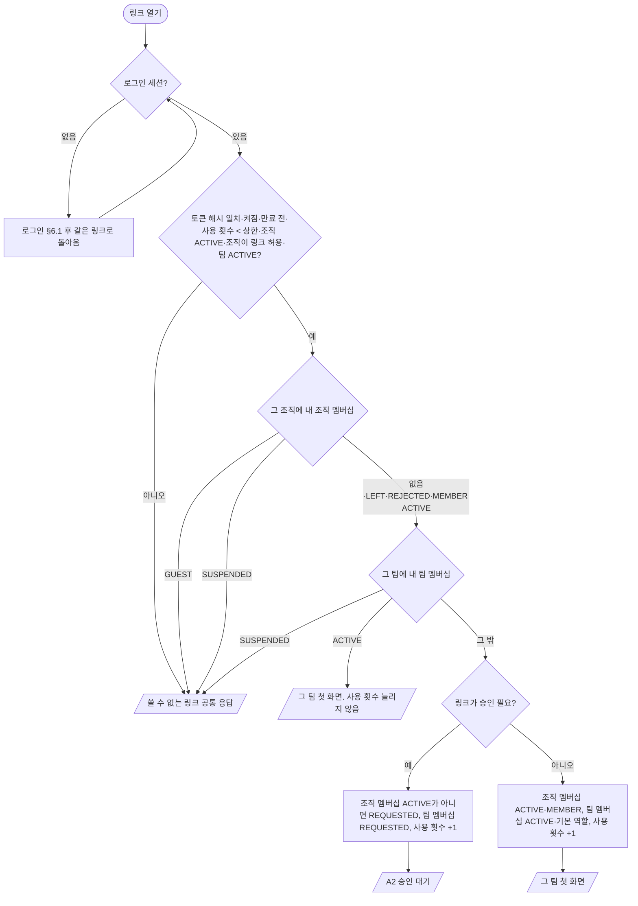

- 승인 필요 링크로 만든 팀 요청은 팀 관리자가 E2에서 처리한다.
- 조직 멤버십을 새로 만들어야 하는 경우(그 조직의 `ACTIVE` 구성원이 아닌 사람)는 링크를 만든 사람과 TEN-ADM-01에 따라 갈린다.

| 링크를 만든 사람 | TEN-ADM-01 | 조직 멤버십 | 팀 멤버십 |
| --- | --- | --- | --- |
| 조직 관리자 | 상관없음 | 승인 필요 링크면 `REQUESTED`(팀 관리자 승인이 조직 멤버십도 `ACTIVE`로 바꿈), 아니면 바로 `ACTIVE` | 링크 설정을 따름 |
| 팀 관리자 | 꺼짐 | 조직 관리자 행과 같음 | 링크 설정을 따름 |
| 팀 관리자 | 켜짐 | 링크 설정과 상관없이 `REQUESTED`. 조직 관리자가 F5에서 승인해야 `ACTIVE` | 조직 멤버십이 `ACTIVE`가 된 뒤 링크 설정을 따름(승인 필요 링크면 이어서 팀 관리자 승인) |

| ID | 요구사항 | 수준 |
| --- | --- | --- |
| TEN-ADM-01 | 조직 설정 "새 구성원 조직 관리자 확인"은 기본 켜짐이다. 켜져 있으면 팀 관리자가 만든 이메일 초대·초대 링크로 조직에 처음 들어오는 사람은 조직 관리자의 승인을 거쳐야 조직 멤버십이 `ACTIVE`가 된다 | 필수 |
| TEN-ADM-02 | TEN-ADM-01을 끄거나 켜는 것은 조직 관리자만 하고 최근 인증이 필요하다. 바꿔도 이미 승인 대기 중인 초대·요청은 그대로 승인을 기다린다 | 필수 |
| TEN-LINK-01 | 사용 횟수 확인과 증가는 원자적으로 한다. 상한이 1인 링크를 두 사람이 동시에 써도 한 사람만 성공한다 | 필수 |
| TEN-LINK-02 | 만료 시각은 필수이며 기본 7일, 만든 시각으로부터 30일을 넘지 않는다. 사용 횟수 상한도 필수다 | 필수 |
| TEN-LINK-03 | 기본 팀 역할은 `TEAM_MEMBER` 또는 `VIEWER`만 고를 수 있다 | 필수 |
| TEN-LINK-04 | 링크 원문은 만들 때 한 번만 응답에 담고 저장하지 않는다 | 필수 |
| TEN-LINK-05 | 실패 사유(없음, 꺼짐, 만료, 상한, 손님, 정지, 조직·팀 상태, 만든 사람의 권한 상실)는 모두 같은 응답이다 | 필수 |
| TEN-LINK-06 | 링크를 만든 사람이 그 팀의 팀 관리자도 조직 관리자도 아니게 되면 그 링크는 쓸 수 없다. 조직이 초대 링크를 끄면 이미 만든 링크도 모두 쓸 수 없다 | 필수 |

### 7.5 가입 요청

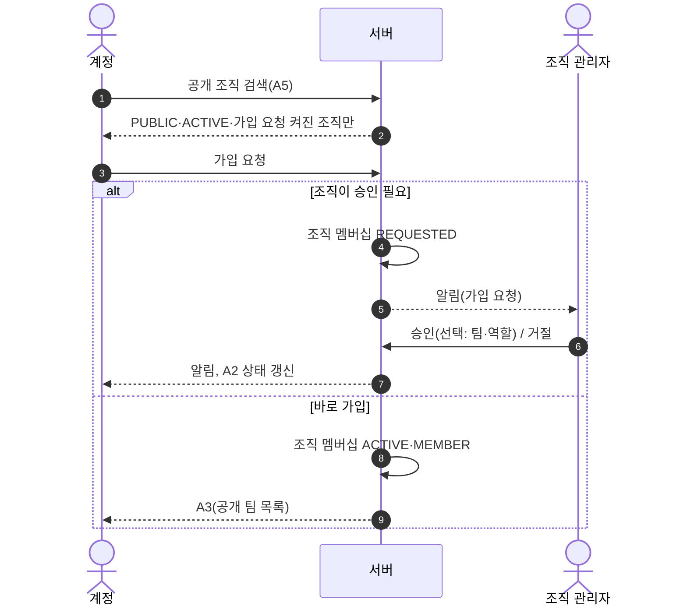

공개 팀 가입:

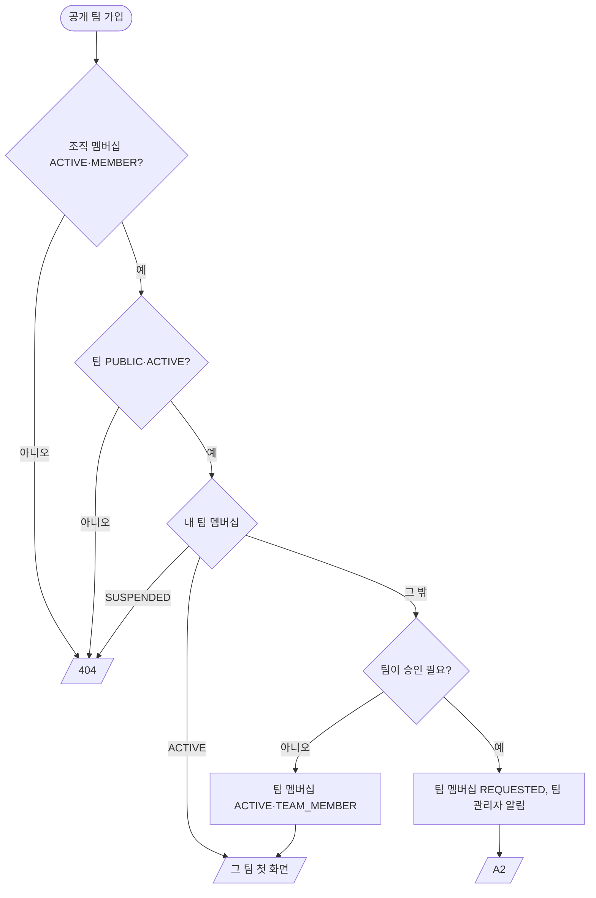

| ID | 요구사항 | 수준 |
| --- | --- | --- |
| TEN-REQ-01 | 같은 계정의 같은 대상에 `REQUESTED`는 하나만 있다 | 필수 |
| TEN-REQ-02 | 거절된 요청은 7일이 지나야 다시 보낼 수 있다(OQ-47). 서버가 거절 시각으로 판정하며, 그 전의 요청은 거부한다 | 필수 |
| TEN-REQ-03 | 요청 개수 제한은 [architecture/security.md](security.md) §13.2을 따른다 | 필수 |

### 7.6 손님 초대

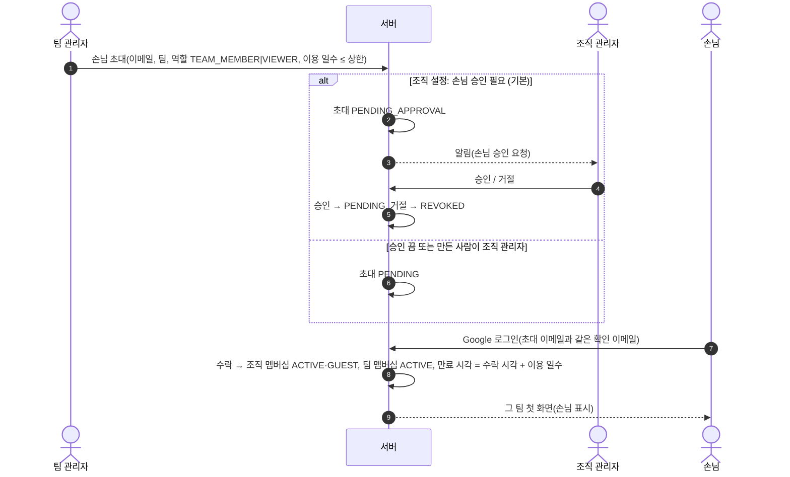

| ID | 요구사항 | 수준 |
| --- | --- | --- |
| TEN-GUEST-01 | 이용 일수는 필수이며 기본 30일, 상한은 조직 설정(기본 90일, 최대 90일)이다 | 필수 |
| TEN-GUEST-02 | 만료 7일 전에 그 팀 관리자와 손님 본인에게 알린다 | 필수 |
| TEN-GUEST-03 | 연장은 손님 초대와 같은 승인 규칙을 거친다. 새 만료 시각은 승인 시각으로부터 90일을 넘지 않는다 | 필수 |
| TEN-GUEST-04 | 만료 판정은 서버 작업을 기다리지 않는다. 요청 처리 시점에 현재 시각 ≥ 만료 시각이면 만료로 본다(§10) | 필수 |
| TEN-GUEST-05 | 손님에게는 그 팀 데이터만 보인다. 다른 팀 이름, 조직 멤버 목록, 조직 활동 기록, 공개 팀 목록이 보이지 않는다 | 필수 |
| TEN-GUEST-06 | 손님은 조직 설정으로 허용할 때만 조직 공간(조직 범위 모듈)에 들어간다(기본 꺼짐) | 필수 |
| TEN-GUEST-07 | 손님을 구성원으로 바꾸는 것은 조직 관리자만 하며, 바꾸면 팀 멤버십의 만료 시각을 지운다 | 필수 |
| TEN-GUEST-08 | 동료 화면과 목록에 손님 표시를 붙인다 | 필수 |

### 7.7 도메인 자동 가입 (v0.3)

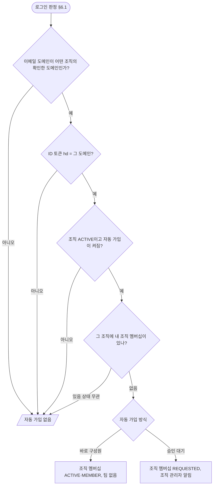

| ID | 요구사항 | 수준 |
| --- | --- | --- |
| TEN-DOM-01 | `MULTI_ORG`에서 도메인은 DNS TXT 확인을 마친 뒤에만 자동 가입에 쓴다([architecture/security.md](security.md) §11) | 필수 |
| TEN-DOM-02 | `SINGLE_ORG`의 자동 가입 도메인은 환경 변수로 정하고 DNS 확인을 하지 않는다 | 필수 |
| TEN-DOM-03 | 자동 가입은 그 조직에 조직 멤버십이 한 번도 없던 계정에만 일어난다. 나간 사람, 거절된 사람, 정지된 사람을 다시 넣지 않는다 | 필수 |
| TEN-DOM-04 | 자동 가입은 팀 멤버십을 만들지 않는다 | 필수 |

## 8. 조직 만들기와 부트스트랩

### 8.1 조직 만들기 (`MULTI_ORG`)

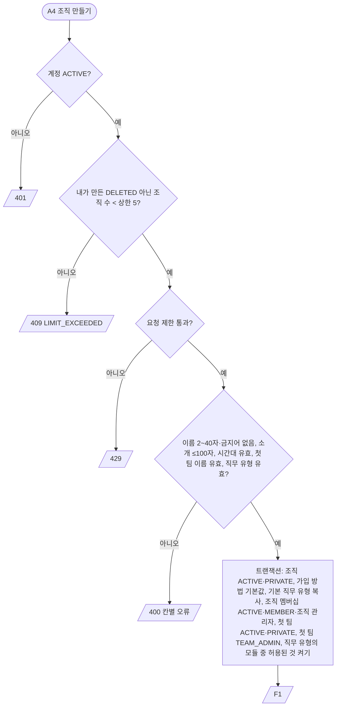

| ID | 요구사항 | 수준 |
| --- | --- | --- |
| TEN-ORG-01 | 새 조직 기본값은 가장 닫힌 쪽이다: `PRIVATE`, 이메일 초대 켜짐, 초대 링크 꺼짐, 가입 요청 꺼짐, 도메인 자동 가입 꺼짐, 새 구성원 조직 관리자 확인 켜짐(TEN-ADM-01), 손님 승인 필요 켜짐, 손님 이용 일수 상한 90일, 손님 조직 공간 출입 꺼짐. 조직 관리자가 F7에서 연다 | 필수 |
| TEN-ORG-02 | 조직 이름은 배포 안에서 유일하지 않아도 된다. 조직은 이름이 아니라 식별자로 구별한다 | 필수 |
| TEN-ORG-03 | 조직 만들기는 하나의 트랜잭션이다. 중간에 실패하면 조직이 남지 않는다 | 필수 |
| TEN-ORG-04 | 새 조직에 허용되는 모듈의 기본값은 배포에 설치된 `BUNDLED` 모듈 전체다. `EXTENSION` 모듈은 조직 관리자가 F4에서 허용해야 한다 | 필수 |

### 8.2 부트스트랩 (`SINGLE_ORG`)

| 순서 | 처리 |
| --- | --- |
| 서버 시작 | `DELETED`가 아닌 조직이 없으면 환경 변수의 조직 이름·시간대로 조직을 만든다. 하나 있으면 아무것도 하지 않는다. 둘 이상이면 시작을 멈춘다(TEN-MODE-03) |
| 첫 관리자 | 로그인 판정에서 조직의 `ACTIVE` 조직 관리자가 0명이고 계정의 확인된 이메일이 부트스트랩 이메일과 같을 때만 그 계정을 조직 관리자로 만든다 |
| 이후 | 조직 관리자가 한 명이라도 있으면 부트스트랩 이메일은 아무 효과가 없다 |

| ID | 요구사항 | 수준 |
| --- | --- | --- |
| TEN-BOOT-01 | 부트스트랩은 "조직 관리자 0명" 조건과 "이메일 일치" 조건을 같은 트랜잭션 안에서 확인하고 적용한다. 조직 행을 잠가 동시 로그인 둘이 모두 관리자가 되지 않게 한다. 시작 때 만드는 조직은 고정 ID를 써서, 동시에 뜬 서버가 조직을 둘 만들지 못한다 | 필수 |
| TEN-BOOT-02 | 부트스트랩 적용은 조직 활동 기록에 남는다 | 필수 |

### 8.3 조직 설정과 보관

| ID | 요구사항 | 수준 |
| --- | --- | --- |
| TEN-SET-01 | 설정 고치기는 보낸 필드만 바꾸고 `version`은 필수다. 조직 행을 잠근 뒤 `version`이 다르면 `409 VERSION_CONFLICT`다. 바뀐 값이 없으면 `version`을 올리지 않고 활동 기록도 남기지 않는다 | 필수 |
| TEN-SET-02 | 값 범위: 이름은 조직 만들기와 같은 규칙, 한 줄 소개는 공백뿐이면 지운다, 시간대는 IANA 이름, 손님 이용 일수 상한은 1~90일, 손님 기본 일수는 1일부터 상한까지, 초대 수락 기한은 1~30일(TEN-INVT-03) | 필수 |
| TEN-SET-03 | 가입 요청(`joinRequestMode`)은 `PUBLIC`일 때만 켤 수 있다. `PRIVATE`인데 켜려 하면 `400`이고, `PRIVATE`로 바꾸면 `OFF`로 되돌린다. 이미 들어온 요청은 그대로 둔다(TEN-JOIN-05) | 필수 |
| TEN-SET-04 | 설정 변경 활동 기록(`ORG_SETTINGS_CHANGED`)의 바뀌기 전·후 값은 바뀐 항목만 `항목=값`을 `;`로 이어 쓴다. 이름과 한 줄 소개는 사용자가 쓴 글이라 값 없이 항목 이름만 남긴다(TEN-LOG-03) | 필수 |
| TEN-SET-05 | 조직 보관은 `ACTIVE`에서만 된다. 이미 보관됐으면 `409 ALREADY_PROCESSED`, 그 밖의 상태면 `409 READ_ONLY`다. 보관하면서 그 조직의 `REQUESTED` 조직·팀 멤버십을 `REJECTED`로 바꾸고 하나씩 활동 기록에 남긴다. 팀 상태는 바꾸지 않는다(조직이 `ACTIVE`가 아니면 쓰기가 막힌다) | 필수 |
| TEN-SET-06 | 조직 복원은 `ARCHIVED`에서만 된다. 이미 `ACTIVE`면 `409 ALREADY_PROCESSED`, 관리자 없는 보관 조직(`ownerless`)은 `404`다. 보관·복원·설정 고치기는 조직 행을 잠가 직렬화한다 | 필수 |

### 8.4 팀 설정

| ID | 요구사항 | 수준 |
| --- | --- | --- |
| TEN-TSET-01 | 팀 설정 고치기는 이름, 공개 범위, 가입 방식, 리포트 주 시작 요일, 공지 칸 제목만 받는다. 보낸 필드만 바꾸고 `version`이 필수다. 팀 행을 잠근 뒤 `version`이 다르면 `409 VERSION_CONFLICT`, 바뀐 값이 없으면 `version`과 활동 기록이 그대로다(TEN-SET-01과 같은 방식). 편집 마감(OQ-14)은 정해지기 전까지 받지 않는다 | 필수 |
| TEN-TSET-02 | 값 범위: 이름은 팀 만들기와 같은 규칙과 이름 키 유일(DB 유일 제약 위반만 `DUPLICATE`), 주 시작 요일은 1~7, 공지 칸 제목은 직무 유형 기본값과 같은 규칙(TEN-JOB-05). 비공개로 바꿔도 이미 들어온 팀 가입 요청은 그대로 둔다(TEN-SET-03과 같음) | 필수 |
| TEN-TSET-03 | 활동 기록 `TEAM_SETTINGS_CHANGED`의 바뀌기 전·후 값은 바뀐 항목만 `항목=값`을 `;`로 이어 쓰고, 이름과 공지 칸 제목은 사용자가 쓴 글이라 항목 이름만 남긴다(TEN-SET-04와 같음) | 필수 |
| TEN-TSET-04 | 업무 구분 라벨은 이름 30자, 팀 안에서 이름 키로 유일, 숨긴 것을 포함해 팀당 50개까지다. 추가 항목은 대상(`TASK`·`PROJECT`), 종류(`TEXT`·`MEMO`), 이름 40자, 같은 대상 안에서 이름 키로 유일, 대상마다 20개까지다. 넘으면 `409 LIMIT_EXCEEDED`이고, 팀 행을 잠가 동시 요청에도 지킨다 | 필수 |
| TEN-TSET-05 | 라벨·추가 항목은 지우지 않고 숨긴다. 고치기는 이름·순서(0~9999)·숨김(추가 항목은 필수 여부도)만 받고 `version`이 필수다. 대상과 종류는 바꾸지 않는다. 새로 만들면 같은 묶음의 마지막 순서 다음에 놓는다. 목록은 순서, 만든 시각, ID 순이다 | 필수 |
| TEN-TSET-06 | 라벨·추가 항목 목록은 팀 멤버 누구나 보지만 숨긴 것은 팀 관리자·조직 관리자가 `includeHidden=true`로 물을 때만 보인다. 활동 기록은 `TEAM_LABEL_CREATED`·`TEAM_LABEL_CHANGED`·`TEAM_FIELD_CREATED`·`TEAM_FIELD_CHANGED`이고, 바뀐 이름의 값은 남기지 않는다 | 필수 |
| TEN-TSET-07 | 팀 개요의 손님 만료 임박은 그 팀 `ACTIVE` 팀 멤버십 중 만료 시각이 지금부터 7일 안인 수다 | 필수 |

## 9. 역할과 권한

### 9.1 원칙

- 조직 관리자는 그 조직의 모든 팀에서 팀 관리자와 같은 관리 권한을 가진다. 팀 멤버십이 없으면 그 팀의 출석·EXP·업적·공간·담당 업무가 없다.
- 손님은 자기 팀 역할(`TEAM_MEMBER`/`VIEWER`)의 권한에서 손님 제한(TEN-GUEST-05·06)을 뺀 권한을 가진다.
- 운영자는 조직 상태만 바꾼다. 조직·팀의 데이터를 읽지 않는다. 운영자 계정은 배포 설정의 환경 변수로 정한다.
- 모듈 권한은 모듈이 등록하며, 아래 표는 고정 기능만 다룬다.

### 9.2 권한 표

○ 허용, △ 조건부(비고), 빈칸 불가.

| 행동 | 운영자 | 조직 관리자 | 팀 관리자 | 팀원 | 읽기 전용 | 비고 |
| --- | --- | --- | --- | --- | --- | --- |
| 조직 정지·해제 | ○ | | | | | |
| 조직 설정(공개 범위, 가입 방법, 손님 규칙, 시간대) | | ○ | | | | 최근 인증 |
| 조직 보관·복원·삭제 요청 | | ○ | | | | 최근 인증 |
| 직무 유형 관리, 허용 모듈, 휴일 달력 | | ○ | | | | |
| 팀 만들기·보관·복원 | | ○ | | | | |
| 조직 관리자 지정·해제 | | ○ | | | | 최근 인증, TEN-INV-05 |
| 조직 멤버십 승인·거절·정지·내보내기 | | ○ | | | | 팀 관리자 링크로 들어온 새 구성원 확인 포함(TEN-ADM-01) |
| 손님 초대 승인·연장 승인·구성원 전환 | | ○ | | | | |
| 팀 관리자가 만든 새 구성원 초대 승인·거절 | | ○ | | | | TEN-ADM-01 |
| 조직 활동 기록 보기 | | ○ | | | | |
| 이메일 초대(구성원) 만들기 | | ○ | △ | | | 팀 관리자는 자기 팀 |
| 손님 초대 만들기 | | ○ | △ | | | 팀 관리자는 자기 팀 |
| 초대 링크 만들기·끄기 | | ○ | △ | | | 팀 관리자는 자기 팀. 조직이 초대 링크를 허용할 때만(기본 꺼짐) |
| 팀 가입 요청 승인·거절 | | ○ | ○ | | | |
| 팀 역할 바꾸기, 팀 멤버십 정지·내보내기 | | ○ | ○ | | | `TEAM_ADMIN` 부여 포함, TEN-INV-06 |
| 팀 설정, 팀 기능(모듈) 켜고 끄기 | | ○ | ○ | | | 조직이 허용한 모듈만 |
| 팀 활동 기록 보기 | | ○ | ○ | | | |
| 팀 데이터 보기 | | ○ | ○ | ○ | ○ | |
| 업무 만들기 | | ○ | ○ | △ | | 팀원은 담당자를 자기로만 |
| 업무 고치기·지우기·상태 바꾸기 | | ○ | ○ | △ | | 팀원은 자기가 담당자인 업무 |
| 프로젝트 만들기·고치기·보관 | | ○ | ○ | | | |
| 리포트 공지 칸 쓰기 | | ○ | ○ | ○ | | 편집 마감 전 |
| 오늘의 할 일, 출석, 현재 상태 | | | ○ | ○ | ○ | 팀 멤버십이 있어야 함 |
| 공개 팀 가입 요청 | | ○ | ○ | ○ | ○ | 구성원(`MEMBER`)만 |
| 팀·조직 스스로 나가기 | | △ | △ | ○ | ○ | 마지막 관리자는 불가 |

| ID | 요구사항 | 수준 |
| --- | --- | --- |
| TEN-PERM-01 | 위 표는 서버에서 강제한다. 화면의 버튼 숨김은 보조일 뿐이다 | 필수 |
| TEN-PERM-02 | 표의 모든 칸(허용·불가)은 역할별 테스트로 확인한다 | 필수 |
| TEN-PERM-03 | 업무 담당자는 그 팀의 `ACTIVE` 팀 멤버십을 가진 계정만 될 수 있다. 읽기 전용(`VIEWER`)도 담당자가 될 수 없다 | 필수 |
| TEN-PERM-04 | 조직 관리자가 팀 화면을 열람한 사실은 팀원에게 보이지 않고 조직 활동 기록에 남는다 | 필수 |
| TEN-PERM-05 | TEN-PERM-04의 기록은 팀 멤버십 없이 조직 관리자로 `GET /api/teams/{teamId}`를 부를 때 `ORG_ADMIN_VIEWED_TEAM`으로 남긴다. 기록이 넘치지 않게 같은 관리자·같은 팀은 1시간에 한 번만 남긴다 | 필수 |

## 10. 지금 팀 확정

팀 데이터 API(`/api/teams/{teamId}/...`)는 모든 처리 전에 아래 순서로 지금 팀(`TeamContext`)을 확정한다. 조직 데이터 API(`/api/orgs/{orgId}/...`)는 1~4단계만 거친다(조직 컨텍스트).

| 순서 | 확인 | 실패 응답 |
| --- | --- | --- |
| 1 | 로그인 세션이 있고 계정이 `ACTIVE` | 401 |
| 2 | 경로의 `teamId`로 팀을 찾고, 그 팀의 조직을 서버가 정한다(사용자가 보낸 조직 값은 쓰지 않는다) | 404 |
| 3 | 조직 상태가 `ACTIVE`, `ARCHIVED`, `DELETION_SCHEDULED` 중 하나 | 404 |
| 4 | 그 조직에 `ACTIVE` 조직 멤버십이 있고, 손님이면 만료 시각 전 | 404 |
| 5 | 팀 멤버십이 `ACTIVE`이고 손님이면 만료 시각 전, 또는 4단계의 멤버십이 조직 관리자 | 404 |
| 6 | 손님이면 TEN-GUEST-05 범위 안의 자원인지 | 404 |
| 7 | 요청한 기능이 모듈이면 그 모듈이 이 팀(또는 조직)에서 켜져 있음 | 404 |
| 8 | 자원이 이 팀 소속인지(자원 조회는 늘 팀 식별자와 함께, §11.2) | 404 |
| 9 | 쓰기 요청이면 팀이 `ACTIVE`이고 조직이 `ACTIVE` | 409 `READ_ONLY` |
| 10 | 권한 표(§9.2)와 업무 규칙 | 403 `FORBIDDEN_ACTION` (볼 수 있는 자원에 대한 쓰기 권한 부족) |

| ID | 요구사항 | 수준 |
| --- | --- | --- |
| TEN-CTX-01 | 1~8단계의 실패는 모두 같은 404 응답이다. 응답 본문과 응답 시간으로 실패 단계를 구별할 수 없어야 한다 | 필수 |
| TEN-CTX-02 | 지금 팀은 요청마다 서버가 다시 확정한다. 이전 요청의 결과나 사용자가 보낸 역할·조직·팀 값을 믿지 않는다 | 필수 |
| TEN-CTX-03 | 멤버십·역할·모듈 상태를 캐시하면, 상태가 바뀌는 즉시 캐시를 무효화한다. 무효화 전까지 옛 권한이 쓰이는 시간은 0이어야 한다(쓰기 전에 무효화) | 필수 |
| TEN-CTX-04 | 모듈 코드는 확정된 지금 팀만 받는다. 모듈이 스스로 팀을 찾지 않는다 | 필수 |
| TEN-CTX-05 | CSRF 실패(403), 최근 인증 필요(401 `REAUTH_REQUIRED`), 요청 제한(429)은 [architecture/security.md](security.md)를 따르며 1단계 전에 판정한다 | 필수 |
| TEN-CTX-06 | 모든 `/api` 컨트롤러 메서드는 권한 수준 하나를 선언한다: `PUBLIC`, `SIGNUP_PENDING`, `ACCOUNT`(경로에 조직·팀 없음), `ORG_MEMBER`·`ORG_ADMIN`(`{orgId}` 경로, 1~4단계), `TEAM_VIEWER`·`TEAM_MEMBER`·`TEAM_ADMIN`(`{teamId}` 경로, 1~6단계). 쓰기 API는 쓰기 표시를 함께 단다(9단계). 판정은 요청 본문을 읽기 전에 한다 | 필수 |
| TEN-CTX-07 | 조직 수준에서 손님은 4단계에서 `404`다(TEN-GUEST-05). 예외는 [architecture/api.md](api.md) 표에 "손님 가능"으로 적은 `ORG_MEMBER` API뿐이며, 권한 선언에 손님 허용(`guestAllowed`)을 함께 단다. 손님 허용은 `ORG_MEMBER`의 읽기 API에만 달 수 있고(쓰기 표시와 함께 쓸 수 없다), 어기면 서버가 시작하지 않는다. 조직 구성원이 `ORG_ADMIN` API를, 팀 멤버가 자기 역할보다 높은 팀 API를 부르면 볼 수 있는 대상이므로 10단계 `403 FORBIDDEN_ACTION`이다 | 필수 |
| TEN-CTX-08 | 조직 경로 아래 팀 자원(`/api/orgs/{orgId}/teams/{teamId}/...`)은 조직 컨텍스트를 확정한 뒤 "조직 식별자 + 팀 식별자"로 찾는다. 다른 조직의 팀이면 `404`다 | 필수 |

## 11. 데이터 소속과 격리

### 11.1 소속

| 계정에 속함 | 조직에 속함 | 팀에 속함 |
| --- | --- | --- |
| 표시 이름, 이메일, 프로필 사진 주소, 기본 아바타, 약관 동의, 알림 설정, 방해 금지 시간 | 조직 설정, 가입 방법, 확인한 도메인, 직무 유형, 허용·켠 모듈, 시간대, 휴일 달력, 조직 멤버십, 이메일 초대, 조직 공간 설정, 조직 활동 기록 | 팀 설정, 팀 멤버십, 초대 링크, 업무, 프로젝트, 오늘의 할 일, 퀘스트, 리포트, 출석, EXP·레벨·시즌 기록, 업적, 칭찬, 휴식 기록, 산길 거리·남긴 말, 알림, 팀 활동 기록, 아바타·책상 꾸미기, 켠 모듈 |

- 공간 위치, 라운지 채팅(OQ-10)은 서버 메모리에만 둔다([architecture/realtime.md](realtime.md)).
- 알림은 팀에 속한다. 조직 범위 알림(조직 가입 요청, 초대 승인 대기 등)은 조직에 속한다.

### 11.2 격리 규칙

| ID | 요구사항 | 수준 |
| --- | --- | --- |
| TEN-ISO-01 | 팀 데이터 API 경로에는 팀 식별자가, 조직 데이터 API 경로에는 조직 식별자가 들어간다 | 필수 |
| TEN-ISO-02 | 팀 소속 자원은 늘 "팀 식별자 + 자원 식별자"로 조회한다. 자원 식별자만으로 조회하는 코드 경로를 두지 않는다 | 필수 |
| TEN-ISO-03 | 다른 조직·팀 자원, 볼 수 없는 자원은 404로 응답한다(ADR-0006) | 필수 |
| TEN-ISO-04 | 저장할 때 팀 소속 자원이 가리키는 모든 자원(프로젝트, 담당자, 참석자, 라벨 등)이 같은 팀 소속인지 확인한다 | 필수 |
| TEN-ISO-05 | 여러 팀 사람이 함께하는 기능(조직 공간의 광장·연회장)은 조직 소속 데이터로만 만든다. 조직 소속 데이터는 팀 소속 자원을 가리키지 않는다(TEN-INV-12) | 필수 |
| TEN-ISO-06 | 조직 공간에서 다른 팀 사람에게는 계정 정보(표시 이름, 기본 아바타)와 현재 상태, 팀 이름만 보인다(OQ-21) | 필수 |
| TEN-ISO-07 | 정해진 시각에 도는 작업(마감 알림, 시즌 마감, 손님 만료, 삭제 예약)은 조직·팀 단위로 나눠 처리하고, 한 단위의 실패가 다른 단위를 멈추지 않는다 | 필수 |
| TEN-ISO-08 | 캐시 키, 로그, 실시간 주소에는 조직·팀 식별자를 넣는다 | 필수 |
| TEN-ISO-09 | 외부에 노출하는 식별자는 추측하기 어려운 값(예: UUID)으로 한다 | 권장 |
| TEN-ISO-10 | 검색·목록 API는 결과를 지금 팀(또는 지금 조직)으로 거른 뒤 정렬·페이지를 적용한다 | 필수 |

### 11.3 격리 검증 데이터

| 계정 | 파도 조직 | 구름 조직 |
| --- | --- | --- |
| 다온 | `MEMBER`. 바다팀 `TEAM_ADMIN`, 숲팀 `TEAM_MEMBER` | 없음 |
| 하늘 | `MEMBER`. 바다팀 `VIEWER` | `MEMBER`. 바다팀 `TEAM_MEMBER` |
| 새봄 | `GUEST`. 숲팀 `TEAM_MEMBER`, 만료 시각 있음 | 조직 관리자, 바다팀 `TEAM_ADMIN` |
| 도윤 | 조직 관리자, 팀 멤버십 없음 | 없음 |
| 이슬 | 없음 | 없음 (계정만 있음) |

- 두 조직 모두 "바다팀"이라는 같은 이름의 팀을 가진다. 이름으로 팀을 찾는 경로가 섞이지 않는지 확인하기 위해서다.
- 숲팀은 `PRIVATE`, 파도 조직의 바다팀은 `PUBLIC`이다.

| ID | 테스트 | 수준 |
| --- | --- | --- |
| TEN-TST-01 | 모든 팀 데이터 API에서 다온이 구름 조직 바다팀의 식별자로 부르면 404 | 필수 |
| TEN-TST-02 | 하늘이 파도 조직 숲팀(`PRIVATE`, 멤버십 없음) 자원을 부르면 404 | 필수 |
| TEN-TST-03 | 새봄이 파도 조직의 숲팀 밖 자원(바다팀, 조직 멤버 목록, 공개 팀 목록, 조직 활동 기록)을 부르면 404 | 필수 |
| TEN-TST-04 | 새봄의 만료 시각을 지난 시각으로 바꾸면 서버 작업 실행 전에도 숲팀 API가 404 | 필수 |
| TEN-TST-05 | 도윤은 파도 조직 두 팀의 관리 API에 접근하지만 출석·할 일·업무 담당 API는 거부(404 또는 403) | 필수 |
| TEN-TST-06 | 하늘(`VIEWER`)의 파도 바다팀 쓰기 요청은 403, 구름 바다팀 쓰기 요청은 성공 | 필수 |
| TEN-TST-07 | 다온의 요청 본문에 `teamId`, `orgId`, `role`, `orgAdmin`을 끼워 넣어도 무시된다 | 필수 |
| TEN-TST-08 | 다온이 바다팀 업무의 프로젝트로 숲팀 프로젝트를 지정하면 거부 | 필수 |
| TEN-TST-09 | 이 표의 모든 테스트(TEN-TST-01~08, 10~17)를 PostgreSQL, MySQL, MariaDB에서 모두 통과한다(§11.4) | 필수 |
| TEN-TST-10 | 이슬이 비공개 조직 이름으로 검색하면 결과가 없고, 존재하는 비공개 조직과 없는 조직에 대한 모든 응답이 같다 | 필수 |
| TEN-TST-11 | 꺼진 모듈의 API가 404 | 필수 |
| TEN-TST-12 | 초대 링크로 손님(새봄)이 파도 조직에 들어오지 못하고, 손님이 구성원 초대를 수락하지 못한다 | 필수 |
| TEN-TST-13 | 부트스트랩 이메일이 조직 관리자가 있을 때는 효과가 없다(`SINGLE_ORG`) | 필수 |
| TEN-TST-14 | 마지막 팀 관리자·조직 관리자의 강등·정지·나가기·탈퇴가 거부되고, 동시 요청 두 개로도 0명이 되지 않는다 | 필수 |
| TEN-TST-15 | TEN-ADM-01이 켜진 파도 조직에서 다온(바다팀 `TEAM_ADMIN`)이 만든 이메일 초대·초대 링크로 이슬이 조직 관리자 승인 없이 `ACTIVE`가 되지 않는다. 도윤(조직 관리자)이 만든 초대는 바로 수락된다 | 필수 |
| TEN-TST-16 | 혼자뿐인 조직의 조직 관리자가 탈퇴하면 그 조직이 `ARCHIVED`·관리자 없음이 되고, 복원·초대·링크·가입 요청이 모두 거부된다 | 필수 |
| TEN-TST-17 | 초대 링크를 만든 팀 관리자가 강등되면 그 링크가 공통 실패 응답을 돌려준다(TEN-LINK-06) | 필수 |

### 11.4 DB 격리 방식과 이식성

DB 하나에 모든 조직이 테이블을 함께 쓴다. 조직마다 DB·스키마를 두지 않는다. 지원 DB는 PostgreSQL 기준, MySQL·MariaDB 호환이다([ADR-0013](../adr/0013-shared-db-portable-sql.md)).

| 쓰는 곳 | DB |
| --- | --- |
| 공개 서비스 (`MULTI_ORG`) | 공유 DB 하나. 관리형 PostgreSQL로 시작한다 |
| 단체가 자기 서버에 띄운 배포 (`SINGLE_ORG`) | 그 단체의 DB(PostgreSQL, MySQL, MariaDB 중 하나) |

| ID | 요구사항 | 수준 |
| --- | --- | --- |
| TEN-DB-01 | 마이그레이션과 쿼리는 PostgreSQL, MySQL, MariaDB에서 같게 동작하는 문법만 쓴다. 공통 문법이 없는 곳만 Flyway DB별 위치에 따로 둔다 | 필수 |
| TEN-DB-02 | DB 전용 기능을 쓰지 않는다: RLS, `jsonb`·배열 타입, `ENUM` 타입, `ON CONFLICT`·`ON DUPLICATE KEY`, 부분 인덱스, DB 전문 검색, DB 시퀀스·자동 증가 ID | 필수 |
| TEN-DB-03 | 격리는 DB가 아니라 앱(§10 TeamContext, §11.2)이 지킨다. DB 기능에 격리를 맡기지 않는다 | 필수 |
| TEN-DB-04 | 문자 집합은 `utf8mb4`, 정렬 규칙은 대소문자를 구분하는 바이너리 정렬로 고정한다(MySQL·MariaDB). 비교·유일 제약이 세 DB에서 같게 동작해야 한다 | 필수 |
| TEN-DB-05 | 대소문자를 무시해야 하는 값(이메일, 도메인)은 앱에서 소문자로 맞춰 저장하고 그대로 비교한다 | 필수 |
| TEN-DB-06 | 시각은 모두 UTC로 저장한다. 시간대 정보를 가진 DB 타입을 쓰지 않는다. 조직 시간대 변환은 앱에서 한다 | 필수 |
| TEN-DB-07 | 트랜잭션 격리 수준을 앱에서 READ COMMITTED로 명시한다. 한 번만 일어나야 하는 일(하루 한 번 출석, EXP 한 번 지급, 초대 한 번 수락)은 유일 제약으로 보장하고, 위반은 "이미 처리됨"으로 다룬다 | 필수 |
| TEN-DB-08 | ID는 앱에서 만든 UUID(v7)다. 저장 타입은 도메인 모델에서 정하되 세 DB에서 같은 값으로 옮길 수 있어야 한다 | 필수 |
| TEN-DB-09 | 테이블·컬럼 이름은 소문자 `snake_case`이고 세 DB의 예약어(`user`, `order`, `group`, `key` 등)를 쓰지 않는다 | 필수 |
| TEN-DB-10 | 마이그레이션 파일 하나에는 스키마 변경 하나만 둔다. MySQL·MariaDB는 DDL을 되돌리지 못하므로, 실패하면 앞으로 고치는 마이그레이션을 더한다 | 필수 |
| TEN-DB-11 | CI는 같은 테스트를 PostgreSQL, MySQL, MariaDB에서 돌린다 | 필수 |
| TEN-DB-12 | 관리형 PostgreSQL은 DB 서버로만 쓴다. 그 서비스의 인증, 저장소, 실시간, RLS 정책, 브라우저 직접 접근을 쓰지 않는다 | 필수 |
| TEN-DB-13 | 추가만 하는 표(활동 기록)는 DB 트리거로 `UPDATE`를 막는다(SEC-LOG-03). MySQL·MariaDB에서 이진 로그가 켜져 있고 마이그레이션 계정에 `SUPER` 권한이 없으면 `log_bin_trust_function_creators=1`을 켠다. 관리형 MySQL은 파라미터 그룹에서 켠다 | 필수 |

### 11.5 조직 단위 이관

| ID | 요구사항 | 수준 |
| --- | --- | --- |
| TEN-PORT-01 | 모든 저장 데이터는 계정, 조직, 팀(팀은 조직에 속함) 가운데 하나에 속한다. 어디에도 속하지 않는 업무 데이터를 두지 않는다 | 필수 |
| TEN-PORT-02 | 조직 하나에 속한 모든 데이터는 그 조직 식별자에서 출발해 빠짐없이 찾을 수 있어야 한다 | 필수 |
| TEN-PORT-03 | 조직 내보내기는 그 조직·팀 데이터와 참조하는 계정의 최소 정보(`sub`, 이메일, 표시 이름)를 DB와 무관한 형식(엔티티별 JSON, 스키마 버전 포함)으로 낸다 | 선택 |
| TEN-PORT-04 | 가져오기는 계정을 `sub`로 맞추고, UUID를 그대로 쓴다. 가져오는 배포의 스키마 버전이 낮으면 거부한다 | 선택 |
| TEN-PORT-05 | 내보내기·가져오기는 조직 관리자와 대상 배포의 운영자가 함께 승인해야 실행하고, 활동 기록에 남긴다 | 선택 |

- 내보내기·가져오기 기능은 후보 기능이다([product/overview.md](../product/overview.md) §7). TEN-PORT-01·02는 지금부터 지킨다.

## 12. 직무 유형

| 항목 | 규칙 |
| --- | --- |
| 소속 | 조직에 속한다. 조직을 만들 때 기본 직무 유형 4개(기본, 개발, 디자인, 운영)를 그 조직으로 복사한다 |
| 담는 값 | 켤 모듈 목록, 업무 구분 라벨, 업무 추가 항목, 프로젝트 추가 항목, 리포트 공지 칸 제목, 리포트 주기·편집 마감 기본값(OQ-14) |
| 적용 | 팀을 만들 때 고른 직무 유형의 값을 팀 설정으로 **복사**한다. 팀은 그 뒤 독립적으로 값을 바꾼다 |
| 바꾸기 | 직무 유형을 고쳐도 이미 만든 팀은 바뀌지 않는다. 팀을 만든 직무 유형은 팀에 기록만 남는다 |
| 숨기기 | 쓰는 팀이 있는 직무 유형은 지우지 않고 숨긴다 |
| 고정 규칙 | 업무 상태·우선순위, 권한 규칙, EXP·레벨 공식, 시즌 길이, 출석 규칙은 직무 유형이 바꾸지 못한다 |

| ID | 요구사항 | 수준 |
| --- | --- | --- |
| TEN-JOB-01 | 직무 유형의 켤 모듈 중 그 조직이 허용하지 않은 모듈은 팀을 만들 때 켜지 않는다 | 필수 |
| TEN-JOB-02 | 복사는 팀 만들기 트랜잭션 안에서 한다. 업무 구분 라벨은 직무 유형 기본값의 순서대로 `team_task_label`에 복사한다. 라벨 표가 생기기 전(V15)에 만든 팀은 채우지 않는다 | 필수 |
| TEN-JOB-03 | 직무 유형 이름은 조직 안에서 유일하다. 팀 이름과 같은 이름 키(NFKC, 공백 하나로, 소문자)로 비교하고 DB 유일 제약으로도 막는다. 겹치면 `400`(`fields`의 `DUPLICATE`) | 필수 |
| TEN-JOB-04 | 조직당 직무 유형은 50개까지다. 넘으면 `409 LIMIT_EXCEEDED`이며, 조직 행을 잠가 동시 요청에도 지킨다 | 필수 |
| TEN-JOB-05 | 기본값 검사: 모듈 key는 소문자로 시작하는 소문자·숫자·`-` 40자 이내로 20개까지, 업무 구분 라벨은 30자 이내로 20개까지, 공지 칸 제목은 40자 이내로 5개까지이며 팀의 공지 칸 제목 저장 길이(400자)를 넘지 않는다. 목록 안에서 이름 키가 겹치면 `DUPLICATE`, 리포트 주 시작 요일은 1~7 | 필수 |
| TEN-JOB-06 | 고치기는 보낸 필드만 바꾸고 `version`이 필수다(TEN-SET-01과 같은 방식). 기본값은 묶음째 바꾼다. 활동 기록(`JOB_TYPE_CHANGED`)에는 바뀐 항목 이름만 남긴다 | 필수 |
| TEN-JOB-07 | 숨기기·다시 보이기를 반복하면 `409 ALREADY_PROCESSED`다. 숨긴 유형으로는 팀을 만들 수 없고, 이미 만든 팀은 그대로다. 목록은 기본으로 숨긴 유형을 빼고, 항목마다 그 유형으로 만든 팀 수를 담는다 | 필수 |

## 13. 모듈 활성화

### 13.1 단계

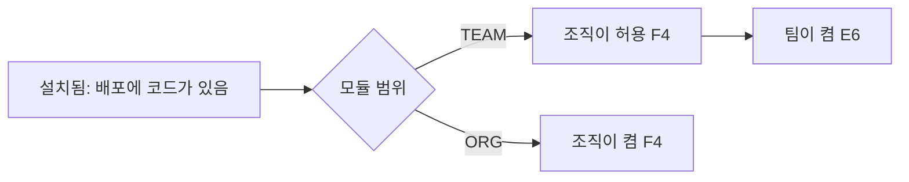

| 범위 | 순서 | 누가 |
| --- | --- | --- |
| `TEAM` | 설치됨 → 조직이 허용 → 팀이 켬 | 개발자 → 조직 관리자 → 팀 관리자(또는 조직 관리자) |
| `ORG` | 설치됨 → 조직이 켬 | 개발자 → 조직 관리자 |

### 13.2 끄기와 의존

| ID | 요구사항 | 수준 |
| --- | --- | --- |
| TEN-MOD-01 | 모듈을 끄면 그 범위에서 모듈의 API(404), 메뉴, 알림 생성, EXP 출처, 실시간 이벤트, 정해진 시각 작업이 멈춘다 | 필수 |
| TEN-MOD-02 | 모듈을 꺼도 모듈 데이터는 지우지 않는다. 다시 켜면 이어진다 | 필수 |
| TEN-MOD-03 | 조직이 `TEAM` 범위 모듈의 허용을 거두면 그 조직의 모든 팀에서 그 모듈이 꺼진다 | 필수 |
| TEN-MOD-04 | 모듈 A가 모듈 B를 필요로 하면, B가 켜져 있어야 A를 켤 수 있고, B를 끄면 A도 함께 꺼진다. 끄기 전에 함께 꺼지는 모듈 목록을 보여 주고 확인을 받는다 | 필수 |
| TEN-MOD-05 | 모듈 켜기·끄기·허용·거두기는 활동 기록에 남고, 지금 접속한 사람의 화면에 실시간으로 반영된다(`team.modules-changed`, [architecture/realtime.md](realtime.md)) | 필수 |
| TEN-MOD-06 | 모듈 테이블은 켜짐 여부와 관계없이 마이그레이션으로 만든다. `BUNDLED`는 `db/migration/core`, `EXTENSION`은 `db/migration/company` 위치를 쓴다(CONTRIBUTING.md §3) | 필수 |

### 13.3 확장 지점 등록 항목

모듈은 아래 항목을 한 묶음으로 서버에 등록한다. `BUNDLED`와 `EXTENSION`이 같은 계약을 쓴다. 코드 형태(인터페이스, 패키지 구조, 검증)는 [architecture/modules.md](modules.md) §5를 따른다.

| 항목 | 내용 | 검증 |
| --- | --- | --- |
| 모듈 정보 | 식별자, 이름, 설명, 범위(`TEAM`/`ORG`), 출처, 기본 켜짐, 필요한 모듈 | 식별자 중복이면 서버 시작 실패 |
| API | 모듈이 여는 API와 각 API의 필요 권한 | 권한 선언이 없는 API가 있으면 서버 시작 실패([architecture/security.md](security.md)) |
| 메뉴 | 켜졌을 때 보일 메뉴 | — |
| 권한 | 모듈이 더하는 권한과 역할별 기본값 | 손님에게 관리 권한을 주는 선언 금지 |
| EXP 출처 | 출처 식별자, 기본 양, 하루 상한 | [domain/rules.md](../domain/rules.md) |
| 알림 종류 | 알림 식별자, 받는 범위 | — |
| 실시간 이벤트 | 이벤트 이름, 범위(개인·팀·공간·조직 공간·조직) | [architecture/realtime.md](realtime.md) |
| 정해진 시각 작업 | 작업과 주기. 켜진 단위에서만 돈다 | — |
| 마이그레이션 위치 | `core` 또는 `company` | 출처와 맞지 않으면 서버 시작 실패 |

## 14. 생애와 떠나기

### 14.1 조직·팀

| 일 | 주체 | 조건 | 처리 |
| --- | --- | --- | --- |
| 팀 보관 | 조직 관리자 | — | 팀 `ARCHIVED`, 그 팀의 `REQUESTED` 팀 멤버십 `REJECTED`, `PENDING` 초대 `REVOKED`, 초대 링크 끔 |
| 팀 복원 | 조직 관리자 | 조직 `ACTIVE` | 팀 `ACTIVE`. 링크는 꺼진 채로 둔다 |
| 조직 보관 | 조직 관리자 | 최근 인증 | 조직 `ARCHIVED`, 모든 팀 읽기 전용, 대기 중인 요청·초대 정리(팀 보관과 같음) |
| 조직 정지 | 운영자 | — | 조직 `SUSPENDED`, 모든 멤버의 그 조직 권한 회수 |
| 조직 삭제 요청 | 조직 관리자 | 최근 인증 (v0.3) | `DELETION_SCHEDULED`, 30일 뒤 `DELETED`. 기간 안에 취소 가능 |
| 조직 삭제 | 서버 | 30일 경과 | 조직의 모든 데이터와 활동 기록을 지운다. 계정은 지우지 않는다 |
| 빈 조직 정리 | 서버 | 90일 동안 조직의 어떤 계정도 그 조직의 API를 부르지 않음 | 조직 관리자에게 알린 뒤 14일 안에 활동이 없으면 `ARCHIVED` |

### 14.2 사람

| 일 | 주체 | 조건 | 처리 |
| --- | --- | --- | --- |
| 팀 나가기 | 본인 | 마지막 팀 관리자가 아님 | 팀 멤버십 `LEFT`(사유 `SELF`) |
| 팀에서 내보내기 | 팀 관리자, 조직 관리자 | TEN-INV-06 | 팀 멤버십 `LEFT`(사유 `REMOVED`) |
| 조직 나가기 | 본인 | 마지막 조직 관리자가 아니고, 그 조직 어느 팀에서도 마지막 팀 관리자가 아님 | 조직 멤버십 `LEFT`, 그 조직 팀 멤버십 모두 `LEFT` |
| 조직에서 내보내기 | 조직 관리자 | 위와 같은 조건을 대상자 기준으로 | 같은 처리, 사유 `REMOVED` |
| 손님 만료 | 서버 | 만료 시각 도달 | 해당 팀 멤버십 `EXPIRED`. `ACTIVE` 팀 멤버십이 남지 않으면 조직 멤버십 `EXPIRED` |
| 탈퇴 | 본인 | §5.1 | 계정 `DELETED`, 모든 멤버십 `LEFT`(사유 `ACCOUNT_DELETED`), 개인정보 삭제 |

- 팀 멤버십이 끝나도 그 사람이 담당자인 업무는 담당자를 그대로 두고 "팀에 없음"으로 표시한다. 담당자 바꾸기는 팀 관리자가 한다.
- 권한 회수는 상태 변경과 같은 트랜잭션 직후 즉시 한다(TEN-CTX-03).

### 14.3 조직 관리자의 구성원 관리

| ID | 요구사항 | 수준 |
| --- | --- | --- |
| TEN-MEM-01 | 정지·해제·내보내기·조직 관리자 지정·해제의 대상은 그 조직의 `ACTIVE`·`SUSPENDED` 조직 멤버십뿐이다. 멤버십이 없거나 다른 상태면 `404`다. 자기 자신의 정지·내보내기는 `400`이다(스스로 나가기는 `/api/me/orgs/{orgId}/leave`) | 필수 |
| TEN-MEM-02 | 정지는 `ACTIVE`에서, 해제는 `SUSPENDED`에서만 된다. 반복하면 `409 ALREADY_PROCESSED`다. 팀 멤버십 상태는 바꾸지 않는다(§5.4). 대상이 어느 팀의 마지막 팀 관리자여도 정지할 수 있다. 정지는 되돌릴 수 있고, 그동안 그 팀은 조직 관리자가 관리한다 | 필수 |
| TEN-MEM-03 | 내보내기는 조직 멤버십을 `LEFT`(사유 `REMOVED`)로 바꾸고 조직 관리자 여부를 해제한다. 그 조직의 `ACTIVE`·`SUSPENDED`·`REQUESTED` 팀 멤버십도 모두 `LEFT`(사유 `REMOVED`)로 바꾼다. 대상이 `ACTIVE` 팀의 마지막 팀 관리자면 `409 LAST_ADMIN_REQUIRED`다. 팀 관리자 수에는 조직 멤버십도 `ACTIVE`인 사람만 센다 | 필수 |
| TEN-MEM-04 | 조직 관리자 지정은 `ACTIVE` 구성원(`MEMBER`)만 받는다. 손님·정지된 사람은 `400`, 이미 관리자면 `409 ALREADY_PROCESSED`다. 지정이 커밋되면 대상의 세션을 모두 끊는다(SEC-SESS-03, 이벤트 `OrgAdminGranted`). 해제는 관리자가 아니면 `409 ALREADY_PROCESSED`이고, 마지막이 아니면 자기 자신도 해제할 수 있다. 해제할 때는 세션을 끊지 않는다(권한은 요청마다 다시 조회한다) | 필수 |
| TEN-MEM-05 | 활동 중인 조직 관리자를 0명으로 만드는 정지·내보내기·해제는 `409 LAST_ADMIN_REQUIRED`다(TEN-INV-05·20). 조직 행을 잠근 뒤 요청자가 아직 `ACTIVE` 조직 관리자인지 다시 확인한다. 아니면 `404`(멤버십이 활동 중이 아님) 또는 `403`(관리자 아님)이다 | 필수 |
| TEN-MEM-06 | 멤버십을 바꾸는 요청은 조직 행을 먼저 잠그고, 팀 행이 필요하면 팀 ID 순서로 잠근다. 팀 만들기의 첫 팀 관리자, 팀 복원의 새 팀 관리자처럼 다른 사람의 조직 멤버십을 확인하고 팀 멤버십을 만드는 요청과 팀 단위 멤버십 변경(팀 관리자 API)도 같은 순서를 따른다. 확인한 뒤 그 사람이 내보내져 조직을 떠난 사람이 팀 관리자로 남는 일이 없다 | 필수 |
| TEN-MEM-07 | 구성원 목록은 기본으로 `ACTIVE`·`SUSPENDED`·`EXPIRED`를 보이고, 쿼리 `state`는 `ACTIVE`·`SUSPENDED`·`EXPIRED`·`LEFT`만 받는다(요청 중·거절은 가입 요청 API). `teamId`는 그 팀의 `ACTIVE`·`SUSPENDED` 팀 멤버십이 있는 사람이고, 그 조직의 팀이 아니면 빈 목록이다. 들어온 순서, 커서 페이지 | 필수 |
| TEN-MEM-08 | 활동 기록: 조직에 `ORG_MEMBER_SUSPENDED`·`ORG_MEMBER_UNSUSPENDED`·`ORG_MEMBER_REMOVED`·`ORG_ADMIN_GRANTED`·`ORG_ADMIN_REVOKED`, 내보낼 때 팀마다 `TEAM_MEMBER_REMOVED`. 대상은 계정 ID, 바뀌기 전·후 값은 멤버십 상태뿐이다 | 필수 |

### 14.4 팀 관리자의 팀원 관리

| ID | 요구사항 | 수준 |
| --- | --- | --- |
| TEN-TMEM-01 | 팀원 목록은 팀 멤버 누구나 본다. 팀 관리자·조직 관리자에게는 이메일과 `ACTIVE`·`SUSPENDED`·`EXPIRED`(쿼리 `state`로 `LEFT`까지)를 보이고, 팀원·읽기 전용에게는 이메일 없이 `ACTIVE`만 보인다(쿼리 `state`는 무시한다). 들어온 순서, 커서 페이지 | 필수 |
| TEN-TMEM-02 | 바로 추가는 그 조직의 `ACTIVE` 구성원(`MEMBER`)만, 역할은 `TEAM_MEMBER`·`VIEWER`만 받는다. 손님은 초대로만 들어온다. 팀 관리자는 역할 바꾸기(최근 인증)로만 준다. 나갔거나 거절된 멤버십은 같은 행을 다시 `ACTIVE`로 쓰고, 이미 있거나 요청 중·만료면 `409 ALREADY_PROCESSED`다 | 필수 |
| TEN-TMEM-03 | 역할 바꾸기는 `version`이 필수이고, 같은 역할이면 `409 ALREADY_PROCESSED`다. `TEAM_ADMIN`으로 올리는 것은 팀 멤버십과 조직 멤버십이 모두 `ACTIVE`인 구성원만 된다(손님은 `400`, TEN-INV-07) | 필수 |
| TEN-TMEM-04 | 활동 중인 팀(`ACTIVE`)의 활동 중인 팀 관리자를 0명으로 만드는 강등·정지·내보내기는 `409 LAST_ADMIN_REQUIRED`다(TEN-INV-06). 팀 관리자 수에는 조직 멤버십도 `ACTIVE`인 사람만 센다. 조직 단위 정지(TEN-MEM-02)와 달리 팀 단위 정지도 막는다 | 필수 |
| TEN-TMEM-05 | 대상은 그 팀의 `ACTIVE`·`SUSPENDED` 팀 멤버십뿐이다(아니면 `404`, API-TADM-03). 자기 자신의 정지·내보내기는 `400`이고(스스로 나가기는 `/api/me/teams/{teamId}/leave`), 마지막이 아니면 자기 강등은 된다 | 필수 |
| TEN-TMEM-06 | 팀원을 바꾸는 요청은 조직 행 → 팀 행 순서로 잠근 뒤(TEN-MEM-06) 조직과 팀이 아직 `ACTIVE`인지(아니면 `409 READ_ONLY`), 요청자가 아직 그 팀의 `ACTIVE` 팀 관리자이거나 `ACTIVE` 조직 관리자인지 다시 확인한다. 아니면 `403`(조직 멤버십이 활동 중이 아니면 `404`)이다. 권한 판정과 잠금 사이에 보관되어도 바뀌지 않는다 | 필수 |
| TEN-TMEM-07 | 활동 기록: `TEAM_MEMBER_ADDED`(전 값은 예전 상태, 후 값은 역할), `TEAM_ROLE_CHANGED`, `TEAM_MEMBER_SUSPENDED`, `TEAM_MEMBER_UNSUSPENDED`, `TEAM_MEMBER_REMOVED`. 팀 활동 기록 조회는 그 팀 기록만, (시각, ID) 최신순 커서이고 거르기 규칙은 TEN-LOG-06과 같다 | 필수 |

## 15. 활동 기록

활동 기록은 더하기만 한다. 고치거나 지우는 API가 없다([architecture/security.md](security.md) §13.5). 각 기록은 시각, 행위자(계정, 운영자, 서버), 행동, 대상, 바뀌기 전·후 값을 가진다.

| 범위 | 기록하는 행동 |
| --- | --- |
| 조직 | 조직 만들기·설정 변경(공개 범위, 가입 방법, 손님 규칙, 시간대)·보관·복원·정지·해제·삭제 요청·취소, 팀 만들기·보관·복원, 직무 유형 변경, 모듈 허용·거두기·켜기·끄기(`ORG`), 조직 관리자 지정·해제, 조직 멤버십 전이 전부, 이메일 초대 만들기·승인·거절·취소·수락, 손님 연장·구성원 전환, 도메인 등록·확인, 부트스트랩, 조직 관리자의 팀 열람, 휴일 달력 변경 |
| 팀 | 팀 설정 변경, 모듈 켜기·끄기(`TEAM`), 팀 멤버십 전이 전부, 팀 역할 변경, 초대 링크 만들기·끄기·사용, 업무 만들기·고치기·지우기·담당자 변경·상태 변경, 프로젝트 만들기·고치기·보관 |

| ID | 요구사항 | 수준 |
| --- | --- | --- |
| TEN-LOG-01 | 상태를 바꾸는 트랜잭션과 활동 기록 쓰기는 같은 트랜잭션이다. 기록 없이 상태만 바뀌는 일이 없다 | 필수 |
| TEN-LOG-02 | 조직 관리자는 조직 기록과 모든 팀 기록을, 팀 관리자는 자기 팀 기록을 본다. 손님과 팀원·읽기 전용은 보지 못한다 | 필수 |
| TEN-LOG-03 | 기록에는 토큰 원문, 세션 번호, 이메일 초대의 전체 목록 같은 민감한 값을 남기지 않는다 | 필수 |
| TEN-LOG-04 | 활동 기록은 기본 1년 보관한다. 배포 설정으로 늘릴 수 있지만 1년보다 줄일 수 없다. 기간이 지난 기록은 서버 작업이 지우고, 지운 범위(기간, 건수)를 운영 로그에 남긴다 | 필수 |
| TEN-LOG-05 | 탈퇴한 사람의 활동 기록은 지우지 않는다. 행위자는 탈퇴한 계정 ID로 남고 화면에는 "탈퇴한 사용자"로 보인다(SEC-PRIV-02) | 필수 |
| TEN-LOG-06 | 조직 활동 기록 조회는 조직 기록과 그 조직 모든 팀의 기록을 합쳐 (시각, ID) 최신순으로 커서 페이지를 준다. 같은 시각의 기록은 ID 순서다. `teamId`를 주면 그 팀 기록과 그 팀을 대상으로 한 조직 기록만, 그 조직의 팀이 아니면 빈 목록이다. `from`은 포함, `to`는 제외이고 `from`이 `to`보다 앞서야 한다. `action`은 대문자 상수 형식만 받는다. 항목에 행위자·대상(계정·팀)의 이름과 팀 이름을 붙인다 | 필수 |
