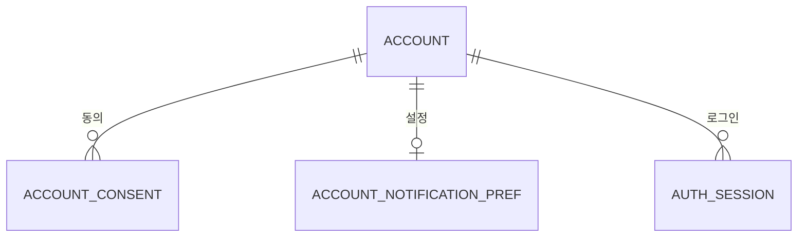
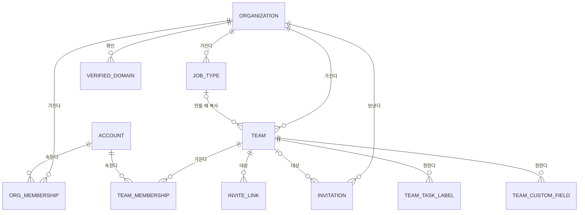
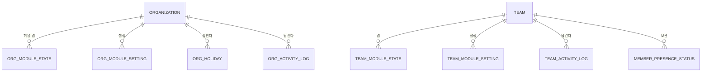
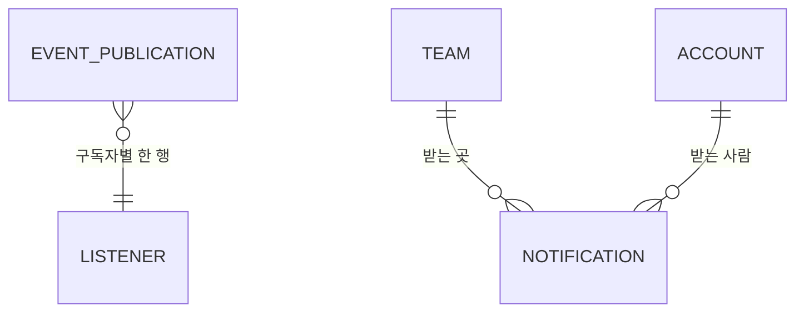
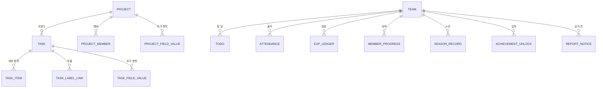
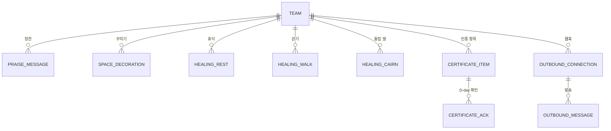

# 도메인 모델

> 버전: v0.4.0\
> 수정일: 2026-11-05

엔티티, 관계, 제약, 소속, 멱등 키를 정한다. 논리 모델이며 실제 DDL은 Flyway 마이그레이션에서 쓴다. 규칙의 근거는 [domain/rules.md](rules.md), 상태 전이는 [architecture/tenancy.md](../architecture/tenancy.md) §5, DB 이식성은 [architecture/tenancy.md](../architecture/tenancy.md) §11.4, 단위와 패키지는 [architecture/modules.md](../architecture/modules.md) §3을 따른다. 요구사항 ID 접두어는 `DOM`이다.

## 1. 범위와 규칙

### 1.1 논리 타입

| 논리 타입 | 뜻 | PostgreSQL | MySQL | MariaDB |
| --- | --- | --- | --- | --- |
| `UUID` | 앱이 만드는 UUID v7. 하이픈을 넣은 소문자 36자 | `CHAR(36)` | `CHAR(36)` | `CHAR(36)` |
| `TEXT(n)` | 최대 n자 문자열. n은 [architecture/security.md](../architecture/security.md) §12.1 | `VARCHAR(n)` | `VARCHAR(n)` | `VARCHAR(n)` |
| `LONG_TEXT` | 긴 글(정리된 서식 있는 글 등) | `TEXT` | `MEDIUMTEXT` | `MEDIUMTEXT` |
| `INT` | 32비트 정수 | `INTEGER` | `INT` | `INT` |
| `BIGINT` | 64비트 정수 | `BIGINT` | `BIGINT` | `BIGINT` |
| `BOOL` | 참·거짓 | `BOOLEAN` | `TINYINT(1)` | `TINYINT(1)` |
| `UTC_TIMESTAMP` | 시간대 정보 없는 UTC 시각, 마이크로초 | `TIMESTAMP(6)` (without time zone) | `DATETIME(6)` | `DATETIME(6)` |
| `LOCAL_DATE` | 조직 시간대 기준 날짜 | `DATE` | `DATE` | `DATE` |
| `TIME` | 시각(시:분) | `TIME` | `TIME` | `TIME` |
| `CODE` | 앱 상수(상태, 종류 등) | `VARCHAR(40)` | `VARCHAR(40)` | `VARCHAR(40)` |
| `SECRET` | 암호문과 키 버전 | `VARCHAR(1024)` + 키 버전 `INT` | 같음 | 같음 |
| `HASH` | SHA-256 16진수 | `CHAR(64)` | `CHAR(64)` | `CHAR(64)` |

| ID | 요구사항 | 수준 |
| --- | --- | --- |
| DOM-TYPE-01 | DB `ENUM`, `jsonb`, 배열, 시간대가 있는 시각 타입을 쓰지 않는다(TEN-DB-02, TEN-DB-06) | 필수 |
| DOM-TYPE-02 | `CODE` 값은 대문자 상수이고 허용 목록은 앱이 검사한다. DB `CHECK` 제약은 세 DB가 같게 처리하는 단순 비교만 쓴다 | 필수 |
| DOM-TYPE-03 | 모든 문자열 열은 길이 상한을 가진다. 상한이 없는 열은 `LONG_TEXT`뿐이며, 앱이 상한을 검사한다(SEC-INPUT-01) | 필수 |
| DOM-TYPE-04 | MySQL·MariaDB의 문자 집합은 `utf8mb4`, 정렬 규칙은 바이너리다(TEN-DB-04). 이메일·도메인은 소문자로 저장한다(TEN-DB-05) | 필수 |

### 1.2 공통 열

| 열 | 타입 | 규칙 |
| --- | --- | --- |
| `id` | `UUID` | 모든 엔티티의 기본 키. 앱이 만든다(TEN-DB-08) |
| `created_at` | `UTC_TIMESTAMP` | 만든 시각 |
| `updated_at` | `UTC_TIMESTAMP` | 고친 시각. 추가만 하는 엔티티(원장, 기록)에는 없다 |
| `version` | `INT` | 낙관적 잠금. 동시 수정을 막아야 하는 엔티티에만 둔다(표의 "잠금" 열) |
| 소속 열 | `UUID` | `org_id`, `team_id`, `account_id` 가운데 소속(§2)에 맞는 열. 팀 소속 엔티티는 `team_id`를 반드시 가진다 |

| ID | 요구사항 | 수준 |
| --- | --- | --- |
| DOM-COL-01 | 팀 소속 엔티티는 `team_id`를 가지고, 팀 안의 다른 자원을 가리키는 외래 키는 같은 `team_id`를 함께 비교한다(TEN-ISO-04) | 필수 |
| DOM-COL-02 | 다른 단위의 엔티티는 JPA 연관관계가 아니라 식별자 열로 가리킨다(ARCH-PKG-02). 같은 단위 안에서만 연관관계를 쓴다 | 필수 |
| DOM-COL-03 | 계정을 가리키는 열(`account_id`, `assignee_id` 등)은 탈퇴한 계정도 그대로 가리킨다. 화면은 "탈퇴한 사용자"로 보인다(SEC-PRIV-02) | 필수 |

### 1.3 이름 규칙

- 테이블·열 이름은 소문자 `snake_case`, 단수형이다. 세 DB의 예약어(`user`, `order`, `group`, `key`, `value`, `status` 단독 사용은 피한다)를 쓰지 않는다(TEN-DB-09).
- 모듈 테이블은 모듈 key를 접두어로 쓴다(ARCH-DATA-03). 예: `praise_message`, `outbound_connection`.
- 상태 열은 `state`, 종류 열은 `kind`로 통일한다.

### 1.4 삭제 정책

| 방식 | 대상 | 규칙 |
| --- | --- | --- |
| 지우지 않음(상태로 표현) | 조직, 팀, 멤버십, 초대, 프로젝트(보관), 직무 유형(숨김) | 상태 전이로만 바꾼다 |
| 소프트 삭제(`deleted_at`) | 업무, 업무 세부 항목, 오늘의 할 일, 산길 돌탑 말 | 목록에서 빠지고 활동 기록·원장의 참조는 남는다 |
| 물리 삭제 | 완료된 이벤트 발행 기록·보낸 외부 발송 행(보관 기간 뒤), 만료된 세션과 가입 대기 세션, 만료된 중복 요청 방지 키, 30일 지난 돌탑 말(OQ-23), 조직이 `DELETED`가 될 때 그 조직의 모든 데이터 | 서버 작업으로만 지운다 |
| 추가만 함 | EXP 원장, 출석, 활동 기록, 약관 동의, 휴식 기록 | 고치거나 지우는 코드 경로가 없다(RULE-ATT-05, SEC-LOG-03) |

## 2. 소속과 단위

| 엔티티 | 테이블 | 소속 | 단위 |
| --- | --- | --- | --- |
| 계정 | `account` | 계정 | core.account |
| 약관 동의 | `account_consent` | 계정 | core.account |
| 알림 설정 | `account_notification_pref` | 계정 | core.notification |
| 세션 | `auth_session` | 계정 | core.auth |
| 가입 대기 세션 | `auth_pending_signup` | 계정(만들기 전) | core.auth |
| 중복 요청 방지 키 | `api_idempotency_key` | 계정 | core.support |
| 조직 | `organization` | 조직 | core.tenancy |
| 확인한 도메인 | `verified_domain` | 조직 | core.tenancy |
| 조직 멤버십 | `org_membership` | 조직 | core.tenancy |
| 이메일 초대 | `invitation` | 조직 | core.tenancy |
| 직무 유형 | `job_type` | 조직 | core.tenancy |
| 조직 휴일 | `org_holiday` | 조직 | core.calendar |
| 조직 모듈 허용·켜짐 | `org_module_state` | 조직 | core.module |
| 조직 모듈 설정 | `org_module_setting` | 조직 | core.module |
| 조직 활동 기록 | `org_activity_log` | 조직 | core.audit |
| 팀 | `team` | 팀(조직에 속함) | core.tenancy |
| 팀 멤버십 | `team_membership` | 팀 | core.tenancy |
| 초대 링크 | `invite_link` | 팀 | core.tenancy |
| 업무 구분 라벨 | `team_task_label` | 팀 | core.tenancy |
| 추가 항목 정의 | `team_custom_field` | 팀 | core.tenancy |
| 팀 모듈 켜짐 | `team_module_state` | 팀 | core.module |
| 팀 모듈 설정 | `team_module_setting` | 팀 | core.module |
| 팀 활동 기록 | `team_activity_log` | 팀 | core.audit |
| 현재 상태 | `member_presence_status` | 팀 | core.realtime |
| 도메인 이벤트 발행 기록 | `event_publication` | 조직 또는 팀(이벤트 본문에 담음) | core.event |
| 알림 | `notification` | 팀 또는 조직 | core.notification |
| 프로젝트 | `project` | 팀 | project |
| 프로젝트 멤버 | `project_member` | 팀 | project |
| 프로젝트 추가 항목 값 | `project_field_value` | 팀 | project |
| 업무 | `task` | 팀 | task |
| 업무 세부 항목 | `task_item` | 팀 | task |
| 업무 라벨 | `task_label_link` | 팀 | task |
| 업무 추가 항목 값 | `task_field_value` | 팀 | task |
| 오늘의 할 일 | `todo` | 팀 | todo |
| 리포트 공지 칸 | `report_notice` | 팀 | report |
| 출석 | `attendance` | 팀 | attendance |
| 비근무일 접속 | `attendance_offday_visit` | 팀 | attendance |
| 연속 출석 캐시 | `attendance_streak` | 팀 | attendance |
| EXP 원장 | `exp_ledger` | 팀 | progression |
| 진행 요약 | `member_progress` | 팀 | progression |
| 레벨 보상 열림 | `level_reward_unlock` | 팀 | progression |
| 시즌 기록 | `season_record` | 팀 | progression |
| 업적 획득 | `achievement_unlock` | 팀 | progression |
| 칭찬 | `praise_message` | 팀 | module.praise |
| 꾸미기 선택 | `space_decoration` | 팀 | module.space |
| 휴식 기록 | `healing_rest` | 팀 | module.healing |
| 산길 걷기 | `healing_walk` | 팀 | module.healing |
| 산길 일별 거리 | `healing_walk_daily` | 팀 | module.healing |
| 산길 팀 시즌 거리 | `healing_team_distance` | 팀 | module.healing |
| 돌탑 말 | `healing_cairn` | 팀 | module.healing |
| 당일 날씨 | `healing_weather` | 조직 | module.healing |
| 퀘스트 배정 | `quest_assignment` | 팀 | module.quest |
| 모닝 브리핑 발송 | `briefing_dispatch` | 팀 | module.briefing |
| 인증 항목 | `certificate_item` | 팀 | module.certificate |
| D-day 확인 | `certificate_ack` | 팀 | module.certificate |
| 외부 알림 연결 | `outbound_connection` | 팀 | module.outbound |
| 외부 발송 대기열 | `outbound_message` | 팀 | module.outbound |

| ID | 요구사항 | 수준 |
| --- | --- | --- |
| DOM-OWN-01 | 위 표에 없는 엔티티를 만들려면 이 표에 소속과 단위를 먼저 더한다(ARCH-DATA-01, TEN-PORT-01) | 필수 |
| DOM-OWN-02 | 조직 소속 엔티티는 팀 소속 엔티티를 가리키지 않는다(TEN-INV-12). 조직 소속 엔티티가 팀을 가리키는 경우는 `team_id`만 값으로 담는다(예: 연회장 테이블의 팀 이름 표시) | 필수 |

## 3. core.account·core.auth

### account

| 필드 | 타입 | 필수 | 설명 |
| --- | --- | --- | --- |
| `id` | `UUID` | ○ | |
| `google_sub` | `TEXT(255)` | ○ | Google `sub`. 유일. 탈퇴 시 되돌릴 수 없는 해시로 바꾼다(SEC-PRIV-02) |
| `email` | `TEXT(254)` | 탈퇴 전 ○ | 확인된 이메일, 소문자. 탈퇴 시 지운다 |
| `display_name` | `TEXT(30)` | ○ | 표시 이름. 처음 값은 Google 이름이다. 탈퇴 시 지운다 |
| `display_name_custom` | `BOOL` | ○ | 사용자가 바꿨는지. 참이면 로그인 때 Google 이름으로 덮지 않는다(TEN-AUTH-04) |
| `picture_url` | `TEXT(1024)` | | 프로필 사진 주소 |
| `workspace_domain` | `TEXT(253)` | | ID 토큰의 `hd`. 없으면 개인 계정(TEN-ACC-01~04) |
| `state` | `CODE` | ○ | `ACTIVE`·`SUSPENDED`·`DELETED`([architecture/tenancy.md](../architecture/tenancy.md) §5.1) |
| `default_avatar` | `TEXT(40)` | | 기본 아바타 코드 |
| `last_login_at` | `UTC_TIMESTAMP` | | |
| `deleted_at` | `UTC_TIMESTAMP` | | 탈퇴 시각 |

- 유일: `google_sub`(TEN-INV-01, TEN-INV-21).
- 인덱스 후보: `email`(초대 맞추기).

### account_consent (추가만)

| 필드 | 타입 | 필수 | 설명 |
| --- | --- | --- | --- |
| `account_id` | `UUID` | ○ | |
| `terms_version` | `TEXT(20)` | ○ | 약관 버전 |
| `privacy_version` | `TEXT(20)` | ○ | 개인정보 처리방침 버전 |
| `agreed_at` | `UTC_TIMESTAMP` | ○ | |

- 다시 동의(OQ-49)는 새 행을 더한다.

### account_notification_pref

| 필드 | 타입 | 필수 | 설명 |
| --- | --- | --- | --- |
| `account_id` | `UUID` | ○ | 유일 |
| `disabled_kinds` | `TEXT(1000)` | ○ | 끈 알림 종류 코드 목록(쉼표 구분). 정규 테이블 대신 짧은 목록으로 둔다 |
| `quiet_start` | `TIME` | | 방해 금지 시작 |
| `quiet_end` | `TIME` | | 방해 금지 끝 |
| `briefing_enabled` | `BOOL` | ○ | 모닝 브리핑 받기(RULE-BRF-05). 기본 참 |
| `version` | `INT` | ○ | 잠금 |

### auth_session

서버 세션 저장소다. Spring Session의 저장소 인터페이스를 우리 JDBC 구현으로 채운다([ADR-0018](../adr/0018-hashed-session-store.md)). 정해진 열만 두고 임의 속성은 저장하지 않는다(SEC-SESS-06, SEC-SESS-13).

| 필드 | 타입 | 필수 | 설명 |
| --- | --- | --- | --- |
| `session_id_hash` | `HASH` | ○ | 기본 키. 세션 ID의 SHA-256. 원문은 저장하지 않는다(SEC-SESS-12) |
| `account_id` | `UUID` | | 로그인 전에는 비어 있다. 인덱스(계정별 즉시 무효화, SEC-SESS-07, 동시 세션 상한 SEC-SESS-11) |
| `authenticated_at` | `UTC_TIMESTAMP` | | 최근 인증 판정(SEC-SESS-10) |
| `created_at` | `UTC_TIMESTAMP` | ○ | 최대 수명의 기준 |
| `last_used_at` | `UTC_TIMESTAMP` | ○ | 유휴 만료 |
| `expires_at` | `UTC_TIMESTAMP` | ○ | 유휴 만료와 최대 수명 중 이른 시각 |
| `login_state_hash`, `login_nonce`, `login_code_verifier` | `HASH`, `TEXT(64)`, `TEXT(128)` | | 로그인 진행 값. 10분 뒤 무효, 쓰면 지운다(SEC-SESS-14) |
| `login_return_path` | `TEXT(200)` | | 로그인 뒤 돌아갈 앱 안 경로. 상대 경로만(SEC-AUTH) |
| `login_started_at` | `UTC_TIMESTAMP` | | |

- 인덱스 후보: (`account_id`), (`expires_at`) 만료 정리.
- 만료된 행은 서버 작업이 지운다(§1.4).

### auth_pending_signup

약관 동의 전 상태다. 계정을 만들지 않는다(TEN-AUTH-02). 15분 뒤 지운다(TEN-AUTH-03, OQ-47).

| 필드 | 타입 | 필수 | 설명 |
| --- | --- | --- | --- |
| `session_id_hash` | `HASH` | ○ | |
| `google_sub` | `TEXT(255)` | ○ | |
| `email`, `name`, `picture_url`, `workspace_domain` | `TEXT` | | ID 토큰 값 |
| `invite_link_id` | `UUID` | | 링크로 들어온 경우 동의 직후 처리한다([architecture/tenancy.md](../architecture/tenancy.md) §6.3) |
| `expires_at` | `UTC_TIMESTAMP` | ○ | |

### api_idempotency_key

만드는 요청의 중복 처리를 막는다([architecture/api.md](../architecture/api.md) API-CON-03).

| 필드 | 타입 | 필수 | 설명 |
| --- | --- | --- | --- |
| `account_id` | `UUID` | ○ | |
| `idempotency_key` | `TEXT(36)` | ○ | 화면이 만든 UUID |
| `request_hash` | `HASH` | ○ | 메서드, 경로, 본문의 SHA-256. 같은 키에 다른 본문이면 거부한다 |
| `response_status` | `INT` | | 처리 중이면 비어 있다 |
| `response_body` | `LONG_TEXT` | | 처음 응답. 토큰이 담긴 응답은 저장하지 않는다(API-CON-05) |
| `expires_at` | `UTC_TIMESTAMP` | ○ | 만든 뒤 24시간 |

- 유일: (`account_id`, `idempotency_key`). 같은 키의 동시 요청은 유일 제약으로 하나만 처리한다(TEN-DB-07).
- 만료된 행은 서버 작업이 지운다(§1.4).

## 4. core.tenancy

### organization

| 필드 | 타입 | 필수 | 설명 |
| --- | --- | --- | --- |
| `name` | `TEXT(40)` | ○ | |
| `tagline` | `TEXT(100)` | | 한 줄 소개 |
| `visibility` | `CODE` | ○ | `PRIVATE`(기본)·`PUBLIC` |
| `state` | `CODE` | ○ | `ACTIVE`·`SUSPENDED`·`ARCHIVED`·`DELETION_SCHEDULED`·`DELETED`([architecture/tenancy.md](../architecture/tenancy.md) §5.2) |
| `time_zone` | `TEXT(64)` | ○ | IANA 시간대 이름 |
| `join_link_enabled` | `BOOL` | ○ | 초대 링크 켜기(기본 거짓, TEN-ORG-01) |
| `member_admission_review` | `BOOL` | ○ | 팀 관리자가 들이는 새 구성원에 조직 관리자 확인(기본 참, TEN-ADM-01) |
| `join_request_mode` | `CODE` | ○ | `OFF`(기본)·`APPROVAL`·`INSTANT`. `PUBLIC`일 때만 켤 수 있고, 공개로 바꿔도 `OFF`로 남는다. `PRIVATE`로 바꾸면 `OFF`로 되돌린다. 이미 들어온 `REQUESTED`는 조직 관리자가 처리할 때까지 남는다(TEN-JOIN-05) |
| `guest_approval_required` | `BOOL` | ○ | 손님 초대에 조직 관리자 승인(기본 참) |
| `guest_default_days`, `guest_max_days` | `INT` | ○ | 30, 90 |
| `guest_orgspace_allowed` | `BOOL` | ○ | 손님 조직 공간 출입(기본 거짓) |
| `invitation_ttl_days` | `INT` | ○ | 이메일 초대 수락 기한(기본 7, 최대 30, TEN-INVT-03) |
| `ownerless` | `BOOL` | ○ | 혼자뿐인 조직 관리자가 탈퇴해 보관된 조직(기본 거짓). 참이면 복원하지 않는다([architecture/tenancy.md](../architecture/tenancy.md) §5.1) |
| `created_by` | `UUID` | ○ | 만든 계정 |
| `state_before_suspend` | `CODE` | | 감사용. 해제는 늘 `ACTIVE`([architecture/tenancy.md](../architecture/tenancy.md) §5.2) |
| `deletion_scheduled_at` | `UTC_TIMESTAMP` | | 삭제 예약 시각(30일 유예, v0.3) |
| `version` | `INT` | ○ | 잠금 |

- 인덱스 후보: (`visibility`, `state`, `name`) 공개 조직 찾기(이름 앞부분 일치, TEN-DB-02).
- 불변식: TEN-INV-05(`ownerless`가 참인 `ARCHIVED` 조직만 예외), TEN-INV-13.

### verified_domain (도메인 자동 가입)

| 필드 | 타입 | 필수 | 설명 |
| --- | --- | --- | --- |
| `org_id` | `UUID` | ○ | |
| `domain` | `TEXT(253)` | ○ | 소문자. 유일(TEN-INV-10) |
| `challenge` | `TEXT(64)` | ○ | DNS 확인 값 |
| `challenge_expires_at` | `UTC_TIMESTAMP` | ○ | 72시간(OQ-47) |
| `verified_at` | `UTC_TIMESTAMP` | | |
| `last_checked_at` | `UTC_TIMESTAMP` | | 30일 재확인(OQ-47) |
| `join_mode` | `CODE` | ○ | `INSTANT`·`APPROVAL` |

- 유일: `domain`. 확인 전 행끼리 같은 도메인이 겹칠 수 있는지는 SEC-ORG 규칙을 따르며, 확인된 행은 하나뿐이다.

### team

| 필드 | 타입 | 필수 | 설명 |
| --- | --- | --- | --- |
| `org_id` | `UUID` | ○ | 바뀌지 않는다(TEN-INV-02) |
| `name` | `TEXT(40)` | ○ | 보이는 이름 |
| `name_key` | `TEXT(40)` | ○ | 비교용 이름. 유니코드 NFKC 정규화, 앞뒤·연속 공백 정리, 소문자(TEN-DB-05) |
| `visibility` | `CODE` | ○ | `PRIVATE`(기본)·`PUBLIC` |
| `join_mode` | `CODE` | ○ | 공개 팀의 가입 방식 `APPROVAL`(기본)·`INSTANT`(OQ-52) |
| `state` | `CODE` | ○ | `ACTIVE`·`ARCHIVED` |
| `job_type_id` | `UUID` | | 만들 때 고른 직무 유형(기록만, TEN-JOB) |
| `report_week_start` | `INT` | ○ | 주 시작 요일(1=월) |
| `report_lock_weekday`, `report_lock_time` | `INT`, `TIME` | | 편집 마감(OQ-14) |
| `report_notice_titles` | `TEXT(400)` | ○ | 공지 칸 제목 목록 |
| `version` | `INT` | ○ | 잠금 |

- 유일: (`org_id`, `name_key`). 보관된 팀도 포함한다. 겉보기만 비슷한 이름으로 다른 팀을 사칭하지 못하게 비교용 이름으로 판정한다.
- 인덱스 후보: (`org_id`, `state`).
- 불변식: TEN-INV-02, TEN-INV-06.

### org_membership

| 필드 | 타입 | 필수 | 설명 |
| --- | --- | --- | --- |
| `org_id`, `account_id` | `UUID` | ○ | 유일 쌍(TEN-INV-03) |
| `kind` | `CODE` | ○ | `MEMBER`·`GUEST` |
| `org_admin` | `BOOL` | ○ | 손님은 거짓만(TEN-INV-07) |
| `state` | `CODE` | ○ | `REQUESTED`·`ACTIVE`·`REJECTED`·`SUSPENDED`·`LEFT`·`EXPIRED`([architecture/tenancy.md](../architecture/tenancy.md) §5.4) |
| `joined_via` | `CODE` | ○ | `CREATOR`·`BOOTSTRAP`·`INVITATION`·`LINK`·`REQUEST`·`DOMAIN` |
| `expires_at` | `UTC_TIMESTAMP` | 손님 ○ | TEN-INV-09로 계산해 저장 |
| `left_reason` | `CODE` | | `SELF`·`REMOVED`·`ACCOUNT_DELETED` |
| `rejected_at` | `UTC_TIMESTAMP` | | 다시 요청 대기(TEN-REQ-02) |
| `version` | `INT` | ○ | 잠금. 마지막 관리자 보호(TEN-INV-20) |

- 가입 요청은 별도 엔티티가 아니라 이 행의 `REQUESTED` 상태다([architecture/tenancy.md](../architecture/tenancy.md) §5.4, TEN-REQ-01).
- 인덱스 후보: (`org_id`, `state`), (`account_id`, `state`), (`org_id`, `org_admin`, `state`).

### team_membership

| 필드 | 타입 | 필수 | 설명 |
| --- | --- | --- | --- |
| `team_id`, `account_id` | `UUID` | ○ | 유일 쌍(TEN-INV-03) |
| `role` | `CODE` | ○ | `TEAM_ADMIN`·`TEAM_MEMBER`·`VIEWER`. 손님은 `TEAM_ADMIN` 불가(TEN-INV-07) |
| `state` | `CODE` | ○ | org_membership과 같은 값([architecture/tenancy.md](../architecture/tenancy.md) §5.5) |
| `joined_via` | `CODE` | ○ | org_membership과 같은 값 + `DIRECT`(관리자 바로 추가) |
| `expires_at` | `UTC_TIMESTAMP` | 손님 ○ | 90일 이내(TEN-INV-08) |
| `left_reason` | `CODE` | | |
| `version` | `INT` | ○ | 잠금 |

- 인덱스 후보: (`team_id`, `state`, `role`), (`account_id`, `state`).
- 불변식: TEN-INV-04, TEN-INV-06, TEN-INV-08.

### invitation (이메일 초대)

| 필드 | 타입 | 필수 | 설명 |
| --- | --- | --- | --- |
| `org_id` | `UUID` | ○ | |
| `team_id` | `UUID` | 손님 ○ | 구성원 초대는 선택 |
| `email` | `TEXT(254)` | ○ | 소문자(TEN-INVT-01) |
| `kind` | `CODE` | ○ | `MEMBER`·`GUEST` |
| `role` | `CODE` | ○ | `TEAM_MEMBER`·`VIEWER`(TEN-INV-11) |
| `guest_days` | `INT` | 손님 ○ | 이용 일수 |
| `state` | `CODE` | ○ | `PENDING_APPROVAL`·`PENDING`·`ACCEPTED`·`DECLINED`·`EXPIRED`·`REVOKED`([architecture/tenancy.md](../architecture/tenancy.md) §5.6) |
| `accept_by` | `UTC_TIMESTAMP` | ○ | 수락 기한 |
| `created_by`, `approved_by`, `accepted_by` | `UUID` | | 계정 |

- 유일 성격: (`org_id`, `email`, `team_id`)에 `PENDING_APPROVAL`·`PENDING`은 하나(TEN-INVT-02). 부분 인덱스를 쓰지 않으므로(TEN-DB-02) 앱이 같은 트랜잭션에서 기존 행을 `REVOKED`로 바꾸고, 동시성은 조직 단위 직렬화로 막는다.
- 인덱스 후보: (`email`, `state`) 로그인 때 받은 초대 찾기.

### invite_link

| 필드 | 타입 | 필수 | 설명 |
| --- | --- | --- | --- |
| `org_id`, `team_id` | `UUID` | ○ | |
| `token_hash` | `HASH` | ○ | 유일. 원문은 저장하지 않는다(TEN-LINK-04, SEC-TOKEN) |
| `approval_required` | `BOOL` | ○ | |
| `role` | `CODE` | ○ | `TEAM_MEMBER`·`VIEWER`(TEN-LINK-03) |
| `expires_at` | `UTC_TIMESTAMP` | ○ | 기본 7일, 30일 이내(TEN-LINK-02) |
| `max_uses` | `INT` | ○ | 필수(TEN-LINK-02). 무제한 링크는 없다 |
| `use_count` | `INT` | ○ | 원자적 조건부 증가(TEN-LINK-01) |
| `enabled` | `BOOL` | ○ | |
| `created_by` | `UUID` | ○ | |

- TEN-ADM-01의 "만든 사람이 조직 관리자인가"는 링크를 쓰는 시점에 `created_by`의 현재 조직 관리자 여부로 판정한다. 만든 뒤 조직 관리자에서 내려온 사람의 링크는 팀 관리자 링크로 다룬다.
- 만든 사람이 그 팀의 팀 관리자도 조직 관리자도 아니게 되면 링크를 쓸 수 없다(TEN-LINK-05 공통 응답).

### job_type

| 필드 | 타입 | 필수 | 설명 |
| --- | --- | --- | --- |
| `org_id` | `UUID` | ○ | 조직을 만들 때 기본 직무 유형을 복사한다([architecture/tenancy.md](../architecture/tenancy.md) §12) |
| `name` | `TEXT(40)` | ○ | |
| `description` | `TEXT(200)` | | |
| `hidden` | `BOOL` | ○ | 쓰는 팀이 있으면 지우지 않고 숨긴다 |
| `defaults` | `LONG_TEXT` | ○ | 켤 모듈, 라벨, 추가 항목, 공지 칸 제목, 리포트 주기 기본값을 담은 앱 직렬화 값. 팀을 만들 때 각 팀 테이블로 복사한다(TEN-JOB-02). JSON 문자열이며 DB JSON 타입을 쓰지 않는다 |

### team_task_label, team_custom_field

| 엔티티 | 필드 |
| --- | --- |
| `team_task_label` | `team_id`, `name` `TEXT(30)`, `sort_order` `INT`, `hidden` `BOOL`. 유일: (`team_id`, `name`) |
| `team_custom_field` | `team_id`, `target` `CODE`(`TASK`·`PROJECT`), `label` `TEXT(40)`, `kind` `CODE`(`TEXT`·`MEMO`), `required` `BOOL`, `sort_order` `INT`, `hidden` `BOOL` |

- 추가 항목 종류에 비밀 정보는 없다(OQ-12).

## 5. core.module·core.calendar·core.audit·core.realtime

| 엔티티 | 필드 | 제약 |
| --- | --- | --- |
| `org_module_state` | `org_id`, `module_key` `TEXT(40)`, `allowed` `BOOL`(`TEAM` 범위), `enabled` `BOOL`(`ORG` 범위), `changed_by`, `changed_at` | 유일 (`org_id`, `module_key`) |
| `team_module_state` | `team_id`, `module_key`, `enabled` `BOOL`, `changed_by`, `changed_at` | 유일 (`team_id`, `module_key`) |
| `org_module_setting`, `team_module_setting` | 소속 id, `module_key`, `setting_key` `TEXT(60)`, `setting_value` `TEXT(2000)`, `version` | 유일 (소속 id, `module_key`, `setting_key`). 값의 형식과 기본값은 ModuleDefinition의 설정 스키마([architecture/modules.md](../architecture/modules.md) §5.1)가 검사한다 |
| `org_holiday` | `org_id`, `day` `LOCAL_DATE`, `name` `TEXT(40)`, `created_by` | 유일 (`org_id`, `day`) |
| `org_activity_log`, `team_activity_log` | 소속 id, `actor_id`(계정 또는 시스템이면 비움), `action` `CODE`, `target_type` `CODE`, `target_id` `UUID`, `before_value`·`after_value` `TEXT(2000)`, `occurred_at` | 추가만(SEC-LOG-03). 인덱스 (소속 id, `occurred_at`), (소속 id, `actor_id`) |
| `member_presence_status` | `team_id`, `account_id`, `status` `CODE`(`AVAILABLE`·`FOCUS`·`MEETING`·`AWAY`), `away_by_idle` `BOOL`(무활동으로 생긴 `AWAY`. 입력이 생기면 `AVAILABLE`로, UX-FLOW-12), `changed_at` | 유일 (`team_id`, `account_id`). 마지막 상태만 저장한다([architecture/realtime.md](../architecture/realtime.md) `status.changed`) |

- 모듈 켜짐 기록이 있는데 배포에 모듈 코드가 없으면 꺼진 것으로 다룬다(ARCH-MOD-04). 행은 지우지 않는다.
- 활동 기록의 값 열에 토큰, 세션, 웹훅 주소, 이메일 초대 전체 목록을 넣지 않는다(TEN-LOG-03, SEC-HOOK-03).

## 6. core.event·core.notification

### event_publication

도메인 이벤트 저장소다. Spring Modulith의 이벤트 발행 기록 표를 쓴다([ADR-0016](../adr/0016-spring-modulith-events.md)). 이벤트 하나에 구독자 수만큼 행이 생긴다. 열 구조는 라이브러리가 DB마다 정하므로 §1.1 논리 타입과 DOM-TYPE-01의 예외다(DOM-LIB-01).

| 필드 | 설명 |
| --- | --- |
| `id` | 발행 기록 ID |
| `listener_id` | 구독자 식별자 |
| `event_type` | 이벤트 레코드의 클래스 이름 |
| `serialized_event` | 불변 레코드의 직렬화 값. `org_id`와 팀 범위면 `team_id`를 담는다(ARCH-EVT-05, ARCH-EVT-06) |
| `publication_date` | 발행 시각 |
| `completion_date` | 구독자 처리 완료 시각. 비어 있으면 미처리 |
| `status` | 처리 상태(발행됨, 처리 중, 완료, 실패, 다시 보냄) |
| `completion_attempts` | 시도 횟수(ARCH-EVT-04) |
| `last_resubmission_date` | 마지막으로 다시 보낸 시각 |

- 원인 변경과 같은 트랜잭션에서 행을 만든다(ARCH-EVT-01).
- 구독자의 모듈이 그 범위에서 꺼져 있으면 처리 없이 완료로 기록한다(ARCH-EVT-05).
- 완료된 행은 보관 기간 뒤 지운다(ARCH-EVT-08).

| ID | 요구사항 | 수준 |
| --- | --- | --- |
| DOM-LIB-01 | 라이브러리가 쓰는 표(`event_publication`)는 라이브러리가 DB마다 제공하는 열 구조를 그대로 따른다. DDL은 Flyway DB별 위치에 두고(TEN-DB-01), 라이브러리의 자동 스키마 생성은 끈다 | 필수 |
| DOM-LIB-02 | 앱 코드는 라이브러리 표를 직접 조회하거나 고치지 않는다. 라이브러리 API로만 다룬다 | 필수 |

### notification

| 필드 | 타입 | 필수 | 설명 |
| --- | --- | --- | --- |
| `recipient_id` | `UUID` | ○ | 계정 |
| `org_id` | `UUID` | ○ | |
| `team_id` | `UUID` | | 조직 범위 알림이면 비움([domain/rules.md](rules.md) §10) |
| `kind` | `CODE` | ○ | `TASK_ASSIGNED` 등([domain/rules.md](rules.md) §10.1) |
| `actor_id` | `UUID` | | 보낸 사람 |
| `target_type`, `target_id` | `CODE`, `UUID` | | 이동할 화면 대상 |
| `dedupe_key` | `TEXT(200)` | | 정해진 시각 알림의 멱등 키(RULE-NOTI-01) |
| `silent` | `BOOL` | ○ | 방해 금지·휴식 중 |
| `read_at` | `UTC_TIMESTAMP` | | |

- 유일: (`recipient_id`, `dedupe_key`)(`dedupe_key`가 있을 때). 부분 유일 인덱스를 쓰지 않으므로 `dedupe_key`가 없는 행은 `id`로 채운 값을 넣어 유일 제약을 그대로 건다.
- 인덱스 후보: (`recipient_id`, `team_id`, `read_at`).

## 7. 고정 기능

### project

| 필드 | 타입 | 필수 | 설명 |
| --- | --- | --- | --- |
| `team_id` | `UUID` | ○ | |
| `name` | `TEXT(40)` | ○ | |
| `description` | `TEXT(1000)` | | |
| `lead_id` | `UUID` | | 대표 담당자(같은 팀 활동 멤버) |
| `start_date`, `end_date` | `LOCAL_DATE` | | 기간(선택) |
| `state` | `CODE` | ○ | `ACTIVE`·`ARCHIVED` |
| `version` | `INT` | ○ | 잠금 |

- `project_member`: (`team_id`, `project_id`, `account_id`) 유일.
- `project_field_value`: (`team_id`, `project_id`, `field_id`) 유일, `value` `TEXT(2000)`.

### task

| 필드 | 타입 | 필수 | 설명 |
| --- | --- | --- | --- |
| `team_id` | `UUID` | ○ | |
| `project_id` | `UUID` | ○ | 같은 팀(RULE-TASK-02) |
| `title` | `TEXT(200)` | ○ | |
| `description` | `LONG_TEXT` | | 정리된 서식 있는 글, 20,000자(SEC-INPUT-04) |
| `assignee_id` | `UUID` | | 같은 팀 활동 멤버, `VIEWER` 아님 |
| `priority` | `CODE` | ○ | `URGENT`·`HIGH`·`NORMAL`·`LOW` |
| `state` | `CODE` | ○ | `TODO`·`IN_PROGRESS`·`ON_HOLD`·`DONE`([domain/rules.md](rules.md) §2.2) |
| `start_date`, `due_date` | `LOCAL_DATE` | ○ | 시작 ≤ 마감(RULE-TASK-01) |
| `important` | `BOOL` | ○ | |
| `in_report` | `BOOL` | ○ | 리포트에 넣기 |
| `done_at` | `UTC_TIMESTAMP` | | 마지막으로 `DONE`이 된 시각(리포트 기간 판정) |
| `created_by` | `UUID` | ○ | |
| `deleted_at` | `UTC_TIMESTAMP` | | 소프트 삭제 |
| `version` | `INT` | ○ | 잠금(RULE-TASK-05) |

- 인덱스 후보: (`team_id`, `state`, `due_date`), (`team_id`, `assignee_id`, `state`), (`team_id`, `project_id`).
- `task_item`: `team_id`, `task_id`, `content` `TEXT(500)`, `effort_minutes` `INT`(1~14,400, RULE-TASK-04), `done` `BOOL`, `sort_order` `INT`, `deleted_at`. 업무당 50줄(OQ-51).
- `task_label_link`: (`team_id`, `task_id`, `label_id`) 유일.
- `task_field_value`: (`team_id`, `task_id`, `field_id`) 유일, `value` `TEXT(2000)`.

### todo

| 필드 | 타입 | 필수 | 설명 |
| --- | --- | --- | --- |
| `team_id`, `account_id` | `UUID` | ○ | 작성자만 다룬다(RULE-TODO-01) |
| `day` | `LOCAL_DATE` | ○ | "오늘로 가져오기"는 이 값을 바꾼다(RULE-TODO-04) |
| `content` | `TEXT(200)` | ○ | |
| `done` | `BOOL` | ○ | |
| `done_on` | `LOCAL_DATE` | | 체크한 날짜(하루 상한 판정, RULE-TODO-05) |
| `sort_order` | `INT` | ○ | |
| `deleted_at` | `UTC_TIMESTAMP` | | |

- 인덱스 후보: (`team_id`, `account_id`, `day`). 하루 50개(RULE-TODO-02).

### attendance (추가만)

| 필드 | 타입 | 필수 | 설명 |
| --- | --- | --- | --- |
| `team_id`, `account_id` | `UUID` | ○ | |
| `workday` | `LOCAL_DATE` | ○ | 조직 시간대 근무일 |
| `checked_in_at` | `UTC_TIMESTAMP` | ○ | RULE-ATT-02 |

- 유일: (`team_id`, `account_id`, `workday`)(RULE-ATT-01).
- `attendance_offday_visit`: (`team_id`, `account_id`, `day`) 유일, `first_visit_at`(RULE-ATT-03).
- `attendance_streak`: (`team_id`, `account_id`) 유일, `current_streak` `INT`, `streak_start` `LOCAL_DATE`, `last_workday` `LOCAL_DATE`, `longest_in_season` `INT`. 출석 기록으로 다시 만들 수 있는 캐시다(RULE-ATT-09).

### exp_ledger (추가만)

| 필드 | 타입 | 필수 | 설명 |
| --- | --- | --- | --- |
| `team_id`, `account_id` | `UUID` | ○ | 받은 사람 |
| `source` | `CODE` | ○ | `ATTENDANCE`·`STREAK_BONUS`·`TASK_DONE`·`TODO_DONE`·`QUEST_DONE`·`QUEST_BONUS`·`PRAISE_RECEIVED`, 모듈 등록 출처 |
| `idempotency_key` | `TEXT(200)` | ○ | [domain/rules.md](rules.md) §6.1의 키를 정해진 순서로 이은 값 |
| `amount` | `INT` | ○ | 양수(지급) 또는 음수(회수) |
| `season` | `TEXT(7)` | ○ | `YYYY-MM`. 회수는 원래 지급의 시즌([domain/rules.md](rules.md) §6.2) |
| `occurred_on` | `LOCAL_DATE` | ○ | 하루 상한 판정(RULE-EXP-04) |
| `occurred_at` | `UTC_TIMESTAMP` | ○ | |

- 유일 성격: 같은 `idempotency_key`의 합은 0 또는 한 몫이다(RULE-EXP-01). 지급·회수가 같은 키를 번갈아 쓰므로 유일 제약 대신, 같은 트랜잭션에서 `member_progress` 행을 잠그고(RULE-EXP-05) 키의 현재 합을 확인한다. 이를 보조하려고 (`team_id`, `idempotency_key`, `seq`) 유일 제약을 둔다. `seq` `INT`는 그 키의 몇 번째 기록인지다.
- 인덱스 후보: (`team_id`, `account_id`, `season`), (`team_id`, `account_id`, `source`, `occurred_on`).

### member_progress

| 필드 | 타입 | 필수 | 설명 |
| --- | --- | --- | --- |
| `team_id`, `account_id` | `UUID` | ○ | 유일 쌍 |
| `total_exp` | `INT` | ○ | 원장 합계의 캐시 |
| `level` | `INT` | ○ | 저장 레벨. 내려가지 않는다(RULE-LVL-03) |
| `season`, `season_exp` | `TEXT(7)`, `INT` | ○ | 현재 시즌과 시즌 EXP 캐시 |
| `version` | `INT` | ○ | 잠금 행(RULE-EXP-05) |

- 원장에서 다시 만들 수 있는 캐시다. 원장과 다르면 원장이 맞다.
- `level_reward_unlock`: (`team_id`, `account_id`, `level`) 유일(RULE-LVL-05).

### season_record·achievement_unlock

| 엔티티 | 필드 | 제약 |
| --- | --- | --- |
| `season_record` | `team_id`, `season`, `category` `CODE`(`EXP`·`STREAK`·`PRAISE`·`SPECIAL`), `account_id`, `rank` `INT`, `score` `INT`, `award_code` `CODE` | 시즌 마감 작업이 쓴다(RULE-SEA-04). 마감 작업 멱등 키는 (`team_id`, `season`, `category`) 기록이 있는지로 판정(RULE-SEA-03) |
| `achievement_unlock` | `team_id`, `account_id`, `achievement_code` `CODE`, `unlocked_at` | 유일 (`team_id`, `account_id`, `achievement_code`)(RULE-ACH-01). 업적 정의는 코드([domain/rules.md](rules.md) §9)이며 테이블이 아니다 |

### report_notice

| 필드 | 타입 | 필수 | 설명 |
| --- | --- | --- | --- |
| `team_id` | `UUID` | ○ | |
| `period_kind` | `CODE` | ○ | `WEEK`·`MONTH` |
| `period_start` | `LOCAL_DATE` | ○ | |
| `slot_title` | `TEXT(40)` | ○ | 공지 칸 제목 |
| `body` | `LONG_TEXT` | | 정리된 서식 있는 글 |
| `version` | `INT` | ○ | 잠금(RULE-RPT-06) |

- 유일: (`team_id`, `period_kind`, `period_start`, `slot_title`).
- 리포트의 업무 목록, 출석률, 퇴근 요약은 계산 결과이며 저장하지 않는다(RULE-RPT-02, RULE-RPT-07, RULE-LEAVE-02).

## 8. 모듈

### 8.1 praise (칭찬)

| 필드 | 타입 | 필수 | 설명 |
| --- | --- | --- | --- |
| `team_id` | `UUID` | ○ | 같은 팀 안에서만(OQ-50) |
| `sender_id`, `receiver_id` | `UUID` | ○ | 서로 달라야 한다 |
| `message` | `TEXT(200)` | ○ | 서식 없는 글 |
| `sent_on` | `LOCAL_DATE` | ○ | 보내는 쪽 하루 10번, 받는 쪽 EXP 하루 5건 판정 |

### 8.2 space (공간)

| 엔티티 | 필드 | 제약 |
| --- | --- | --- |
| `space_decoration` | `team_id`, `account_id`, `slot` `CODE`(아바타 테두리, 이름표, 칭호, 책상 소품), `item_code` `CODE` | 유일 (`team_id`, `account_id`, `slot`). 고를 수 있는 값은 `level_reward_unlock`이 정한다 |

- 회의 기록 테이블은 없다(ADR-0015). 회의실(B4)의 외부 회의 링크는 팀 설정 값이다(E4, `team_module_setting`의 `space`, `meeting_url`). 주소는 `https`만 받는다(SEC-INPUT-05).

### 8.3 healing (힐링 존)

| 엔티티 | 필드 | 제약 |
| --- | --- | --- |
| `healing_rest` | `team_id`, `account_id`, `kind` `CODE`(`FIRE_GAZE`·`WATER_GAZE`·`YOGA`·`WALK`·`MOUNTAIN_GAZE`), `started_at`, `ended_at`, `counted` `BOOL`(최소 시간 이상, OQ-36) | 진행 중(끝 시각 없음)은 계정 × 팀에 하나(RULE-REST-02). 서버 상한 3시간 뒤 자동 종료 |
| `healing_walk` | `team_id`, `account_id`, `started_at`, `ended_at`, `stamps` `TEXT(100)`(받은 구간 코드 목록), `completed_loop` `BOOL` | 한 번의 걷기(RULE-TRAIL-04) |
| `healing_walk_daily` | `team_id`, `account_id`, `day` `LOCAL_DATE`, `meters` `INT` | 유일 (`team_id`, `account_id`, `day`)(RULE-TRAIL-02) |
| `healing_team_distance` | `team_id`, `season` `TEXT(7)`, `meters` `BIGINT`, `unlocked_scenes` `TEXT(200)`, `version` | 유일 (`team_id`, `season`). 시즌 팀 합계 5km마다 풍경 하나를 연다(RULE-TRAIL-03) |
| `healing_cairn` | `team_id`, `account_id`, `spot` `CODE`, `message` `TEXT(100)`, `expires_at`(30일, OQ-23), `deleted_at` | 쉼터마다 최근 몇 개만 보인다 |
| `healing_weather` | `org_id`, `day` `LOCAL_DATE`, `slot` `INT`(하루 몇 번째, OQ-40), `weather` `CODE`, `starts_at` | 유일 (`org_id`, `day`, `slot`). 당일 날씨만 쓴다 |

- 무지개 업적의 "본 적"은 `achievement_unlock`으로만 남긴다.

### 8.4 quest (오늘의 퀘스트)

| 엔티티 | 필드 | 제약 |
| --- | --- | --- |
| `quest_assignment` | `team_id`, `account_id`, `day` `LOCAL_DATE`, `quest_code` `CODE`, `completed_at` | 유일 (`team_id`, `account_id`, `day`, `quest_code`). 하루 목록은 한 번 정하고 바꾸지 않는다(RULE-QUEST-03) |

### 8.5 halloffame (명예의 전당)

- 테이블이 없다. `season_record`와 `member_progress`, `attendance_streak`를 읽어 보여 준다.

### 8.6 briefing (아침 요약·모닝 브리핑)

| 엔티티 | 필드 | 제약 |
| --- | --- | --- |
| `briefing_dispatch` | `team_id`, `account_id`, `day` `LOCAL_DATE`, `state` `CODE`(`QUEUED`·`SENT`·`SKIPPED_EMPTY`·`SKIPPED_OFF`·`DROPPED`), `queued_at`, `sent_at` | 유일 (`team_id`, `account_id`, `day`)(RULE-BRF-01). 내용은 저장하지 않고 보낼 때 계산한다 |

- 발송 시각은 `team_module_setting`(`briefing`, `send_time`)이다(OQ-54).

### 8.7 certificate (인증·만료일 관리)

| 엔티티 | 필드 | 제약 |
| --- | --- | --- |
| `certificate_item` | `team_id`, `name` `TEXT(100)`, `owner_id` `UUID`(담당자), `expires_on` `LOCAL_DATE`, `renewed_at`, `memo` `TEXT(500)`, `archived` `BOOL`, `version` | 인덱스 (`team_id`, `expires_on`) |
| `certificate_ack` | `team_id`, `item_id`, `account_id`, `stage` `CODE`(`D45`·`D30`·`D14`·`D7`·`D3`·`D1`·`D0`·`OVERDUE`), `ack_day` `LOCAL_DATE`, `acked_at` | 유일 (`item_id`, `account_id`, `stage`, `ack_day`). `OVERDUE`가 아닌 단계는 `ack_day`에 고정값을 넣어 단계마다 한 번만 남긴다(RULE-CERT-01) |

- D-day 단계 목록은 `team_module_setting`(`certificate`, `stages`)이다(OQ-53).

### 8.8 outbound (외부 알림)

| 엔티티 | 필드 | 제약 |
| --- | --- | --- |
| `outbound_connection` | `team_id`, `target` `CODE`(`TEAM_ROOM`·`PERSONAL_ROOM`), `owner_id` `UUID`(개인 방의 주인, 팀 대화방이면 비움), `provider` `CODE`(`GOOGLE_CHAT_WEBHOOK`), `secret` `SECRET`(웹훅 주소, SEC-HOOK-01), `last4` `TEXT(4)`, `registered_by` `UUID`, `owner_confirmed` `BOOL`, `content_level` `CODE`(`COUNT_AND_LINK`·`TITLE`), `state` `CODE`(`ACTIVE`·`PAUSED`), `consecutive_failures` `INT`, `last_success_at`, `version` | 팀 대화방은 팀마다 하나, 개인 방은 (`team_id`, `owner_id`)마다 하나. 유일 (`team_id`, `target`, `owner_key`)이며 `owner_key`는 팀 대화방이면 `team_id`, 개인 방이면 `owner_id`를 담는다 |
| `outbound_message` | `team_id`, `connection_id`, `kind` `CODE`, `body` `TEXT(4000)`(보낼 내용, 내용 수준 적용 뒤), `state` `CODE`(`PENDING`·`SENT`·`FAILED`), `attempts` `INT`, `next_attempt_at`, `sent_at` | 인덱스 (`state`, `next_attempt_at`). 웹훅 주소는 담지 않는다. 보낸 행은 보관 기간 뒤 지운다 |

- 팀 대화방에 보낼 알림 항목(레벨업 등)은 `team_module_setting`(`outbound`, `team_room_kinds`)이다([domain/rules.md](rules.md) §10.3).

### 8.9 orgspace (조직 공간)

- 테이블이 없다. 광장(B9)과 연회장(B10)의 위치, 앉은 자리, 리액션, 건배는 저장하지 않는다(§9, ADR-0015). 조직 공간 설정(정원 등)은 `org_module_setting`(`orgspace`)이다.

## 9. 저장하지 않는 것

| 무엇 | 어디에 두나 | 근거 |
| --- | --- | --- |
| 아바타 위치·앉은 자리 | 서버 메모리 | ADR-0010, [architecture/realtime.md](../architecture/realtime.md) §7 |
| 접속 여부, 지금 있는 공간 | 서버 메모리 | `presence.*` |
| 라운지 채팅 | 서버 메모리, 당일만 | OQ-10 |
| 리액션, 차 마시기, 장작, 요가 동작, 건배 | 저장 안 함 | `reaction.sent`, `hall.toast` 등 |
| 산길 자동 걷기 진행도 | 서버 메모리 | `trail.progress`. 거리만 일별로 쌓는다 |
| 업적 정의, 레벨 보상 목록, 퀘스트 목록, 직무 유형 기본 묶음 | 코드 | 버전과 함께 배포된다 |
| 리포트 집계, 퇴근 요약, 모닝 브리핑 내용, 오늘 요약 | 계산 | RULE-RPT-02, RULE-LEAVE-02, 이 문서 §8.6 |

## 10. 멱등 키

| 일 | 키 | 보장 방법 |
| --- | --- | --- |
| 출석 | (`team_id`, `account_id`, `workday`) | 유일 제약(RULE-ATT-01) |
| 비근무일 접속 | (`team_id`, `account_id`, `day`) | 유일 제약 |
| EXP 지급·회수 | (`team_id`, `idempotency_key`) + 현재 합 | 진행 행 잠금 + `seq` 유일(RULE-EXP-01~05) |
| 레벨 보상 | (`team_id`, `account_id`, `level`) | 유일 제약 |
| 업적 | (`team_id`, `account_id`, `achievement_code`) | 유일 제약 |
| 시즌 마감 | (`team_id`, `season`, `category`) | 기록 존재 확인 + 유일 제약 |
| 정해진 시각 알림 | (`recipient_id`, `dedupe_key`) | 유일 제약(RULE-NOTI-01) |
| 이벤트 구독자 처리 | 구독자마다 `event_publication` 한 행 + 구독자 쪽 멱등 키(위 표의 키) | 라이브러리 완료 표시 + 유일 제약(ARCH-EVT-03, DOM-LIB-01) |
| 만드는 API 요청 | (`account_id`, `idempotency_key`) | 유일 제약(API-CON-03) |
| 모닝 브리핑 | (`team_id`, `account_id`, `day`) | 유일 제약(RULE-BRF-01) |
| D-day 확인 | (`item_id`, `account_id`, `stage`, `ack_day`) | 유일 제약(RULE-CERT-01) |
| 퀘스트 배정 | (`team_id`, `account_id`, `day`, `quest_code`) | 유일 제약 |
| 초대 링크 사용 | `invite_link.use_count` 조건부 증가 | 원자적 갱신(TEN-LINK-01) |
| 초대 수락 | 초대 `state`가 `PENDING`일 때만 | 조건부 갱신(TEN-AUTH-10) |

| ID | 요구사항 | 수준 |
| --- | --- | --- |
| DOM-IDEM-01 | 위 키의 유일 제약 위반은 "이미 처리됨"으로 다루고 같은 결과를 돌려준다(TEN-DB-07) | 필수 |
| DOM-IDEM-02 | 멱등 키를 이을 때 순서와 구분자를 코드 한곳에 정하고, 모든 단위가 그 함수를 쓴다 | 필수 |

## 11. 조직 단위 이관 경로

조직 하나의 모든 데이터는 `organization.id`에서 출발해 찾는다(TEN-PORT-02).

| 출발 | 경로 | 엔티티 |
| --- | --- | --- |
| 조직 | `org_id` 직접 | 조직, 확인한 도메인, 조직 멤버십, 이메일 초대, 직무 유형, 조직 휴일, 조직 모듈 상태·설정, 조직 활동 기록, 도메인 이벤트(조직 범위), 알림(조직 범위), 당일 날씨, 조직 공간 전부 |
| 조직 → 팀 | `team.org_id` → `team_id` | 팀 소속 엔티티 전부(§2 표의 소속 "팀") |
| 조직 → 계정 | 조직 멤버십·팀 멤버십·각 엔티티의 계정 열 | 계정의 최소 정보(`google_sub`, 이메일, 표시 이름)만(TEN-PORT-03) |
| 제외 | — | 세션, 가입 대기 세션, 다른 조직 멤버십, 계정 알림 설정, 서버 메모리 상태 |

## 12. 검증

| ID | 테스트 | 수준 |
| --- | --- | --- |
| DOM-TEST-01 | 모든 엔티티가 §2의 소속을 선언했는지(ARCH-TEST-03) | 필수 |
| DOM-TEST-02 | 팀 소속 엔티티의 저장소에 `team_id` 없이 찾는 메서드가 없는지 | 필수 |
| DOM-TEST-03 | §10의 유일 제약이 세 DB에서 같게 동작: 동시 요청 두 개 가운데 하나만 성공 | 필수 |
| DOM-TEST-04 | 대소문자만 다른 이메일·도메인이 세 DB에서 같은 값으로 저장·비교되는지(DOM-TYPE-04) | 필수 |
| DOM-TEST-05 | `UTC_TIMESTAMP` 열의 값이 세 DB에서 같은 시각으로 읽히는지(시간대 설정이 다른 DB 세션에서) | 필수 |
| DOM-TEST-06 | EXP 원장: 지급 → 회수 → 다시 지급의 합이 한 몫, 같은 요청 동시 두 번이 한 번만 반영 | 필수 |
| DOM-TEST-07 | 조직 하나의 이관 경로(§11)로 모은 엔티티 수가 전체 테이블에서 그 조직 것의 합과 같음 | 권장 |
| DOM-TEST-08 | 활동 기록·원장·출석에 고치기·지우기 코드 경로가 없음(아키텍처 테스트) | 필수 |
