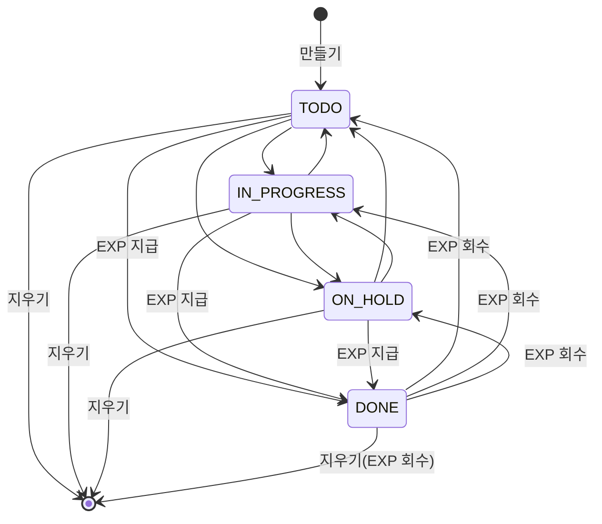
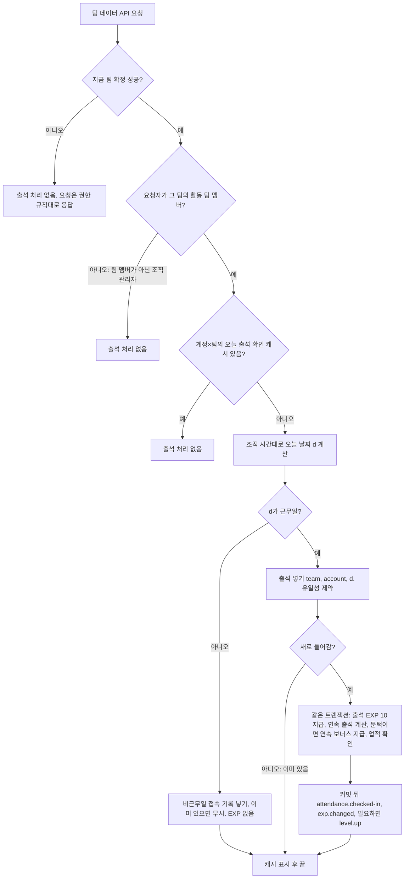
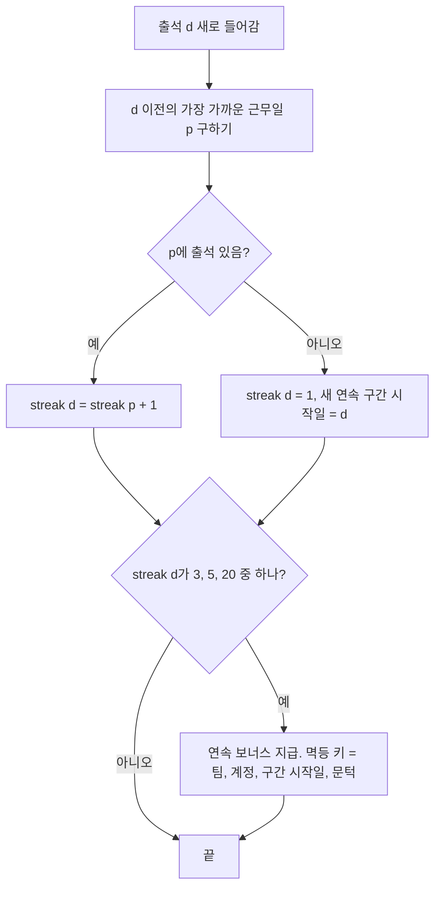
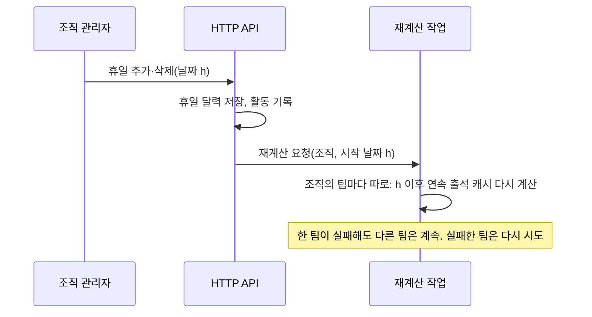
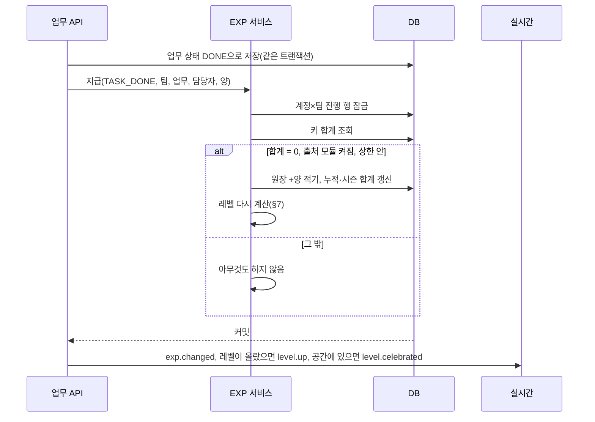
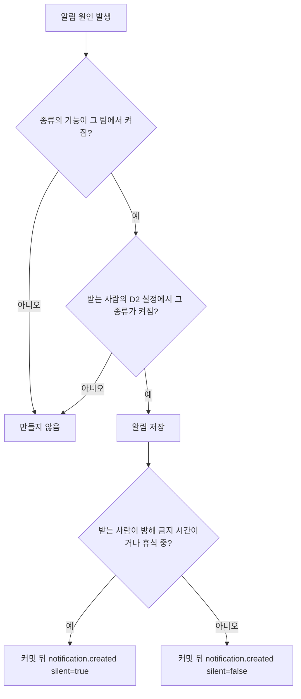
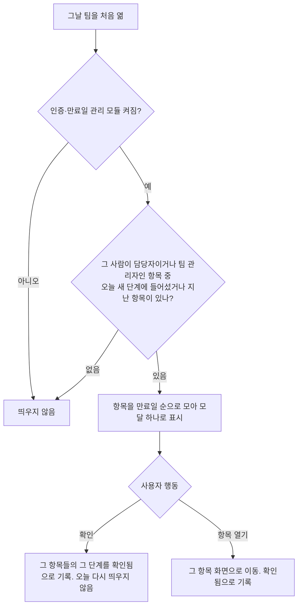
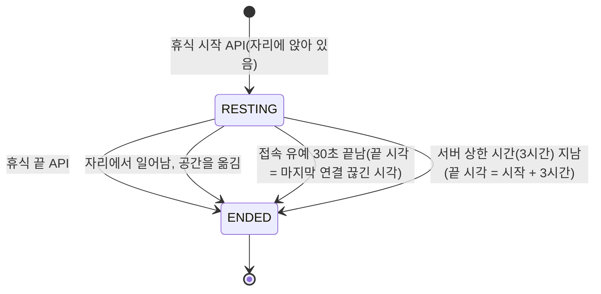

# 도메인 규칙

> 버전: v0.1.0\
> 수정일: 2026-11-04

업무, 오늘의 할 일, 근무일과 출석, EXP·레벨·시즌, 업적, 알림 생성, 휴식, 리포트의 계산 규칙을 정한다. 누가 할 수 있는지는 [architecture/tenancy.md](../architecture/tenancy.md)의 권한 표가, 화면 동작은 [product/screens.md](../product/screens.md)가 정한다. 각 규칙이 들어가는 단계는 [product/overview.md](../product/overview.md)가 정한다.

## 1. 공통

| ID | 요구사항 | 수준 |
| --- | --- | --- |
| RULE-COM-01 | 이 문서의 모든 기록(업무, 할 일, 출석, EXP, 휴식, 리포트)은 팀에 속한다. 같은 계정이라도 팀마다 따로 계산한다 | 필수 |
| RULE-COM-02 | 날짜는 조직 시간대(F7)의 달력 날짜로 계산한다. 하루의 경계는 그 시간대의 자정이다. 시각은 UTC로 저장한다 | 필수 |
| RULE-COM-03 | 숫자 기본값(EXP 양, 상한, 기간)은 설정 값으로 두고 코드에 흩어 쓰지 않는다. 바뀌어도 이미 남은 기록은 다시 계산하지 않는다 | 필수 |
| RULE-COM-04 | 같은 요청이 두 번 와도 결과가 한 번 처리한 것과 같아야 한다(멱등). 출석·EXP·업적은 유일성 제약으로 보장한다 | 필수 |

## 2. 업무

### 2.1 항목

| 항목 | 규칙 | 필수 여부 |
| --- | --- | --- |
| 제목 | 1~200자, 서식 없는 글 | 필수 |
| 설명 | 서식 있는 글. 저장할 때 허용 목록으로 정리한다([architecture/security.md](../architecture/security.md)) | 선택 |
| 프로젝트 | 같은 팀의 `ACTIVE` 프로젝트 하나 | 필수 |
| 담당자 | 같은 팀의 활동 팀 멤버 0명 또는 1명 | 선택 |
| 우선순위 | `URGENT`(긴급) / `HIGH`(높음) / `NORMAL`(보통) / `LOW`(낮음). 기본 `NORMAL` | 필수 |
| 기간 | 시작일과 마감일(날짜). 하루만 고르면 시작일 = 마감일 | 필수 |
| 상태 | `TODO`(할 일) / `IN_PROGRESS`(진행 중) / `ON_HOLD`(보류) / `DONE`(완료). 새 업무는 `TODO` | 필수 |
| 세부 항목 | 0~50줄(OQ-51). 줄마다 내용(길이 상한은 [architecture/security.md](../architecture/security.md) §12.1), 공수, 완료 여부, 순서 | 선택 |
| 업무 구분 라벨 | 팀 설정(E4)의 라벨 중 0개 이상 | 선택 |
| 추가 항목 | 팀 설정(E4)이 정한 입력 칸 | 팀 설정에 따름 |
| 중요 표시 | 참/거짓. 업무 패널과 오늘 요약에서 강조 | 선택 |
| 리포트에 넣기 | 참/거짓 | 선택 |
| 버전 | 서버가 고칠 때마다 1씩 올린다 | 서버 |

| ID | 요구사항 | 수준 |
| --- | --- | --- |
| RULE-TASK-01 | 시작일 ≤ 마감일이어야 한다. 아니면 저장하지 않는다 | 필수 |
| RULE-TASK-02 | 프로젝트와 담당자는 업무와 같은 팀에 속해야 한다. 다른 팀 값이면 대상이 없는 것으로 응답한다([architecture/tenancy.md](../architecture/tenancy.md)) | 필수 |
| RULE-TASK-03 | `ARCHIVED` 프로젝트는 새 업무나 프로젝트 변경의 대상으로 고를 수 없다. 이미 그 프로젝트에 있는 업무는 그대로 둔다 | 필수 |
| RULE-TASK-04 | 공수는 분 단위 정수(1~14,400)로 저장한다. 화면의 고르기 값은 30분, 1시간, 2시간, 4시간, 1일(480분), 2일(960분)이다. 업무의 공수 합계는 세부 항목 공수의 합이다 | 필수 |
| RULE-TASK-05 | 고칠 때 요청의 버전이 저장된 버전과 다르면 저장하지 않고 `409 VERSION_CONFLICT`로 응답한다. 받는 쪽은 다시 불러온다 | 필수 |
| RULE-TASK-06 | 업무를 지우면 목록에서 사라지고 활동 기록에 남는다. 지운 업무가 `DONE`이면 그 업무로 지급한 EXP를 회수한다(§6.3) | 필수 |
| RULE-TASK-07 | 담당자가 바뀌면 새 담당자에게 업무 배정 알림을 만든다(§10) | 필수 |

### 2.2 상태 전이

정해진 순서가 없다. 어느 상태에서든 다른 어느 상태로든 바꿀 수 있다. EXP는 `DONE`으로 들어갈 때와 `DONE`에서 나올 때만 움직인다.

| ID | 요구사항 | 수준 |
| --- | --- | --- |
| RULE-TASK-08 | 같은 상태로 바꾸는 요청은 아무것도 바꾸지 않고 성공으로 응답한다. EXP도 움직이지 않는다 | 필수 |
| RULE-TASK-09 | `DONE`으로 들어갈 때 담당자가 있으면 담당자에게, 없으면 아무에게도 EXP를 주지 않는다 | 필수 |
| RULE-TASK-10 | `DONE` 상태에서 담당자를 바꿀 때의 EXP 처리는 OQ-33이다 | 필수 |

## 3. 오늘의 할 일과 오늘의 퀘스트

### 3.1 오늘의 할 일 (고정 기능)

| ID | 요구사항 | 수준 |
| --- | --- | --- |
| RULE-TODO-01 | 할 일은 계정 × 팀 × 날짜에 속한다. 작성자만 만들고, 고치고, 지우고, 체크한다 | 필수 |
| RULE-TODO-02 | 내용은 1~200자 서식 없는 글이다. 하루에 최대 50개다 | 필수 |
| RULE-TODO-03 | 순서는 작성자가 끌어서 바꾼다. 서버는 순서 값을 저장한다 | 필수 |
| RULE-TODO-04 | 지난 날짜의 완료하지 않은 할 일은 C3의 "지난 할 일"에 보인다. "오늘로 가져오기"는 그 할 일의 날짜를 오늘로 바꾼다. 새 할 일을 만들지 않는다 | 필수 |
| RULE-TODO-05 | 체크하면 EXP를 지급하고 체크를 풀면 회수한다(§6). 하루 상한은 체크한 날짜 기준 10개다 | 필수 |
| RULE-TODO-06 | 다른 사람에게 보이는지는 OQ-34다 | 필수 |

### 3.2 오늘의 퀘스트 (팀 범위 모듈)

| ID | 요구사항 | 수준 |
| --- | --- | --- |
| RULE-QUEST-01 | 출처와 체크 방식은 OQ-01, OQ-02를 따른다 | 필수 |
| RULE-QUEST-02 | 그 팀에서 꺼진 모듈에 기대는 퀘스트(예: 힐링 존 모듈이 꺼진 팀의 "힐링 존에서 쉬기")는 뽑지 않는다 | 필수 |
| RULE-QUEST-03 | 하루에 뽑는 퀘스트 목록은 계정 × 팀 × 날짜마다 한 번 정하고 바꾸지 않는다 | 필수 |

## 4. 근무일

[ADR-0007](../adr/0007-attendance-workday.md)을 따른다.

| ID | 요구사항 | 수준 |
| --- | --- | --- |
| RULE-WD-01 | 근무일은 조직 시간대 기준 월요일~금요일 가운데 조직 휴일 달력(F8)에 없는 날이다 | 필수 |
| RULE-WD-02 | 근무일은 조직마다 하나의 정의를 쓴다. 팀마다 다르게 두지 않는다 | 필수 |
| RULE-WD-03 | 휴일 달력은 조직 관리자만 고친다. 외부 공휴일 서비스를 쓰지 않는다 | 필수 |
| RULE-WD-04 | 휴일 달력을 고쳐도 이미 남은 출석 기록은 바꾸지 않는다. 연속 출석은 바뀐 달력으로 다시 계산한다(§5.3) | 필수 |
| RULE-WD-05 | 조직 시간대를 바꿨을 때 이미 지난 날짜의 기록을 다시 나누지 않는다. 바뀐 시간대가 적용되는 시점은 OQ-32다 | 필수 |

## 5. 출석

### 5.1 기록 시점

출석은 "근무일에 그 팀을 처음 연 순간"이다. 어느 화면으로 들어왔는지(로비, 업무 화면, 알림 링크)는 상관없다. "출근하기" 버튼은 없다.

| ID | 요구사항 | 수준 |
| --- | --- | --- |
| RULE-ATT-01 | 출석은 계정 × 팀 × 근무일마다 최대 한 건이다. DB 유일성 제약으로 보장한다. 동시에 들어온 요청 가운데 하나만 EXP를 받는다 | 필수 |
| RULE-ATT-02 | 출석 시각은 그 근무일에 처음 들어간 요청의 서버 시각이다. 지각을 판정하지 않는다 | 필수 |
| RULE-ATT-03 | 비근무일에 팀을 열면 접속 기록만 남긴다. 출석 EXP를 주지 않고 연속 출석에 넣지 않으며, 연속 출석을 끊지도 않는다 | 필수 |
| RULE-ATT-04 | 그 팀의 활동 팀 멤버가 아니면(팀 멤버가 아닌 조직 관리자 포함) 출석을 남기지 않는다 | 필수 |
| RULE-ATT-05 | 출석 기록은 만들어진 뒤 바꾸거나 지우지 않는다. 사람이 고치는 API를 두지 않는다 | 필수 |
| RULE-ATT-06 | 출석 확인은 요청 경로를 느리게 만들지 않도록 계정 × 팀 × 날짜 캐시로 하루 한 번만 DB에 쓴다 | 권장 |
| RULE-ATT-07 | 손님과 읽기 전용도 활동 팀 멤버이면 출석을 남긴다 | 필수 |

### 5.2 연속 출석

- 정의: 날짜 d의 연속 출석 수 = d에서 거꾸로 세어, 출석이 있는 근무일이 끊김 없이 이어진 수. 비근무일은 건너뛰고 세지 않는다.
- 예: 금요일 출석, 토·일 비근무일, 월요일 출석이면 월요일의 연속 출석 수는 금요일 값 + 1이다.
- 근무일에 출석하지 않으면 그다음 근무일의 연속 출석 수는 1부터 다시 센다.

| ID | 요구사항 | 수준 |
| --- | --- | --- |
| RULE-ATT-08 | 연속 보너스는 한 연속 구간에서 문턱마다 한 번만 지급한다(3번째 근무일 +5, 5번째 +20, 20번째 +100) | 필수 |
| RULE-ATT-09 | 연속 출석 수는 저장 값이 아니라 출석 기록과 근무일 정의로 다시 만들 수 있어야 한다. 저장해 두는 값은 계산 결과의 캐시다 | 필수 |

### 5.3 휴일 달력 변경과 재계산

| ID | 요구사항 | 수준 |
| --- | --- | --- |
| RULE-ATT-10 | 재계산은 출석 기록을 바꾸지 않고 연속 출석 캐시만 바꾼다 | 필수 |
| RULE-ATT-11 | 재계산으로 연속 출석 수가 바뀌었을 때 이미 지급한 연속 보너스의 처리는 OQ-31이다 | 필수 |
| RULE-ATT-12 | 재계산은 팀마다 독립적으로 실행하고 같은 요청을 두 번 실행해도 결과가 같다 | 필수 |

### 5.4 출석 도장판 표시 (C5)

| 칸 | 표시 |
| --- | --- |
| 출석한 근무일 | 도장 |
| 출석하지 않은 지난 근무일 | 빈 칸 |
| 비근무일(주말, 휴일) | 흐린 칸. 비어 있어도 끊김으로 보이지 않게 한다. 그날 접속했어도 도장을 찍지 않는다 |
| 오늘 이후 | 표시 없음 |
| 이어진 연속 구간 | 도장 사이를 이어 그린다. 비근무일 칸은 건너뛰어 잇는다 |

## 6. EXP

### 6.1 출처와 기본값

| 출처 코드 | 내용 | 양 | 멱등 키 | 하루 상한 | 기능 |
| --- | --- | --- | --- | --- | --- |
| `ATTENDANCE` | 근무일 출석 | 10 | 팀, 계정, 근무일 | 1 | 고정 |
| `STREAK_BONUS` | 연속 출석 문턱 | 3번째 +5, 5번째 +20, 20번째 +100 | 팀, 계정, 구간 시작일, 문턱 | 없음 | 고정 |
| `TASK_DONE` | 업무 완료(담당자) | `LOW`·`NORMAL` 10, `HIGH` 15, `URGENT` 20 | 팀, 업무 | 없음 | 고정 |
| `TODO_DONE` | 오늘의 할 일 체크 | 2 | 팀, 할 일 | 10건 | 고정 |
| `QUEST_DONE` | 오늘의 퀘스트 | 5 | 팀, 계정, 날짜, 퀘스트 | 3건 | 팀 범위 모듈 |
| `QUEST_BONUS` | 퀘스트 모두 완료 | 15 | 팀, 계정, 날짜 | 1 | 팀 범위 모듈 |
| `PRAISE_RECEIVED` | 칭찬 받기 | 5 | 팀, 칭찬 | 5건(OQ-30) | 팀 범위 모듈 |

- 위 표에 없는 행동(휴식, 업적, 인사, 리액션 등)은 EXP를 주지 않는다. 휴식은 [ADR-0011](../adr/0011-no-exp-for-rest.md)을 따른다.
- 모듈과 확장 모듈은 등록할 때 출처 코드, 양, 멱등 키, 하루 상한을 선언해야 출처를 더할 수 있다.
- 자기 자신에게 칭찬을 보낼 수 없다.
- 칭찬은 같은 팀 안에서만 보내고, 보내는 쪽은 하루 10번까지다(OQ-50).

### 6.2 원장

EXP는 덧셈만 하는 원장으로 기록한다. 누적·시즌 합계는 원장에서 계산하며, 저장된 합계는 캐시다.

| 원장 항목 | 내용 |
| --- | --- |
| 팀, 계정 | 받은 사람 |
| 출처 코드, 멱등 키 | §6.1 |
| 양 | 양수(지급) 또는 음수(회수) |
| 시즌 | 원래 지급이 속한 시즌. 회수는 원래 지급과 같은 시즌에 적는다 |
| 시각 | 서버 시각 |

| ID | 요구사항 | 수준 |
| --- | --- | --- |
| RULE-EXP-01 | 같은 멱등 키의 원장 합은 늘 0 또는 그 키의 지급 양 하나다(한 대상 한 몫) | 필수 |
| RULE-EXP-02 | 지급은 그 키의 현재 합이 0일 때만, 회수는 현재 합이 0보다 클 때만 원장에 적는다. 그 밖의 요청은 아무것도 하지 않는다 | 필수 |
| RULE-EXP-03 | 회수 양은 그 키로 마지막에 지급한 양과 같다. 지급 뒤 우선순위가 바뀌어도 회수 양은 바뀌지 않는다 | 필수 |
| RULE-EXP-04 | 하루 상한은 그날(조직 시간대) 그 출처로 적힌 원장의 순 지급 건수로 센다. 상한에 이르면 지급하지 않고 성공으로 응답한다 | 필수 |
| RULE-EXP-05 | 원장 쓰기와 합계 캐시 갱신, 레벨 계산은 한 트랜잭션에서 계정 × 팀 진행 행을 잠근 채 한다 | 필수 |
| RULE-EXP-06 | 모듈이 꺼지면 그 모듈의 출처로 새 지급·회수를 하지 않는다. 이미 받은 EXP는 그대로다. 다시 켜면 이어서 지급한다 | 필수 |

### 6.3 지급·회수 흐름

회수(`DONE`에서 나감, `DONE` 업무 지우기, 할 일 체크 풀기, 칭찬 취소가 생기면 그 취소)는 같은 흐름에서 "합계 > 0이면 원장 −양"으로 처리한다.

## 7. 레벨

| ID | 요구사항 | 수준 |
| --- | --- | --- |
| RULE-LVL-01 | 레벨 n에 필요한 누적 EXP는 `25 × (n − 1) × (n + 2)`다. 레벨 1은 0이다 | 필수 |
| RULE-LVL-02 | 계산 레벨은 누적 EXP 이하인 필요 EXP를 가진 가장 큰 n이다 | 필수 |
| RULE-LVL-03 | 레벨은 내려가지 않는다. 저장 레벨 = max(저장 레벨, 계산 레벨) | 필수 |
| RULE-LVL-04 | 회수로 누적 EXP가 현재 레벨의 필요 EXP보다 작아지면 다음 레벨까지의 진행률은 0으로 보인다 | 필수 |
| RULE-LVL-05 | 레벨이 오르면 같은 트랜잭션에서 그 레벨까지의 보상 열림을 기록한다. 한 번에 여러 레벨이 오르면 모든 레벨의 보상을 연다 | 필수 |

| 레벨 | 필요한 누적 EXP | 이전 레벨과의 차 |
| --- | --- | --- |
| 1 | 0 | - |
| 2 | 100 | 100 |
| 3 | 250 | 150 |
| 4 | 450 | 200 |
| 5 | 700 | 250 |
| 6 | 1,000 | 300 |
| 7 | 1,350 | 350 |
| 8 | 1,750 | 400 |
| 9 | 2,200 | 450 |
| 10 | 2,700 | 500 |
| 15 | 5,950 | - |
| 20 | 10,450 | - |

레벨로 여는 보상 종류: 칭호, 아바타 꾸미기(테두리, 이름표), 책상 꾸미기 소품, 힐링 존의 새 구역. 어느 레벨에 무엇을 여는지는 도메인 모델에서 정한다.

## 8. 시즌

| ID | 요구사항 | 수준 |
| --- | --- | --- |
| RULE-SEA-01 | 시즌은 고정 기능이며 모든 팀이 같은 규칙을 쓴다. 기본 길이는 조직 시간대의 달력 한 달이다. 경계는 매월 1일 00:00이다 | 필수 |
| RULE-SEA-02 | 시즌이 바뀌면 시즌 EXP만 0부터 다시 센다. 누적 EXP, 레벨, 업적, 연속 출석은 그대로다 | 필수 |
| RULE-SEA-03 | 시즌 마감 작업은 팀마다 독립적으로 실행한다. 멱등 키는 팀 × 시즌이다. 한 팀이 실패해도 다른 팀은 계속하고, 실패한 팀은 다시 시도한다 | 필수 |
| RULE-SEA-04 | 마감 작업은 그 시즌의 순위(시즌 EXP, 시즌 안 가장 긴 연속 출석, 칭찬 받은 수)와 특별상을 기록으로 남긴다. 명예의 전당 모듈이 꺼져 있어도 기록은 남긴다 | 필수 |
| RULE-SEA-05 | 같은 값은 같은 순위로 매긴다 | 필수 |
| RULE-SEA-06 | 마감 작업은 시즌 경계 뒤 늦게 도착한 회수 원장(§6.2, 지난 시즌에 적힘)을 반영하기 위해 경계 뒤 1시간에 실행한다 | 권장 |

### 8.1 명예의 전당 (팀 범위 모듈)

| 순위 | 기준 |
| --- | --- |
| 시즌 EXP | 이번 시즌 시즌 EXP 합계 |
| 연속 출석 | 지금 이어지고 있는 연속 출석 수 |
| 칭찬 받은 수 | 이번 시즌에 받은 칭찬 수. 칭찬 모듈이 켜진 팀만 |

순위가 평가 압박이 되는 문제는 OQ-05다.

## 9. 업적

| ID | 요구사항 | 수준 |
| --- | --- | --- |
| RULE-ACH-01 | 업적은 계정 × 팀마다 한 번만 얻는다. 유일성 제약으로 보장한다 | 필수 |
| RULE-ACH-02 | 업적은 조건에 관련된 기록이 생길 때 확인한다. 얻으면 `achievement.unlocked`를 보낸다 | 필수 |
| RULE-ACH-03 | 업적은 EXP를 주지 않는다. 회수로 조건이 다시 맞지 않게 되어도 업적은 거두지 않는다 | 필수 |
| RULE-ACH-04 | 조건이 모듈에 기대는 업적은 그 모듈이 켜진 팀에서만 확인한다 | 필수 |

| 코드 | 이름 | 조건 | 필요한 모듈 |
| --- | --- | --- | --- |
| `FIRST_ATTENDANCE` | 첫 출근 | 출석 1회 | 없음 |
| `STREAK_5` | 일주일 개근 | 연속 출석 5 | 없음 |
| `STREAK_20` | 한 달 개근 | 연속 출석 20 | 없음 |
| `PRAISE_10` | 칭찬 부자 | 칭찬 10번 받기 | 칭찬 |
| `REST_10` | 쉬는 법을 아는 사람 | 휴식 10회 | 힐링 존 |
| `REST_50` | 바닷가 단골 | 휴식 50회 | 힐링 존 |
| `FIRE_GAZE_20` | 모닥불 지기 | 불멍 20회 | 힐링 존 |
| `WATER_GAZE_20` | 파도 친구 | 물멍 20회 | 힐링 존 |
| `YOGA_20` | 기지개 장인 | 요가 20회 | 힐링 존 |
| `TRAIL_FIRST` | 첫 완주 | 산길 한 바퀴 첫 완주 | 힐링 존 |
| `TRAIL_10` | 길 위의 사람 | 산길 한 바퀴 완주 10회 | 힐링 존 |
| `TRAIL_FOUR_SEASONS` | 사계절 산행 | 봄(3~5월)·여름(6~8월)·가을(9~11월)·겨울(12~2월)에 각각 산길 완주 | 힐링 존 |
| `RAINBOW` | 무지개를 본 사람 | 무지개 날씨 동안 힐링 존(바닷가, 산길)에 들어감 | 힐링 존 |

## 10. 알림 생성

알림은 팀에 속한다. 전달은 [architecture/realtime.md](../architecture/realtime.md) §4.1의 `notification.created`를 쓴다.

### 10.1 종류

| 종류 코드 | 만드는 때 | 받는 사람 | 기능 |
| --- | --- | --- | --- |
| `TASK_ASSIGNED` | 담당자가 정해지거나 바뀜 | 새 담당자(본인이 정했으면 만들지 않음) | 고정 |
| `TASK_DUE_SOON` | 마감 전날과 마감 당일, 정해진 시각(OQ-35) | 담당자. `DONE`이면 만들지 않음 | 고정 |
| `TASK_OVERDUE` | 마감 다음 날, 정해진 시각(OQ-35) | 담당자. `DONE`이면 만들지 않음 | 고정 |
| `JOIN_REQUEST` | 가입 요청이 들어옴 | 팀 관리자 또는 조직 관리자 | 고정 |
| `LEVEL_UP` | 레벨이 오름 | 본인 | 고정 |
| `MEETING_STARTED` | 팀 회의 시작 | 회의 참석자 | 공간 |
| `GREETING` | 인사 | 받는 사람 | 공간 |
| `WAVE` | 손 흔들어 부르기 | 받는 사람 | 고정(B7·B8에서도 됨) |
| `PRAISE` | 칭찬 받기 | 받는 사람 | 칭찬 |
| `ASSEMBLY` | 연회장 모임 일정·시작 | 조직 멤버(손님은 F7 설정에 따름) | 조직 공간 |
| `SHARED_MEETING_INVITED` | 공용 회의 참석자로 뽑힘 | 그 사람 | 조직 공간 |
| `GUEST_EXPIRING` | 손님 이용 기간 끝 7일 전 | 그 팀의 팀 관리자 | 고정 |

### 10.2 생성 절차

| ID | 요구사항 | 수준 |
| --- | --- | --- |
| RULE-NOTI-01 | 정해진 시각의 알림(`TASK_DUE_SOON`, `TASK_OVERDUE`, `GUEST_EXPIRING`)은 팀마다 독립적으로 만들고, 멱등 키(종류, 대상, 날짜)로 하루 한 번만 만든다 | 필수 |
| RULE-NOTI-02 | 같은 상대에게 보내는 `WAVE`는 1분에 한 번, `GREETING`은 같은 상대에게 하루에 한 번만 알림으로 저장한다. 그 밖의 인사는 실시간 표시만 한다 | 필수 |
| RULE-NOTI-03 | 휴식이 끝나면 휴식 중 `silent=true`로 받은 알림 수를 한 번 보여 준다 | 필수 |
| RULE-NOTI-04 | 아침 요약(팀 범위 모듈)은 앱 안 알림을 만들지 않는다. B1의 오늘 요약 카드와 모닝 브리핑(§10.5)으로만 보인다 | 필수 |

### 10.3 외부 알림 대상

외부 알림 모듈이 켜진 팀에서만 적용한다. 외부로는 알림을 하나하나 보내지 않고, 아래 두 가지만 보낸다. 발송 보안은 [architecture/security.md](../architecture/security.md) §13.6을 따른다.

| 보내는 곳 | 등록하는 것 | 등록하는 사람 | 보내는 것 |
| --- | --- | --- | --- |
| 개인 방 | 그 사람만 있는 Google Chat 방의 웹훅 주소 1개 | 본인(D2) 또는 팀 관리자가 대신(E3) | **모닝 브리핑**(§10.5)만 |
| 팀 대화방 | 팀이 쓰는 Google Chat 방의 웹훅 주소 1개 | 팀 관리자(E6) | 아래 표에서 켠 팀 알림 |

| 팀 대화방 알림 | 기본 | 내용 |
| --- | --- | --- |
| 레벨업 | 켜짐 | 누가 몇 레벨이 됐는지 |
| 마감 지난 업무 요약 | 꺼짐 | 근무일 아침 한 번, 팀 전체 마감 지난 업무 건수 |
| 회의 시작 | 꺼짐 | 팀 회의 시작 |
| 연회장 모임 | 꺼짐 | 연회장 모임 일정과 시작(조직 공간이 켜진 조직) |

| ID | 요구사항 | 수준 |
| --- | --- | --- |
| RULE-NOTI-05 | 마감 임박, 업무 배정, 가입 요청, 인증 만료, 인사, 부르기, 칭찬 같은 개별 알림은 외부로 보내지 않는다. 앱 안 알림(§10.2)으로만 만든다 | 필수 |
| RULE-NOTI-06 | 개인 방 웹훅은 받는 사람이 Workspace 계정일 때만 등록할 수 있다([architecture/tenancy.md](../architecture/tenancy.md) §6.4) | 필수 |
| RULE-NOTI-07 | 팀 대화방 알림은 방해 금지 시간과 관계없이 보낸다 | 필수 |

### 10.4 외부로 보내는 내용 수준

| 수준 | 담는 것 | 예 |
| --- | --- | --- |
| `COUNT_AND_LINK` (개수와 링크) | 알림 종류, 건수, reberu 화면 링크 | "마감 지난 업무 3건이 있어요. reberu에서 보기" |
| `TITLE` (제목 포함) | 위에 더해 업무·회의 제목, 사람 표시 이름 | "'로그인 화면 수정' 마감이 지났어요" |

| ID | 요구사항 | 수준 |
| --- | --- | --- |
| RULE-NOTI-10 | 팀 대화방의 기본 수준은 `COUNT_AND_LINK`다. 팀 관리자가 E6에서 `TITLE`로 바꿀 수 있다 | 필수 |
| RULE-NOTI-11 | 모닝 브리핑은 본인이 등록했거나 본인이 확인한 개인 방이면 `TITLE`, 대신 등록된 뒤 확인 전이면 `COUNT_AND_LINK`다 | 필수 |
| RULE-NOTI-12 | 외부 메시지에는 업무 설명, 메모, 세부 항목, 이메일을 넣지 않는다 | 필수 |
| RULE-NOTI-13 | 외부 메시지의 링크는 로그인한 사람만 열 수 있는 reberu 화면 주소다. 링크에 토큰을 넣지 않는다 | 필수 |
| RULE-NOTI-14 | 손님이 받는 개인 알림도 같은 규칙을 따른다. 팀 대화방에는 손님 이름을 넣지 않는다 | 필수 |

### 10.5 모닝 브리핑

근무일 아침에 그 사람의 오늘 일을 한 번에 알려 준다. 아침 요약 모듈이 만들고, 앱 안에서는 B1의 오늘 요약 카드로, 외부 알림 모듈과 개인 방 웹훅이 있으면 개인 방으로도 보낸다.

| 항목 | 담는 것 |
| --- | --- |
| 마감 지남 | 그 사람이 담당자이고 `DONE`이 아닌, 마감일이 지난 업무 |
| 오늘 마감 | 마감일이 오늘인 업무 |
| 곧 마감 | 마감일이 3일 안인 업무 |
| 중요 | 중요 표시한 업무 가운데 위에 없는 것 |
| 오늘 회의 | 오늘 잡힌 팀 회의(공간 모듈이 켜진 팀) |
| 남은 할 일 | 어제까지 끝내지 못한 오늘의 할 일 |

| ID | 요구사항 | 수준 |
| --- | --- | --- |
| RULE-BRF-01 | 브리핑은 근무일(§4)에만, 팀 설정의 발송 시각(기본 조직 시간대 08:30, OQ-54)에 사람마다 하루 한 번 만든다. 멱등 키는 (팀, 사람, 날짜)다 | 필수 |
| RULE-BRF-02 | 담을 항목이 하나도 없으면 보내지 않는다 | 필수 |
| RULE-BRF-03 | 여러 팀에 속한 사람은 팀마다 따로 받는다. 각 브리핑에는 그 팀의 업무만 담는다 | 필수 |
| RULE-BRF-04 | 받는 사람이 방해 금지 시간이면 방해 금지 시간이 끝난 뒤 보낸다. 그날 근무일이 끝날 때까지 못 보내면 버린다 | 필수 |
| RULE-BRF-05 | 받는 사람이 D2에서 모닝 브리핑을 껐으면 개인 방으로 보내지 않는다. 앱 안 카드는 그대로 보인다 | 필수 |
| RULE-BRF-06 | 항목마다 최대 10건까지 담고, 넘으면 "외 N건"과 reberu 링크를 붙인다 | 필수 |

### 10.6 인증·만료일 D-day 안내

인증·만료일 관리 모듈의 만료 안내는 알림이 아니라 **팀을 열 때 뜨는 모달**로 보여 준다.

| 단계 | 기준 (기본값, 팀 설정으로 바꿈) |
| --- | --- |
| 첫 안내 | D-45 |
| 다가옴 | D-30, D-14, D-7 |
| 임박 | D-3, D-1, 당일 |
| 지남 | 만료일 다음 날부터 매일 |

| ID | 요구사항 | 수준 |
| --- | --- | --- |
| RULE-CERT-01 | 같은 항목의 같은 단계는 사람마다 한 번만 띄운다. 멱등 키는 (항목, 단계, 사람)이다. 지남 단계는 날짜도 키에 넣어 매일 띄운다 | 필수 |
| RULE-CERT-02 | 받는 사람은 그 항목의 담당자와 그 팀의 팀 관리자다(OQ-53) | 필수 |
| RULE-CERT-03 | 모달은 그날 팀을 처음 열 때 한 번만 뜬다. 하던 일 중에 갑자기 뜨지 않는다 | 필수 |
| RULE-CERT-04 | 만료일이 지난 항목을 "갱신함"으로 바꾸거나 새 만료일을 넣으면 지남 안내가 멈춘다 | 필수 |
| RULE-CERT-05 | D-day 안내는 앱 안 알림(D1)과 외부 알림으로 보내지 않는다 | 필수 |

## 11. 휴식

[ADR-0011](../adr/0011-no-exp-for-rest.md)을 따른다.

| 종류 코드 | 이름 | 장소 |
| --- | --- | --- |
| `FIRE_GAZE` | 불멍 | 바닷가 모닥불 |
| `WATER_GAZE` | 물멍 | 바닷가 돗자리·파라솔, 산길 계곡 바위 쉼터 |
| `YOGA` | 요가 | 바닷가 요가 매트 |
| `WALK` | 걷멍 | 산길 천천히 걷기(자동) |
| `MOUNTAIN_GAZE` | 산멍 | 산길 정상 전망대 |

| ID | 요구사항 | 수준 |
| --- | --- | --- |
| RULE-REST-01 | 휴식 시작과 끝은 HTTP API로 기록한다. 시작 시각과 끝 시각은 서버 시각이다 | 필수 |
| RULE-REST-02 | 계정 × 팀마다 진행 중인 휴식은 하나다. 진행 중에 다시 시작하면 이전 휴식을 끝내고 새로 시작한다 | 필수 |
| RULE-REST-03 | 휴식으로 세는 최소 시간은 OQ-36이다. 최소 시간보다 짧으면 기록은 남기되 횟수에 넣지 않는다 | 필수 |
| RULE-REST-04 | 휴식은 EXP를 주지 않는다. 횟수와 시간은 종류별로 따로 센다 | 필수 |
| RULE-REST-05 | 휴식 중인 동안 알림은 `silent=true`로 보낸다(§10.2) | 필수 |
| RULE-REST-06 | 끊김으로 다시 연결되면 진행 중 휴식은 시작 시각 기준으로 이어서 잰다(유예 안) | 필수 |

## 12. 산길 거리와 완주

| ID | 요구사항 | 수준 |
| --- | --- | --- |
| RULE-TRAIL-01 | 걸은 거리는 서버가 계산한다. `trail.progress`의 구간·진행도 변화를 구간 길이로 바꾸고, 걷는 속도 상한을 넘는 몫은 버린다 | 필수 |
| RULE-TRAIL-02 | 거리는 계정 × 팀 × 날짜로 쌓고, 팀 합계는 시즌마다 0부터 센다 | 필수 |
| RULE-TRAIL-03 | 팀 합계가 문턱(도메인 모델에서 정함)을 넘으면 그 시즌의 산길 풍경을 연다. 순위를 매기지 않는다 | 필수 |
| RULE-TRAIL-04 | 한 번의 걷기(들어와서 나갈 때까지) 안에서 모든 구간 도장을 받으면 "한 바퀴 완주" 한 번이다 | 필수 |
| RULE-TRAIL-05 | 쉼터에 남긴 말은 1~100자 서식 없는 글이고, 보관은 OQ-23을 따른다 | 필수 |

## 13. 퇴근

| ID | 요구사항 | 수준 |
| --- | --- | --- |
| RULE-LEAVE-01 | 퇴근 시각 규칙은 OQ-06을 따른다 | 필수 |
| RULE-LEAVE-02 | 퇴근 요약(C8)은 그날 출석 시각, 완료한 업무, 받은 EXP, 휴식 횟수와 시간, 받은 칭찬을 기록에서 계산해 보인다. 따로 저장하지 않는다 | 필수 |

## 14. 리포트

| ID | 요구사항 | 수준 |
| --- | --- | --- |
| RULE-RPT-01 | 리포트 기간은 팀 설정의 주 시작 요일로 나눈 주 단위와 달력 월 단위다. 주기와 편집 마감은 OQ-14를 따른다 | 필수 |
| RULE-RPT-02 | 리포트의 업무 목록은 "리포트에 넣기"가 켜진 업무와, 기간 안에 `DONE`이 된 업무의 합집합이다. 계산 결과이며 따로 저장하지 않는다 | 필수 |
| RULE-RPT-03 | 공지 칸(확인해 주세요, 이번 목표, 전달 사항, 직무 유형이 정한 칸)은 팀 × 기간마다 저장한다. 팀원 이상이 쓴다 | 필수 |
| RULE-RPT-04 | 이번 기간 공지 칸이 비어 있으면 직전 기간의 내용을 "지난 기간 내용"으로 표시한다. 복사해 저장하지 않는다 | 필수 |
| RULE-RPT-05 | 편집 마감이 지나면 그 기간의 공지 칸 쓰기 요청을 거부한다(코드 `REPORT_LOCKED`) | 필수 |
| RULE-RPT-06 | 공지 칸은 버전으로 동시 수정을 막는다(RULE-TASK-05와 같은 방식) | 필수 |
| RULE-RPT-07 | 출석률 = 기간 안 팀 활동 멤버의 출석 건수 ÷ (기간 안 근무일 수 × 그 근무일들의 활동 멤버 수). 비근무일은 넣지 않는다 | 필수 |

## 15. 검증

각 테스트는 해당 기능을 만드는 단계([product/overview.md](../product/overview.md))에서 통과해야 한다.

| ID | 테스트 |
| --- | --- |
| RULE-TEST-01 | 시작일 > 마감일, 다른 팀 프로젝트·담당자, 보관된 프로젝트 지정이 거부된다 |
| RULE-TEST-02 | 모든 상태 조합의 전이가 되고, `DONE`으로 들어갈 때만 지급, 나올 때만 회수된다 |
| RULE-TEST-03 | 같은 업무를 완료·해제·완료해도 원장 합이 0 또는 한 몫이다. 우선순위를 바꾼 뒤 회수 양이 원래 지급 양과 같다 |
| RULE-TEST-04 | 버전이 다른 수정 요청이 충돌로 거부된다 |
| RULE-TEST-05 | 같은 날 같은 팀에 동시 요청 10개가 와도 출석 1건, 출석 EXP 1번이다 |
| RULE-TEST-06 | 토·일·휴일 접속은 접속 기록만 남고 EXP가 없으며 연속 출석이 끊기지 않는다 |
| RULE-TEST-07 | 금·월 출석이 연속으로 이어지고, 근무일 결석 뒤 1부터 다시 센다 |
| RULE-TEST-08 | 연속 3·5·20번째에 보너스가 한 번씩만 지급된다 |
| RULE-TEST-09 | 조직 시간대 자정 직전·직후 요청이 서로 다른 날짜로 기록된다 |
| RULE-TEST-10 | 휴일을 더하거나 빼면 출석 기록은 그대로이고 연속 출석만 다시 계산된다. 두 번 실행해도 같다 |
| RULE-TEST-11 | 팀 멤버가 아닌 조직 관리자가 팀을 열어도 출석이 남지 않는다 |
| RULE-TEST-12 | 할 일 11번째 체크부터 EXP가 없고, 체크를 풀면 회수된다. 가져온 할 일로 다시 체크해도 한 몫이다 |
| RULE-TEST-13 | 모듈을 끄면 그 출처의 지급이 멈추고 기존 EXP가 남는다 |
| RULE-TEST-14 | 레벨 공식 표의 모든 값이 맞고, 회수 뒤에도 레벨이 내려가지 않으며, 한 번에 여러 레벨이 오르면 모든 보상이 열린다 |
| RULE-TEST-15 | 시즌 마감이 팀마다 독립적이고 두 번 실행해도 기록이 하나다. 회수 원장이 원래 시즌에 반영된다 |
| RULE-TEST-16 | 업적이 한 번만 열리고, 모듈이 꺼진 팀에서는 그 모듈 업적을 확인하지 않는다 |
| RULE-TEST-17 | 꺼진 알림 종류는 만들어지지 않고, 방해 금지·휴식 중에는 `silent=true`다. 정해진 시각 알림이 하루 한 번만 만들어진다 |
| RULE-TEST-18 | 휴식이 일어남·공간 이동·유예 끝·3시간 상한에서 끝나고, 최소 시간 미만은 횟수에 들지 않는다 |
| RULE-TEST-19 | 산길 거리에서 속도 상한을 넘는 몫이 빠진다 |
| RULE-TEST-20 | 리포트 마감 뒤 공지 칸 쓰기가 `REPORT_LOCKED`로 거부되고, 빈 기간에 지난 기간 내용이 표시만 된다 |
