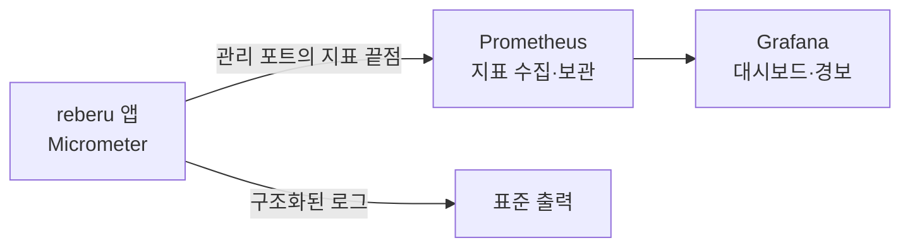

# 관측

> 버전: v0.2.0\
> 수정일: 2026-11-27

배포한 서버의 상태를 숫자로 보고, 문제가 생기면 경보를 받는 방법을 정한다. 결정의 근거는 [ADR-0017](../adr/0017-prometheus-grafana.md)이다. 로그 내용 규칙은 [architecture/security.md](../architecture/security.md) §13(SEC-LOG)을 따른다. 요구사항 ID 접두어는 `OPS`다.

## 1. 구성

| 구성 요소 | 하는 일 | 없을 때 |
| --- | --- | --- |
| Micrometer(앱 안) | 지표를 만들고 Prometheus 형식으로 내보낸다 | 앱에 늘 있다 |
| Prometheus | 정해진 간격으로 지표를 가져와 보관한다 | 지표를 모으지 않는다. 앱은 그대로 돈다 |
| Grafana | 대시보드를 보이고 경보 규칙을 돌린다 | 화면과 경보가 없다. 앱은 그대로 돈다 |

- Prometheus와 Grafana는 `compose.yml`의 `observability` 프로필로 띄운다. 기본 `docker compose up`에는 들어가지 않는다.
- 로그 모음 도구와 분산 추적은 두지 않는다. 필요해지면 새 ADR로 더한다.

## 2. 보안 요구사항

| ID | 요구사항 | 수준 |
| --- | --- | --- |
| OPS-OBS-01 | 지표 끝점은 앱 포트와 다른 관리 포트에서만 연다. 관리 포트는 외부에 공개하지 않고, 같은 내부망의 Prometheus만 접근한다. 관리 포트가 듣는 주소의 기본값은 `127.0.0.1`이다. 관리 포트에는 지표(`/actuator/prometheus`)와 상태 확인(`/actuator/health`)만 열고 인증은 두지 않는다 | 필수 |
| OPS-OBS-02 | 앱 포트에서 열린 관리 끝점은 상태 확인(살아 있음 `/livez`, 요청 받을 준비 `/readyz`)뿐이고 로그인 없이 부른다. 앱 포트의 `/actuator` 아래는 `404`다. 상태 확인 응답은 `{"status":"UP"}`처럼 상태 값만 담고 구성 요소 이름, 판, 오류 내용을 넣지 않는다 | 필수 |
| OPS-OBS-03 | 지표 이름표에 이메일, 이름, 계정·조직·팀 ID, 초대 토큰, 요청 주소 원문, 오류 메시지 원문을 넣지 않는다. 요청 주소는 경로 틀(`/api/teams/{teamId}`)로만 쓴다 | 필수 |
| OPS-OBS-04 | 지표 이름표 값은 앱이 정한 고정 목록에서만 나온다. 사용자 입력이 이름표 값이 되지 않는다. 서버의 파일 경로가 이름표로 나가는 디스크 지표와, 요청마다 여러 개씩 생기는 Spring Security 필터 관측은 끈다 | 필수 |
| OPS-OBS-05 | Grafana 관리자 비밀번호는 `.env`의 `GRAFANA_ADMIN_PASSWORD`로만 넣는다. 값이 비었거나 기본 비밀번호(`admin`)이면 Grafana가 시작하지 않는다. 익명 접근과 가입을 끈다 | 필수 |
| OPS-OBS-06 | Grafana와 Prometheus 화면은 외부에 공개하지 않는다. 내부망이나 별도 인증을 거친 경로로만 연다. `compose.yml`은 두 화면의 포트를 `127.0.0.1`에만 연다 | 필수 |

## 3. 지표

| 분류 | 지표 | 쓰는 곳 |
| --- | --- | --- |
| HTTP | 경로 틀·메서드·상태별 요청 수, 응답 시간 분포 | 오류 비율, 느린 API |
| JVM | 힙·GC·스레드 | 메모리 부족 징후 |
| DB | 연결 풀 사용 중·대기 수, 연결 대기 시간 | 풀 고갈 |
| 이벤트 | 미완료 발행 기록 수, 가장 오래된 미완료 기록의 나이, 구독자별 실패 수(ARCH-EVT-04) | 이벤트 밀림 |
| 보안 | 로그인 실패 수, 요청 제한 초과 수, CSRF 실패 수, 권한 거부 수(SEC-LOG-04) | 공격 징후 |
| 세션 | 활성 세션 수 | 비정상 증가 |
| 실시간 | 연결 수, 초당 메시지 수, 끊김 수 | v0.3부터 |

| ID | 요구사항 | 수준 |
| --- | --- | --- |
| OPS-OBS-07 | 이벤트 지표는 구독자 식별자까지만 나눈다. 조직·팀별로 나누지 않는다(OPS-OBS-03). 구독자 식별자는 `클래스 이름.메서드 이름`이다. 미완료 발행 기록 수와 나이는 30초마다 DB에서 읽어 둔 값이다 | 필수 |
| OPS-OBS-08 | 보안 지표는 실패 종류별로만 센다. 누가 실패했는지는 보안 로그에서 찾는다(SEC-LOG-04). 요청 제한 초과는 규칙 ID별로 센다. 권한 거부는 권한 판정이 거부한 요청만 센다. 있는 조직·팀을 볼 수 없는 계정의 `404`(멤버 아님, 끝난 멤버십, 기한 지난 손님, 손님에게 닫힌 API, 팀 소속 아님, 운영자 아님)는 센다. 없는 자원, 형식이 틀린 ID, 정지·삭제된 조직, 꺼진 모듈의 `404`는 세지 않는다 | 필수 |

앱이 직접 만드는 지표는 다음과 같다. Prometheus에서는 점이 밑줄로 바뀌고 횟수 지표에 `_total`이 붙는다.

| 지표 | 종류 | 이름표 | 뜻 |
| --- | --- | --- | --- |
| `reberu.events.incomplete` | 현재 값 | 없음 | 미완료 발행 기록 수 |
| `reberu.events.incomplete.oldest.age` | 현재 값(초) | 없음 | 가장 오래된 미완료 기록의 나이. 없으면 0 |
| `reberu.events.listener.failures` | 횟수 | `listener` | 구독자가 예외로 끝난 횟수 |
| `reberu.security.rejections` | 횟수 | `kind` | `login_failed`(로그인 실패), `csrf_invalid`(CSRF 실패), `access_forbidden`(권한 거부 `403`), `access_hidden`(권한 판정이 숨긴 `404`) |
| `reberu.security.rate.limited` | 횟수 | `rule` | 요청 제한 초과. 값은 규칙 ID(`SEC-RATE-01`~`08`) |

HTTP·JVM·DB 지표는 Spring Boot가 만드는 것을 그대로 쓴다(`http.server.requests`, `jvm.*`, `hikaricp.connections.*`). `http.server.requests`의 `uri`는 경로 틀이고, 처리기가 없는 요청은 `/**`, 인증 전에 거절된 요청은 `UNKNOWN`으로 모인다.

## 4. 대시보드와 경보

| ID | 요구사항 | 수준 |
| --- | --- | --- |
| OPS-OBS-09 | 대시보드와 경보 규칙은 파일로 저장소에 두고, Grafana가 시작할 때 읽는다. 화면에서 고친 내용은 파일에 다시 반영해야 남는다 | 필수 |
| OPS-OBS-10 | 아래 경보를 기본으로 둔다. 기준 값은 운영하면서 고친다 | 권장 |

| 경보 | 조건(초안) |
| --- | --- |
| 서버 오류 증가 | 5분 동안 `5xx` 응답이 전체의 1% 이상 |
| 응답 지연 | 5분 동안 응답 시간 95번째 백분위가 1초 이상 |
| DB 연결 풀 고갈 | 1분 넘게 연결 대기가 있음 |
| 이벤트 밀림 | 가장 오래된 미완료 발행 기록이 10분 이상 |
| 로그인 실패 급증 | 5분 동안 로그인 실패가 평소의 5배 이상 |

## 5. 로컬에서 보기

| 환경 변수 | 기본값 | 뜻 |
| --- | --- | --- |
| `MANAGEMENT_PORT` | `8081` | 관리 포트. 바꾸면 `ops/prometheus/prometheus.yml`의 수집 대상도 함께 바꾼다 |
| `MANAGEMENT_ADDRESS` | `127.0.0.1` | 관리 포트가 듣는 주소 |
| `GRAFANA_ADMIN_PASSWORD` | 없음 | `observability` 프로필을 띄울 때만 필수(OPS-OBS-05) |

1. `.env`에서 `# GRAFANA_ADMIN_PASSWORD=` 줄의 주석을 풀고 비밀번호를 넣는다.
2. 앱을 띄운다(`./gradlew bootRun`). 지표가 나오는지는 `http://127.0.0.1:8081/actuator/prometheus`에서 먼저 볼 수 있다.
3. `docker compose --profile observability up -d`로 Prometheus와 Grafana를 띄운다.
4. `http://localhost:3000/d/reberu-overview`에 사용자 이름 `admin`과 넣은 비밀번호로 들어가 `reberu 개요` 대시보드를 본다. 수집 상태는 `http://localhost:9090/targets`에서 본다.
5. 끌 때는 `docker compose --profile observability stop prometheus grafana`를 쓴다. `docker compose down -v`는 PostgreSQL 볼륨까지 지운다.

- Prometheus는 컨테이너에서 `host.docker.internal:8081`로 앱의 관리 포트를 읽는다. Docker Desktop에서는 기본 주소 `127.0.0.1` 그대로 읽힌다.
- 컨테이너가 호스트의 `127.0.0.1`에 닿지 않는 환경(Linux의 Docker Engine 등)에서는 `MANAGEMENT_ADDRESS`를 컨테이너망에서만 닿는 주소로 바꾼다. 모든 주소(`0.0.0.0`)로 열어야 하면 방화벽으로 외부 접근을 막는다(OPS-OBS-01).
- Grafana는 처음 띄울 때의 `GRAFANA_ADMIN_PASSWORD`를 `grafana-data` 볼륨에 저장한다. 그 뒤에 `.env` 값을 바꿔도 비밀번호는 바뀌지 않으므로 Grafana 화면에서 바꾸거나 `docker compose exec grafana grafana cli admin reset-admin-password "<새 비밀번호>"`로 맞춘다.
- Grafana 컨테이너가 바로 꺼지면 `docker compose logs grafana`로 비밀번호 설정 안내가 나오는지 본다(OPS-OBS-05).
- `targets`에서 `reberu`가 `DOWN`이면 앱이 꺼져 있거나 관리 포트가 수집 대상과 다르다.
- 대시보드는 15초마다 수집한 값으로 그린다. 처음에는 1~2분 지나야 선이 보이고, 보안·이벤트 패널은 해당 일이 생기기 전까지 비어 있다.
- 설정 파일은 `ops/prometheus/prometheus.yml`, `ops/grafana/provisioning/`, `ops/grafana/dashboards/`에 있다(OPS-OBS-09).

## 6. 단계

- v0.1: 지표 끝점과 관리 포트, HTTP·JVM·DB·이벤트·보안 지표, Compose `observability` 프로필, 기본 대시보드 하나, OPS-OBS-01~06 확인 테스트.
- v0.3: 실시간 지표와 경보.
- v0.4: 공간 위치 메시지 지표. 부하 시험 때 이 대시보드로 결과를 본다.