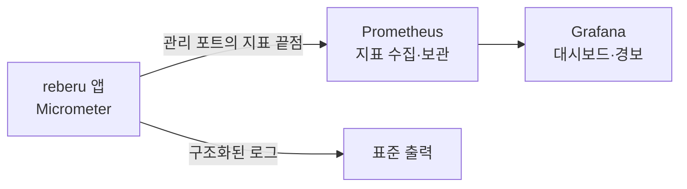

# 관측

> 버전: v0.1.0\
> 수정일: 2026-11-05

배포한 서버의 상태를 숫자로 보고, 문제가 생기면 경보를 받는 방법을 정한다. 결정의 근거는 [ADR-0017](../adr/0017-prometheus-grafana.md)이다. 로그 내용 규칙은 [architecture/security.md](../architecture/security.md) §13(SEC-LOG)을 따른다. 요구사항 ID 접두어는 `OPS`다.

## 1. 구성

| 구성 요소 | 하는 일 | 없을 때 |
| --- | --- | --- |
| Micrometer(앱 안) | 지표를 만들고 Prometheus 형식으로 내보낸다 | 앱에 늘 있다 |
| Prometheus | 정해진 간격으로 지표를 가져와 보관한다 | 지표를 모으지 않는다. 앱은 그대로 돈다 |
| Grafana | 대시보드를 보이고 경보 규칙을 돌린다 | 화면과 경보가 없다. 앱은 그대로 돈다 |

- Prometheus와 Grafana는 `compose.yml`의 `observability` 프로필로 띄운다. 기본 `docker compose up`에는 들어가지 않는다.
- 로그 모음 도구와 분산 추적은 두지 않는다. 필요해지면 새 ADR로 더한다.

## 2. 보안 요구사항

| ID | 요구사항 | 수준 |
| --- | --- | --- |
| OPS-OBS-01 | 지표 끝점은 앱 포트와 다른 관리 포트에서만 연다. 관리 포트는 외부에 공개하지 않고, 같은 내부망의 Prometheus만 접근한다 | 필수 |
| OPS-OBS-02 | 앱 포트에서 열린 관리 끝점은 상태 확인(살아 있음, 요청 받을 준비)뿐이다. 상태 확인 응답에 구성 요소 이름, 판, 오류 내용을 넣지 않는다 | 필수 |
| OPS-OBS-03 | 지표 이름표에 이메일, 이름, 계정·조직·팀 ID, 초대 토큰, 요청 주소 원문, 오류 메시지 원문을 넣지 않는다. 요청 주소는 경로 틀(`/api/teams/{teamId}`)로만 쓴다 | 필수 |
| OPS-OBS-04 | 지표 이름표 값은 앱이 정한 고정 목록에서만 나온다. 사용자 입력이 이름표 값이 되지 않는다 | 필수 |
| OPS-OBS-05 | Grafana 관리자 비밀번호는 `.env`로만 넣는다. 기본 비밀번호로 시작하지 않고, 익명 접근과 가입을 끈다 | 필수 |
| OPS-OBS-06 | Grafana와 Prometheus 화면은 외부에 공개하지 않는다. 내부망이나 별도 인증을 거친 경로로만 연다 | 필수 |

## 3. 지표

| 분류 | 지표 | 쓰는 곳 |
| --- | --- | --- |
| HTTP | 경로 틀·메서드·상태별 요청 수, 응답 시간 분포 | 오류 비율, 느린 API |
| JVM | 힙·GC·스레드 | 메모리 부족 징후 |
| DB | 연결 풀 사용 중·대기 수, 연결 대기 시간 | 풀 고갈 |
| 이벤트 | 미완료 발행 기록 수, 가장 오래된 미완료 기록의 나이, 구독자별 실패 수(ARCH-EVT-04) | 이벤트 밀림 |
| 보안 | 로그인 실패 수, 요청 제한 초과 수, CSRF 실패 수, 권한 거부 수(SEC-LOG-04) | 공격 징후 |
| 세션 | 활성 세션 수 | 비정상 증가 |
| 실시간 | 연결 수, 초당 메시지 수, 끊김 수 | v0.3부터 |

| ID | 요구사항 | 수준 |
| --- | --- | --- |
| OPS-OBS-07 | 이벤트 지표는 구독자 식별자까지만 나눈다. 조직·팀별로 나누지 않는다(OPS-OBS-03) | 필수 |
| OPS-OBS-08 | 보안 지표는 실패 종류별로만 센다. 누가 실패했는지는 보안 로그에서 찾는다(SEC-LOG-04) | 필수 |

## 4. 대시보드와 경보

| ID | 요구사항 | 수준 |
| --- | --- | --- |
| OPS-OBS-09 | 대시보드와 경보 규칙은 파일로 저장소에 두고, Grafana가 시작할 때 읽는다. 화면에서 고친 내용은 파일에 다시 반영해야 남는다 | 필수 |
| OPS-OBS-10 | 아래 경보를 기본으로 둔다. 기준 값은 운영하면서 고친다 | 권장 |

| 경보 | 조건(초안) |
| --- | --- |
| 서버 오류 증가 | 5분 동안 `5xx` 응답이 전체의 1% 이상 |
| 응답 지연 | 5분 동안 응답 시간 95번째 백분위가 1초 이상 |
| DB 연결 풀 고갈 | 1분 넘게 연결 대기가 있음 |
| 이벤트 밀림 | 가장 오래된 미완료 발행 기록이 10분 이상 |
| 로그인 실패 급증 | 5분 동안 로그인 실패가 평소의 5배 이상 |

## 5. 단계

- v0.1: 지표 끝점과 관리 포트, HTTP·JVM·DB·이벤트·보안 지표, Compose `observability` 프로필, 기본 대시보드 하나, OPS-OBS-01~06 확인 테스트.
- v0.3: 실시간 지표와 경보.
- v0.4: 공간 위치 메시지 지표. 부하 시험 때 이 대시보드로 결과를 본다.