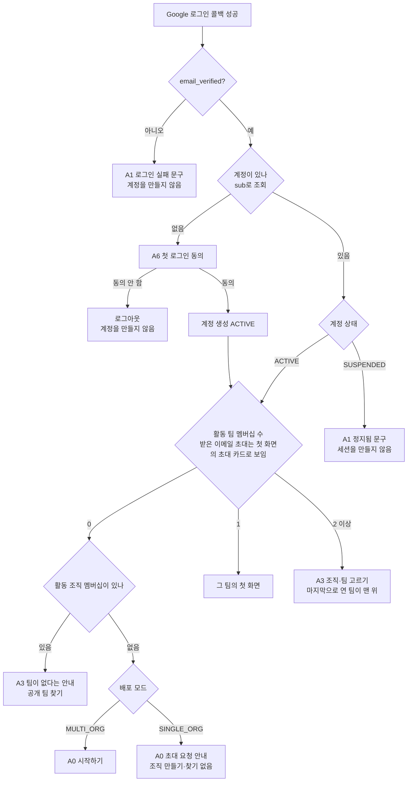
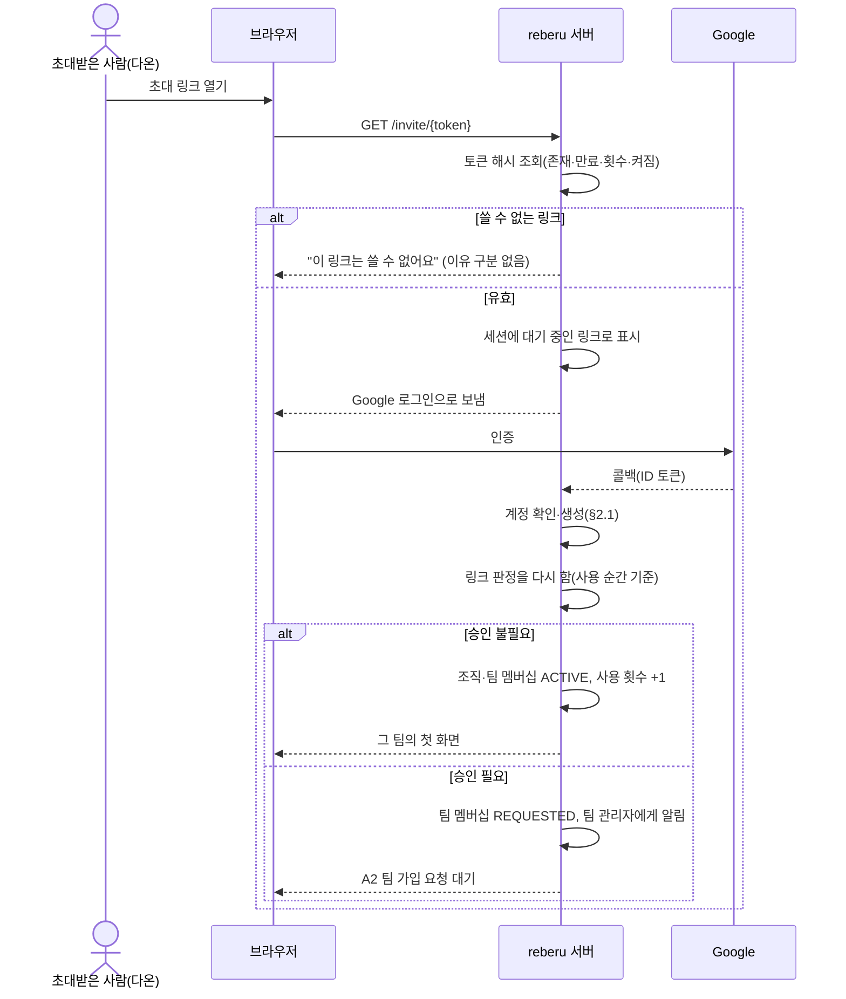
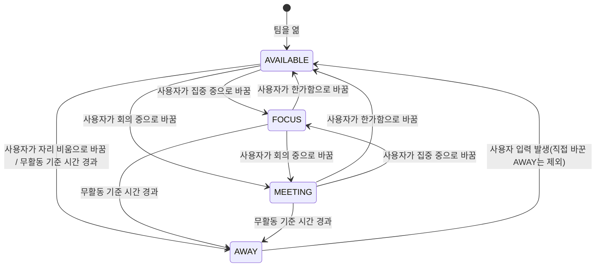
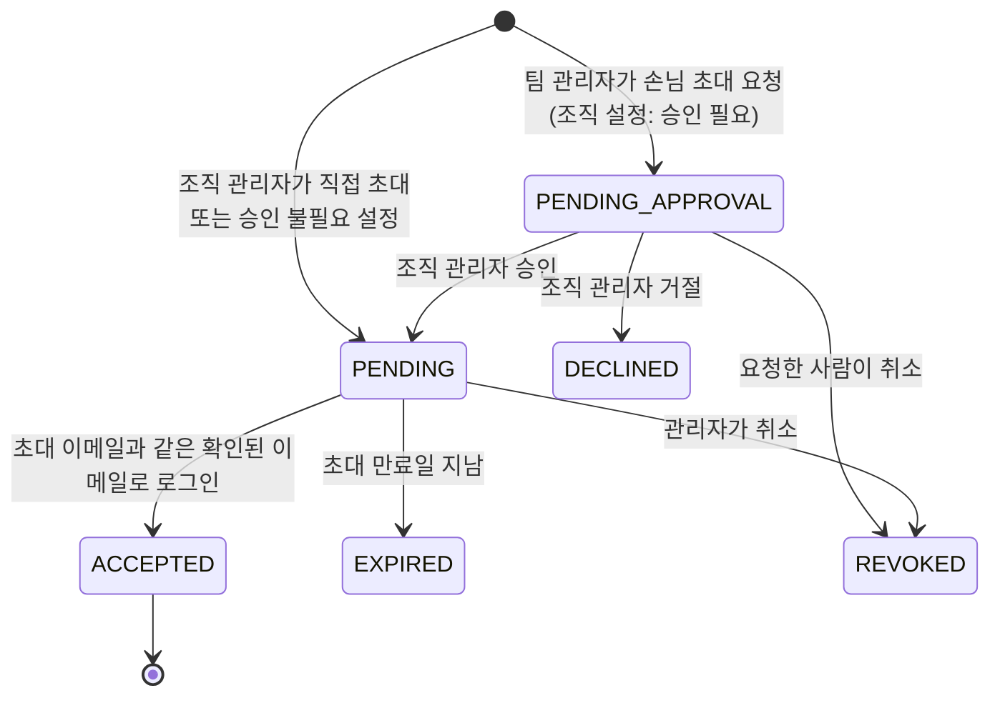
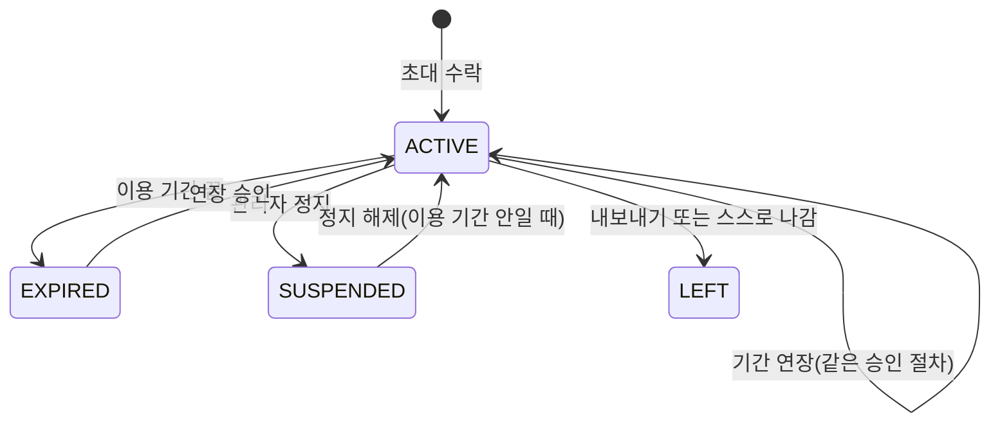

# 사용자 흐름

> 버전: v0.3.0\
> 수정일: 2026-11-05

사용자가 reberu에 처음 들어오는 경로, 역할별 하루, 예외 상황에서의 동작을 정의한다. 화면 하나하나의 명세는 [screens.md](screens.md), 가입·권한 규칙은 [../architecture/tenancy.md](../architecture/tenancy.md), 출석·EXP 규칙은 [../domain/rules.md](../domain/rules.md)가 기준이다. 이 문서와 그 문서들이 어긋나면 그 문서가 우선한다.

## 1. 범위

- 다룬다: 처음 들어오기 경로, 구성원·팀 관리자·조직 관리자·손님의 일상 흐름, 현재 상태 전이, 예외 흐름
- 다루지 않는다: 가입 정책의 판정 규칙(architecture/tenancy), 보안 검증(architecture/security), 이벤트 형식(architecture/realtime)

## 2. 처음 들어오기

### 2.1 로그인 후 첫 화면 결정

로그인 콜백이 끝난 뒤 서버가 첫 화면을 정한다. 클라이언트가 첫 화면을 고르지 않는다.

- UX-FLOW-01 (필수): 첫 화면은 위 흐름의 결과 하나로만 정해진다.
- UX-FLOW-02 (필수): "팀의 첫 화면"은 공간 모듈이 켜진 팀이면 B1 로비, 꺼진 팀이면 B7 단순하게 보기다.
- UX-FLOW-03 (필수): 이메일 초대는 계정이 새것이든 아니든 자동으로 수락하지 않는다. 첫 화면 위에 초대 카드(조직, 팀, 초대한 사람, [수락] [거절])가 뜨고, 한 번 누르면 그 팀 첫 화면으로 간다. 초대 링크를 눌러 들어온 경우는 사용자가 직접 행동한 것이므로 자동으로 수락한다([../architecture/tenancy.md](../architecture/tenancy.md) §6.3).
- UX-FLOW-04 (필수): 첫 화면 결정 중 어느 단계든 팀을 열면 그 순간 출석 판정을 한다([../domain/rules.md](../domain/rules.md) §5).

### 2.2 경로별 흐름

| 경로 | 시작 | 거치는 화면 | 끝 |
| --- | --- | --- | --- |
| 이메일 초대를 받은 구성원 | 관리자가 E2·F5에서 이메일 초대 | A1 → (처음이면 A6) → 초대 카드에서 수락 | 초대받은 팀의 첫 화면 |
| 초대 링크를 받은 사람 | 링크 열기 | A1 → (처음이면 A6) → 링크 판정 | 승인 불필요: 그 팀 / 승인 필요: A2 |
| 조직을 만드는 사람 (`MULTI_ORG`) | A0 "조직 만들기" | A4 → F1 | 첫 팀을 가진 새 조직의 조직 관리자 |
| 공개 조직을 찾는 사람 (`MULTI_ORG`) | A0 "공개 조직 찾기" | A5 → 가입 요청 | 승인 필요: A2 / 바로 가입: A3(팀 없음 안내) |
| 손님 | 팀 관리자가 손님 초대 → 조직 관리자 승인 | A1 → (처음이면 A6) → 초대 카드에서 수락 | 초대받은 팀의 첫 화면, 손님 표시 |
| 도메인 자동 가입 대상 (도입 단계는 [../product/overview.md](overview.md)) | 확인된 도메인 이메일로 로그인 | A1 → (처음이면 A6) | 바로 구성원: A3(팀 없음 안내) / 승인 대기: A2 |
| `SINGLE_ORG` 첫 조직 관리자 | 환경 변수 이메일로 첫 로그인 | A1 → A6 | 조직이 만들어지고 F1 |

- UX-FLOW-05 (필수): 링크 판정은 링크를 연 순간과 로그인 직후 두 번 한다. 그 사이에 링크가 꺼지거나 만료되면 두 번째 판정에서 막는다.
- UX-FLOW-06 (필수): 초대 링크로 들어온 사람의 멤버 종류는 늘 `MEMBER`다. `GUEST` 신분은 이메일 초대로만 생긴다.

## 3. 현재 상태

현재 상태는 팀 멤버십마다 하나다. 동료 화면에 실시간으로 보인다([../architecture/realtime.md](../architecture/realtime.md) `status.changed`).

- UX-FLOW-15 (필수): `AVAILABLE`, `FOCUS`, `MEETING`은 사용자가 직접 고른다. 공간에 들어가거나 나가도 현재 상태는 바뀌지 않는다([../adr/0015-healing-only-spaces.md](../adr/0015-healing-only-spaces.md)).
- UX-FLOW-14 (필수): 무활동 기준 시간(OQ-37)은 서버 설정 값이다. 그 시간 동안 입력이 없으면 `AVAILABLE`·`FOCUS`·`MEETING`이 `AWAY`가 된다.
- UX-FLOW-12 (필수): 사용자가 직접 고른 `AWAY`는 입력이 있어도 바뀌지 않는다. 무활동으로 생긴 `AWAY`만 입력이 생기면 `AVAILABLE`로 돌아간다.
- UX-FLOW-13 (필수): 모든 탭·기기의 연결이 끊긴 뒤 유예 시간이 지나면 현재 상태 표시를 지우고 "접속 안 함"으로 보인다([../architecture/realtime.md](../architecture/realtime.md) §6.2). 다시 들어오면 `AVAILABLE`에서 시작한다.
- 힐링 존에 있을 때의 상태는 OQ-04를 따른다.

## 4. 구성원의 하루

모든 모듈이 켜진 팀의 팀원 기준이다. EXP 수치는 [../domain/rules.md](../domain/rules.md)가 기준이다.

| 순서 | 행동 | 화면 | 서버가 하는 일 | 실시간 | EXP |
| --- | --- | --- | --- | --- | --- |
| 1 | 로그인, 팀을 엶 | A1 → B1 | 근무일이면 그날 첫 열기에 출석 기록, 연속 출석 계산 | `attendance.checked-in`(팀) | 출석, 연속 출석 보너스 |
| 2 | 오늘 요약 확인 (아침 요약 모듈) | B1 | 마감 지남·오늘 마감·3일 안 마감·중요·남은 할 일 집계 | 없음 | 없음 |
| 3 | 동료에게 인사 | B1 | 처리 없음(휘발) | `greeting.sent`(공간) | 없음 |
| 4 | 오늘의 할 일 적기 | 업무 패널, C3 | 할 일 저장 | 없음 | 없음 |
| 5 | 현재 상태를 `FOCUS`로 | 업무 패널 | 상태 저장 | `status.changed`(팀) | 없음 |
| 6 | 업무 진행, 완료 | 업무 패널, C1, C2 | 상태 변경, 완료 시 EXP 지급(한 업무에 한 번 몫) | `task.changed`(팀), `exp.changed`(개인) | 업무 완료 |
| 7 | 레벨업 | C4 짧은 알림 | 레벨 계산 | `level.up`(개인), `level.celebrated`(공간) | 없음 |
| 8 | 라운지에서 칭찬 (칭찬 모듈) | B3, B3-1 | 칭찬 저장, 받은 사람 EXP | `notification.created`, `exp.changed`(받은 사람 개인) | 받은 사람만 |
| 9 | 회의실에 모여 외부 회의 링크 열기 | B4 | 처리 없음(외부 회의는 reberu 밖) | `avatar.seated`(공간) | 없음 |
| 10 | 바닷가·산길에서 휴식 | B5, B12 | 휴식 시작·끝 기록, 알림 모아 두기 | `rest.started`/`rest.ended`(공간) | 없음(ADR-0011) |
| 11 | 퇴근 요약, "내일 봐요" | C8 | 퇴근 시각 기록(OQ-06), 세션 유지 | `presence.offline`(팀, 연결이 끊긴 뒤) | 없음 |

### 4.1 모듈이 꺼진 팀의 변형

| 꺼진 모듈 | 바뀌는 순서 |
| --- | --- |
| 공간 | 1의 첫 화면이 B7. 3·9·10이 없다 |
| 아침 요약 | 2가 없다. 마감 알림(고정 기능)은 D1에 그대로 온다 |
| 칭찬 | 8이 없다. 칭찬 EXP 출처가 사라진다 |
| 오늘의 퀘스트 | C3에 할 일만 보인다 |

- UX-FLOW-20 (필수): 어떤 모듈 조합에서도 업무, 할 일, 출석, 리포트, 알림 흐름은 같다.

### 4.2 비근무일

- UX-FLOW-21 (필수): 주말과 조직 휴일에는 1의 출석 기록과 출석 EXP가 없다. 출근 알림도 보내지 않는다. 화면은 "쉬는 날" 상태를 보인다.
- UX-FLOW-22 (필수): 비근무일에도 업무 완료 EXP 등 출석 외 규칙은 평소와 같다.

## 5. 팀 관리자의 하루

| 순서 | 행동 | 화면 | 결과 |
| --- | --- | --- | --- |
| 1 | 승인 대기·오늘 출석 확인 | E1 | 대기 수, 출석 수 표시(비근무일이면 "쉬는 날") |
| 2 | 가입 요청 승인·거절 | E2 요청 탭 | 요청한 사람 멤버십 `ACTIVE`/`REJECTED`, 요청한 사람 화면이 바로 바뀜 |
| 3 | 이메일 초대·초대 링크 관리 | E2 | 초대 생성(조직 밖 사람이고 "새 구성원 조직 관리자 확인"이 켜져 있으면 `PENDING_APPROVAL`, 아니면 `PENDING`), 링크 생성·끄기(조직이 링크를 허용할 때만) |
| 4 | 손님 초대 요청 | E2 손님 탭 | 조직 설정에 따라 `PENDING_APPROVAL` 또는 `PENDING` |
| 5 | 팀원 역할 변경·정지·내보내기 | E3 | 역할 변경, 멤버십 `SUSPENDED`, 내보내기는 `LEFT`. 대상의 팀 권한이 바로 끊김 |
| 6 | 팀 설정·팀 기능 | E4, E6 | 설정 저장, 모듈 켜고 끄기(조직이 허용한 것만) |
| 7 | 이상 변경 추적 | E5 | 팀 활동 기록 조회 |

## 6. 조직 관리자의 하루

| 순서 | 행동 | 화면 | 결과 |
| --- | --- | --- | --- |
| 1 | 조직 현황 | F1 | 팀별 인원·승인 대기·출석 수 |
| 2 | 팀 만들기·보관 | F2 | 새 팀 `ACTIVE`(직무 유형 기본값 복사), 보관 `ARCHIVED` |
| 3 | 가입 요청·초대 승인 | F5 | 조직 멤버십 `ACTIVE`/`REJECTED`, 팀 관리자가 만든 손님·새 구성원 초대 `PENDING`/`DECLINED` |
| 4 | 공개 범위·가입 방법·손님 규칙 | F7 | 저장 시 최근 인증 확인([../architecture/security.md](../architecture/security.md) §7.2) |
| 5 | 허용 모듈 | F4 | 허용을 거두면 그 모듈을 켠 팀에서 바로 꺼짐 |
| 6 | 휴일 달력 | F8 | 근무일 판정이 바뀜. 지난 출석 기록은 그대로 |
| 7 | 조직 활동 기록 | F6 | 조직 변경과 모든 팀의 기록 조회 |

- UX-FLOW-30 (필수): 조직 관리자는 그 팀의 팀 멤버십이 없어도 E 화면을 연다. 이때 출석·EXP는 쌓이지 않고 공간에 들어가지 않는다.
- 조직 관리자의 팀 열람이 팀원에게 보이는지는 OQ-15를 따른다.

## 7. 손님의 수명

수락 뒤에는 손님의 팀 멤버십이 아래처럼 움직인다.

- UX-FLOW-40 (필수): 이용 기간이 끝나기 7일 전 그 팀의 팀 관리자에게 알린다.
- UX-FLOW-41 (필수): 이용 기간이 끝나는 순간 손님의 그 팀 권한과 실시간 듣기를 끊는다. 다른 활동 멤버십이 없으면 다음 로그인 때 A0으로 간다.
- UX-FLOW-42 (필수): 손님을 구성원으로 바꾸면 이용 기간 제한이 없어지고 활동 기록에 남는다.

## 8. 예외 흐름

| ID | 상황 | 동작 | 기준 문서 |
| --- | --- | --- | --- |
| UX-FLOW-50 (필수) | 연결 끊김 | 30초 유예. 그 안에 다시 연결되면 아무 일도 없던 것으로 본다. 넘으면 공간에서 조용히 사라지고 `presence.offline`. "나갔어요" 알림은 띄우지 않는다. 다시 연결되면 상태를 API로 다시 불러온다 | [../architecture/realtime.md](../architecture/realtime.md) |
| UX-FLOW-51 (필수) | 같은 계정의 여러 탭·기기 | 공간에는 한 명으로 보인다. 위치는 가장 최근에 움직인 탭을 따른다. 모든 탭이 끊겨야 나간 것으로 본다 | architecture/realtime |
| UX-FLOW-52 (필수) | 사용 중 팀에서 정지·내보내기 | 다음 요청부터 그 팀 데이터가 "찾을 수 없음"으로 응답한다. 열린 화면은 `membership.removed`를 받고 A3으로 간다. 쓰던 글은 버린다 | [../architecture/tenancy.md](../architecture/tenancy.md) |
| UX-FLOW-53 (필수) | 사용 중 조직 멤버십 정지 | 그 조직의 모든 팀에 52와 같이 처리한다 | architecture/tenancy |
| UX-FLOW-54 (필수) | 사용 중 계정 정지 | 모든 세션과 연결을 끊고 A1 정지됨으로 간다 | architecture/security |
| UX-FLOW-55 (필수) | 사용 중 모듈 꺼짐 | `team.modules-changed`를 받으면 그 모듈의 메뉴·화면을 닫는다. 그 모듈 화면에 있었으면 팀의 첫 화면으로 간다 | architecture/realtime |
| UX-FLOW-56 (필수) | 공간 정원 참 | 들어가지 못하고 "자리가 다 찼어요". 지금 있던 공간에 그대로 있고 업무 패널은 계속 쓴다 | [spaces.md](spaces.md) |
| UX-FLOW-57 (필수) | 3D를 그리지 못하는 기기 | B7로 자동 전환하고 한 번 안내한다. 기능은 모두 쓴다 | spaces.md |
| UX-FLOW-58 (필수) | 퇴근 요약 없이 창 닫기 | 퇴근 시각 처리는 OQ-06을 따른다 | domain/rules |
| UX-FLOW-59 (필수) | 비근무일 접속 | §4.2 | domain/rules |
| UX-FLOW-60 (필수) | 링크를 연 뒤 로그인 사이에 링크가 무효가 됨 | 로그인 직후 판정에서 막고 "이 링크는 쓸 수 없어요" | §2.2 |
| UX-FLOW-61 (필수) | 초대와 다른 Google 계정으로 로그인 | 초대를 수락하지 않는다. 계정을 이어 붙이지 않는다. 그 계정의 원래 흐름(§2.1)대로 간다 | architecture/tenancy |
| UX-FLOW-62 (필수) | 팀이 보관됨 | 그 팀은 보기만 된다. 쓰기 요청은 거부한다. A3에서 "보관된 팀" 묶음에 보인다 | architecture/tenancy |
