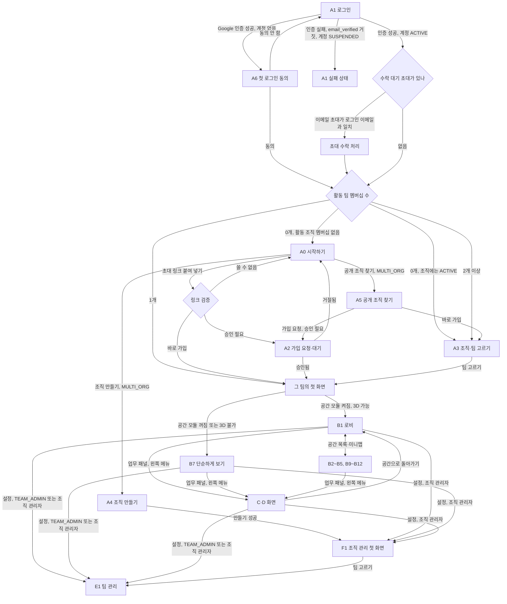
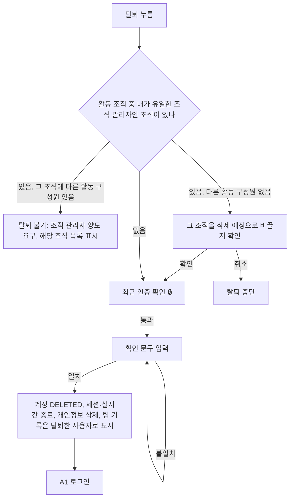

# 화면 명세

> 버전: v0.2.0\
> 수정일: 2026-11-04

화면마다 진입 조건, 상태, 데이터, 행동, 실시간 변화, 오류, 이동을 정한다. 시각 디자인은 다루지 않는다. 그림(평면도·모바일)은 이 문서를 입력으로 따로 그린다.

- 화면 방향과 공간 규칙: [spaces.md](spaces.md)
- 권한·멤버 종류·가입: [../architecture/tenancy.md](../architecture/tenancy.md)
- 보안 요구사항(입력 상한, 최근 인증, 실패 응답): [../architecture/security.md](../architecture/security.md)
- 실시간 이벤트 정의: [../architecture/realtime.md](../architecture/realtime.md)
- 업무·출석·EXP 규칙: [../domain/rules.md](../domain/rules.md)

## 1. 화면 목록

종류: `2D`(일반 화면), `3D`(공간), `창`(다른 화면 위에 뜨는 창). 모바일 ○는 390×844 화면도 정의한다는 뜻이다. 모듈 `-`는 고정 기능이다. 화면별 도입 단계는 [../product/overview.md](overview.md)의 MVP 단계를 따른다.

| 번호 | 이름 | 종류 | 모듈 | 모바일 |
| --- | --- | --- | --- | --- |
| A0 | 시작하기 | 2D | - | ○ |
| A1 | 로그인 | 2D | - | ○ |
| A2 | 가입 요청·대기 | 2D | - | ○ |
| A3 | 조직·팀 고르기 | 2D | - | ○ |
| A4 | 조직 만들기 | 2D | - | ○ |
| A5 | 공개 조직 찾기 | 2D | - | ○ |
| A6 | 첫 로그인 동의 | 2D | - | ○ |
| B0 | 공간 공통 요소 | 3D | 공간 | ○ |
| B1 | 로비 | 3D | 공간 | |
| B2 | 내 자리 | 3D | 공간 | |
| B3 | 라운지 | 3D | 공간 | |
| B3-1 | 칭찬 보내기 | 창 | 칭찬 | ○ |
| B4 | 회의실 | 3D | 공간 | |
| B5 | 바닷가 | 3D | 힐링 존 | |
| B6 | 미니맵 | 창 | 공간 | |
| B7 | 단순하게 보기 | 2D | - | ○ |
| B8 | 동료 카드 | 창 | - | ○ |
| B9 | 광장 | 3D | 조직 공간 | |
| B10 | 연회장 | 3D | 조직 공간 | |
| B12 | 산길 | 3D | 힐링 존 | |
| C0 | 업무 화면 공통 틀 | 2D | - | ○ |
| C1 | 업무 목록 | 2D | - | ○ |
| C2 | 업무 상세·작성 | 2D | - | ○ |
| C3 | 오늘의 할 일·퀘스트 | 2D | - (퀘스트 부분: 오늘의 퀘스트) | ○ |
| C4 | 레벨업 | 창 | - | ○ |
| C5 | 프로필 | 2D | - | ○ |
| C6 | 명예의 전당 | 2D | 명예의 전당 | |
| C7 | 리포트 | 2D | - | |
| C8 | 퇴근 요약 | 창 | - | ○ |
| C9 | 프로젝트 목록 | 2D | - | ○ |
| C10 | 프로젝트 상세·작성 | 2D | - | ○ |
| D1 | 알림 목록 | 창 | - | ○ |
| D2 | 알림 설정 | 2D | - | ○ |
| D3 | 내 계정 | 2D | - | ○ |
| E1 | 팀 관리 첫 화면 | 2D | - | |
| E2 | 가입·초대 관리 | 2D | - | |
| E3 | 팀원 관리 | 2D | - | |
| E4 | 팀 설정·역할 | 2D | - | |
| E5 | 팀 활동 기록 | 2D | - | |
| E6 | 팀 기능 | 2D | - | |
| F1 | 조직 관리 첫 화면 | 2D | - | |
| F2 | 팀 목록·만들기 | 2D | - | |
| F3 | 직무 유형 | 2D | - | |
| F4 | 허용 모듈 | 2D | - | |
| F5 | 구성원 관리 | 2D | - | |
| F6 | 조직 활동 기록 | 2D | - | |
| F7 | 조직 설정 | 2D | - | |
| F8 | 휴일 달력 | 2D | - | |

모듈 이름과 범위: 공간(`TEAM`), 힐링 존(`TEAM`, 공간 필요), 칭찬(`TEAM`), 오늘의 퀘스트(`TEAM`), 명예의 전당(`TEAM`), 아침 요약(`TEAM`), 인증·만료일 관리(`TEAM`), 외부 알림(`TEAM`), 조직 공간(`ORG`). 정의는 [../product/overview.md](overview.md) §5.2.

## 2. 화면 이동

- 팀의 첫 화면(`H`)은 공간 모듈이 켜져 있고 기기가 3D를 그릴 수 있으면 B1, 아니면 B7이다.
- 손님은 A4, A5, E, F에 들어가지 않는다.

## 3. 공통 규칙

### 3.1 접근과 노출

| ID | 수준 | 규칙 |
| --- | --- | --- |
| UX-SCR-001 | 필수 | 진입 조건을 만족하지 않는 화면 주소로 들어오면 "찾을 수 없는 화면" 하나로 처리한다. 권한 없음과 없음을 구별해 보이지 않는다 ([../architecture/security.md](../architecture/security.md) §9) |
| UX-SCR-002 | 필수 | 꺼진 모듈의 화면·메뉴·버튼·알림 종류는 그리지 않는다. `team.modules-changed`를 받으면 현재 화면이 꺼진 모듈의 화면이면 팀의 첫 화면으로 옮긴다 |
| UX-SCR-003 | 필수 | 손님에게는 다른 팀 이름, 조직 구성원 목록, 조직 활동 기록, 공개 팀 찾기, 관리 메뉴를 그리지 않는다. 조직 공간 출입은 조직 설정(F7)을 따른다 |
| UX-SCR-004 | 필수 | 권한이 없는 행동의 버튼은 그리지 않는다. 버튼을 숨겨도 서버가 다시 확인한다는 전제로 화면을 설계한다 |
| UX-SCR-005 | 필수 | 최근 인증이 필요한 행동(표시: 🔒)은 누르는 순간 최근 인증 시각을 확인하고, 지났으면 Google 재인증을 거친 뒤 같은 행동을 이어 간다 ([../architecture/security.md](../architecture/security.md) §7.2) |

### 3.2 문구와 오류

| ID | 수준 | 규칙 |
| --- | --- | --- |
| UX-SCR-010 | 필수 | 인증·초대·가입 실패 문구는 이유를 나누지 않는다. 링크는 "이 링크는 쓸 수 없어요", 로그인은 "로그인하지 못했어요" 하나로 쓴다 |
| UX-SCR-011 | 필수 | 저장 실패 시 사용자가 입력한 내용을 지우지 않는다 |
| UX-SCR-012 | 필수 | 다른 사람이 먼저 처리한 요청(승인, 거절, 수정)은 "이미 처리됐어요"로 알리고 최신 상태를 다시 불러온다 |
| UX-SCR-013 | 권장 | 화면 문구는 짧은 존댓말로 쓴다. 예시 문구는 이 문서에 있는 것을 기준으로 하되 확정 문구는 화면 설계에서 정한다 |

### 3.3 로딩과 재시도

| ID | 수준 | 규칙 |
| --- | --- | --- |
| UX-SCR-020 | 필수 | 실시간 연결이 끊기면 위쪽에 "다시 연결하는 중" 띠를 보이고, 업무 패널과 업무 화면은 계속 쓸 수 있게 한다 |
| UX-SCR-021 | 필수 | 다시 연결되면 현재 화면의 데이터를 API로 다시 불러온다. 놓친 이벤트를 하나씩 재생하지 않는다 ([../architecture/realtime.md](../architecture/realtime.md) §6.3) |
| UX-SCR-022 | 권장 | 저장 요청은 응답 전까지 같은 버튼을 다시 누를 수 없게 한다. 같은 요청이 두 번 가도 서버는 한 번만 처리한다 |
| UX-SCR-023 | 필수 | 3D를 그릴 수 없는 기기(그래픽 초기화 실패, 설정의 3D 끄기)에서는 B7로 바꾸고 한 번 안내한다 |
| UX-SCR-024 | 필수 | 수락하지 않은 이메일 초대가 있으면 첫 화면(A0, A3, 팀 첫 화면) 위에 초대 카드(조직, 팀, 초대한 사람, 멤버 종류, [수락] [거절])를 띄운다. 이메일 초대는 자동으로 수락하지 않는다(OQ-45) |

---

## A. 들어오기

### A0 시작하기

- **목적**: 어느 조직에도 활동 멤버십이 없는 계정이 다음 행동을 고른다.
- **진입 조건**: 계정 `ACTIVE`, 활동 조직 멤버십 0개.
- **상태**: 받은 초대 있음 / 없음 / 보낸 가입 요청 있음.
- **보이는 데이터**
  - 받은 초대: 조직 이름, 팀 이름, 보낸 사람 표시 이름, 멤버 종류, 만료 시각
  - 보낸 가입 요청: 조직 이름, 요청 시각, 상태
- **행동**
  - 초대 수락 → 초대 수락 처리([../architecture/tenancy.md](../architecture/tenancy.md) §6.3) → 팀의 첫 화면
  - 초대 거절 → 초대 `DECLINED` → 목록에서 빠짐
  - 조직 만들기 → A4 (`MULTI_ORG`에서만 보임)
  - 공개 조직 찾기 → A5 (`MULTI_ORG`에서만 보임)
  - 초대 링크 붙여 넣기 → 링크 검증 → A2 또는 팀의 첫 화면. 실패 시 UX-SCR-010 문구
- **실시간**: `notification.created`(새 초대) → 받은 초대 목록 갱신.
- **빈·오류**: 초대 없음 → `MULTI_ORG` "조직을 만들거나 찾아보세요", `SINGLE_ORG` "관리자에게 초대를 요청해 주세요".
- **이동**: A4, A5, A2, 팀의 첫 화면.

### A1 로그인

- **목적**: Google 계정으로 인증한다. 다른 로그인 방법은 없다(ADR-0004).
- **진입 조건**: 로그인하지 않은 사용자.
- **상태**: 기본 / 인증 중 / 실패.
- **보이는 데이터**: 서비스 이름, 한 줄 소개(고정 문구).
- **행동**: "Google로 시작하기" → OIDC 인가 요청 → 콜백 처리([../architecture/tenancy.md](../architecture/tenancy.md) §6.1) → §2 흐름에 따라 이동.
- **실시간**: 없음.
- **빈·오류**
  - 인증 실패, `email_verified` 거짓, 계정 `SUSPENDED` → "로그인하지 못했어요. 다시 시도해 주세요." (UX-SCR-010)
  - 요청 제한에 걸림 → "잠시 후 다시 시도해 주세요."
- **이동**: A6, A0, A3, 팀의 첫 화면.

### A2 가입 요청·대기

- **목적**: 승인을 기다리는 가입 요청의 상태를 보인다.
- **진입 조건**: 내 조직 멤버십 또는 팀 멤버십이 `REQUESTED`.
- **상태**: 조직 가입 대기 / 팀 가입 대기 / 거절됨 / 승인됨.
- **보이는 데이터**: 요청 대상(조직 이름, 팀 이름), 요청 시각, 상태.
- **행동**: 요청 취소 → 멤버십 `REQUESTED` → `LEFT`(사유 `SELF`) → A0 또는 A3.
- **실시간**: `join-request.decided` → 승인되면 대상 팀의 첫 화면, 거절되면 "거절됐어요" 상태.
- **빈·오류**: 대상 조직이 `SUSPENDED`·`DELETED`가 되면 요청은 `REJECTED`로 보인다. 이유는 나누지 않는다.
- **이동**: 팀의 첫 화면, A0, A3.

### A3 조직·팀 고르기

- **목적**: 들어갈 팀을 고른다.
- **진입 조건**: 활동 조직 멤버십 1개 이상, 그리고 활동 팀 멤버십이 0개 또는 2개 이상.
- **상태**: 기본 / 조직별 묶음(조직 2개 이상, `SINGLE_ORG`에서는 묶지 않음) / 팀 없음.
- **보이는 데이터**
  - 팀마다: 조직 이름, 팀 이름, 직무 유형, 내 팀 역할, 손님 표시와 이용 기간 끝, 접속자 수, 오늘 내 출석 여부, 안 읽은 알림 수
  - 마지막으로 연 팀을 맨 위에 둔다
  - `ARCHIVED` 팀은 아래에 따로, 보기만
  - 받은 초대 수
- **행동**
  - 팀 고르기 → 지금 팀 확정 → 팀의 첫 화면. 근무일이면 출석 기록([../domain/rules.md](../domain/rules.md) §5)
  - 공개 팀 찾기 → 조직의 `PUBLIC` 팀 목록 → 가입 요청 또는 바로 들어가기(팀 설정에 따름). 구성원(`MEMBER`)에게만 보임
  - 조직 만들기 → A4, 공개 조직 찾기 → A5 (`MULTI_ORG`, 구성원 계정)
- **실시간**: 없음. 접속자 수는 화면을 열 때 불러온다.
- **빈·오류**: 조직에 들어왔지만 팀 0개 → "아직 들어간 팀이 없어요" + 공개 팀 찾기(구성원에게만).
- **이동**: 팀의 첫 화면, A4, A5, A2.

### A4 조직 만들기

- **목적**: 새 조직과 첫 팀을 만들고 첫 조직 관리자가 된다.
- **진입 조건**: `MULTI_ORG`, 계정 `ACTIVE`, 만든 조직 수가 상한 미만(OQ-27).
- **상태**: 입력 / 저장 중.
- **보이는 데이터(입력)**

| 필드 | 필수 | 규칙 |
| --- | --- | --- |
| 조직 이름 | ○ | 길이 상한과 금지어 검사([../architecture/security.md](../architecture/security.md) §12.1) |
| 한 줄 소개 | | 길이 상한 |
| 공개 범위 | ○ | 기본 `PRIVATE` |
| 시간대 | ○ | 기본은 브라우저 시간대 |
| 첫 팀 이름 | ○ | 길이 상한 |
| 첫 팀 직무 유형 | ○ | 기본 직무 유형 중에서(OQ-16) |

- **행동**: 만들기 → 조직 `ACTIVE`, 내 조직 멤버십 `ACTIVE`·`MEMBER`·조직 관리자, 첫 팀 `ACTIVE`, 내 팀 멤버십 `TEAM_ADMIN` → F1.
- **빈·오류**: 상한 초과 → "더 만들 수 없어요". 이름 규칙 위반 → 칸 아래 안내.
- **이동**: F1.

### A5 공개 조직 찾기

- **목적**: `PUBLIC` 조직을 찾아 가입을 요청한다.
- **진입 조건**: `MULTI_ORG`, 계정 `ACTIVE`.
- **상태**: 검색 전 / 결과 / 결과 없음.
- **보이는 데이터**: 조직 이름, 한 줄 소개, 가입 방식(승인 필요 / 바로 가입). 구성원 수와 이름은 보이지 않는다.
- **행동**
  - 검색(두 글자 이상, 요청 제한 적용) → `PUBLIC` 조직만 결과에 나옴
  - 가입 요청 → 조직 멤버십 `REQUESTED` → A2
  - 바로 가입 → 조직 멤버십 `ACTIVE`·`MEMBER` → A3 (팀 멤버십은 생기지 않음)
  - 이미 `REJECTED`·`SUSPENDED`인 조직 → 버튼 대신 "가입할 수 없어요"
- **빈·오류**: 결과 없음 → "찾는 조직이 없어요". `PRIVATE` 조직과 없는 조직은 결과에서 구별되지 않는다.
- **이동**: A2, A3.

### A6 첫 로그인 동의

- **목적**: 계정을 만들기 전에 이용약관과 개인정보 처리방침 동의를 받는다(OQ-28).
- **진입 조건**: 인증 성공, 해당 `sub`의 계정 없음.
- **상태**: 동의 전.
- **보이는 데이터**: 약관·처리방침 요약과 전문 링크, 받는 개인정보(표시 이름, 이메일, 프로필 사진 주소), 약관 버전.
- **행동**
  - 동의 → 계정 `ACTIVE` 생성, 동의한 약관 버전과 시각 기록 → §2 흐름
  - 동의 안 함 → 세션 종료, 계정 만들지 않음 → A1
- **이동**: §2 흐름.

---

## B. 공간

### B0 공간 공통 요소

- **목적**: 모든 공간 화면(B1~B5, B9~B12)에 같은 자리로 들어가는 요소를 정한다.
- **진입 조건**: 지금 팀이 확정됨, 공간 모듈 켜짐(조직 공간은 조직 공간 모듈).

| 요소 | 내용 | 행동 |
| --- | --- | --- |
| 위쪽 막대 | 팀 이름, 현재 시각(조직 시간대), 접속자 수, 내 레벨·EXP 막대, 안 읽은 알림 수, 소리 켜기/끄기(기본 끔), 보기 전환, 설정 | 팀 이름 → A3, EXP 막대 → C5, 알림 → D1, 보기 전환 → B7, 설정 → D2·D3·E1(팀 관리 권한)·F1(조직 관리자) |
| 공간 목록 | 팀 공간 6곳과 조직 공간 2곳(조직 공간 모듈), 공간별 인원/정원 | 누르면 그 공간으로 바로 이동. 정원이 찬 공간은 누를 수 없음 |
| 업무 패널 | 내 현재 상태, 오늘 할 업무(오늘이 기간에 포함된 내 업무 최대 5개, 마감 지남·오늘 마감 표시), 오늘의 할 일, 오늘의 퀘스트(모듈), 전체 보기 | 상태 바꾸기, 업무 상태 바꾸기, 할 일 체크, 전체 보기 → C1·C3 |
| 공간 뷰 | 아바타(표시 이름, 현재 상태, 손님 표시), 소품, 자리 | 걷기, 아바타 누르기 → B8 |
| 행동 막대 | 공간별 행동, 자리·소품 근처에서 뜨는 행동("앉기" 등) | 공간별 명세 |
| 잠깐 뜨는 알림 | 화면 가장자리에 몇 초 동안 보임 | 누르면 관련 화면 |

| ID | 수준 | 규칙 |
| --- | --- | --- |
| UX-SCR-100 | 필수 | 업무 패널의 위치와 구성은 모든 공간에서 같다 |
| UX-SCR-101 | 필수 | 글 입력 칸에 초점이 있는 동안 이동 키 입력을 공간으로 보내지 않는다. 이동 키는 공간 뷰에 초점이 있을 때만 동작한다 |
| UX-SCR-102 | 필수 | 레벨업·업적·EXP 연출은 짧은 알림으로만 띄우고, 하던 일을 가리는 창은 사용자가 눌렀을 때만 연다 |
| UX-SCR-103 | 필수 | 공간 정원이 차서 들어가지 못해도 업무 패널과 업무 화면은 쓸 수 있다 |
| UX-SCR-104 | 권장 | 깜빡이거나 화면을 흔드는 효과를 쓰지 않는다 |

- **실시간**: `presence.online`/`presence.offline`, `presence.space-changed`, `status.changed`, `space.snapshot`, `avatar.moved`, `avatar.seated`/`avatar.stood`, `notification.created`, `exp.changed`, `level.up`, `level.celebrated`, `team.modules-changed`.
- **빈·오류**: 연결 끊김 → UX-SCR-020. 3D 불가 → UX-SCR-023. 정원 초과 → 공간 목록에서 흐리게, "자리가 다 찼어요".

### B1 로비

- **목적**: 출석 장면을 보이고 동료와 인사한다.
- **진입 조건**: B0와 같음.
- **상태**: 오늘 첫 출근 / 이미 출근함 / 쉬는 날(근무일 아님).
- **보이는 데이터**: 오늘 출석 시각, 연속 출석 일수, 이번 출석으로 받은 EXP, 로비의 동료. 아침 요약 모듈: 마감 지난 업무 수, 오늘 마감, 3일 안 마감, 중요, 남은 할 일.
- **행동**
  - 들어오기 → 출석은 팀을 연 순간 이미 기록됨 → 첫 출근이면 도장 연출
  - 인사하기 → `greeting.sent`를 로비 사람에게
  - 아바타 누르기 → B8
- **실시간**: `attendance.checked-in`(동료 출근 알림), `greeting.sent`, B0 공통.
- **빈·오류**: 로비에 아무도 없음 → "오늘 첫 번째로 왔어요". 쉬는 날 → "오늘은 쉬는 날이에요", 출근 알림을 보내지 않음. 출석 기록 실패 → 다시 시도 버튼, 공간 이용은 막지 않음.
- **이동**: 공간 목록, B8.

### B2 내 자리

- **목적**: 내 책상에 앉아 쉬고 책상을 꾸미는 공간이다. 업무 기능은 없다([../adr/0015-healing-only-spaces.md](../adr/0015-healing-only-spaces.md)).
- **상태**: 기본 / 꾸미기.
- **보이는 데이터**: 내 책상과 연 소품, 옆 책상의 동료와 현재 상태.
- **행동**
  - 책상에 앉기 → 내 아바타가 책상에 앉음(`avatar.seated`)
  - 책상 꾸미기 → 연 소품 중에서 고르기 → 저장
- **실시간**: `avatar.seated`/`avatar.stood`, B0 공통.
- **빈·오류**: 연 소품 없음 → "레벨이 오르면 소품이 열려요".

### B3 라운지

- **목적**: 가볍게 이야기하고 칭찬을 보낸다.
- **상태**: 기본 / 채팅 열림.
- **보이는 데이터**: 테이블 둘레 의자와 앉은 동료, 라운지 채팅(당일분, OQ-10).
- **행동**
  - 의자 근처 → 앉기
  - 찻주전자 근처 → 차 마시기 → `tea.poured`
  - 칭찬 보내기 → B3-1 (칭찬 모듈)
  - 채팅 보내기 → `chat.sent`, 서식 없는 글, 길이 상한
  - 리액션 → `reaction.sent`
- **실시간**: `chat.sent`, `reaction.sent`, `tea.poured`, B0 공통.
- **빈·오류**: 혼자 있음 → "동료가 오면 함께 차를 마실 수 있어요". 채팅 전송 실패 → 메시지 옆 다시 보내기.
- **이동**: B3-1, B8.

### B3-1 칭찬 보내기

- **목적**: 동료에게 칭찬을 보낸다. 받는 사람이 EXP를 받는다.
- **진입 조건**: 칭찬 모듈 켜짐, 팀 역할 `TEAM_MEMBER` 이상. B3, B8, B7에서 연다.
- **상태**: 작성 / 보냄.
- **보이는 데이터**: 받는 사람 후보(같은 팀 활동 멤버, 나 제외), 받는 사람이 받을 EXP.
- **행동**: 보내기 → 칭찬 저장, 받는 사람 EXP 지급([../domain/rules.md](../domain/rules.md) §6), 받는 사람 `notification.created`·`exp.changed` → 창 닫힘.
- **빈·오류**: 상한 초과(OQ-30) → "오늘은 더 보낼 수 없어요". 실패 → UX-SCR-011.
- **이동**: 연 화면.

### B4 회의실

- **목적**: 팀이 모여 앉는 방이다. 회의 기록 기능은 없다([../adr/0015-healing-only-spaces.md](../adr/0015-healing-only-spaces.md)). 음성·화상 회의는 확장 후보다([overview.md](overview.md) §7).
- **상태**: 기본.
- **보이는 데이터**: 방에 있는 동료와 앉은 자리, 팀의 외부 회의 링크 등록 여부.
- **행동**
  - 들어가기, 앉기 → `avatar.seated`. 현재 상태는 바뀌지 않는다
  - 외부 회의 열기 → 팀 설정(E4)의 외부 회의 링크를 새 창으로 엶, 원래 창 접근 차단
- **실시간**: B0 공통.
- **빈·오류**: 외부 회의 링크 없음 → 외부 회의 열기 비활성, 팀 관리자에게는 "E4에서 링크를 등록하세요".

### B5 바닷가

- **목적**: 불멍·물멍·요가로 쉬는 곳이다. 규칙은 [spaces.md](spaces.md) §6.5.
- **진입 조건**: 힐링 존 모듈 켜짐.
- **상태**: 둘러보기 / 쉬는 중(불멍·물멍·요가) / 쉬기 끝. 시간대(낮·노을·밤)와 날씨 조합.
- **보이는 데이터**: 지금 날씨, 모닥불과 통나무 의자, 파도 앞 돗자리, 파라솔과 비치 의자, 요가 매트와 동작 버튼, 자리마다 앉은 동료, 휴식 타이머, 내 누적 휴식 횟수(종류별), 다음 업적까지 남은 횟수, 모아 둔 알림 수.
- **행동**
  - 자리 근처 → 앉기 → 쉬기 시작 → `rest.started`, 업무 패널·위쪽 막대 접힘, 알림 모으기 시작
  - 장작 넣기(모닥불) → `campfire.log-added`
  - 요가 동작 고르기(요가 매트) → `yoga.pose`
  - 업무 패널 펼치기 → 쉬기는 이어지고 패널만 보임
  - 쉬기 끝 → `rest.ended`, 휴식 기록 저장, 모아 둔 알림 수 표시
- **실시간**: `rest.*`, `campfire.log-added`, `yoga.pose`, `weather.changed`, B0 공통.
- **빈·오류**: 쉬는 중 연결 끊김 → 다시 연결되면 시작 시각 기준으로 이어 계산. 최소 시간 미만 → 횟수에 넣지 않고 "조금 더 쉬어도 돼요".
- **이동**: B12(길로 이어짐), C5.

### B6 미니맵

- **목적**: 공간 배치와 인원을 보고 바로 옮긴다.
- **보이는 데이터**: 공간별 이름, 인원/정원, 내 위치.
- **행동**: 공간 누르기 → 그 공간으로 이동(`presence.space-changed`).
- **실시간**: `presence.space-changed`.
- **빈·오류**: 정원 찬 공간은 누를 수 없다.
- **이동**: B1~B5, B9, B10, B12.

### B7 단순하게 보기

- **목적**: 공간 그림 없이 동료와 상태만 보는 화면이다. 공간 모듈이 꺼진 팀의 첫 화면이다.
- **진입 조건**: 지금 팀이 확정됨.
- **상태**: 기본.
- **보이는 데이터**: 동료 목록(표시 이름, 현재 상태, 있는 공간, 손님 표시), 업무 패널, 위쪽 막대.
- **행동**
  - 공간 고르기(공간 모듈 켜짐) → 그 공간에 있는 것으로 기록
  - 동료 누르기 → B8
  - 공간별 행동(차 마시기, 쉬기 시작 등) → 버튼 목록
  - 보기 전환 → 공간 화면
- **실시간**: `presence.*`, `status.changed`, `notification.created`.
- **빈·오류**: 접속한 동료 없음 → "지금 접속한 동료가 없어요".
- **이동**: B8, C, D.

### B8 동료 카드

- **목적**: 동료 한 명의 정보를 보고 말을 건다.
- **상태**: 같은 팀 / 다른 팀(조직 공간에서) / 상대 `FOCUS`·`MEETING` / 상대 오프라인.
- **보이는 데이터**
  - 같은 팀: 표시 이름, 아바타, 현재 상태, 레벨, 있는 공간, 손님 표시
  - 다른 팀: 표시 이름, 기본 아바타, 현재 상태, 팀 이름 (OQ-21)
- **행동**
  - 손 흔들어 부르기 → `wave.received`(상대 개인 범위)
  - 칭찬 보내기 → B3-1 (칭찬 모듈, 같은 팀만)
- **실시간**: `status.changed`.
- **빈·오류**: 상대가 `FOCUS`·`MEETING` → "지금 집중 중이에요" 안내, 부르기는 막지 않음. 오프라인 → "지금 접속해 있지 않아요".
- **이동**: B3-1.

### B9 광장

- **목적**: 조직의 여러 팀 사람이 오가며 만난다.
- **진입 조건**: 조직 공간 모듈 켜짐. 손님은 조직 설정이 허용할 때만.
- **상태**: 기본.
- **보이는 데이터**: 광장의 사람(가까운 사람 위주).
- **행동**: 걷기, 인사, 리액션, 아바타 누르기 → B8(다른 팀은 제한 정보), 입구 근처 → B10.
- **실시간**: 조직 공간 범위의 `avatar.moved`(가까운 사람 위주), `greeting.sent`, `reaction.sent`.
- **빈·오류**: 아무도 없음 → "아직 아무도 없어요".
- **이동**: B10, 팀 공간.

### B10 연회장

- **목적**: 조직 전체가 모여 앉아 어울린다. 진행·발표·질문 기능은 없다([../adr/0015-healing-only-spaces.md](../adr/0015-healing-only-spaces.md)).
- **진입 조건**: B9와 같음.
- **상태**: 기본.
- **보이는 데이터**: 팀별 긴 테이블과 앉은 인원, 내 팀 테이블의 사람, 묶은 리액션 수.
- **행동**
  - 앉기(내 팀 테이블 빈자리 자동), 자리 옮기기
  - 리액션 → 묶어서 표시
  - 건배 → 모든 테이블에서 잔을 드는 연출. 같은 연회장에서 1분에 한 번(OQ-59)
- **실시간**: `assembly.reactions`, `assembly.toast`, 조직 공간 범위의 `avatar.*`.
- **빈·오류**: 정원 초과(OQ-19) → "자리가 다 찼어요" + 단순하게 보기로 함께하기(리액션·건배만). 건배를 1분 안에 다시 누름 → 버튼 흐림.
- **이동**: B9.

### B12 산길

- **목적**: 길을 따라 걷고 쉬는 곳이다. 규칙은 [spaces.md](spaces.md) §6.6.
- **진입 조건**: 힐링 존 모듈 켜짐.
- **상태**: 둘러보기 / 걷는 중(직접·자동) / 쉬는 중(물멍·산멍) / 걷기 끝. 시간대·계절·날씨 조합.
- **보이는 데이터**: 길과 구간(숲 입구, 숲길, 계곡, 오르막 쉼터, 정상 전망대, 내려오는 길), 길 위의 동료, 내 위치와 이번에 받은 구간 도장, 걸은 거리·시간, 팀의 오늘·시즌 누적 거리와 다음 풍경까지 남은 거리, 쉼터의 돌탑(최근 것만), 모아 둔 알림 수.
- **행동**
  - 천천히 걷기(자동) → 업무 패널·위쪽 막대 접힘, `trail.progress`. 아무 키 입력으로 멈춤
  - 쉬는 곳에 앉기 → 물멍·산멍 시작(`rest.started`)
  - 말 남기기(오르막 쉼터) → 서식 없는 글, 길이 상한 → `trail.cairn-added` (OQ-23)
  - 돌탑 누르기 → 남긴 말 읽기. 쓴 사람과 팀 관리자는 지우기
  - 걷기 끝 → 걸은 거리·시간을 휴식으로 기록, 한 바퀴를 마쳤으면 완주 기록
- **실시간**: `trail.progress`, `trail.cairn-added`, `trail.team-distance`, `rest.*`, `weather.changed`, `greeting.sent`, B0 공통.
- **빈·오류**: 길에 아무도 없음 → "오늘 첫 번째로 길을 걸어요". 말 남기기 실패 → UX-SCR-011. 연결 끊김 → 다시 연결되면 마지막 구간에서 이어 감.
- **이동**: B5, C5.

---

## C. 업무와 성장

### C0 업무 화면 공통 틀

- **목적**: C·D 화면의 공통 틀을 정한다. 공간 뷰는 없다.
- **보이는 데이터**: B0의 위쪽 막대(공간 목록 대신 "공간으로 돌아가기"), 왼쪽 메뉴(업무, 프로젝트, 오늘의 할 일, 리포트, 프로필, 명예의 전당(모듈), 알림, 켠 모듈의 메뉴).
- **규칙**: 업무 화면을 보는 동안에도 공간에 있는 것으로 둔다. 동료 화면에는 내 아바타가 마지막 자리에 보인다.
- **인증·만료일 D-day 모달** (인증·만료일 관리 모듈이 켜진 팀): 그날 팀을 처음 열 때 첫 화면(B1, B7, C 화면 어디든) 위에 한 번 뜬다. 항목마다 이름, 만료일, D-day, 담당자, "열기". "확인"을 누르면 그날 다시 뜨지 않는다. 규칙은 [domain/rules.md](../domain/rules.md) §10.6
- **이동**: "공간으로 돌아가기" → 마지막 공간(공간 모듈 꺼짐이면 B7).

### C1 업무 목록

- **목적**: 내 업무와 팀 업무를 보고 상태를 바꾼다.
- **진입 조건**: 지금 팀 확정, 모든 팀 역할.
- **상태**: 내 업무 탭 / 팀 업무 탭. 묶기: 상태별 / 담당자별.
- **보이는 데이터(업무 행)**: 제목, 담당자, 프로젝트, 우선순위, 기간, 상태, 중요 표시, 세부 항목 진행(완료/전체), 공수 합계. 묶음마다 건수와 공수 합계. `DONE`은 접어 둔다.
- **행동**
  - 탭·묶기 바꾸기, 필터(담당자, 프로젝트, 우선순위, 상태)
  - 상태 바꾸기 → 업무 상태 변경([../domain/rules.md](../domain/rules.md) §2.2), `DONE`이면 담당자 EXP 지급, `DONE`에서 다른 상태로 가면 회수
  - 업무 누르기 → C2
  - 새 업무 → C2 작성
- **권한별 노출**

| 요소 | `TEAM_ADMIN`·조직 관리자 | `TEAM_MEMBER` | `VIEWER` |
| --- | --- | --- | --- |
| 새 업무 | ○ | ○ | |
| 상태 바꾸기 | 모든 업무 | 내가 담당자인 업무 | |
| 담당자 필터·팀 업무 탭 | ○ | ○ | ○ |

- **실시간**: `task.changed`(팀 업무 탭에서 행 추가·갱신·제거).
- **빈·오류**: 업무 없음 → "아직 업무가 없어요" + 새 업무(권한 있을 때). 필터 결과 없음 → "조건에 맞는 업무가 없어요". 프로젝트 0개 → "먼저 프로젝트를 만들어 주세요" + C10(`TEAM_ADMIN`).
- **이동**: C2, C10.

### C2 업무 상세·작성

- **목적**: 업무 하나를 만들고 고친다.
- **상태**: 작성 / 보기 / 수정 / 완료됨 / 보기만(권한 없음).
- **필드**

| 필드 | 필수 | 규칙 |
| --- | --- | --- |
| 제목 | ○ | 길이 상한([../architecture/security.md](../architecture/security.md) §12.1) |
| 설명 | | 서식 있는 글. 저장할 때 허용 태그만 남긴다 |
| 담당자 | ○ | 같은 팀 활동 멤버. `TEAM_MEMBER`는 자기만 고른다 |
| 프로젝트 | ○ | 같은 팀의 `ARCHIVED`가 아닌 프로젝트 |
| 우선순위 | ○ | 기본 `NORMAL` |
| 기간 | ○ | 시작일 ≤ 마감일. 하루만 고르면 그날이 마감일 |
| 상태 | ○ | 새 업무는 `TODO` |
| 세부 항목 | | 줄마다 내용, 공수, 완료 여부. 순서 변경 가능. 개수 상한 |
| 업무 구분 라벨 | | 팀 설정의 라벨 중에서 |
| 중요 표시 | | 업무 패널·아침 요약에서 강조 |
| 리포트에 넣기 | | C7에 포함 |
| 팀 추가 항목 | 팀 설정 | 팀 설정에서 정한 칸 |

- **행동**
  - 저장 → 업무 생성·수정, `task.changed`. 담당자가 바뀌면 새 담당자에게 `notification.created`
  - 완료 → `DONE`, 담당자 EXP 지급
  - 다시 열기 → `DONE`이 아닌 상태, EXP 회수(OQ-13)
  - 지우기 → 확인 후 삭제, 활동 기록
- **권한별 노출**: 고치기·완료·지우기는 `TEAM_ADMIN`·조직 관리자(모든 업무)와 담당자인 `TEAM_MEMBER`에게만 보인다. `VIEWER`는 보기만.
- **실시간**: 보고 있는 업무의 `task.changed` → "하늘님이 이 업무를 바꿨어요" + 다시 불러오기. 수정 중이면 덮어쓰지 않고 충돌을 알린다.
- **빈·오류**: 필수 칸 비어 있음 → 칸 아래 안내. 없는 업무·다른 팀 업무 → UX-SCR-001. 저장 실패 → UX-SCR-011.
- **이동**: C1, C10.

### C3 오늘의 할 일·퀘스트

- **목적**: 오늘의 작은 일을 적고 체크한다.
- **상태**: 진행 중 / 모두 끝남.
- **보이는 데이터**
  - 오늘의 할 일: 내가 적은 항목, 완료 여부, 어제 못 끝낸 항목(위에 따로)
  - 오늘의 퀘스트(모듈): 서버가 준 퀘스트, 퀘스트별 EXP와 완료 여부, 모두 끝낼 때 보너스(OQ-01, OQ-02)
- **행동**
  - 할 일 추가·고치기·지우기·순서 바꾸기
  - 할 일 체크 → EXP 지급(출처별 상한, OQ-30) / 체크 풀기 → 회수
  - 어제 것 오늘로 가져오기
- **실시간**: `quest.completed`.
- **빈·오류**: 할 일 없음 → "오늘 할 일을 적어 볼까요?". 퀘스트 미배정 → "퀘스트를 준비하고 있어요".
- **이동**: 없음.

### C4 레벨업

- **목적**: 레벨이 오른 것을 알리되 하던 일을 막지 않는다.
- **상태**: 짧은 알림 / 축하 창.
- **보이는 데이터**: 새 레벨, 새로 열린 것(칭호, 꾸미기, 소품, 풍경).
- **행동**: 짧은 알림 누르기 → 축하 창. "꾸미러 가기" → C5.
- **실시간**: `level.up`(나), `level.celebrated`(같은 공간 동료).
- **이동**: C5.

### C5 프로필

- **목적**: 내 성장 기록을 보고 아바타·책상을 꾸민다. 지금 팀의 기록만 보인다.
- **상태**: 기본 / 꾸미기.
- **보이는 데이터**: 표시 이름, 아바타와 꾸미기, 레벨·칭호, 누적 EXP, 다음 레벨까지 남은 EXP, 출석 도장판(근무일마다 도장, 근무일이 아닌 날은 흐리게, 연속 출석), 받은 칭찬 수(칭찬 모듈), 업적(연 것과 남은 것), 최근 EXP 내역, 지난 업무(이번 주·지난주·이번 달·기간 지정), 휴식 기록(힐링 존 모듈).
- **행동**: 꾸미기 → 연 것 중에서 고르기 → 저장 → 공간에 반영.
- **실시간**: 없음.
- **빈·오류**: 업적 없음 → "첫 업적까지 출석 1회 남았어요".
- **이동**: C6, D3.

### C6 명예의 전당

- **목적**: 팀의 시즌 기록을 함께 본다.
- **진입 조건**: 명예의 전당 모듈 켜짐(OQ-05).
- **상태**: 이번 시즌 / 지난 시즌.
- **보이는 데이터**: 시즌 EXP 순위, 연속 출석 순위, 칭찬 받은 순위(칭찬 모듈), 내 순위, 지난 시즌 기록과 특별상.
- **행동**: 순위 종류 바꾸기.
- **실시간**: 없음.
- **빈·오류**: 기록 없음 → "이번 시즌 첫 기록을 남겨 보세요".

### C7 리포트

- **목적**: 팀의 한 주(또는 한 달)를 한 장으로 보고 팀에 전할 말을 적는다.
- **상태**: 이번 기간(편집 가능) / 마감 지남(보기만) / 지난 기간. 주 단위 / 월 단위.
- **보이는 데이터**
  - 업무: "리포트에 넣기" 업무와 기간 안 완료 업무. 상태별·담당자별·프로젝트별 묶기
  - 담당 현황: 담당자가 있는 업무 / 없는 업무
  - 공지 칸: 팀 설정의 칸 제목별 내용. 이번 기간에 쓴 것이 없으면 직전 기간 것을 이어서 보임
  - 출석률
- **행동**
  - 기간·묶기 바꾸기
  - 공지 칸 쓰기(마감 전, `TEAM_MEMBER` 이상) → `report.changed`
  - 전체 복사 → 글로 복사
- **실시간**: `report.changed`, `task.changed`.
- **빈·오류**: 기록 없음 → "이 기간에는 기록이 없어요". 마감 지남 → 편집 칸 잠금, "이번 리포트가 마감됐어요"(OQ-14).
- **이동**: C2, B4 결과.

### C8 퇴근 요약

- **목적**: 오늘 한 일을 보고 하루를 마친다.
- **상태**: 기본 / 퇴근함.
- **보이는 데이터**: 오늘 출석 시각, 완료한 업무, 받은 EXP, 휴식 횟수와 시간, 받은 칭찬.
- **행동**: "내일 봐요" → 퇴근 시각 기록(OQ-06), 공간에서 나감, 실시간 연결 종료.
- **빈·오류**: 완료 업무 없음 → "오늘은 쉬어 가는 날이었어요".
- **이동**: A1.

### C9 프로젝트 목록

- **목적**: 팀의 프로젝트를 찾고 관리한다.
- **상태**: 진행 중 / 보관함.
- **보이는 데이터**: 이름, 대표 담당자, 프로젝트 멤버 수, 진행 중 업무 수, 마감 지난 업무 수. 보관함 개수.
- **행동**: 검색, 내 프로젝트만, 프로젝트 누르기 → C10, 새 프로젝트(`TEAM_ADMIN`) → C10 작성, 보관·복원(`TEAM_ADMIN`).
- **실시간**: 없음.
- **빈·오류**: 프로젝트 없음 → `TEAM_ADMIN` "첫 프로젝트를 만들어 주세요" / 그 밖 "아직 프로젝트가 없어요".
- **이동**: C10.

### C10 프로젝트 상세·작성

- **목적**: 프로젝트 하나의 정보와 업무를 본다.
- **상태**: 작성 / 보기 / 수정 / 보관됨(보기만).
- **보이는 데이터**: 이름(필수), 설명, 대표 담당자, 프로젝트 멤버(같은 팀 활동 멤버), 기간(선택), 이 프로젝트의 업무(C1과 같은 묶음), 팀 추가 항목(글·메모 종류).
- **행동**
  - 저장(`TEAM_ADMIN`)
  - 프로젝트 멤버 추가·빼기, 대표 담당자 정하기(`TEAM_ADMIN`)
  - 추가 항목 넣기·순서 바꾸기(`TEAM_ADMIN`). 비밀 정보 종류는 없다(OQ-12)
  - 이 프로젝트에 새 업무 → C2(프로젝트 채움)
- **빈·오류**: 이름 없음 → 저장 안 됨. 보관됨 → 새 업무 버튼 숨김.
- **이동**: C2, C9.

---

## D. 알림과 내 계정

### D1 알림 목록

- **목적**: 지금 팀의 알림을 모아 본다.
- **상태**: 전체 / 안 읽음.
- **보이는 데이터**: 알림마다 종류, 보낸 사람, 시각, 읽음 여부. 종류: 업무 배정, 마감 임박, 마감 지남, 레벨업, 출근·인사·부르기(공간), 칭찬(칭찬 모듈), 초대 수락, 가입 요청(관리 권한), 손님 이용 기간 만료 임박(팀 관리자).
- **행동**: 알림 누르기 → 읽음 → 관련 화면. 모두 읽음.
- **실시간**: `notification.created`.
- **빈·오류**: 없음 → "새 알림이 없어요".
- **이동**: 알림 종류별 화면.

### D2 알림 설정

- **목적**: 받을 알림을 고르고, 모닝 브리핑을 받을 개인 Google Chat 방을 연결한다. 종류·방해 금지는 계정 단위, Chat 연결은 팀 단위다.
- **보이는 데이터**
  - 종류별 켜기/끄기, 방해 금지 시간
  - 모닝 브리핑 받기 (Workspace 계정이고 지금 팀에 외부 알림·아침 요약 모듈이 켜졌을 때만, [architecture/tenancy.md](../architecture/tenancy.md) §6.4): 켜기/끄기, 개인 방 연결 상태(없음 / 연결됨 / 관리자가 대신 등록함·확인 필요 / 발송 멈춤), 웹훅 끝 4자리, 등록한 사람, 내용 수준, 발송 시각(팀 설정, 보기만). 브리핑 내용은 [domain/rules.md](../domain/rules.md) §10.5
- **행동**
  - 종류·방해 금지를 바꾸면 바로 저장
  - 웹훅 등록·바꾸기·지우기 🔒 → 형식 검사([architecture/security.md](../architecture/security.md) §13.6) → 그 방으로 연결 확인 메시지 발송
  - 관리자가 대신 등록한 웹훅 "맞아요" 확인 → 내용 수준이 `TITLE`로 바뀜 / "아니에요" → 그 웹훅 삭제, 대신 등록한 관리자에게 알림
  - 발송 멈춤 상태에서 "다시 시도" → 연결 확인 메시지 재발송
- **실시간**: 관리자가 대신 등록하면 `notification.created`(확인 요청).
- **빈·오류**
  - 저장 실패 → 바꾸기 전 값으로 되돌리고 안내
  - 형식이 다른 주소 → "Google Chat 웹훅 주소만 넣을 수 있어요"
  - 연결 확인 메시지 실패 → 저장하지 않고 "그 방으로 보내지 못했어요. 주소를 확인해 주세요"

### D3 내 계정

- **목적**: 표시 이름을 바꾸고 탈퇴한다.
- **진입 조건**: 로그인한 계정.
- **상태**: 기본 / 탈퇴 확인 / 탈퇴 불가(양도 필요).
- **보이는 데이터**: 표시 이름(OQ-09), 이메일(보기만), 기본 아바타, 동의한 약관 버전, 속한 조직 목록과 조직 관리자 여부.
- **행동**
  - 표시 이름 바꾸기 → 길이 상한·금지어 검사 → 저장
  - 탈퇴(OQ-28) → 아래 흐름
- **탈퇴 흐름**

- **빈·오류**: 양도 필요 → 조직별로 F5 바로가기.
- **이동**: A1.

---

## E. 팀 관리

- **진입 조건(공통)**: 지금 팀의 `TEAM_ADMIN` 또는 그 조직의 조직 관리자. 손님은 없다. 그 밖에는 UX-SCR-001.
- 모두 2D 관리 화면이고 지금 팀 하나만 다룬다.

### E1 팀 관리 첫 화면

- **보이는 데이터**: 가입 요청 대기 수, 오늘 출석한 수와 안 한 수(근무일이 아니면 "오늘은 쉬는 날"), 손님 이용 기간 만료 임박 수, 최근 활동 기록 5개.
- **행동**: 숫자 누르기 → E2, E3, E5.
- **실시간**: `admin.join-request.created`, `attendance.checked-in`.
- **이동**: E2~E6.

### E2 가입·초대 관리

- **상태**: 탭 4개 — 요청 / 이메일 초대 / 초대 링크 / 손님.
- **보이는 데이터**
  - 요청: 공개 팀 가입 요청(조직 구성원), 요청 시각, 처리한 사람·시각
  - 이메일 초대: 이메일, 팀 역할, 보낸 사람, 상태(`PENDING`/`ACCEPTED`/`EXPIRED`/`REVOKED`/`DECLINED`), 만료 시각
  - 초대 링크: 링크마다 승인 필요 여부, 기본 팀 역할, 만료 시각, 사용 횟수/상한, 켜짐 여부. 토큰 원문은 만들 때 한 번만 보임
  - 손님: 이메일, 팀 역할, 이용 기간, 상태(`PENDING_APPROVAL`/`PENDING`/`ACCEPTED`/`EXPIRED`/`REVOKED`)
- **행동**
  - 요청 승인·거절 → `join-request.decided`
  - 이메일 초대 만들기 → 이메일 여러 개, 팀 역할(`TEAM_MEMBER`/`VIEWER`), 멤버 종류 `MEMBER`
  - 초대 취소 → `REVOKED`
  - 초대 링크 만들기·끄기(조직이 초대 링크를 켰을 때)
  - 손님 초대 만들기 → 이메일, 팀 역할, 이용 기간 → 조직 설정에 따라 `PENDING_APPROVAL` 또는 `PENDING`
  - 바로 추가 → 같은 조직의 활동 구성원을 골라 팀 역할 지정
- **실시간**: `admin.join-request.created`, 초대 수락 `notification.created`.
- **빈·오류**: 이미 처리됨 → UX-SCR-012. 관리자 역할은 어느 행동에서도 고를 수 없다.

### E3 팀원 관리

- **보이는 데이터**: 표시 이름, 이메일, 멤버 종류, 팀 역할, 팀 멤버십 상태, 들어온 날, 최근 출석일, 손님이면 이용 기간.
- **행동**
  - 팀 역할 바꾸기(`TEAM_ADMIN` 지정 포함, 손님은 `TEAM_ADMIN` 불가) 🔒
  - 팀에서 정지·해제, 내보내기 → 그 팀 세션 권한과 실시간 즉시 해제(`membership.removed`)
  - 손님 이용 기간 연장 요청 → 손님 승인 규칙 적용
  - Google Chat 개인 알림 대신 등록 🔒 (외부 알림 모듈이 켜졌고 그 사람이 Workspace 계정일 때) → 그 사람에게 확인 요청 알림. 확인 전에는 "개수와 링크"만 보냄. 그 사람이 확인한 뒤에는 바꿀 수 없음
- **보이는 데이터(더함)**: 사람마다 개인 Chat 알림 연결 상태(없음 / 연결됨 / 확인 대기 / 발송 멈춤). 웹훅 주소 원문은 보이지 않음
- **빈·오류**: 마지막 `TEAM_ADMIN`을 낮추거나 내보내기 → 막고 "팀 관리자가 한 명은 있어야 해요".
- **이동**: E5(그 사람의 기록).

### E4 팀 설정·역할

- **보이는 데이터**: 팀 이름, 직무 유형(보기만), 팀 공개 범위와 가입 방식(공개 팀: 승인 필요 / 바로 들어오기), 업무 구분 라벨, 업무·프로젝트 추가 항목, 리포트 공지 칸 제목, 리포트 주기 시작 요일·편집 마감 시각(OQ-14), 공간별 정원(공간 모듈), 외부 회의 링크(`https`만, 회의실 B4에서 엶), 역할별 권한 표(보기만).
- **행동**: 저장, 라벨·추가 항목 추가·수정·순서 변경.
- **빈·오류**: 저장 실패 → 바꾸기 전 값 유지.

### E5 팀 활동 기록

- **보이는 데이터**: 시각, 행위자, 행동, 대상. 조직 관리자의 열람도 남는다(OQ-15).
- **행동**: 기간·행위자·행동 종류로 거르기. 고치거나 지우는 행동은 없다.
- **빈·오류**: 결과 없음 → "조건에 맞는 기록이 없어요".

### E6 팀 기능

- **보이는 데이터**: 조직이 허용한(F4) `TEAM` 범위 모듈만. 모듈마다 이름, 설명, 출처(`BUNDLED`/`EXTENSION`), 켜짐 여부, 켜면 생기는 메뉴, 필요한 모듈.
- **행동**
  - 켜기 → 필요한 모듈이 꺼져 있으면 먼저 켜라고 안내 → 켜짐 → `team.modules-changed`
  - 끄기 → "쌓인 기록은 남고 다시 켜면 이어져요" 확인 → 이 모듈을 필요로 하는 켜진 모듈도 함께 꺼짐을 표시 → `team.modules-changed`
- **외부 알림 설정** (외부 알림 모듈이 켜졌을 때)
  - 팀 대화방 웹훅 등록·바꾸기·지우기 🔒 → 형식 검사 → 연결 확인 메시지 발송. 저장 뒤에는 끝 4자리만 보임
  - 내용 수준: `COUNT_AND_LINK`(기본) / `TITLE`
  - 보낼 팀 알림: [domain/rules.md](../domain/rules.md) §10.3 표의 항목을 켜고 끔(기본: 레벨업만 켜짐)
  - 모닝 브리핑 발송 시각(아침 요약 모듈이 켜졌을 때, 기본 08:30, OQ-54)
  - 인증·만료일 D-day 단계(인증·만료일 관리 모듈이 켜졌을 때, 기본 D-45·30·14·7·3·1·당일, [domain/rules.md](../domain/rules.md) §10.6)
  - 발송 상태: 마지막 성공 시각, 발송 멈춤이면 이유와 "다시 시도"
- **실시간**: `team.modules-changed`.
- **빈·오류**
  - 저장 실패 → 바꾸기 전 상태
  - 형식이 다른 주소 → "Google Chat 웹훅 주소만 넣을 수 있어요"
  - 연결 확인 메시지 실패 → 저장하지 않음

---

## F. 조직 관리

- **진입 조건(공통)**: 지금 조직의 조직 관리자. 그 밖에는 UX-SCR-001. 표시 🔒가 붙은 행동은 최근 인증이 필요하다.

### F1 조직 관리 첫 화면

- **보이는 데이터**: 팀 수와 팀별 인원, 조직·팀 가입 요청 대기 수, 손님 승인 대기 수, 팀별 오늘 출석 수, 최근 조직 활동 5개, 다음 해 휴일 미입력 안내(연말).
- **행동**: 숫자 누르기 → F2, F5, F6, 팀별 E 화면.
- **빈·오류**: 팀 없음 → "첫 팀을 만들어 주세요" + F2.

### F2 팀 목록·만들기

- **상태**: 진행 중 / 보관함 / 만들기.
- **보이는 데이터**: 팀마다 이름, 직무 유형, 공개 범위, 인원, 팀 관리자, 켠 모듈 수, 만든 날.
- **행동**
  - 팀 만들기 → 이름, 직무 유형, 공개 범위, 첫 `TEAM_ADMIN` → 직무 유형 기본값을 팀에 복사
  - 보관 🔒 → 팀 `ARCHIVED`, 팀원 세션 권한은 보기만으로 / 복원 🔒
  - 팀 누르기 → 그 팀의 E1
- **빈·오류**: 같은 이름 → "이미 있는 팀 이름이에요". 첫 팀 관리자 없음 → 만들 수 없음.

### F3 직무 유형

- **보이는 데이터**: 직무 유형마다 이름, 설명, 켤 모듈, 업무 구분 라벨, 업무·프로젝트 추가 항목, 리포트 공지 칸, 리포트 주기 기본값, 이 유형으로 만든 팀 수.
- **행동**: 추가·수정·숨기기. 수정해도 이미 만든 팀은 바뀌지 않는다는 안내.
- **빈·오류**: 쓰는 팀이 있는 유형은 지우지 않고 숨긴다.

### F4 허용 모듈

- **보이는 데이터**: 설치된 모듈(`BUNDLED`·`EXTENSION`), 범위(`TEAM`/`ORG`), 허용 여부, 켠 팀 수. `ORG` 범위 모듈은 여기서 켜고 끈다.
- **행동**
  - `TEAM` 모듈 허용 → E6에 나타남
  - 허용 거두기 🔒 → "켠 팀 N곳에서 꺼져요. 기록은 남아요" 확인 → 해당 팀들에 `team.modules-changed`
  - `ORG` 모듈 켜기·끄기 🔒
- **빈·오류**: 저장 실패 → 바꾸기 전 상태.

### F5 구성원 관리

- **상태**: 탭 4개 — 구성원 / 가입 요청 / 이메일 초대 / 손님.
- **보이는 데이터**
  - 구성원: 표시 이름, 이메일, 멤버 종류, 조직 멤버십 상태, 조직 관리자 여부, 속한 팀과 팀 역할, 마지막 접속
  - 가입 요청: 공개 조직 가입 요청, 도메인 자동 가입의 승인 대기(v0.3), 요청 시각
  - 이메일 초대: 모든 팀의 이메일 초대(팀, 이메일, 역할, 멤버 종류, 상태)
  - 손님: 이메일, 팀, 팀 역할, 이용 기간, 초대한 팀 관리자, 상태
- **행동**
  - 조직에서 정지·해제 🔒 → 조직 멤버십 `SUSPENDED`, 그 조직의 모든 팀 권한·실시간 즉시 해제
  - 조직 관리자 지정·해제 🔒 (손님은 지정 불가)
  - 가입 요청 승인(들어갈 팀·역할 선택 가능)·거절
  - 이메일 초대 만들기 → 이메일 여러 개, 팀, 팀 역할, 멤버 종류
  - 손님 승인·거절·연장 🔒, 손님을 구성원으로 바꾸기 🔒
- **빈·오류**: 마지막 조직 관리자 해제 → 막고 "조직 관리자가 한 명은 있어야 해요".
- **이동**: 팀별 E3.

### F6 조직 활동 기록

- **보이는 데이터**: 시각, 행위자, 행동, 대상, 팀(팀 기록이면). 조직 변경과 모든 팀 기록.
- **행동**: 기간·행위자·행동 종류·팀으로 거르기.
- **빈·오류**: 결과 없음 → "조건에 맞는 기록이 없어요".

### F7 조직 설정

- **보이는 데이터**
  - 기본: 조직 이름, 한 줄 소개, 시간대(출석 하루 경계의 기준)
  - 공개 범위: `PRIVATE` / `PUBLIC`
  - 가입 방법: 이메일 초대(늘 켜짐), 초대 링크 켜기, 가입 요청 켜기와 승인 필요 / 바로 가입(`PUBLIC`만), 도메인 자동 가입(v0.3: 도메인마다 DNS 확인 상태와 확인 값, 바로 구성원 / 승인 대기)
  - 손님: 조직 관리자 승인 필요(기본 켜짐), 이용 기간 기본값·상한, 조직 공간 출입 허용(기본 꺼짐)
  - 이메일 초대 만료 기본값
  - 조직 삭제(OQ-28, v0.3)
- **행동**: 저장 🔒. 공개 범위·가입 방법을 바꿔도 이미 들어온 사람은 그대로이며, 막으려면 F5에서 정지한다.
- **빈·오류**: 이름 규칙 위반 → 칸 아래 안내.
- **이동**: F8.

### F8 휴일 달력

- **보이는 데이터**: 연도별 달력과 목록. 휴일마다 날짜, 이름, 넣은 사람.
- **행동**: 추가·수정·삭제, 다른 해 휴일 복사 후 날짜 수정. 지난 날짜를 바꾸면 "출석 기록은 그대로, 연속 출석만 다시 계산" 확인([../domain/rules.md](../domain/rules.md) §5.3).
- **빈·오류**: 다음 해 휴일 없음 → 연말에 F1 안내.
