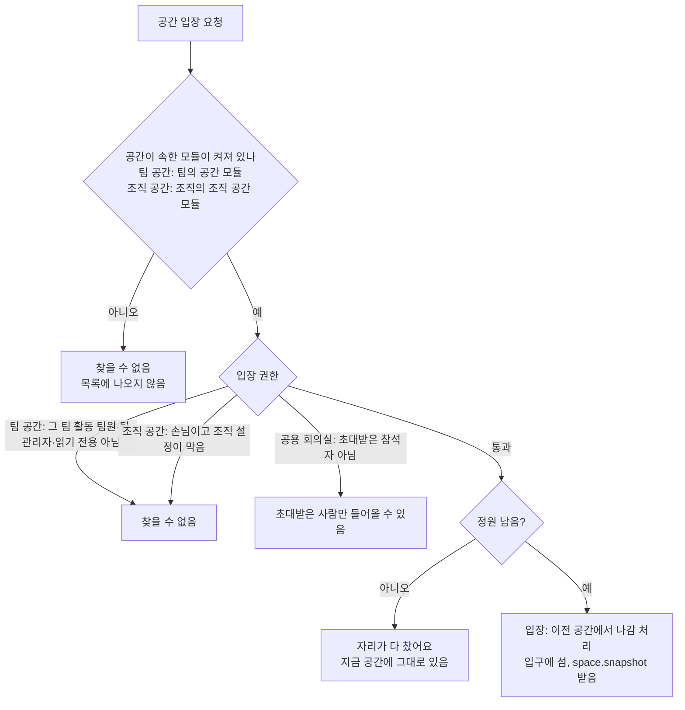

# 공간

> 버전: v0.1.0\
> 수정일: 2026-11-04

reberu의 화면 방향과 공간(걸어 다니는 3D 장소) 모델을 정의한다. 공간은 업무 툴 위에 얹은 선택 계층이다(ADR-0001). 화면별 명세는 [screens.md](screens.md), 위치·이벤트 동기화는 [../architecture/realtime.md](../architecture/realtime.md), 모듈 구조는 [../product/overview.md](overview.md)가 기준이다.

## 1. 범위

- 다룬다: 화면 방향 원칙, 화면 종류와 배치, 이동 규칙, 정원, 공간 목록과 공간별 명세, 공간 안 상호작용, 시간대·날씨, 모듈 꺼짐 시 대체, 접근성
- 다루지 않는다: 그림체·색·3D 모델(시각 디자인), 이벤트 형식(architecture/realtime), EXP·휴식 기록 규칙([../domain/rules.md](../domain/rules.md))

## 2. 화면 방향 원칙

reberu는 업무 관리 툴이고, 공간은 분위기와 만남을 위한 층이다. 둘이 부딪히면 업무 쪽을 고른다(ADR-0001).

| ID | 원칙 | 수준 |
| --- | --- | --- |
| UX-SPACE-01 | 업무 행동(업무, 할 일, 현재 상태, 알림)은 어느 공간에서든 업무 패널로 할 수 있다. 공간 이동은 업무의 필수 경로가 아니다 | 필수 |
| UX-SPACE-02 | 업무 패널은 모든 공간 화면에서 같은 자리, 같은 구성이다 | 필수 |
| UX-SPACE-03 | 레벨업·업적·EXP 연출은 하던 일을 가리는 창으로 띄우지 않는다. 짧은 알림을 먼저 보이고, 누를 때만 자세한 창을 연다 | 필수 |
| UX-SPACE-04 | 조용함이 기본이다. 카메라는 캐릭터 뒤에서 천천히 따라오고 크게 돌지 않는다. 소리는 기본으로 꺼져 있다. 깜빡이거나 흔들리거나 번쩍이는 효과를 쓰지 않는다 | 필수 |
| UX-SPACE-05 | B7 단순하게 보기에서 모든 기능을 쓸 수 있다. 공간에서만 되는 업무 기능을 만들지 않는다 | 필수 |
| UX-SPACE-06 | 공간과 업무 화면은 다른 곳이다. 업무·프로젝트·관리 화면(C, D, E, F)에는 공간과 걷기를 넣지 않는다 | 필수 |

## 3. 화면 종류와 배치

### 3.1 화면 종류

| 종류 | 화면 | 모습 |
| --- | --- | --- |
| 팀 공간 | B1~B5, B12 | 3D 공간 뷰 + 업무 패널 |
| 조직 공간 | B9~B11 | 3D 공간 뷰 + 업무 패널(지금 보고 있는 팀의 것) |
| 공간 위 창 | B3-1, B6, B8 | 공간 뷰 위에 뜨는 창 |
| 단순하게 보기 | B7 | 공간 그림 없는 2D 목록 + 업무 패널 |
| 업무 화면 | C, D | 공간 없는 2D 화면 |
| 관리 화면 | E, F | 공간 없는 2D 화면 |

### 3.2 공간 화면 배치

| 영역 | 내용 |
| --- | --- |
| 위쪽 막대 | 조직·팀 이름(누르면 A3), 현재 시각(조직 시간대), 접속자 수, 내 레벨·EXP 막대, 알림, 소리 켜기/끄기, 보기 전환(B7), 설정 |
| 공간 목록 | 팀 공간과 조직 공간 묶음, 지금 있는 곳, 공간별 인원/정원 |
| 공간 뷰 | 지금 공간의 아바타(이름표 + 현재 상태 표시 + 손님 표시), 소품, 자리, 가까이 가면 뜨는 행동 버튼 |
| 업무 패널 | 현재 상태, 오늘 할 업무(오늘이 기간에 들어가는 내 업무 최대 5개, 마감 지남·오늘 마감 표시), 오늘의 할 일, 오늘의 퀘스트(모듈), 업무 화면 바로가기 |
| 행동 막대 | 지금 공간의 행동 버튼 |
| 잠깐 뜨는 알림 | 오른쪽 아래, 몇 초 뒤 사라짐 |

- UX-SPACE-10 (필수): 데스크톱에서 업무 패널은 공간 뷰 옆에 고정된다. 휴식 중(§6.5, §6.6)에만 가장자리로 접히고, 사용자가 언제든 다시 펼친다.
- UX-SPACE-11 (필수): 모바일에서는 업무 패널이 기본 화면이고 공간 뷰는 탭으로 연다. 공간 뷰에서는 화면 왼쪽 아래 조이스틱으로 걷는다.

### 3.3 3D 세기

공간마다 업무와의 거리에 따라 연출 세기를 다르게 한다.

| 세기 | 공간 | 이유 |
| --- | --- | --- |
| 강 | 바닷가, 산길 | 쉬러 가는 곳이라 분위기가 곧 기능이다 |
| 중 | 로비, 라운지, 광장, 연회장 | 만나고 인사하는 곳이다. 동료가 잘 보이는 정도로 둔다 |
| 약 | 내 자리, 회의실, 공용 회의실 | 일하는 곳이다. 공간은 배경이고 업무 정보가 먼저 보인다 |
| 없음 | B7, C, D, E, F | 업무 툴 화면이다 |

## 4. 이동과 정원

### 4.1 이동 규칙 (ADR-0010)

| ID | 규칙 | 수준 |
| --- | --- | --- |
| UX-SPACE-20 | 공간 사이는 공간 목록이나 미니맵(B6)에서 골라 바로 옮긴다. 공간과 공간을 걸어서 잇지 않는다. 바닷가와 산길처럼 길로 이어진 모습은 입구 표시일 뿐 같은 이동 규칙을 따른다 | 필수 |
| UX-SPACE-21 | 공간 안은 걸어 다닌다. PC는 WASD·방향키와 바닥 클릭, 휴대폰은 조이스틱을 쓴다 | 필수 |
| UX-SPACE-22 | 공간마다 걸을 수 있는 경계가 있고, 큰 소품(테이블, 파라솔, 모닥불 등)은 통과하지 못한다. 서버는 경계 밖 좌표를 버린다([../architecture/realtime.md](../architecture/realtime.md)) | 필수 |
| UX-SPACE-23 | 업무 패널, 채팅 칸 등 입력 칸에 초점이 있는 동안 이동 키를 받지 않는다. 공간 뷰를 누른 뒤에만 이동 키가 동작한다 | 필수 |
| UX-SPACE-24 | 자리와 소품 가까이 가면 그 행동 버튼("앉기", "차 마시기" 등)이 뜬다. 행동은 버튼으로만 시작한다 | 필수 |
| UX-SPACE-25 | 위치는 서버 메모리에만 두고 저장하지 않는다. 서버가 다시 켜지면 모두 들어온 공간의 입구에서 시작한다 | 필수 |
| UX-SPACE-26 | 업무 화면(C, D)을 보는 동안에도 공간에 있는 것으로 보고, 아바타는 마지막 자리에 머문다 | 필수 |

### 4.2 공간 입장 판정

- UX-SPACE-27 (필수): 팀 공간에는 그 팀의 활동 팀 멤버십이 있는 사람만 들어간다. 역할(`TEAM_ADMIN`, `TEAM_MEMBER`, `VIEWER`)에 관계없이 들어갈 수 있다. 팀 멤버십이 없는 조직 관리자는 들어가지 않는다.
- UX-SPACE-28 (필수): 한 계정은 한 순간에 공간 하나에만 있다. 새 공간에 들어가면 이전 공간에서 나간 것으로 처리한다.

### 4.3 정원

- UX-SPACE-30 (필수): 공간마다 정원이 있다. 팀 공간 정원은 팀 설정(E4), 조직 공간 정원은 조직 설정(F7, 연회장은 F9)으로 정한다. 기본값은 OQ-17, OQ-19를 따른다.
- UX-SPACE-31 (필수): 정원이 차면 들어가지 못하고, 공간 목록과 미니맵에서 그 공간이 흐리게 보인다.
- UX-SPACE-32 (필수): 앉을 자리 수는 정원과 따로다. 자리가 모두 차면 "앉기" 버튼만 흐려지고 공간에는 머문다.
- UX-SPACE-33 (필수): 연회장 정원을 넘는 사람은 B7 방식으로 모임에 참여한다. 위치를 주고받지 않고 안건·질문·리액션만 받는다.

## 5. 공간 목록

| 키 `spaceKey` | 공간 | 하는 일 | 화면 | 3D 세기 | 앉을 자리 | 모듈 |
| --- | --- | --- | --- | --- | --- | --- |
| `LOBBY` | 로비 | 출석 장면, 인사, 오늘 요약 | B1 | 중 | 없음 | 공간 |
| `DESK` | 내 자리 | 집중 시작, 책상 꾸미기 (OQ-03) | B2 | 약 | 책상(팀 멤버십마다 하나) | 공간 |
| `LOUNGE` | 티타임 라운지 | 차 마시기, 칭찬, 채팅, 리액션 | B3 | 중 | 테이블 둘레 의자 | 공간 |
| `MEETING_ROOM` | 회의실 | 팀 회의, 안건·메모·결과 | B4 | 약 | 회의 테이블 의자 | 공간 |
| `BEACH` | 바닷가 | 불멍, 물멍, 요가 | B5 | 강 | 통나무 의자, 돗자리, 비치 의자, 요가 매트 | 힐링 존 |
| `TRAIL` | 산길 | 걷멍, 물멍, 산멍, 팀이 함께 걸은 거리 | B12 | 강 | 나무 의자, 바위 쉼터, 쉼터 벤치, 전망대 | 힐링 존 |
| `PLAZA` | 광장 | 다른 팀 사람과 만남, 연회장·공용 회의실 입구 | B9 | 중 | 없음 | 조직 공간 |
| `HALL` | 연회장 | 조직 전체 모임 | B10 | 중 | 팀별 긴 테이블 의자, 단상 | 조직 공간 |
| `SHARED_MEETING_ROOM:{roomId}` | 공용 회의실 | 여러 팀이 함께하는 회의 | B11 | 약 | 회의 테이블 의자 | 조직 공간 |

- 키는 [../architecture/realtime.md](../architecture/realtime.md) §2.1의 구독 주소에 쓰는 상수와 같다.
- 팀 공간(`LOBBY`~`TRAIL`)은 팀마다 하나씩 있다. `LOBBY`~`MEETING_ROOM`은 공간 모듈, `BEACH`·`TRAIL`은 공간에 의존하는 힐링 존 모듈에 속한다. 둘 다 팀 범위(`TEAM`) 모듈이다(OQ-11, [../product/overview.md](overview.md) §5.2).
- 조직 공간(`PLAZA`, `HALL`, `SHARED_MEETING_ROOM:{roomId}`)은 조직마다 하나씩 있다(공용 회의실은 방마다 `roomId`). 조직 공간 모듈은 조직 범위(`ORG`) 모듈이다.
- 바닷가와 산길을 묶어 "힐링 존"이라 부르며, 힐링 존 모듈이 켜진 팀에만 있다. 공간 모듈을 끄면 힐링 존도 꺼진다(OQ-43).

## 6. 공간별 명세

### 6.1 로비 (B1)

| 행동 | 결과 |
| --- | --- |
| 들어오기 | 출석은 팀을 연 순간 이미 기록됐다([../domain/rules.md](../domain/rules.md)). 오늘 첫 출근이면 출석 장면(도장, 연속 출석, 받은 EXP)을 보인다. 비근무일이면 "쉬는 날" 안내를 보이고 출근 알림을 보내지 않는다 |
| 오늘 요약 (아침 요약 모듈) | 첫 출근 때 작은 카드: 마감 지남, 오늘 마감, 3일 안 마감, 오늘 회의, 만료가 다가오는 인증(인증·만료일 관리 모듈) |
| 인사하기 | 로비에 있는 동료에게 짧은 알림 |
| 아바타 누르기 | B8 동료 카드 |

### 6.2 내 자리 (B2)

- 역할은 OQ-03을 따른다: 책상에 앉아 집중 시작, 레벨로 연 소품으로 책상 꾸미기.
- 업무 패널의 행동(현재 상태, 업무, 할 일)은 B0과 같다.

### 6.3 티타임 라운지 (B3)

| 행동 | 결과 |
| --- | --- |
| 의자 가까이 → 앉기 | 그 의자에 앉음 |
| 찻주전자 가까이 → 차 마시기 | 라운지 동료에게 짧은 알림. 기록하지 않는다 |
| 칭찬 보내기 (칭찬 모듈) | B3-1 |
| 채팅 | 라운지에 있는 사람끼리 짧은 글. 보관은 OQ-10 |
| 리액션 | 내 아바타 위에 잠깐 뜸 |

### 6.4 회의실 (B4)

| 행동 | 결과 |
| --- | --- |
| 들어가기 | 현재 상태 `MEETING`, 참석자에 추가 |
| 회의 열기 | 제목, 외부 회의 링크(`https`만). 누가 여는지는 OQ-07 |
| 안건 적기 | 회의 전·중 |
| 회의 시작 | 참석자에게 알림 |
| 외부 회의 열기 | 새 창으로 엶. 음성·화상은 reberu가 다루지 않는다 |
| 메모 쓰기 | 참석자가 같은 메모를 봄. 동시 편집은 OQ-08 |
| 회의 끝내기 | 결과 요약을 참석자에게 공유, C7 리포트에 모임 |
| 나가기 | 현재 상태가 입장 전 상태로 돌아감([flows.md](flows.md) §3) |

### 6.5 바닷가 (B5)

쉬는 자리가 네 종류 있다. 어느 자리에서든 "멍하기" 또는 "요가"를 시작하면 휴식으로 기록한다([../domain/rules.md](../domain/rules.md) §11).

| 쉬는 자리 | 모습 | 쉬는 방법 |
| --- | --- | --- |
| 모닥불 | 모래 위 모닥불과 둘레의 통나무 의자 | 불멍 |
| 파도 앞 돗자리 | 물가에 깔린 돗자리 | 물멍 |
| 파라솔 | 파라솔 그늘과 비치 의자 | 물멍 |
| 요가 매트 | 바다를 향해 나란히 깔린 매트 | 요가: 숨 고르기, 기지개, 앉은 자세, 비틀기 |

| 행동 | 결과 |
| --- | --- |
| 앉기 | 그 자리에 앉음 |
| 쉬기 시작 | 휴식 타이머 시작. 카메라가 천천히 불·바다 쪽으로 다가감. 업무 패널과 위쪽 막대가 가장자리로 접힘. 소리가 켜져 있으면 불·파도 소리 |
| 쉬는 동안 | 새 알림은 저장만 하고 화면에 띄우지 않는다. 모아 둔 알림 수만 보인다 |
| 요가 동작 고르기 | 아바타가 그 동작을 천천히 함. 옆 매트 사람에게도 보인다. 동작은 기록하지 않는다 |
| 장작 넣기 (모닥불) | 모닥불 둘레 사람에게 짧은 알림. 둘레에 앉은 사람이 많을수록 불이 조금 커진다. 기록하지 않는다 |
| 쉬기 끝 | 휴식 기록(종류, 시간). 모아 둔 알림을 한 번에 보임 |

- UX-SPACE-40 (필수): 쉬기 시작 후 휴식으로 인정하는 최소 시간은 [../domain/rules.md](../domain/rules.md)를 따른다. 그보다 짧으면 기록하지 않고 "조금 더 쉬어도 돼요"를 보인다.
- UX-SPACE-41 (필수): 쉬는 중 연결이 끊겼다가 유예 시간 안에 돌아오면 시작 시각 기준으로 이어서 잰다.

### 6.6 산길 (B12)

바닷가 옆 산으로 이어지는 걷는 길이다. 순례길처럼 천천히 걸으며 쉰다.

| 순서 | 구간 키 | 구간 | 쉬는 곳 |
| --- | --- | --- | --- |
| 1 | `forest-gate` | 숲 입구: 오솔길, 나무 이정표 | 길 안내판(팀이 함께 걸은 거리) |
| 2 | `forest-path` | 숲길: 키 큰 나무 사이 길 | 나무 의자 |
| 3 | `valley` | 계곡: 돌다리, 작은 폭포 | 바위 쉼터(물멍) |
| 4 | `rest-shelter` | 오르막 쉼터: 지붕 있는 쉼터 | 쉼터 벤치, 말 남기기(돌탑) |
| 5 | `summit` | 정상 전망대: 능선, 아래로 바닷가가 보임 | 전망대(산멍) |
| 6 | `descent` | 내려오는 길: 들꽃 핀 비탈 | 없음 |

| 행동 | 결과 |
| --- | --- |
| 걷기 | 직접 걸어서 길을 따라감 |
| 천천히 걷기 | 아바타가 길을 따라 혼자 걷고 카메라가 뒤에서 따라감(걷멍). 업무 패널이 접힘. 아무 키나 누르면 멈춤 |
| 쉬는 곳에 앉기 | 바위 쉼터는 물멍, 전망대는 산멍 시작. 바닷가와 같은 규칙 |
| 구간 도장 | 이번 걷기에서 구간에 처음 닿으면 도장을 받음. 1~6을 모두 받으면 "한 바퀴 완주" |
| 말 남기기 | 오르막 쉼터에 짧은 글을 남기면 돌탑이 쌓임. 같은 팀만 읽음. 보관은 OQ-23 |
| 걷기 끝 | 걸은 거리와 시간을 휴식으로 기록. 팀이 함께 걸은 거리에 더함 |

- UX-SPACE-45 (필수): 팀이 함께 걸은 거리는 시즌마다 새로 시작하고 순위를 매기지 않는다. 정해진 거리마다 길가에 새 풍경이 열린다([../domain/rules.md](../domain/rules.md) §12).
- UX-SPACE-46 (필수): 산길 정원은 쉬는 곳 자리 수가 아니라 길 위에 동시에 있을 수 있는 사람 수다.
- UX-SPACE-47 (필수): 천천히 걷기 중에는 좌표 대신 구간과 구간 안 진행 정도만 동기화한다([../architecture/realtime.md](../architecture/realtime.md) `trail.progress`).

### 6.7 광장 (B9)

| 행동 | 결과 |
| --- | --- |
| 걷기, 인사, 리액션 | 가까이 있는 사람에게만 보인다 |
| 아바타 누르기 | B8. 다른 팀 사람은 OQ-21의 정보만 보인다 |
| 입구 가까이 → 들어가기 | B10, B11 |

### 6.8 연회장 (B10)

조직 전체 모임(타운홀 미팅, 시즌 시상, 새 구성원 환영)을 하는 큰 홀이다.

**배치**

- 홀 가운데 팀마다 긴 테이블이 하나씩 있다. 테이블 끝에 팀 이름표가 있다. 들어가면 내 팀 테이블의 빈자리에 앉는다. 빈자리가 있으면 다른 팀 테이블로 옮긴다.
- 여러 팀에 속한 사람은 지금 보고 있는 팀의 테이블에 앉는다. 손님 등 팀 테이블이 없는 사람은 손님 테이블에 앉는다(OQ-39).
- 앞쪽에 테이블과 수직으로 놓인 단상이 있다.
- 테이블은 팀 목록에서 자동으로 놓는다. 팀이 많으면 두 줄로 놓는다.

**진행자 권한**

| 행동 | 진행자 | 참석자 |
| --- | --- | --- |
| 모임 시작·끝 | ○ | |
| 안건 넘기기 | ○ | |
| 발표자를 단상으로 부르기·내리기 | ○ | |
| 질문 "답함" 표시 | ○ | |
| 건배 | ○ | |
| 손든 사람 목록 보기 | ○ | |
| 앉기, 자리 옮기기, 손들기 | ○ | ○ |
| 질문 남기기(익명 선택), "나도 궁금해요" | ○ | ○ |
| 리액션, 외부 회의 열기 | ○ | ○ |

- UX-SPACE-50 (필수): 진행자는 F9에서 정한 사람이다. 누가 모임을 여는지는 OQ-20을 따른다.
- UX-SPACE-51 (필수): 리액션은 서버가 종류별 수로 묶어 1초마다 보낸다. 화면은 묶은 수("👏 32")로 보인다.
- UX-SPACE-52 (필수): 건배는 모든 테이블에서 잔을 드는 짧은 연출이며 업무를 막지 않는다.
- UX-SPACE-53 (필수): 모임이 끝나면 요약(안건, 답한 질문, 남은 질문)을 그 조직의 활동 구성원 모두가 본다.
- UX-SPACE-54 (필수): 분위기는 reberu의 바닷가 콘셉트로 새로 만든다(높은 천장, 노을이 보이는 큰 창, 매달린 등, 나무 긴 테이블). 특정 영화·작품의 연회장을 떠올리게 하는 요소(문장, 깃발, 떠 있는 촛불, 하늘이 비치는 천장 등)를 쓰지 않는다.

### 6.9 공용 회의실 (B11)

- 회의실(B4)과 같은 행동을 한다.
- UX-SPACE-56 (필수): 회의를 연 사람이 참석자를 그 조직의 여러 팀에서 고른다. 고른 사람만 들어온다.
- UX-SPACE-57 (필수): 회의 기록은 조직에 속하고, 참석자와 조직 관리자만 본다([../architecture/tenancy.md](../architecture/tenancy.md)).
- UX-SPACE-58 (필수): 회의에서 나온 할 일은 각자 자기 팀 업무로 만든다. 공용 회의실에서 다른 팀 업무를 만들지 않는다.

## 7. 공간 안 상호작용

| 행동 | 어디서 | 받는 사람 | 기록 |
| --- | --- | --- | --- |
| 인사하기 | 로비, 광장, 산길 | 같은 공간(광장은 가까운 사람) | 알림으로 남김 |
| 손 흔들어 부르기 | B8(어디서든) | 상대 한 명 | 알림으로 남김 |
| 칭찬 보내기 | B3-1, B8 (칭찬 모듈) | 상대 한 명 | 저장, 받은 사람 EXP |
| 리액션 | 라운지, 광장, 연회장 | 같은 공간 | 기록하지 않음 |
| 차 마시기, 장작 넣기, 요가 동작 | 라운지, 바닷가 | 같은 공간 | 기록하지 않음 |

- UX-SPACE-60 (필수): 상대가 `FOCUS`나 `MEETING`이면 부르기 버튼 옆에 그 상태를 안내한다. 부르기를 막지는 않는다.
- UX-SPACE-61 (필수): 다른 팀 사람에게는 칭찬을 보낼 수 없다(칭찬은 팀 기록이다).

## 8. 시간대와 날씨

### 8.1 시간대

- UX-SPACE-70 (필수): 하늘과 빛은 조직 시간대의 지금 시각으로 정한다. 낮, 노을, 밤 세 구간이다. 경계는 조직 시간대 기준 고정 시각이며 값은 시각 디자인에서 정한다(OQ-38).
- UX-SPACE-71 (필수): 구간이 바뀔 때 몇 분에 걸쳐 천천히 바꾼다. 밤에는 산길 길가에 작은 등이 켜지고 모닥불 빛이 돋보인다.

### 8.2 날씨

날씨는 실제 날씨가 아니라 서버가 정하는 가상 날씨다(OQ-22). 같은 조직의 모든 사람이 같은 날씨를 본다.

| 날씨 키 | 날씨 | 가능한 계절 | 바닷가 변화 | 산길 변화 |
| --- | --- | --- | --- | --- |
| `CLEAR` | 맑음 | 모두 | 밝은 바다, 잔잔한 파도 | 맑은 하늘 |
| `PARTLY_CLOUDY` | 구름 조금 | 모두 | 구름 그림자가 지나감 | 같음 |
| `OVERCAST` | 흐림 | 모두 | 회색 하늘, 조금 높은 파도 | 같음 |
| `RAIN` | 비 | 봄, 여름, 가을 | 가는 빗줄기, 모닥불이 작아지되 꺼지지 않음, 파라솔 아래 빗소리 | 젖은 길 |
| `WIND` | 바람 | 모두 | 파라솔이 흔들리고 불꽃이 기움 | 나뭇잎이 흔들림 |
| `FOG` | 안개 | 봄, 가을, 겨울 | 먼바다가 흐려짐 | 정상 아래 구름바다 |
| `SNOW` | 눈 | 겨울 | 모래 위 얇은 눈, 모닥불 둘레가 밝아 보임 | 눈 덮인 길 |
| `RAINBOW` | 무지개 | `RAIN` 바로 뒤에만, 드물게 | 바다 위 무지개 | 같음 |

- UX-SPACE-75 (필수): 계절은 조직 시간대 기준 달로 정한다(3~5월 봄, 6~8월 여름, 9~11월 가을, 12~2월 겨울).
- UX-SPACE-76 (필수): 서버가 하루 3번 날씨를 바꾸고(OQ-40)(`weather.changed`, 조직 범위), 화면은 몇 분에 걸쳐 천천히 바꾼다.
- UX-SPACE-77 (필수): 천둥·번개처럼 번쩍이는 날씨는 없다.
- UX-SPACE-78 (필수): 산길의 계절 풍경(봄 꽃, 여름 짙은 초록, 가을 단풍, 겨울 눈)은 날씨와 따로 계절만으로 정한다.
- UX-SPACE-79 (필수): 같은 날씨가 로비 창밖과 연회장 큰 창 밖에도 보인다.

## 9. 모듈 꺼짐 시 대체

| 꺼진 것 | 동작 |
| --- | --- |
| 팀의 공간 모듈 | B1~B6, B12가 없고(힐링 존도 함께 꺼짐, OQ-43) B7이 팀의 첫 화면이다. 출석·업무 등 고정 기능은 그대로다. 그 팀 사람도 조직 공간에는 들어갈 수 있다 |
| 팀의 힐링 존 모듈 | B5, B12가 공간 목록·미니맵에서 사라진다. 휴식 기록과 산길 거리는 남고 다시 켜면 이어진다 |
| 조직의 조직 공간 모듈 | B9~B11이 공간 목록·미니맵에서 사라진다. 연회장 모임 화면(F9)과 관련 알림이 사라진다 |
| 칭찬 모듈 | 칭찬 버튼(B3, B8)이 사라진다 |
| 아침 요약 모듈 | 로비 오늘 요약 카드가 없다 |

- UX-SPACE-80 (필수): 모듈이 꺼진 순간 그 공간에 있던 사람은 팀의 첫 화면으로 옮겨진다([flows.md](flows.md) §8).

## 10. 접근성과 설정

| ID | 설정 | 기본 | 수준 |
| --- | --- | --- | --- |
| UX-SPACE-90 | 소리 | 꺼짐 | 필수 |
| UX-SPACE-91 | 날씨 효과(비·눈 입자) | 켜짐. 끄면 하늘색만 바뀐다 | 필수 |
| UX-SPACE-92 | 움직임 줄이기 | 운영체제의 움직임 줄이기 설정을 따름. 켜지면 카메라 다가가기, 불티, 파도 움직임을 줄인다 | 필수 |
| UX-SPACE-93 | 느린 기기 | 프레임이 일정 기준 아래로 떨어지면 효과를 자동으로 줄인다. 3D를 그리지 못하면 B7로 바꾼다 | 필수 |
| UX-SPACE-94 | 키보드만으로 쓰기 | 공간 목록, 업무 패널, 행동 버튼은 키보드로 고를 수 있다 | 필수 |

## 11. 레퍼런스 원칙

- 아이디어와 방식은 레퍼런스(온라인 요가원, 산사, Gather, ZEP, 온라인 순례길)에서 가져온다.
- 그림 파일, 캐릭터, 맵 배치, 화면 문구, 로고, 서비스 이름, 표지·상징은 새로 만든다.
- UX-SPACE-99 (필수): 실제 서비스나 작품의 결과물을 옮긴 요소는 리뷰에서 걸러 낸다.
